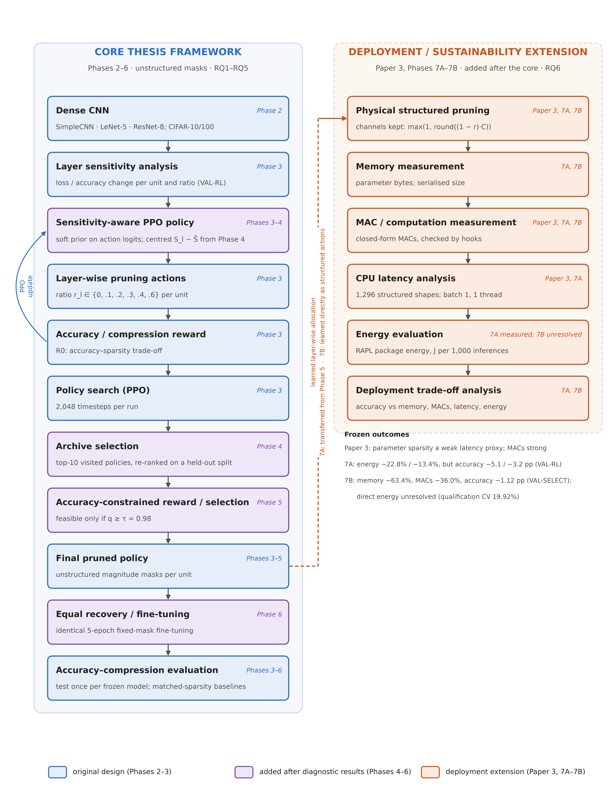

# Chapter 3 — Proposed Framework

## 3.1 General

This chapter describes the methodology developed in this thesis: a reinforcement learning (RL) framework that learns
layer-wise pruning allocations with Proximal Policy Optimisation (PPO), guided by layer sensitivity.

The framework was built across pre-registered experimental phases, and several components were added because a
diagnostic analysis exposed a specific weakness of an earlier version. The chapter therefore presents it
**chronologically**, each component with the phase in which it entered and the problem it addressed (Table 3.1;
Figure 3.1). It describes *what* each component does and *why*, not how well it performed: outcomes are in Chapters 5
and 6, and datasets, splits, seeds, statistics and measurement procedures in Chapter 4.

**Table 3.1. Development of the framework across phases.** "Search" components affect which pruning policy is
found or selected; "evaluation" components affect how a selected policy is assessed.

| Component | Phase introduced | Role | Motivation |
|---|---|---|---|
| Layer-wise pruning units, discrete ratio actions, PPO agent | initial design (frozen in Phase 3) | search | learn a non-uniform allocation instead of one uniform ratio |
| Accuracy–sparsity reward R0 | initial design (frozen in Phase 3) | search | reward retained accuracy and compression jointly |
| Normalised layer sensitivity | initial design (frozen in Phase 3) | search (guidance) | identify layers whose pruning is most damaging |
| Soft sensitivity prior on action logits | initial design; evaluated in Phase 3 | search (guidance) | bias the agent towards gentler pruning of sensitive layers |
| Centred sensitivity prior | Phase 4 | search (guidance) | remove the shared "prune less" pressure, keeping only *relative* sensitivity |
| Elite behavioural cloning (Phase 4 only) | Phase 4 | search | steer PPO towards the best policies it has visited; dropped from Phase 5 on |
| Archive of visited policies and held-out selection | Phase 4 | search (selection) | the terminal PPO policy may be worse than policies visited during search |
| Accuracy-constrained reward | Phase 5 | search | the accuracy–sparsity trade-off reward encouraged excessive pruning |
| Constraint-aware archive selection | Phase 5 | search (selection) | choose the most compressed candidate that meets the accuracy constraint on held-out data |
| Equal fixed-mask recovery | Phase 6 | evaluation | compare methods after identical fine-tuning |
| Physical structured realisation; memory, MAC, latency and energy measurement | Paper 3, Phase 7A | evaluation (extension) | test whether compression becomes deployment efficiency |
| Deployment-oriented structured PPO | Phase 7B | search (extension) | learn directly in the structured deployment space |



**Figure 3.1. Overall thesis framework.**
Left: the core framework (Phases 2–6, unstructured masks); each component is tagged with the phase that introduced
it (blue: original design; purple: added after diagnostic results). Right: the deployment and sustainability extension
(Paper 3, Phases 7A–7B), added later. Dashed arrow: the learned allocation is transferred in Phase 7A and learned
directly as structured actions in Phase 7B.

Table 3.2 lists the notation used throughout the thesis.

**Table 3.2. Notation.**

| Symbol | Meaning |
|---|---|
| M | trained dense network (the reference model) |
| N_L | number of pruning units (N_L = 4 for every architecture in this thesis) |
| l | index of a pruning unit, l = 1, …, N_L |
| 𝓡 | ratio set {0, 0.1, 0.2, 0.3, 0.4, 0.6} |
| a_l | action at unit l, a_l ∈ {0, …, 5} |
| r(a) | pruning ratio of action a: r(0..5) = 0, 0.1, 0.2, 0.3, 0.4, 0.6 |
| r_l | pruning ratio assigned to unit l, r_l = r(a_l) |
| **r** | pruning policy (allocation), **r** = [r_1, …, r_{N_L}]; equivalently the action vector **a** |
| M_**r** | network M pruned by policy **r** |
| s_l | state observed by the agent before deciding unit l |
| π_θ(a \| s) | PPO policy with parameters θ |
| S_l | normalised sensitivity of unit l, S_l ∈ [0, 1] |
| S̄ | mean sensitivity over units, S̄ = (1/N_L) Σ_l S_l |
| S̃_l | centred sensitivity, S̃_l = S_l − S̄ |
| c_l | prior coefficient of unit l (P1: c_l = 0.5·S_l; centred prior: c_l = 1.0·S̃_l) |
| A_b | accuracy of the dense reference on the reward split (VAL-RL) |
| A_p | accuracy of the pruned network M_**r** on the same split |
| q | retained accuracy, q = A_p / A_b |
| ρ | sparsity: percentage of zero weights over all convolutional and fully connected weights |
| D | number of distinct actions in **a** |
| R | episode reward |
| τ | retained-accuracy threshold of the constrained reward (τ = 0.98 in Phase 5) |
| 𝒜 | archive of unique visited policies |
| C_l | number of output channels (or neurons) of unit l before structured pruning |
| k_l | number of channels kept by structured pruning of unit l |
| MAC(**r**) | multiply–accumulate operations per image of the pruned network |
| T(**r**) | measured batch-1 CPU latency per inference (ms) |
| E(**r**) | measured CPU package energy per 1,000 inferences (J) |
| Ê(**r**) | surrogate (predicted) energy per 1,000 inferences, used only inside the Phase-7B search |

The letter L is deliberately not used on its own. N_L is the number of pruning units and T is latency.

## 3.2 Problem Formulation

Let M be a trained convolutional network whose prunable convolutional and fully connected layers are grouped into
N_L **pruning units**. A pruning policy assigns each unit a pruning ratio:

$$\mathbf{r} = [r_1, r_2, \ldots, r_{N_L}], \qquad r_l \in \mathcal{R} = \{0, 0.1, 0.2, 0.3, 0.4, 0.6\}. \tag{3.1}$$

Applying **r** to M yields the pruned network M_**r**. The uniform policy, r_1 = … = r_{N_L}, is one point in this
space. The framework searches for **non-uniform** allocations, because units differ in weight share, computation,
sensitivity to the same pruning fraction, and downstream effect on later units.

Compression is measured by the sparsity ρ: the percentage of zero-valued weights over **all** convolutional and fully
connected weight tensors, including the output classifier, which is never pruned:

$$\rho(M_{\mathbf r}) = 100 \cdot \frac{\sum_{t} \#\{w \in t : w = 0\}}{\sum_t |t|}, \tag{3.2}$$

where t ranges over every Conv2d and Linear weight tensor. Biases and batch-normalisation parameters are not counted
and are never pruned.

**The goal** is conceptual, not a guaranteed optimum: a layer-wise policy **r** that balances predictive performance
and compression as specified by the reward and constraints in force. Formally, the agent maximises

$$\max_{\theta} \; \mathbb{E}_{\mathbf a \sim \pi_\theta}\big[ R(M_{\mathbf r(\mathbf a)}) \big], \tag{3.3}$$

where R encodes the trade-off (Sections 3.7 and 3.13). Equation (3.3) defines what PPO optimises; it does not claim
that PPO finds the best policy. The space is searched stochastically, the returned policy is chosen by a separate
selection rule (Sections 3.11–3.13), and enumeration (Section 3.6) shows how close it comes to the best one.

## 3.3 Layer-Wise Pruning Representation

**Pruning units.** Each architecture registers exactly four pruning units (Table 3.3), so every setting has the same
action space. A unit consists of one or more weight tensors, and an action applies the same ratio to every tensor in
the unit. The output classifier is excluded in every architecture.

**Table 3.3. Pruning units of the core framework (unstructured).**

| Architecture | Unit 1 | Unit 2 | Unit 3 | Unit 4 | Never pruned |
|---|---|---|---|---|---|
| SimpleCNN | conv1 (`features.0`) | conv2 (`features.3`) | conv3 (`features.6`) | fc1 (`classifier.1`) | output layer (`classifier.3`) |
| LeNet-5 | conv1 | conv2 | fc1 | fc2 | output layer |
| ResNet-8 | stem convolution | stage 1 (both block convolutions) | stage 2 (both block convolutions and the 1×1 shortcut) | stage 3 (both block convolutions and the 1×1 shortcut) | output layer |

**Within-unit pruning (core framework).** In Phases 3–6, a ratio r_l is applied as **L1 unstructured** pruning to
every tensor of unit l: the round(r_l · |t|) smallest-magnitude weights of each tensor t are masked to zero, using
PyTorch's pruning reparameterisation [@paszke2019pytorch]. Shapes are unchanged and the mask can be frozen during
fine-tuning (Section 3.15), so every pruned network is a masked copy of the same dense network and the whole policy
space can be evaluated once and cached for the exhaustive diagnostics.

**Same actions, different structural meaning.** In SimpleCNN a unit is a single layer; in ResNet-8 it is a residual
stage, so one action prunes several tensors at once. When the deployment extension realises policies as physically
smaller networks (Section 3.16), the ResNet-8 units are redefined around the residual coupling, so the two definitions
are not interchangeable.

## 3.4 Reinforcement Learning Formulation

Choosing **r** is represented as a **finite-horizon sequential decision process** with one decision per pruning unit.
An episode visits the units in their fixed order l = 1, …, N_L (Algorithm 3.1). At step l:

1. the agent observes a state s_l describing unit l and the decisions taken so far (Section 3.5);
2. it samples an action a_l ∼ π_θ(· | s_l) from the discrete action set (Section 3.6);
3. the environment applies ratio r(a_l) to unit l of the working copy of the network;
4. the next state s_{l+1} is formed from unit l + 1 and the updated history.

After the last unit (N_L = 4 steps), the pruned network M_**r** is evaluated on the reward split and the episode
reward R is paid. All intermediate rewards are zero, and each episode starts again from an unpruned copy of M.

Transitions are deterministic given the actions, and the terminal reward depends only on the complete action vector.
The state summarises the current unit and the cumulative pruning, not the full history; the thesis does not claim it is
a sufficient statistic, so the process is not claimed to be strictly Markov in the state.

**Why RL rather than enumeration?** The small space is enumerated only to *evaluate* the search (Section 3.6). The same
agent and reward apply unchanged to spaces far too large to enumerate and to non-differentiable objectives such as
measured hardware cost; the small settings are a laboratory in which the search can be measured against ground
truth.

## 3.5 State Representation

**Core framework (Phases 3–6).** The state is the seven-feature vector of the historical environment
(`src/rl`, `unit_state`), computed for the current unit l of N_L units:

$$s_l = \Big[\, \tfrac{l-1}{N_L-1},\;\; \log(1+n_l),\;\; \tfrac{n_l}{\max_j n_j},\;\; \overline{|w_l|},\;\; \sigma(w_l),\;\; \textstyle\sum_{j<l} r_j,\;\; \sigma^{\text{slot}}_l \,\Big], \tag{3.4}$$

where n_l is the number of weights in unit l, mean |w_l| and σ(w_l) are the mean absolute value and the standard
deviation of its current weights, Σ_{j<l} r_j is the cumulative pruning ratio chosen so far, and σ^slot_l is a
sensitivity slot.

**The sensitivity slot was set to 0 in every condition of Phases 3, 4 and 5**, as pre-registered, so in the core
framework sensitivity never entered PPO through its *observation*, only through the soft action prior
(Sections 3.9–3.10). After the last unit the state is a zero vector.

**Deployment extension (Phase 7B).** The deployment-oriented structured PPO of Phase 7B (Section 3.16.3) uses a
different, eight-feature state, which does include centred sensitivity. The two state definitions are listed
separately in Table 3.4 and must not be mixed.

**Table 3.4. State features by phase.**

| # | State feature | Meaning | Phases used |
|---|---|---|---|
| 1 | (l − 1)/(N_L − 1) | position of the current unit | 3, 4, 5 |
| 2 | log(1 + n_l) | log weight count of the unit | 3, 4, 5 |
| 3 | n_l / max_j n_j | relative weight count | 3, 4, 5 |
| 4 | mean \|w_l\| | mean weight magnitude (current, masked weights) | 3, 4, 5 |
| 5 | σ(w_l) | weight standard deviation | 3, 4, 5 |
| 6 | Σ_{j<l} r_j | cumulative pruning ratio so far | 3, 4, 5 |
| 7 | sensitivity slot | **set to 0 in all Phase 3–5 conditions** | 3, 4, 5 (constant 0) |
| 1′ | (l − 1)/(N_L − 1) | position of the current unit | 7B |
| 2′ | log(1 + C_l) | log channel count of the unit | 7B |
| 3′ | unit share of dense parameters | parameter contribution | 7B |
| 4′ | unit share of dense MACs | computational contribution | 7B |
| 5′ | S̃_l | centred structured sensitivity | 7B |
| 6′ | r_{l−1} | ratio chosen for the previous unit | 7B |
| 7′ | mean_{j<l} r_j | mean ratio chosen so far | 7B |
| 8′ | Ê(partial policy) / Ê(dense) | predicted energy of the policy so far (remaining units at ratio 0), relative to dense | 7B |

## 3.6 Action Space

At each unit the agent chooses one of six actions, which map to pruning ratios:

$$r(a) \in \{0,\; 0.1,\; 0.2,\; 0.3,\; 0.4,\; 0.6\}, \qquad a \in \{0, 1, 2, 3, 4, 5\}. \tag{3.5}$$

That is, 0%, 10%, 20%, 30%, 40% or 60% of the unit's weights (core framework) or channels (structured extension). All
actions are always available; no action is masked. A policy is the sequence of the four unit actions, so the number of
distinct policies is

$$|\mathcal{R}|^{N_L} = 6^4 = 1{,}296 \tag{3.6}$$

in every setting. The highest single ratio is 0.6, so even the most aggressive policy [5, 5, 5, 5] leaves 40% of every
pruned tensor. The excluded classifier is never pruned, which caps the achievable total sparsity ρ of each
architecture below 60%.

The small space is deliberate: all 1,296 policies can be evaluated once per setting, giving an exact reward landscape
that shows how good the policies PPO *visits* and *returns* are, and where the reward's own optimum lies.

The same count of 1,296 holds for every architecture, but the policies do not correspond across architectures. In
SimpleCNN, an action on unit 2 masks the selected fraction of the weights of a single convolution. For ResNet-8, an
action is applied to a residual-stage weight group, where the selected pruning ratio masks the corresponding fraction
of weights across the convolutional layers associated with that group; the residual stage itself is not structurally
removed (Table 3.3).

## 3.7 Initial Reward Function

The initial reward R0 was inherited from the original framework and frozen in Phase 3. It is paid at the end of each
episode:

$$R_0 = 1.5 \cdot \frac{A_p}{A_b} \; + \; \lambda_s \cdot \rho \; + \; 0.05 \cdot D, \qquad \lambda_s = 0.01. \tag{3.7}$$

Here A_p is the accuracy (%) of M_**r** on the reward split (VAL-RL); A_b is the accuracy (%) of the dense reference on
the same split, fixed per setting, so A_p/A_b is the retained accuracy q; ρ is the sparsity in **percent** as defined
in Equation (3.2) (global, parameter-based, over all Conv2d/Linear weights including the classifier); and D is the
number of distinct actions in the episode's action vector (1 to 4). The weights are 1.5 on retained accuracy,
λ_s = 0.01 per percentage point of sparsity, and a small bonus of 0.05 per distinct action. The coefficients are fixed
and were not tuned in any phase.

The diversity term, part of the original design, is a mild incentive against trivially uniform policies. For
reproducibility: the original notebook used λ_s = 0.04, which the library default still carries; every frozen phase
(Phases 3, 4 and the R0 control in Phase 5) uses λ_s = 0.01, as recorded in the Phase-4 pre-registration.

Equation (3.7) trades accuracy against sparsity at a fixed exchange rate, with no threshold below which accuracy loss
becomes unacceptable. Section 3.13 returns to this point.

## 3.8 Layer Sensitivity Analysis

The sensitivity of a unit measures how much the network's loss increases when that unit alone is pruned. It is
computed once per setting on the dense reference model, using only the reward split (VAL-RL), never the selection
split or the test set. The procedure (`src/sensitivity`, `loss_sensitivity`) is:

1. **Baseline loss.** Evaluate the dense model's mean cross-entropy loss L_0 on VAL-RL.
2. **Single-unit probes.** For each unit l and each probe ratio r ∈ {0.1, 0.2, 0.4, 0.6}, prune *only* unit l by r
   (L1 unstructured, as in Section 3.3), leaving every other unit dense. Evaluate the loss L_{l,r}.
3. **Raw sensitivity.** Average the relative loss increases over the probe ratios:

$$S_l^{\text{raw}} = \frac{1}{4} \sum_{r \in \{0.1, 0.2, 0.4, 0.6\}} \frac{L_{l,r} - L_0}{L_0}. \tag{3.8}$$

4. **Normalisation.** Min–max normalise across the units of the network:

$$S_l = \frac{S_l^{\text{raw}} - \min_j S_j^{\text{raw}}}{\max_j S_j^{\text{raw}} - \min_j S_j^{\text{raw}}} \in [0, 1]. \tag{3.9}$$

The most sensitive unit has S_l = 1 and the least sensitive S_l = 0; the normalisation makes sensitivities comparable
across architectures but discards their absolute scale. Loss rather than accuracy registers small degradations that do
not yet change predictions.

The vector was frozen on the configuration-I VAL-RL split for Phases 3–4, recomputed on the configuration-II split in
Phase 5, and computed with each unit pruned *structurally* (whole channels removed; Section 3.16) in Phase 7B
(Section 4.10). In every case only VAL-RL data are used. Because the probes measure each unit in isolation and miss
interactions between units, sensitivity is treated as *guidance* for the search, not as a substitute for it.

## 3.9 Sensitivity-Guided Action Prior

In the initial design, sensitivity guides the agent through a **soft prior on the action logits**. Let z_l(a) be the
logit that the PPO actor assigns to action a at unit l. Before the action distribution is formed, the logits are
shifted:

$$\tilde z_l(a) = z_l(a) \; - \; c_l \cdot \frac{r(a)}{0.6}, \qquad \pi_\theta(a \mid s_l) = \operatorname{softmax}_a\big(\tilde z_l(a)\big). \tag{3.10}$$

Here c_l is the prior coefficient of unit l, and r(a)/0.6 rescales the ratio so that the most aggressive action has
weight 1. In Phase 3, c_l = β·S_l with β = 0.5 (condition P1, "correct prior"). The implementation
(`src/rl`, `SoftPriorPolicy`) subtracts the pre-computed matrix B[l, a] = c_l · r(a)/0.6 from the logits in every
forward pass, both when actions are sampled and when log-probabilities are evaluated during the PPO update.

The penalty grows with the unit's sensitivity and the action's aggressiveness, and action 0 (no pruning) is never
penalised. The prior **shifts preferences but does not replace the learned policy**: every action keeps a non-zero
probability, the actor can learn to override it, and with c_l = 0 the policy is exactly standard PPO.

Phase 3 tested this prior against three controls of the same strength β = 0.5: P0, no prior; P2, a shuffled prior in
which each unit receives another unit's sensitivity; and P3, a constant prior in which every unit receives the mean
sensitivity. The controls separate the effect of *layer-specific* information from that of a generic bias towards
lighter pruning.

## 3.10 Centred Sensitivity Prior

Since every S_l ≥ 0, the total penalty Σ_l c_l = β·Σ_l S_l of the Section 3.9 prior is positive, so the correct,
shuffled and constant priors carry the **same total conservatism**. Any benefit they share could come from this common
"prune less" pressure rather than from information about *which* units are sensitive.

Phase 4 therefore introduced a **centred** prior that keeps only relative sensitivity:

$$\tilde S_l = S_l - \bar S, \qquad \bar S = \frac{1}{N_L}\sum_{j=1}^{N_L} S_j, \qquad c_l = 1.0 \cdot \tilde S_l, \tag{3.11}$$

used in Equation (3.10) in place of c_l = 0.5·S_l. Its coefficients sum to zero (Σ_l c_l = 0), so the prior carries
no net conservatism: aggressive actions are penalised on units more sensitive than average (S̃_l > 0) and favoured on
less sensitive ones (S̃_l < 0), while action 0 is unchanged. Pruning is redistributed from sensitive to insensitive
units instead of being reduced everywhere. This centred prior (condition "P2" in the Phase-4 and Phase-5 records)
became the standard prior of the core framework from Phase 4 onward.

Phase 4 evaluated it against the Phase-3 prior, a centred prior permuted across units, a magnitude-matched
pure-conservatism prior (c_l = mean_j |S̃_j| for every unit) and a sign-reversed prior (c_l = −S̃_l) (Section 4.10).
The sensitivity state slot remained 0 (Section 3.5), so sensitivity acts on the search only through this prior.

## 3.11 Policy-Retention Problem

The initial design returns the agent's **terminal policy**: after training, the deterministic policy
a_l = argmax_a π_θ(a | s_l) is rolled out once, and the resulting action vector is the selected pruning policy.

During training PPO samples hundreds of complete policies, but the distribution it converges to need not favour the
best of them: a stochastic policy-gradient method updates on noisy reward estimates and can sample an excellent policy
early, then drift towards a region of high but not maximal average reward. Returning only the terminal policy discards
evaluations that have already been paid for. With exact landscapes (Section 3.6), the problem is the gap between the
rank of the **best policy sampled** and the rank of the **policy finally returned**; when the first is consistently
better, the limitation lies in *retention and selection*, not exploration. Phase 4 identified this gap and introduced
archive-based selection to address it.

## 3.12 Archive-Based Policy Selection

### 3.12.1 Archive (Phase 4)

During each PPO run, an **archive** 𝒜 records every unique policy sampled in a training episode, with its action
vector **a**, its reward on the reward split (VAL-RL), which is the reward the agent was trained on, and the episode in
which it was first sampled. A policy sampled again keeps its first entry. Recording is read-only: it does not change
the training process and draws no random numbers.

### 3.12.2 Selection rule (Phase 4)

At the end of training, the archive is reduced to a candidate set and one candidate is selected on held-out data:

$$\mathcal{C} = \operatorname{top}_{10}\big\{ \mathbf a \in \mathcal{A} \text{ by } R_{\text{VAL-RL}}(\mathbf a) \big\}, \qquad \mathbf a^{\star} = \arg\max_{\mathbf a \in \mathcal{C}} R_{\text{VAL-SELECT}}(\mathbf a). \tag{3.12}$$

𝒞 holds the 10 unique archived policies with the highest VAL-RL reward (ties: earlier discovery), and **a**⋆ is the
candidate scoring highest under the same reward on the **selection split** (VAL-SELECT; ties: higher VAL-RL reward,
then earlier discovery). VAL-SELECT is disjoint from the reward split and never used during training (Chapter 4).

The two-stage rule avoids relying only on the final policy (Section 3.11) and only on the best VAL-RL reward, which
would favour candidates whose reward is inflated by noise in the reward split.

**Archive selection is a retention and selection mechanism based on validation evidence.** It decides which visited
policy is returned. It does not change what the agent learns, and its correctness is defined relative to the
validation splits, not the test set.

### 3.12.3 Elite behavioural cloning (Phase 4 only)

Phase 4 also tested a training-time complement to the archive, using the best policies seen so far as additional
supervised targets for the PPO actor:

$$\mathcal{L} = \mathcal{L}_{\text{PPO}} + \eta \, \mathcal{L}_{\text{elite}}, \qquad \mathcal{L}_{\text{elite}} = -\frac{1}{4K} \sum_{e=1}^{K} \sum_{l=1}^{4} \log \pi_\theta\big(a^{(e)}_l \mid s^{(e)}_l\big), \tag{3.13}$$

where (s^(e)_l, a^(e)_l) are the state–action pairs of the K = 5 best unique VAL-RL-reward policies seen so far,
η = 0.1, and the term is active once at least five unique policies have been seen. The Phase-4 final pipeline
combined it with the archive rule (condition S2A); Phase 5 removed it and kept the archive, so the mature core
framework does not include Equation (3.13).

### 3.12.4 Constraint-aware selection (Phase 5)

With the accuracy-constrained reward (Section 3.13) the selection rule changed with it. The candidates are still the
top 10 archived policies by VAL-RL reward, and the archive of all runs is frozen and hashed *before* any VAL-SELECT
evaluation. The selected policy is

$$\mathbf a^{\star} = \arg\max_{\mathbf a \in \mathcal{C}} \Big\{ \rho(\mathbf a) \;:\; q_{\text{VAL-SELECT}}(\mathbf a) \geq \tau \Big\}, \tag{3.14}$$

that is, the **most compressed candidate whose retained accuracy on the selection split meets the threshold**. Ties go
to higher VAL-SELECT accuracy, then higher VAL-RL reward, then earlier discovery. If no candidate meets the threshold,
the candidate with the highest q_VAL-SELECT is chosen and the fallback is reported. Training rewards compression inside
the feasible region; selection then confirms feasibility on held-out data.

## 3.13 Reward Misalignment and Accuracy-Constrained Reward

### 3.13.1 Why R0 can encourage excessive pruning

Equation (3.7) converts accuracy and sparsity into one scalar at a fixed rate: an extra percentage point of sparsity is
worth 0.01, and an extra percentage point of retained accuracy 0.015. A policy that gives up some accuracy for enough
sparsity can therefore score *higher* than a gentler policy, however damaging the accuracy loss is in practice. R0 has
no region in which accuracy loss becomes unacceptable, so in fragile architectures the reward-optimal policy can be one
a practitioner would reject.

A weak optimiser hides this problem; once search and retention improve (Sections 3.10–3.12), the agent finds exactly
what the reward specifies, a pruning instance of the observation that more capable optimisers exploit misspecified
rewards more strongly
[@pan2022misspecification; @skalse2022rewardgaming]. Phase 4 also tested alternative trade-off rewards, with sparsity
targets and normalised axes (Section 4.12). None met its pre-registered criterion, so R0 was retained for Phase 4, and
Phase 5 redesigned the reward around an explicit constraint.

### 3.13.2 Accuracy-constrained reward (Phase 5)

The Phase-5 reward is constraint-first. With q = A_p/A_b on VAL-RL and the sparsity written as a fraction (ρ/100):

$$R_{\text{c}} = \begin{cases} 1 + \dfrac{\rho}{100} + \varepsilon \, q, & q \geq \tau, \\[1.2ex] -\kappa \, (\tau - q), & q < \tau, \end{cases} \qquad \tau = 0.98,\;\; \varepsilon = 0.01,\;\; \kappa = 10. \tag{3.15}$$

Here τ = 0.98 is the retained-accuracy threshold: a policy is *feasible* if it keeps at least 98% of the dense VAL-RL
accuracy. τ was chosen before any PPO run, by a pre-registered rule on the VAL-RL landscapes (Section 4.9.3); the test
set was not used. The offset 1 makes every feasible reward larger than every infeasible one; ρ/100 is the compression
reward, paid only inside the feasible region; ε·q with ε = 0.01 is a small tie-breaker that prefers higher accuracy
among equally sparse feasible policies; and κ = 10 is the penalty slope for infeasible policies, proportional to the
shortfall below τ. There is no diversity term.

**Compression is rewarded only inside the acceptable-accuracy region.** Any feasible policy (reward ≥ 1) is worth more
than any infeasible one (reward < 0); among infeasible ones, smaller shortfalls are penalised less, which keeps a
learning signal pointing back towards feasibility. The reward-optimal policy is the most compressed feasible policy on
VAL-RL, matching a stated tolerance of 2% relative accuracy loss on VAL-RL. Two limitations are inherent and examined
in Chapter 5: feasibility on VAL-RL does not imply feasibility on unseen data, and τ is a *relative* threshold, not an
absolute accuracy bound. The centred prior was kept in Phase 5 as an exploration mechanism, with an otherwise identical
prior-free condition to measure its contribution.

## 3.14 Final Core Framework

Table 3.5 lists the components that survived the diagnostic sequence, separating **search** components, which
determine the selected policy, from **evaluation** components, which assess it.

**Table 3.5. Mature core framework (as frozen after Phase 5, evaluated in Phase 6).**

| Stage | Component | Type | Section |
|---|---|---|---|
| 1 | Dense reference model M, trained once per setting | input | 3.2 |
| 2 | Normalised loss sensitivity S_l on VAL-RL | search (guidance) | 3.8 |
| 3 | PPO over four units with six ratio actions; seven-feature state (sensitivity slot 0) | search | 3.4–3.6 |
| 4 | Centred sensitivity prior, c_l = 1.0·S̃_l, on the action logits | search (guidance) | 3.10 |
| 5 | Accuracy-constrained reward R_c with τ = 0.98 on VAL-RL | search | 3.13 |
| 6 | Archive of unique visited policies; top-10 candidates by VAL-RL reward | search (retention) | 3.12 |
| 7 | Constraint-aware selection on VAL-SELECT | search (selection) | 3.12.4 |
| 8 | Selected pruning policy **a**⋆, applied as unstructured masks | output | 3.3 |
| 9 | Equal fixed-mask recovery (5 epochs, identical for every method) | **evaluation** | 3.15 |
| 10 | Test evaluation, once per frozen model; matched-sparsity baselines | **evaluation** | Chapter 4 |

Relative to the initial version, the prior is centred, the returned policy comes from an archive on held-out data,
the reward is constraint-first, and selection enforces the same constraint on held-out data; behavioural cloning was
dropped, and the state is unchanged.

Equal recovery (stage 9) is **not part of PPO's decision making**. The agent's reward is always computed on the pruned
network *without* fine-tuning. Recovery is applied only after a policy has been selected, identically to every
compared method, so that the final comparison reflects the allocation rather than differences in recovery budgets.

## 3.15 Equal Recovery and Fine-Tuning Protocol

Pruning methods differ in how much accuracy they lose *immediately*, but in deployment a pruned network is normally
fine-tuned before use, and recovery can reduce or reverse those differences [@renda2020rewinding; @le2021retraining].
To compare allocations fairly after recovery, Phase 6 applied one fixed protocol to every compared model
(`experiments/phase6/phase6_lib.py`, `PROTOCOL` and `finetune`): Adam at learning rate 1×10⁻⁴ with cosine annealing to
zero over E epochs, stepped once per epoch,

$$\eta_e = \tfrac{1}{2}\,\eta_0 \big(1 + \cos(\pi e / E)\big), \qquad \eta_0 = 10^{-4},\; e = 0, \ldots, E-1, \tag{3.16}$$

with E = 5 epochs fixed in advance by a timing rule. The remaining settings (optimiser constants, batch size,
augmentation) are listed in Section 4.13. Four design rules define the protocol:
- **Frozen mask.** The pruning mask is frozen with PyTorch's pruning reparameterisation, so masked weights stay exactly
  zero; no pruned weight may regrow and no new weight may be pruned, which is checked after every epoch.
- **Batch normalisation.** Training mode during fine-tuning, so running statistics are updated identically for every
  method; evaluation mode for every evaluation.
- **Shared seeds.** The fine-tuning seed is the policy seed + 100, and the PPO, LAMP and global-magnitude models that
  form one comparison triple share it, and hence the same data order.
- **No checkpoint selection.** The model after the final epoch is used.

The protocol is deliberately modest: it does not maximise any method's recovered accuracy, which would need
method-specific tuning, but gives every allocation the same opportunity to recover. The extension reuses it on
physically compacted networks, which have no masks to freeze: 5 epochs with seed 600 and one shared data stream in
Phase 7A, and 5 epochs for Phase-7B final models, whose accuracy proxy (Section 3.16.3) shortens it to 2 epochs.

## 3.16 Deployment-Oriented Structured Extension

> **This section describes a later extension**, developed after the core framework (Phases 3–6) was complete, to test
> whether layer-wise compression becomes real deployment efficiency (Research Question 6). The deployment-oriented
> structured PPO of Section 3.16.3 is a separate variant evaluated on its own terms, not the final form of the core
> method.

### 3.16.1 From masks to physical structure

The core framework's **unstructured** masks keep the dense tensor shapes. On general-purpose CPUs the zeros are still
stored and multiplied unless sparse kernels are used, so parameter sparsity need not reduce latency or energy
[@hoefler2021sparsity; @he2024structuredsurvey].

The extension therefore realises a layer-wise allocation as a **physically smaller dense network**, using structured
channel (filter) and neuron removal [@li2017filters; @he2017channel]. For a unit with C_l output channels or neurons
and ratio r_l, the number of channels kept is

$$k_l = \max\!\big(1, \operatorname{round}((1 - r_l)\, C_l)\big), \tag{3.17}$$

and the k_l channels with the largest L1 filter norms are kept (ties go to the lower index). Importance is always
computed on the dense model, so the result does not depend on the order in which units are compacted
(`src/pruning/structured_units.py`). Removing an output channel also removes the corresponding input of every layer
that reads it; the output layer itself is never pruned.

**Residual coupling (ResNet-8).** In a residual network every layer that writes to or reads from the same residual
stream must keep the same channel set. The structured ResNet-8 units therefore differ from the unstructured units of
Table 3.3: the stem unit cuts the stage-1 residual width on one shared channel set, and each stage unit removes only
block-internal channels (exact definitions in Section 4.6.2). The same action index thus has a different structural
meaning in ResNet-8 than in SimpleCNN, and a policy learned for unstructured ResNet-8 units maps onto the structured
units only approximately.

### 3.16.2 Measurement: three levels of deployment efficiency

A compacted network can be assessed at three related but non-interchangeable levels (Table 3.6), used throughout
Chapter 6. A result at one level does not establish a result at the next.

**Table 3.6. Three levels of deployment efficiency.**

| Level | Quantity | Definition in this thesis |
|---|---|---|
| 1. Memory / compression | parameter memory | Σ over parameters of (number of elements × element size) in bytes; serialised checkpoint size as a secondary measure |
| 2. Computation | MACs; latency T(**r**) | multiply–accumulate operations per image of all convolutional and linear layers, from a closed form checked against forward hooks; measured batch-1 CPU latency |
| 3. Operational energy | E(**r**) | CPU package energy per 1,000 inferences, read from the Intel RAPL counters through the Windows Energy Meter Interface; no TDP-based or modelled estimate |

The measurement protocols are specified in Sections 4.17–4.18.

### 3.16.3 Two uses of the extension

**(a) Structured transfer of the learned allocation (Phase 7A).** The most frequently selected Phase-5 policy has its
action indices interpreted as structured ratios (Equation 3.17); the compacted network is recovered with the equal
protocol of Section 3.15 and measured (memory, MACs, latency and energy) against a dense model and structured
comparators recovered identically. The agent is not retrained, so Phase 7A tests the transfer of an allocation from
*masked* to *structured* pruning, not a new search.

**(b) Deployment-oriented structured PPO (Phase 7B).** Phase 7B redesigns the agent to search directly in the
structured space of one architecture (SimpleCNN). Its search reward uses a *surrogate (predicted)* energy saving, not
measured energy, so the name does not imply any measured energy result for its models:

- **Actions.** Structured ratios per unit (Equation 3.17), so every action vector is a physical channel-width
  configuration.
- **State.** The eight features of Table 3.4 (rows 1′–8′), including centred structured sensitivity S̃_l.
- **Prior.** The centred prior of Equation (3.10), with c_l = 1.0·S̃_l, computed from structured sensitivity.
- **Accuracy proxy.** Full recovery of every candidate is too expensive, so feasibility is judged by q̂ =
  A_2/A_2,dense, the VAL-RL accuracy after a 2-epoch version of the recovery protocol relative to the dense model's.
  The proxy and its threshold τ̂ were validated against 5-epoch recovery before the search (Chapter 4).
- **Energy surrogate.** Energy cannot be measured inside the search, so the reward uses a surrogate fitted beforehand
  to directly measured energies of sampled policies, linear in the policy's measured batch-1 latency T_table (Paper 3
  latency tables):

$$\hat E(\mathbf r) = a + b \cdot T_{\text{table}}(\mathbf r), \qquad a = -0.117,\; b = 13.762 \;\; (\text{J per 1,000 inferences; } T \text{ in ms}). \tag{3.18}$$

  The surrogate makes the search computationally feasible. **It is not a measurement**, and a predicted saving is
  never reported as an energy result. Any energy claim about a final model requires direct hardware measurement
  under a qualified protocol (Chapter 6).
- **Reward.** Constraint-first, as in Equation (3.15), with the compression term replaced by the predicted energy
  saving:

$$R_{\text{7B}} = \begin{cases} 1 + \alpha \, \dfrac{\hat s(\mathbf r)}{s_{\max}} + \varepsilon \, \hat q, & \hat q \geq \hat\tau, \\[1.2ex] -\kappa\,(\hat\tau - \hat q), & \hat q < \hat\tau, \end{cases} \qquad \hat s(\mathbf r) = 1 - \frac{\hat E(\mathbf r)}{\hat E(\text{dense})}, \tag{3.19}$$

  where s_max is the largest predicted saving over the 1,296 policies, α = 4 was fixed on development seeds before the
  confirmatory runs, and ε = 0.01 and κ = 10, as in Phase 5.
- **Feasible archive and selection.** Every unique *feasible* policy visited is archived, and the policy with the
  lowest predicted energy is selected (tie rules in Section 4.11). Confirmatory runs used 20 pre-registered seeds; the
  primary policy is the one selected most often across seeds.

Phase 7B thus carries sensitivity guidance, a constraint-first reward, archive selection and equal recovery into the
deployment setting, adding a proxy and a surrogate only to make the search affordable. Its evaluation criteria are
defined in Chapter 4 and its outcomes reported in Chapter 6.

## 3.17 Overall Algorithm

Algorithm 3.1 summarises the mature core framework and Algorithm 3.2 the deployment extension's evaluation workflow.
They are kept separate so that the core framework is not confused with the extension.

**Algorithm 3.1 — Sensitivity-aware adaptive pruning with archive selection and accuracy constraint (core framework).**

```
Input:  trained dense network M with pruning units 1..N_L; ratio set R = {0, .1, .2, .3, .4, .6};
        reward split VAL-RL; selection split VAL-SELECT; threshold tau = 0.98;
        PPO hyper-parameters (Table 3.7); episodes E_ep = 512; archive size K_c = 10
Output: selected pruning policy a*; pruned network M_a*

 1  A_b <- accuracy of M on VAL-RL
 2  for each unit l: S_raw[l] <- mean_{r in {.1,.2,.4,.6}} (Loss(M with only unit l pruned by r) - Loss(M)) / Loss(M)   (3.8)
 3  S <- min-max normalise S_raw; c[l] <- 1.0 * (S[l] - mean(S))                                                        (3.9),(3.11)
 4  initialise PPO actor-critic pi_theta, V_phi; archive Arch <- empty map
 5  for episode = 1 .. E_ep:
 6      M' <- copy of M; actions <- []
 7      for l = 1 .. N_L:
 8          s_l <- state of unit l (seven features; sensitivity slot = 0)                                                (3.4)
 9          logits <- actor(s_l) - c[l] * r(a)/0.6 for every action a                                                    (3.10)
10          a_l ~ softmax(logits); prune every tensor of unit l of M' by r(a_l) (L1 unstructured); append a_l
11      A_p <- accuracy of M' on VAL-RL; rho <- sparsity of M' (all conv/linear weights)                                 (3.2)
12      R <- R_c(A_p / A_b, rho; tau)                                                                                    (3.15)
13      if actions not in Arch: Arch[actions] <- (R, episode)
14      store transitions (rewards 0 at l < N_L, R at l = N_L); every 64 steps: PPO update (clipped objective)            (3.20)
15  C <- the 10 entries of Arch with the highest R (ties: earlier episode)                                               (3.12)
16  freeze C; evaluate every candidate on VAL-SELECT
17  a* <- argmax rho over {a in C : q_VAL-SELECT(a) >= tau}; ties: higher VAL-SELECT accuracy, higher R, earlier;
        if the set is empty: a* <- argmax q_VAL-SELECT (reported fallback)                                               (3.14)
18  M_a* <- M pruned by a*
19  [evaluation] recover M_a* with the equal fixed-mask protocol (5 epochs; Section 3.15), identically for every method
20  [evaluation] evaluate on the test set once, after the model is frozen
```

Steps 1–18 are search; steps 19–20 are evaluation and do not influence the selected policy. The earlier versions are
obtained by substitution: Phase 3 used c_l = 0.5·S_l, R0 (Equation 3.7) and the terminal deterministic policy (steps
15–17 replaced); Phase 4 used c_l = 1.0·S̃_l, R0 and Equation (3.12), with behavioural cloning (Equation 3.13) added to
the PPO loss.

**Algorithm 3.2 — Deployment-oriented structured evaluation (extension; Phases 7A–7B).**

```
Input:  dense network M; a structured policy a (7A: transferred from the core framework;
        7B: selected by the deployment-oriented structured PPO); comparator policies; recovery protocol
Output: accuracy, parameter memory, MACs, latency and measured energy of each model

 1  for each model (dense, a, comparators):
 2      k_l <- max(1, round((1 - r(a_l)) * C_l)) for every unit; keep the k_l channels with largest L1 norm          (3.17)
 3      build the physically compacted network; propagate removed channels to the layers that read them
        (ResNet-8: shared channel set across the residual stream)
 4      recover with the equal protocol (5 epochs, identical seed and data stream); record VAL-RL / VAL-SELECT accuracy
 5      Level 1: parameter memory (bytes) and serialised size
 6      Level 2: MACs (closed form, hook-checked); batch-1 CPU latency
 7  qualify the energy instrument on the dense model (pre-registered stability criterion)
 8  if qualified: Level 3: paired sessions of package energy per 1,000 inferences, dense anchor in every session
    else: report energy as unresolved (no estimate is substituted)
```

**Table 3.7. PPO configuration (identical in Phases 3, 4, 5 and 7B).**

| Setting | Value |
|---|---|
| Implementation | Stable-Baselines3 PPO [@raffin2021sb3] |
| Actor and critic | MLP with two hidden layers of 64 units, tanh activations, orthogonal initialisation |
| Optimiser | Adam, learning rate 3×10⁻⁴ |
| Rollout length / minibatch / epochs per update | n_steps = 64, batch size 32, 10 epochs |
| Discount γ / GAE λ | 0.99 / 0.95 |
| Clipping range ϵ | 0.2 |
| Entropy coefficient / value coefficient / gradient clipping | 0.01 / 0.5 / 0.5 |
| Training budget | 2,048 timesteps = 512 episodes of 4 steps per run |
| Threads | 1 per run |

**PPO objective.** PPO [@schulman2017ppo] updates the actor by maximising the clipped surrogate objective, with
advantages estimated by generalised advantage estimation [@schulman2016gae]:

$$\mathcal{L}^{\text{PPO}}(\theta) = \mathbb{E}_t\!\Big[\min\!\big(\kappa_t(\theta)\hat A_t,\; \operatorname{clip}(\kappa_t(\theta), 1-\epsilon, 1+\epsilon)\hat A_t\big)\Big] - c_v\,\mathbb{E}_t\big[(V_\phi(s_t) - \hat R_t)^2\big] + c_e\,\mathbb{E}_t\big[\mathcal{H}(\pi_\theta(\cdot\mid s_t))\big], \tag{3.20}$$

where κ_t(θ) = π_θ(a_t | s_t) / π_θold(a_t | s_t) is the probability ratio, Â_t the advantage estimate, R̂_t the return
target, 𝓗 the policy entropy, and ϵ = 0.2, c_v = 0.5 and c_e = 0.01 (Table 3.7). The sensitivity prior enters through
π_θ, since the shifted logits of Equation (3.10) define the distribution in both κ_t and 𝓗. The behavioural-cloning
term of Equation (3.13) is added to the loss only in the Phase-4 S2 runs.

## 3.18 Computational Workflow and Reproducibility

Three design choices make the framework measurable and reproducible (implementation in Chapter 4):
1. **Exhaustive landscapes.** All 1,296 policies of every setting are evaluated once on the reward and selection
   splits. PPO's terminal evaluations are read from this cache, which returns exactly the live value and consumes the
   random stream as an uncached run does, so each run is an *auditable search* in which every visited or returned
   policy has a known rank.
2. **Separated data roles.** Training data update weights only; VAL-RL drives sensitivity, reward and training;
   VAL-SELECT only chooses among frozen archive candidates; the test set is read once per frozen, hashed model. The
   archive is frozen before any selection-split evaluation, and the final policy list before any test evaluation.
3. **Pre-registered configurations.** Reward constants, prior coefficients, thresholds, seeds, selection rules, the
   recovery protocol and decision criteria were fixed before each phase's confirmatory runs. No constant was tuned on
   test data, no threshold was changed after results were seen, and the library was verified to reproduce the
   historical environment bit for bit (Phase 2).

**Computational cost.** A run needs 512 episodes (each one cached pruned-network evaluation), 64-step PPO updates and,
in the core framework, one VAL-SELECT evaluation of 10 candidates; equal recovery costs 5 epochs per model. The
extension adds structured compaction, hardware measurement and, in Phase 7B, a 2-epoch proxy landscape of all 1,296
structured policies. This cost, compared with deterministic methods that need no search, is discussed in Chapter 7.

## 3.19 Chapter Summary

A PPO agent assigns one of six pruning ratios to each of four units, with sensitivity entering only as a soft prior on
the action logits, never as an active state feature. Phase 4 centred the prior and added archive selection on held-out
data; Phase 5 replaced the fixed-rate reward R0 with a constraint-first reward that pays for compression only when at
least 98% of the dense accuracy is retained; Phase 6 fixed an equal, mask-preserving recovery protocol. Separately and
later, the deployment extension realises allocations as physically smaller networks evaluated for memory, computation
and measured energy: Phase 7A transfers the core allocation, and Phase 7B's deployment-oriented structured PPO
searches the structured space directly, using a validated accuracy proxy and a latency-based energy surrogate, neither
of which is treated as a measurement.

Chapter 4 specifies the experimental setup used to evaluate each component, and Chapters 5 and 6 report the results.
