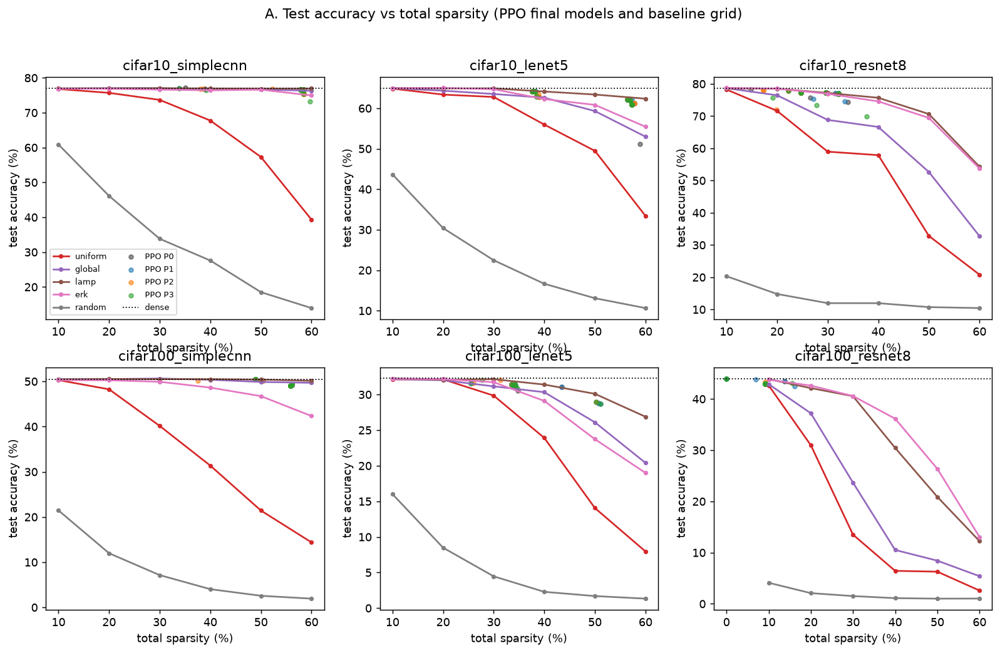
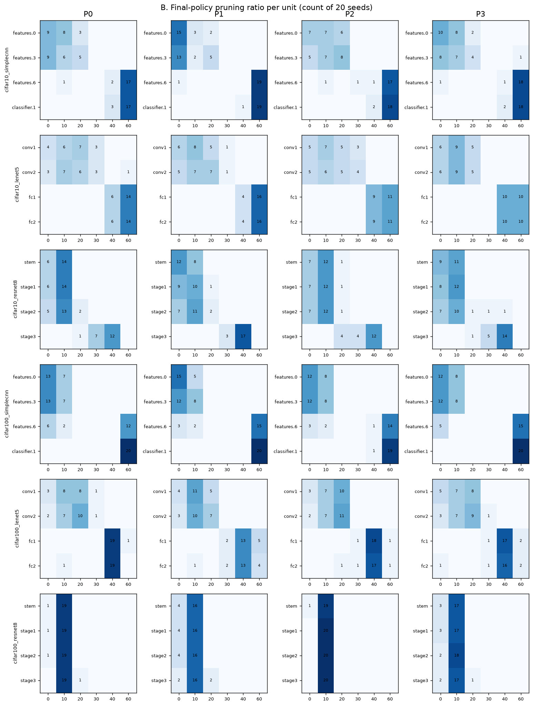
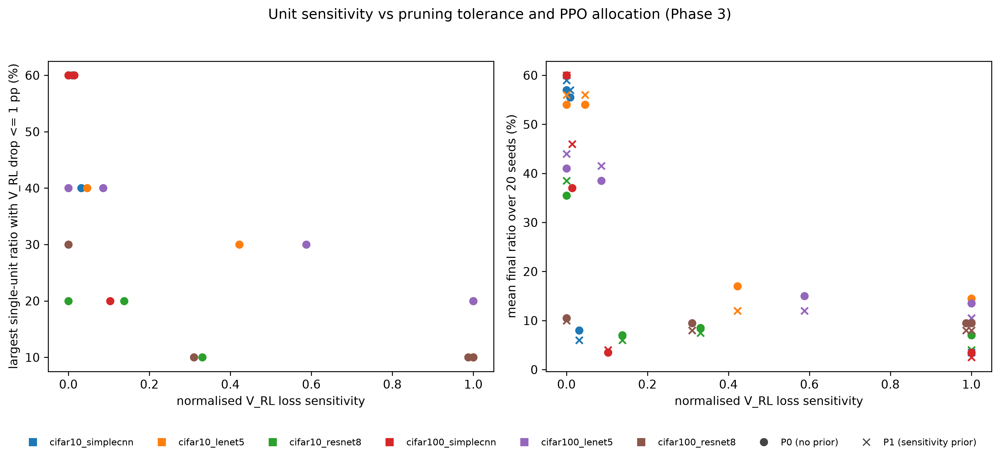
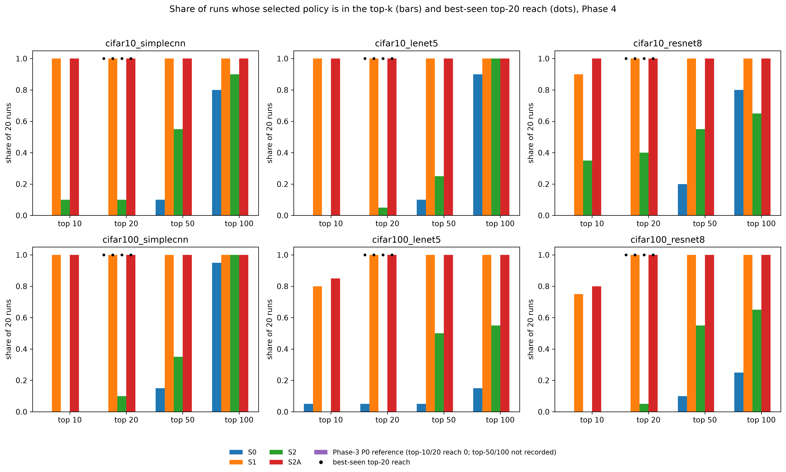
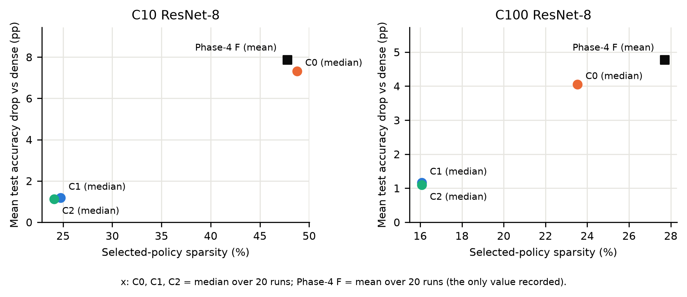
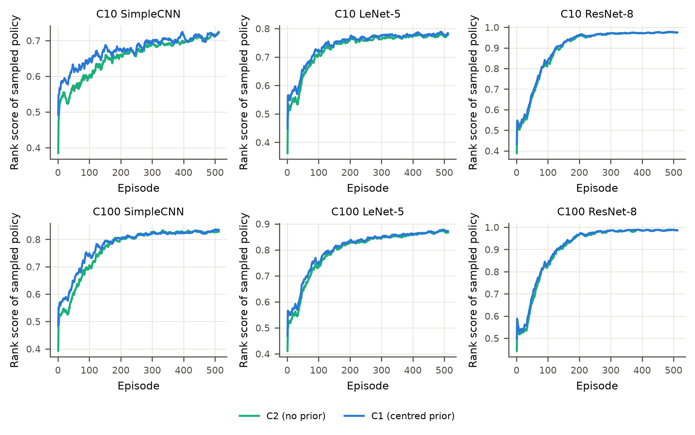
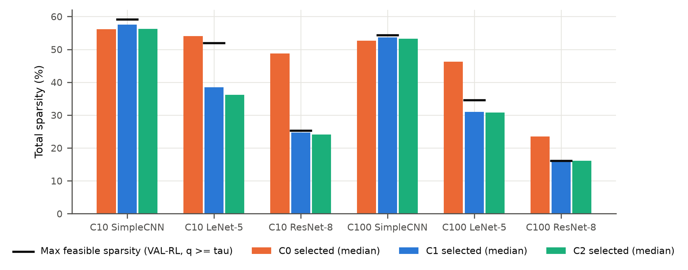
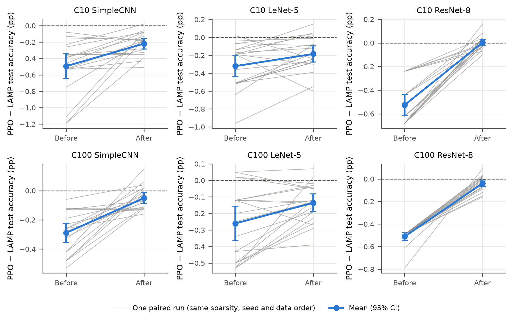

# Chapter 5 — Results of the Core Framework

## 5.1 General

This chapter reports the results of the core framework, Phases 3–6, and answers Research Questions 1–5; the
deployment extension is reported in Chapter 6. Each
section gives the question, the experiment (designed in Chapter 4), the numerical and statistical result, a short
interpretation and a claim boundary stating what the result does *not* show. Broader interpretation across phases is
left to Chapter 7.

**Reporting conventions** (from Chapter 4):
- **Accuracy and differences.** Accuracies are percentages, and differences are percentage points (pp). Every accuracy
  names its split:
  - "test" is the official 10,000-image test set;
  - "VAL-RL (I)" and "VAL-SELECT (I)" are the 3,000 / 2,000 validation configuration of Phases 3–4;
  - "VAL-RL" and "VAL-SELECT" without a numeral are the 2,500 / 2,500 configuration of Phases 5–6.
- **Statistics.** Comparisons are paired by seed (n = 20 per setting) and use Holm-adjusted exact two-sided
  sign-flip p-values. A result is **supported** when its direction matches the hypothesis, the Holm p < 0.05 and the
  95% t-interval excludes 0; **opposite**, **inconclusive** and the cross-setting classes STRONG, MODERATE, LIMITED,
  NOT SUPPORTED and REVERSED are defined in Section 4.15.1.
- **Matching.** Baselines are built at the identical zero count of the PPO model they are compared with, that is, at
  each PPO run's *own* sparsity.
- **Sparsity and settings.** Sparsity ρ is masked weight sparsity (Equation 3.2). Settings are written C10 and C100
  for CIFAR-10 and CIFAR-100.

## 5.2 Dense Reference Performance

Table 5.1 gives the six dense references against which every pruned model is compared.

**Table 5.1. Dense reference models (accuracy %, seed-0 reference).**

| Dataset | Architecture | Full validation | Test | Test, 3 seeds (mean ± SD) | VAL-RL (I) | VAL-RL (II) |
|---|---|---|---|---|---|---|
| CIFAR-10 | SimpleCNN† | 77.32 | 77.03 | — (1 model) | 76.97 | 76.88 |
| CIFAR-10 | LeNet-5 | 64.32 | 64.96 | 66.21 ± 1.51 | 64.30 | 64.20 |
| CIFAR-10 | ResNet-8 | 78.72 | 78.69 | 78.69 ± 0.51 | 78.53 | 78.92 |
| CIFAR-100 | SimpleCNN | 49.08 | 50.50 | 49.84 ± 0.65 | 50.37 | 48.96 |
| CIFAR-100 | LeNet-5 | 32.58 | 32.28 | 31.42 ± 0.75 | 33.30 | 32.76 |
| CIFAR-100 | ResNet-8 | 43.48 | 43.99 | 43.58 ± 0.53 | 43.77 | 43.76 |

† The historical 10-epoch checkpoint, not the 30-epoch Phase-2 recipe (Section 4.5).

Across the three training seeds, test accuracy varies by at most about 1.5 pp (SD). The fixed seed-0 reference of
C10 LeNet-5 lies below its three-seed mean; it was kept because the reference rule is fixed in advance. The two VAL-RL
columns are the denominators A_b of retained accuracy q in Phases 3–4 and in Phase 5.

## 5.3 Phase 3 — PPO versus Baselines

**Question (RQ1).** Does a PPO agent learn layer-wise allocations that are more accurate than uniform allocation and
other one-shot baselines at the same sparsity?

**Evidence.** Phase 3 ran 480 PPO runs: 6 settings × 4 conditions × seeds 300–319. The P0 (no-prior) final policy of
each run was compared on test accuracy with Uniform, Random, Global magnitude, ERK [@evci2020rigl] and LAMP
[@lee2021lamp] (Section 4.7), each built at the run's exact zero count. No model was fine-tuned.

**Sparsity context.** PPO chose its own sparsity. The mean final sparsity of P0 was 55.06% (C10 SimpleCNN), 51.54%
(C10 LeNet-5), 28.35% (C10 ResNet-8), 53.28% (C100 SimpleCNN), 34.59% (C100 LeNet-5) and 9.46% (C100 ResNet-8).
Phase 3 is therefore not a single fixed-sparsity comparison. The range is 9.5–55.1%, and the SimpleCNN networks were
pruned roughly six times as heavily as CIFAR-100 ResNet-8.

**Table 5.2. Phase 3: P0 minus baseline, test accuracy (pp, mean of 20 paired runs).** "+" = supported, "−" =
opposite, "·" = inconclusive.

| Setting (P0 test) | Uniform | Random | Global | ERK | LAMP |
|---|---|---|---|---|---|
| C10 SimpleCNN (76.44) | +31.37 + | +59.60 + | −0.07 · | +0.75 + | −0.55 − |
| C10 LeNet-5 (61.67) | +16.29 + | +48.69 + | +2.74 + | +1.93 + | −1.64 − |
| C10 ResNet-8 (76.95) | +14.17 + | +64.36 + | +7.38 + | −0.06 · | +0.15 · |
| C100 SimpleCNN (49.66) | +29.69 + | +47.29 + | −0.01 · | +4.35 + | −0.65 − |
| C100 LeNet-5 (31.18) | +3.67 + | +27.89 + | −0.13 · | +0.30 · | −0.68 − |
| C100 ResNet-8 (43.01) | +0.23 · | +38.76 + | +0.28 + | −0.80 − | −0.75 − |
| **Supported / opposite (of 6)** | **5 / 0** | **6 / 0** | **3 / 0** | **3 / 1** | **0 / 5** |
| **Class** | **STRONG** | **STRONG** | **MODERATE** | **LIMITED** | **NOT SUPPORTED, REVERSED** |

**Uniform and Random.**
- **Uniform: STRONG** (5 of 6 settings). Every supported setting has Holm p = 1.1 × 10⁻⁵, and PPO won in 20 of 20
  seeds in each.
  - The largest gain, **+31.37 pp** (exact mean 31.365 pp, ≈ +31.4 pp; 95% CI 26.57–36.16), is on **CIFAR-10 SimpleCNN, test accuracy**.
    There, at 55.06% mean sparsity, uniform pruning fell to 45.08% while PPO kept 76.44%.
  - This maximum is specific to that setting (Table 5.2).
- **C100 ResNet-8 is inconclusive** (+0.23 pp). PPO chose the uniform policy [1, 1, 1, 1] itself in 19 of 20 runs, so
  19 pairs are ties.
- **Random: STRONG** (6 of 6), from +27.89 to +64.36 pp (Holm p = 4.6 × 10⁻⁵ in every setting).

**Global magnitude and ERK.**
- **Global: MODERATE.** PPO is better in 3 settings (Holm p ≤ 0.0015) and within ±0.13 pp in the other three
  (inconclusive).
- **ERK: LIMITED.** PPO is better in 3 settings (Holm p ≤ 0.0087), inconclusive in 2, and worse in C100 ResNet-8
  (−0.80 pp, Holm p = 5.3 × 10⁻⁵).

**LAMP.** LAMP is significantly more accurate than PPO in **5 of 6 settings**, by 0.55–1.64 pp (Holm p ≤ 0.002;
LAMP won 19–20 of 20 seeds in four of them). C10 ResNet-8 is inconclusive (+0.15 pp). The statement "PPO > LAMP" is
NOT SUPPORTED and, being opposite in five settings, REVERSED.

**Allocations.** PPO's final policies are non-uniform (Figure 5.2):
- **SimpleCNN:** it prunes conv3 and the large hidden layer at 40–60% and keeps the first convolution at 0–20%.
- **LeNet-5:** the two fully connected layers absorb most of the pruning.
- **C10 ResNet-8:** stage 3 is pruned most.

Uniform, by contrast, must apply the same ratio to the small, sensitive first layers.

**Figure 5.1. Test accuracy against total sparsity (Phase 3).** Lines: the five baselines on a fixed descriptive
sparsity grid (10–60%); points: the final models of the 20 PPO runs per condition (P0–P3); dotted line: dense test
accuracy. The statistical comparison in Table 5.2 uses baselines built at each PPO run's own zero count.

**Figure 5.2. Final-policy pruning ratio per unit (Phase 3).** Each cell is the count of the 20 seeds that chose that
ratio for that unit, by setting (rows) and condition (columns P0–P3). In Phase 3, P2 is the *shuffled* prior.

**Interpretation.** The result supports the first part of RQ1: PPO's non-uniform allocations are far more accurate
than uniform or random allocation at the same sparsity. Against the stronger magnitude-based baselines the advantage
is mixed; against LAMP it is reversed.

**Claim boundary.**
- The comparison is before any fine-tuning, at the sparsity PPO chose.
- It does not show that PPO beats one-shot magnitude-based allocation in general.
- It does not show that PPO matches LAMP.
- It says nothing about uniform pruning after fine-tuning: Phase 6 did not include Uniform.

## 5.4 Phase 3 — Effect of Sensitivity Guidance

**Question (RQ2, first test).** Does the sensitivity prior improve PPO's search and the final model?

**Evidence.** Four conditions were compared on the configuration-I VAL-RL landscape and on test: P0 (no prior), P1
(the sensitivity prior), P2 (the shuffled prior) and P3 (the constant prior). The primary exploration endpoint is the
VAL-RL (I) accuracy AUC over the 512 sampled policies. The final-model endpoint is the test accuracy in excess of
matched global magnitude, compared as P1 − P0.

**Results (Table 5.11, Phase-3 rows):**
- **Primary exploration endpoint (P1 − P0, VAL-RL (I) accuracy AUC): MODERATE**, supported in 3 of 6 settings: C10
  SimpleCNN (+0.46, Holm p = 0.002), C100 SimpleCNN (+0.35, Holm p = 0.0098) and C100 ResNet-8 (+0.54, Holm
  p = 5.7 × 10⁻⁵). The other three settings are inconclusive, and none is opposite.
- **Secondary exploration endpoints: STRONG in 6 of 6** settings for each of:
  - reward-rank AUC: +0.013 to +0.032 in rank score, Holm p ≤ 5.5 × 10⁻⁴;
  - utility AUC: Holm p ≤ 3.6 × 10⁻⁴;
  - destructive-policy frequency: lower under P1, by 0.9–3.8 percentage points of sampled policies, Holm p ≤ 0.0022.
- **Layer specificity** (P1 better than both the shuffled and the constant prior): **LIMITED**, supported only in
  C10 SimpleCNN.
- **Final model: NOT SUPPORTED**, 0 of 6 supported and 0 opposite. The P1 − P0 differences in excess over global
  magnitude range from −0.10 to +0.86 pp, and every Holm p ≥ 0.094. The raw test-accuracy differences are also all
  inconclusive.

**Control insight.** On LeNet-5 the shuffled and constant priors did at least as well as the correct prior:
- **C10 LeNet-5, VAL-RL (I) accuracy AUC:** P1 − P2 = −0.21 (Holm p = 0.27); P1 − P3 = −0.21 (Holm p = 0.31).
- **Descriptive mean test accuracy:** C10 LeNet-5: P1 62.17%, P2 62.54%, P3 62.83%; C100 LeNet-5: P1 30.81%,
  P2 31.15%, P3 31.05%.

All three Phase-3 priors carry the same total pressure towards lighter pruning, Σ c_l = 0.5·Σ S_l (Section 3.10). The
pattern therefore raises the possibility that part of the exploration effect comes from a generic conservative bias
rather than from layer-specific information. The Phase-3 data cannot separate the two, and they do not prove either.
This possibility motivated the centred prior of Phase 4.

**Figure 5.3. Unit sensitivity, pruning tolerance and PPO allocation (Phase 3).** Left: for each unit, the largest
single-unit ratio whose VAL-RL (I) accuracy drop is ≤ 1 pp, against normalised loss sensitivity S_l. Right: mean final
ratio over 20 seeds of P0 (circles) and P1 (crosses) against S_l. Each setting has one colour in both panels. Highly
sensitive units tolerate only 10–20% pruning and receive low ratios under both conditions.

**Interpretation.** The sensitivity prior changes *how* PPO searches (better-ranked policies sooner, fewer destructive
ones), not *what* it returns, in a way detectable on test accuracy.

**Claim boundary.** "Sensitivity improves pruned-model accuracy" is not supported. The layer-specific part of the
effect is not established by Phase 3.

## 5.5 Phase 4 — Centred Sensitivity and Exploration

**Question (RQ2, second test).** Without net conservatism, does *relative* sensitivity still help the search?

**Evidence.** Phase 4 Stage B ran 600 runs under R0 with seeds 400–419. It compared the centred prior P2,
c_l = 1.0·(S_l − S̄), whose coefficients sum to zero, against P3 (the centred values permuted across units), P4 (a
magnitude-matched pure-conservatism prior), P5 (the sign-reversed prior) and P0 (no prior). The primary endpoint was
the reward-rank AUC on the configuration-I VAL-RL landscape.

**Results (Table 5.11, Phase-4 rows):**
- **Sensitivity-specific statement** (P2 better than both P3 and P4): **STRONG**, supported in 5 of 6 settings and
  opposite in none.
  - P2 − P3 ranges from +0.018 to +0.097 in rank-score AUC (Holm p ≤ 3.4 × 10⁻⁴, all 6 supported).
  - P2 − P4 ranges from +0.028 to +0.070 in the five supported settings.
  - In C100 ResNet-8, P2 − P4 = −0.002, which is inconclusive.
- **Against the sign-reversed prior** (P2 − P5): supported in **6 of 6** settings, by +0.021 to +0.145 (Holm
  p = 1.1 × 10⁻⁵).
- **Against no prior:** P1 − P0 and P2 − P0 were each supported in 6 of 6.
- **One exploration measure was reversed.** On the VAL-RL (I) accuracy AUC, the statement "P2 better than P3 and P4"
  is NOT SUPPORTED and REVERSED. P2 was significantly *below* the magnitude-matched conservative prior P4 in 4 of 6
  settings (C10 LeNet-5, C10 ResNet-8, C100 LeNet-5 and C100 ResNet-8; mean −0.26 to −0.76). The centred prior
  pushes aggressive actions onto the insensitive units, so the policies it samples are better ranked under R0 but less
  accurate on average. Reward rank and accuracy are different quantities under a trade-off reward, and the
  improvement holds for the former only.
- **Other secondary endpoints:** destructive frequency MODERATE (4 of 6); utility AUC LIMITED (5 supported,
  1 opposite); best-seen rank LIMITED (1 of 6); final-selected rank NOT SUPPORTED (0 of 6).

**Interpretation.** With the shared conservatism removed, correctly assigned relative sensitivity still makes the
explored policies better ranked under the reward, which is stronger evidence for a layer-specific effect than Phase 3
provided. The benefit concerns the *average* explored policy, not the best policy found or the policy returned.

**Claim boundary.**
- The centred prior is not shown to improve accuracy-based exploration in Phase 4 (that endpoint is reversed).
- It is not shown to improve the final model.

## 5.6 Phase 4 — Policy Retention and Archive Selection

**Question (RQ3).** Does PPO end on the good policies it visits, and does archive-based selection change this?

**Evidence.** Phase 4 Stage C compared four search variants under R0 and P2, each with 20 seeds per setting:
- **S0:** the terminal deterministic policy;
- **S1:** archive selection over the S0 runs;
- **S2:** elite behavioural cloning (K = 5, η = 0.1) with the terminal policy;
- **S2A:** elite behavioural cloning with archive selection.

The archive rule takes the top 10 visited policies by VAL-RL (I) reward and returns the one with the highest
VAL-SELECT (I) score. Ranks are positions among all 1,296 policies on the VAL-RL (I) landscape of R0 (1 = optimum).

**Table 5.3. Retention: the best policy encountered, the terminal policy (S0) and the archive-selected policy (S2A).**
Reach is the share of the 20 runs whose policy is in the top-k of the 1,296-policy VAL-RL (I) landscape. Ranks are
medians over runs. Δ test is S2A − S0 test accuracy (pp, mean).

| Setting | A: best seen, top-10 reach (S0) | B: terminal (S0), top-10 reach | B: median rank | C: archive (S2A), top-10 reach | C: top-20 reach | C: median rank | Δ test (S2A − S0) |
|---|---|---|---|---|---|---|---|
| C10 SimpleCNN | 100% | 0% | 92 | 100% | 100% | 3 | +0.14 |
| C10 LeNet-5 | 100% | 0% | 69 | 100% | 100% | 6 | **+0.89** |
| C10 ResNet-8 | 95% | 0% | 96 | 100% | 100% | 1 | **−5.66** |
| C100 SimpleCNN | 100% | 0% | 65 | 100% | 100% | 6 | +0.22 |
| C100 LeNet-5 | 100% | 5% | 173 | 85% | 100% | 7 | +0.45 |
| C100 ResNet-8 | 95% | 0% | 114 | 80% | 100% | 10 | **−4.00** |

**Results.**
- **A. PPO visits top policies.** The best policy seen has a median rank of 1–2.5 and is in the top 10 in 95–100% of
  runs (Phase 3: median best-seen rank 1–4.5).
- **B. PPO does not end on them.** The terminal policy reaches the top 10 in **0% of runs in five settings and 5% in
  the sixth** (C100 LeNet-5). Its median rank is 65–173, and it reaches the top 20 in at most 5% of runs. In Phase 3,
  the terminal P0 policy reached the top 10 in 0% of runs in all six settings.
- **C. The archive retains them.** With S2A, the selected policy reaches the top 10 in **80–100%** of runs and the top
  20 in 100%, with a median rank of 1–10.
  - **Statistics:** "S2A better than S0 on final-selected VAL-RL (I) rank" is STRONG, supported in 6 of 6 settings.
    The mean rank improves by 66–150 positions (Holm p = 3.4 × 10⁻⁵). The same holds on VAL-SELECT (I) rank, 6 of 6.
  - **Archive alone (S1):** the archive rule without behavioural cloning gives 75–100% top-10 reach and is likewise
    supported in 6 of 6.

**Contribution of elite behavioural cloning.** Behavioural cloning alone (S2) improved the final-selected rank in
only 3 of 6 settings (MODERATE) and the best-seen rank in 1 of 6 (LIMITED). The retention gain is therefore mainly a
*selection* effect of the archive, not an effect of cloning or of the sensitivity prior.

**Test accuracy is mixed.** The archive improves the *validation rank* of the returned policy, but its test-accuracy
effect (Table 5.3, last column) varies: small gains in four settings (+0.14, +0.89, +0.22 and +0.45 pp) and
**large losses on ResNet-8: −5.66 pp (C10) and −4.00 pp (C100).** The archive-only variant S1 shows the same pattern.
On ResNet-8, the better-ranked policies are much sparser than the terminal ones: 32.2% → 47.8% (C10) and 8.5% → 27.7%
(C100) mean sparsity for S0 → S2A.

The pre-registered Stage-C criterion, the VAL-SELECT (I) rank of the selected policy, favours the archive variants by
construction, because they select on VAL-SELECT (I). The test comparison does not share this bias.

**Figure 5.4. Share of runs whose selected policy lies in the top-k of the VAL-RL (I) landscape (Phase 4, Stage C).**
Bars: S0, S1, S2 and S2A. Dots: best-seen top-20 reach, which is 100% for every variant. The Phase-3 P0 reference
series shows no bars: its top-10 and top-20 reach is 0, and top-50/100 reach was not recorded.

**Interpretation.** Exploration is not the bottleneck; retention is. PPO finds near-optimal policies early but does
not end on them, and an archive of visited policies recovers them on validation ranking.

**Claim boundary.**
- Archive selection does **not** consistently improve test accuracy. It lost 4–6 pp on ResNet-8, because the policies
  it retains are those the reward ranks highest, and that reward is misaligned (Section 5.7).
- The retention result is a validation-ranking result.

## 5.7 Phase 4 — Reward Misalignment

**Question (RQ4, diagnosis).** Once search and retention work, does the reward point PPO towards acceptable
models?

**Evidence.** Stage A tested three redesigned trade-off rewards against R0. The final pipeline F = (R0, P2, S2A),
fixed by the pre-registered stage selections, was compared with the control K = (R0, P0, S0), the Phase-3
configuration on fresh seeds.

**Redesigned rewards (criterion A: NOT MET).** No redesigned reward met both pre-registered conditions:
- **R1a (common 50% target):** reduced the cross-setting spread of final sparsity to 0.29× that of R0. However, it
  kept ≥ 95% VAL-RL (I) retention in only 2 of 6 settings; C100 ResNet-8 retained 67.5%.
- **R1b (95%-retention targets):** kept retention but did not reduce the spread (1.05×).
- **R2 (anchor-normalised):** reached 0.66× and 4 of 6.

R0 was therefore carried forward unchanged.

**R0's own optimum.** On the VAL-RL (I) landscapes, R0's optimum lies at **23.5–56.4% sparsity**, depending on the
setting. On ResNet-8 that optimum is an accuracy-losing policy: 48.8% sparsity retaining 89.7% of dense VAL-RL (I)
accuracy (C10), and 23.5% sparsity retaining 93.4% (C100).

**Better search finds that optimum (Table 5.5, Phase-4 rows).** On ResNet-8, F's archive selection reached R0's
optimum region, with median selected VAL-RL (I) rank 1 (C10) and 10 (C100) and mean sparsity rising from 29.0% to
47.8% (C10) and from 8.3% to 27.7% (C100) relative to K. Test accuracy fell accordingly: **C10:** 76.82% → 70.83%, a
**7.86 pp** drop below dense; **C100:** 43.11% → 39.22%, a **4.77 pp** drop.

**Final pipeline against the control and LAMP.**
- **Criterion D, F > K on test excess over matched LAMP: NOT MET (LIMITED).** Supported in C10 SimpleCNN (+0.50), C10
  LeNet-5 (+0.95) and C100 LeNet-5 (+0.67 pp); **opposite on both ResNet-8 settings** (−0.95 and −0.92 pp);
  inconclusive in C100 SimpleCNN.
- **Criterion E, LAMP competitiveness: met only as non-inferiority.**
  - LAMP is significantly better than F in **6 of 6** settings: F − LAMP = −0.11, −0.11, −0.68, −0.48, −0.08 and
    −1.62 pp (Holm p ≤ 0.012).
  - The pre-registered one-sided non-inferiority test with a 0.5 pp margin is supported in 3 settings: C10 SimpleCNN,
    C10 LeNet-5 and C100 LeNet-5 (Holm p = 5.7 × 10⁻⁶).
- F remains far ahead of Uniform: +12.05 to +36.04 pp at matched zero count.

**Table 5.4. Phase 4 pre-registered criteria.**

| Criterion | Status |
|---|---|
| A. Reward | **NOT MET** |
| B. Sensitivity-specific prior | **MET** (STRONG) |
| C. Search | **MET** (STRONG for S1 and S2A) |
| D. Final model vs control | **NOT MET** (LIMITED) |
| E. LAMP competitiveness | **MET only through non-inferiority** in 3 settings; "F > LAMP" NOT SUPPORTED |

By its own rule, Phase 4 counted as successful if at least one criterion held. That rule is satisfied, but the phase
is not a success on its two model-level criteria (A and D).

**Interpretation.** The optimiser did what the reward specified. R0 trades accuracy for sparsity at a fixed rate
(Section 3.13.1); once search and retention improved, PPO found R0's optimum, which on fragile networks is an
over-pruned model.

**Claim boundary.** This is evidence of reward misalignment, not a failure of PPO alone. It concerns R0 and these
landscapes. It does not show that every trade-off reward over-prunes.

## 5.8 Phase 5 — Accuracy-Constrained Reward

**Question (RQ4, remedy; RQ2, third test).** Does an accuracy-constrained, validation-aware reward remove the
over-pruning? Does sensitivity guidance still help under it?

**Evidence.** Phase 5 ran 360 runs on configuration II with seeds 500–519, under three conditions:
- **C0:** R0 + centred prior + R0-score archive selection (the Phase-4 pipeline without behavioural cloning);
- **C1:** constrained reward R_c with τ = 0.98 + centred prior + constraint-aware selection;
- **C2:** as C1 without the prior.

All three were evaluated once on test, after the policy list was frozen.

**Table 5.5. ResNet-8 reward alignment across Phases 4 and 5 (test accuracy %, mean of 20 runs; sparsity = mean
selected masked sparsity).**

| Setting | Configuration | Sparsity | Test | Drop vs dense (pp) |
|---|---|---|---|---|
| C10 ResNet-8 (dense 78.69) | Phase-4 K (R0, no prior, terminal) | 29.0% | 76.82 | 1.87 |
| | Phase-4 F (R0, P2, S2A) | 47.8% | 70.83 | 7.86 |
| | Phase-5 C0 (R0, P2, archive) | 46.2% | 71.37 | **7.32** |
| | Phase-5 C1 (R_c, P2, constrained selection) | 24.5% | 77.51 | **1.18** |
| | Phase-5 C2 (R_c, no prior) | 23.9% | 77.57 | 1.12 |
| C100 ResNet-8 (dense 43.99) | Phase-4 K | 8.3% | 43.11 | 0.88 |
| | Phase-4 F | 27.7% | 39.22 | 4.77 |
| | Phase-5 C0 | 25.9% | 39.94 | 4.05 |
| | Phase-5 C1 | 15.6% | 42.83 | 1.16 |
| | Phase-5 C2 | 15.5% | 42.90 | 1.09 |

The Phase-4 and Phase-5 rows use different validation configurations but share the test set and dense reference.

**Over-pruning on ResNet-8.** On **CIFAR-10 ResNet-8**, the constrained reward reduced the mean test-accuracy loss
from **7.32 pp (C0) to 1.18 pp (C1)**, and on **CIFAR-100 ResNet-8** from 4.05 to 1.16 pp, at much lower sparsity
(Table 5.5). On test, C1 − C0 was +6.14 pp (95% CI 4.92–7.36; 20 of 20 seeds
favouring C1; Holm p = 1.1 × 10⁻⁵) on C10 ResNet-8 and +2.89 pp (95% CI 2.30–3.48; 20 of 20; Holm p = 1.1 × 10⁻⁵) on
C100 ResNet-8. C1's selected policies lie at or next to the constrained optimum: median constrained rank 3 (C10) and
1 (C100).

**Figure 5.5. ResNet-8 reward alignment: test-accuracy drop below dense against selected-policy sparsity.**
- C0, C1 and C2 are plotted at their **median** sparsity (48.8%, 24.7% and 24.1% for C10; 23.5%, 16.1% and 16.1% for
  C100).
- The Phase-4 F reference is plotted at its **mean** sparsity (47.8% and 27.7%), the only value recorded; each label
  states its statistic.

**Effect across all six settings (Table 5.6).**
- **C1 − C0 on test accuracy:** supported in 4 settings, LeNet-5 (+0.70 and +1.12 pp) and ResNet-8; **opposite in
  2:** C10 SimpleCNN (−0.31 pp, Holm p = 4.6 × 10⁻⁵) and C100 SimpleCNN (−0.21 pp, Holm p = 0.0022).
- Where C1 is more accurate, it prunes 10–22 pp less than C0. On SimpleCNN, C0 already chose near-safe policies, and
  C1 spends the 2% accuracy allowance on slightly more sparsity.
- Safe sparsity is architecture-dependent: C1's mean sparsity runs from 15.6% (C100 ResNet-8) to 56.9% (C10
  SimpleCNN).

**Table 5.6. Phase 5 by setting (test accuracy %, mean of 20 runs; differences in pp).**

| Setting | C0 test (sparsity) | C1 test (sparsity) | C2 test | C1 − C0 | C1 − LAMP | C1 − Global |
|---|---|---|---|---|---|---|
| C10 SimpleCNN | 76.75 (56.1%) | 76.45 (56.9%) | 76.50 | −0.31 − | −0.49 − | −0.09 · |
| C10 LeNet-5 | 63.14 (53.9%) | 63.83 (38.6%) | 63.99 | +0.70 + | −0.32 − | +1.42 + |
| C10 ResNet-8 | 71.37 (46.2%) | 77.51 (24.5%) | 77.57 | +6.14 + | −0.53 − | +6.51 + |
| C100 SimpleCNN | 50.28 (52.9%) | 50.07 (53.1%) | 50.13 | −0.21 − | −0.29 − | +0.32 + |
| C100 LeNet-5 | 30.67 (46.3%) | 31.79 (30.6%) | 31.86 | +1.12 + | −0.26 − | +0.36 + |
| C100 ResNet-8 | 39.94 (25.9%) | 42.83 (15.6%) | 42.90 | +2.89 + | −0.51 − | +3.48 + |

**Comparison with global magnitude** (descriptive by pre-registration). C1 is more accurate than global magnitude at
the identical zero count in **5 of 6** settings, by +0.32 to +6.51 pp on test (sign-flip Holm p ≤ 0.0011). C10
SimpleCNN is inconclusive (−0.09 pp). The comparison is not confirmatory.

**Comparison with LAMP.**
- LAMP is significantly more accurate than C1 in **all 6** settings, by **0.26–0.53 pp** on test (Holm p ≤ 5.9 × 10⁻⁵;
  LAMP won 16–20 of 20 seeds).
- The gap is within 0.5 pp in four settings. In both ResNet-8 settings it is 0.51–0.53 pp.
- Compared with C0, the gap to LAMP narrowed in C100 ResNet-8 (+0.66 pp, supported), widened on both SimpleCNN
  settings (opposite), and was unchanged elsewhere.

**Sensitivity under the corrected reward (C1 − C2; Table 5.11, Phase-5 rows):**
- **Primary family** (24 tests): **0 opposite outcomes.**
  - Reward-rank AUC: supported in 5 of 6 settings (Holm p ≤ 0.019; C10 ResNet-8 inconclusive).
  - VAL-RL accuracy AUC: supported in 5 of 6 (Holm p ≤ 0.012; C100 ResNet-8 inconclusive).
  - Episodes to the first top-20 and top-10 policy: inconclusive in all six settings, although every point estimate
    favours C1.
- **Secondary:** destructive-action rate lower in 6 of 6 (Holm p ≤ 1.5 × 10⁻⁴); selected rank better in 3 of 6;
  best-seen rank better in 1 of 6.
- **Final test accuracy** (descriptive): C1 is **0.05–0.16 pp below** C2 in all six settings. The C1 − C2 test
  accuracy comparison was not pre-registered as a test.

**Figure 5.6. Rank score of the sampled policy over 512 episodes, C1 (centred prior) vs C2 (no prior) (Phase 5,
VAL-RL).** The mean over 20 seeds, smoothed with a 16-episode rolling mean. The prior's advantage is concentrated
early in training; in most settings the curves meet before the end.

**Table 5.7. Phase 5 pre-registered criteria.**

| Criterion | Status | Reason |
|---|---|---|
| A. Accuracy safety | **PARTIALLY MET** | Supported in both ResNet-8 settings, but opposite in 2 other settings (at most 1 allowed) |
| B. Non-trivial compression | **MET** | C1 median sparsity ≥ 10% in 6 of 6 and ≥ 20% in 5 (4 required) |
| C. Search quality | **PARTIALLY MET** | Median selected constrained rank ≤ 20 in 5 of 6, but only 76.7% of runs selected a top-20 policy (≥ 80% required); 90.8% visited one |
| D. Sensitivity contribution | **MET** | A primary exploration endpoint supported in every setting, 0 of 24 opposite |
| E. Final model improvement | **PARTIALLY MET** | Supported in 4 settings, opposite in 2 (no degradation allowed) |
| F-strong. LAMP | **NOT MET** | C1 never beats LAMP; LAMP better in 6 of 6 |
| F-weak. LAMP | **MET** | Within 0.5 pp in 4 settings, none worse than 1.0 pp |

**Interpretation.** Making accuracy a constraint rather than a traded quantity largely removed the ResNet-8
over-pruning; the remaining effects are small and architecture-dependent. Sensitivity guidance still improves
exploration and still does not improve the final model.

**Claim boundary.**
- The constrained reward does not "guarantee" accuracy (Section 5.9).
- It does not eliminate over-pruning in every setting.
- It does not make PPO better than LAMP.
- The comparison with global magnitude is descriptive.

## 5.9 Phase 5 — Validation-to-Test Transfer

**Question.** Does a policy feasible on validation data remain feasible on test?

**Evidence.** For every selected policy, Phase 5 recorded whether q ≥ 0.98 held on three splits: on VAL-RL, where the
reward enforced it; on VAL-SELECT, where the selection rule enforced it; and on test, measured as test accuracy
divided by dense test accuracy.

**Table 5.8. Validation-to-test feasibility of the selected Phase-5 policies (q ≥ 0.98; runs out of 120).**

| Condition | Feasible on VAL-RL | Feasible on VAL-SELECT | Feasible on test |
|---|---|---|---|
| C0 | 40 / 120 | 44 / 120 | 40 / 120 (33.3%) |
| C1 | **120 / 120** | **119 / 120 (99.2%)** | **81 / 120 (67.5%)** |
| C2 | 120 / 120 | 119 / 120 | 90 / 120 (75.0%) |

- **Selection fallback.** The single C1 policy infeasible on VAL-SELECT is the one selection-rule fallback (C100
  LeNet-5).
- **Transfer failures.** Of the 119 C1 policies feasible on VAL-SELECT, **39 were infeasible on test.**
- **C1 test feasibility by setting:** 100% in both SimpleCNN settings and in C10 ResNet-8; 60% in C100 LeNet-5; 45% in
  C10 LeNet-5; **0% in C100 ResNet-8**, where the mean test retention was 0.974, just below the 0.98 threshold.

**Figure 5.7. Median selected sparsity of C0, C1 and C2 against the maximum feasible sparsity on VAL-RL (q ≥ τ),
by setting (Phase 5).** C0 selects policies beyond the feasible maximum in the LeNet-5 and ResNet-8 settings. C1 and C2
select at or just below it; these boundary policies are where test feasibility is most fragile.

**Interpretation.** Validation feasibility is evidence about test feasibility, not a guarantee. The failures occur
where C1 selects close to the VAL-RL feasibility boundary (Figure 5.7). The frozen Phase-5 analysis notes that two
2,500-image splits carry roughly ±1 pp of sampling noise, comparable to the 2% relative margin in these settings.

**Claim boundary.** No claim of the form "the validation constraint guarantees generalisation" is made. Phase 6 shows
that equal fine-tuning removes most of this gap (Section 5.10).

## 5.10 Phase 6 — Equal Fine-Tuning

**Question (RQ5).** Do the differences between PPO and the strongest deterministic methods persist when every pruned
model receives the same fine-tuning?

**Evidence.**
- **Methods.** Phase 6 fine-tuned three pruned models in each of 120 (setting, policy seed) pairs: **PPO**, the frozen
  Phase-5 C1 policy; and **LAMP and global magnitude**, at exactly PPO's zero count (mismatch 0 in 120 of 120
  triples). A dense control was fine-tuned alongside them. **Phase 6 contains no Uniform baseline.**
- **Protocol.** Every model received 5 epochs of fixed-mask Adam fine-tuning at learning rate 10⁻⁴ with shared seed
  and data order (Section 4.13); the model after epoch 5 was evaluated once on test. There were 480 runs, plus 6
  reproduction runs.

**Table 5.9. Phase 6: test accuracy before → after equal fine-tuning, and the PPO–LAMP and PPO–Global gaps (pp; mean
of 20 paired runs; 95% t-CI).**

| Setting (sparsity) | PPO | LAMP | Global | PPO − LAMP before | PPO − LAMP after [95% CI] | PPO − Global after [95% CI] |
|---|---|---|---|---|---|---|
| C10 SimpleCNN (56.9%) | 76.45 → 79.73 | 76.94 → 79.95 | 76.54 → 79.89 | −0.49 | −0.22 [−0.28, −0.15] | −0.16 [−0.21, −0.11] |
| C10 LeNet-5 (38.6%) | 63.83 → 64.88 | 64.15 → 65.06 | 62.41 → 64.83 | −0.32 | −0.18 [−0.28, −0.09] | +0.05 [−0.05, 0.15] |
| C10 ResNet-8 (24.5%) | 77.51 → 78.74 | 78.03 → 78.73 | 71.00 → 78.67 | −0.53 | +0.00 [−0.02, 0.03] | +0.07 [0.03, 0.11] |
| C100 SimpleCNN (53.1%) | 50.07 → 50.53 | 50.36 → 50.58 | 49.75 → 50.51 | −0.29 | −0.05 [−0.09, −0.01] | +0.03 [−0.02, 0.07] |
| C100 LeNet-5 (30.6%) | 31.79 → 32.36 | 32.05 → 32.49 | 31.43 → 32.24 | −0.26 | −0.14 [−0.19, −0.08] | +0.12 [0.06, 0.18] |
| C100 ResNet-8 (15.6%) | 42.83 → 44.02 | 43.34 → 44.06 | 39.35 → 44.04 | −0.51 | −0.04 [−0.07, −0.01] | −0.02 [−0.07, 0.03] |
| **Mean of 6 settings** | **57.08 → 58.38** | **57.48 → 58.48** | **55.08 → 58.36** | | | |

The dense control moved from 57.91 to 58.51 (mean over settings).

**Recovery.**
- **Every method recovered in every setting.** "Fine-tuning improves accuracy over the same mask before fine-tuning"
  is supported in 18 of 18 method × setting tests (Holm p < 10⁻⁴).
- **Recovery beyond the dense control's own gain** is supported in 17 of 18. The exception is LAMP on C10 SimpleCNN,
  which gained 0.04 pp less than the dense control.
- **Mean recovery per setting:** PPO: 0.46–3.28 pp; LAMP: 0.22–3.01 pp; global magnitude: 0.76–7.67 pp. The ordering,
  global > PPO > LAMP in all six settings, is the inverse of the pre-fine-tuning accuracy: the more a mask had lost,
  the more it recovered.
- **Shortfall after fine-tuning.** Every method ended within 0.14 pp of the dense reference on average. On C10
  SimpleCNN, every model, dense control included, ended about 3 pp *above* the historical reference: the dense control
  itself gained +3.05 pp from the 5 extra epochs (Table 5.1, note †).

**PPO versus LAMP.**
- **Before fine-tuning,** LAMP led by 0.26–0.53 pp in every setting.
- **After fine-tuning,** the absolute PPO–LAMP difference was **0.00–0.22 pp.**
- **Change in the gap (ΔG).** The gap moved in PPO's favour, a supported result, in **5 of 6** settings (Holm
  p ≤ 0.027). C10 LeNet-5 was inconclusive (Holm p = 0.055), and no setting was opposite.
- **Who is ahead after fine-tuning.** LAMP was still significantly ahead in **3 of 6** settings: C10 SimpleCNN,
  −0.22 pp (Holm p = 3.8 × 10⁻⁵); C10 LeNet-5, −0.18 pp (Holm p = 0.0026); C100 LeNet-5, −0.14 pp (Holm
  p = 4.6 × 10⁻⁴). The other three were inconclusive. PPO was significantly ahead in none.
- **The ±0.5 pp rule.** **The post-recovery PPO–LAMP differences fell within the pre-registered ±0.5 pp decision
  margin in all six settings.** The rule is that the 95% t-interval lies inside (−0.5, +0.5) pp. It is a
  confidence-interval decision rule, not a formal statistical equivalence test (Section 4.15.2). Three of the six
  settings were already inside the margin before fine-tuning (C10 LeNet-5, C100 SimpleCNN and C100 LeNet-5).

**PPO versus global magnitude.**
- **Before fine-tuning,** PPO led global magnitude by up to 6.51 pp (Section 5.8).
- **After equal recovery,** the differences were −0.16 to +0.12 pp. PPO's largest remaining advantage was **0.12 pp**
  (C100 LeNet-5; supported); PPO was also ahead by 0.07 pp in C10 ResNet-8 (supported); global was ahead by 0.16 pp in
  C10 SimpleCNN (opposite); the other three settings were inconclusive.
- **Gap change and margin.** The change in the PPO–Global gap was opposite in 5 settings, because global recovered
  much more, and inconclusive on C10 SimpleCNN, where there had been no gap to close. Every post-recovery PPO–Global
  interval lies inside ±0.5 pp.

**Fixed masks and integrity.** No pruned weight regrew: in all 360 pruned runs, per-layer zero counts were identical
before and after fine-tuning, the mask hash was unchanged, and no masked weight was non-zero. The 6 reproduction runs
were bit-identical to the originals, and all 20 integrity checks passed.

**Table 5.10. Phase 6 pre-registered criteria.**

| Criterion | Status | Basis |
|---|---|---|
| A. Fairness | **MET** | one protocol and epoch count; shared seed and data stream in every pair; zero-count mismatch 0 in 120 of 120 triples; masks equal the frozen table |
| B. Recovery | **MET** | recovery supported for all three pruning methods in all 6 settings |
| C. PPO competitiveness (change of the PPO–LAMP gap) | **MET** | gap moved towards PPO in 5 settings, towards LAMP in none. C concerns the change of the gap, not who is ahead: LAMP remains ahead in 3 settings |
| D. Architecture generalisation | **MET** | all six settings complete and present in every family |
| E. Sparsity preservation | **MET** | identical per-layer zero counts and unchanged masks in 360 of 360 pruned runs |
| F. Reproducibility | **MET** | 480 of 480 runs complete; 6 of 6 reproductions bit-identical |

**Figure 5.8. PPO − LAMP test accuracy before and after equal 5-epoch fine-tuning (Phase 6).** Grey lines: one
paired run (same sparsity, seed and data order); blue: mean with 95% CI; dashed line: zero difference. The ±0.5 pp
margin is not drawn; every post-fine-tuning interval lies inside it (Table 5.9).

**Interpretation.** Equal, modest fine-tuning substantially shrinks the differences among pruning methods at these
sparsities: PPO's advantage over global magnitude and LAMP's advantage over PPO both lay mainly *before*
fine-tuning. It also removed most of the validation-to-test retention problem of Section 5.9: after recovery, every
pruned model met retention ≥ 0.98 on test, and the PPO retention gap between VAL-SELECT and test narrowed
significantly in 4 of 6 settings.

**Claim boundary.**
- PPO and LAMP are not claimed to be statistically equivalent, and LAMP remains significantly, though slightly, ahead
  in three settings.
- The result holds for these networks, sparsities and a 5-epoch budget.
- It says nothing about Uniform, ERK or Random after fine-tuning.

## 5.11 Answers to RQ1–RQ5

**Table 5.11. Sensitivity guidance across Phases 3–5: exploration endpoints versus final-model endpoints (settings
supported / opposite, of 6).**

| Phase | Comparison | Exploration endpoints | Final-model endpoint |
|---|---|---|---|
| 3 | P1 − P0 (prior vs none) | VAL-RL (I) accuracy AUC 3 / 0 (MODERATE); rank AUC 6 / 0; utility AUC 6 / 0; destructive frequency 6 / 0 (STRONG) | excess over matched Global 0 / 0 (NOT SUPPORTED) |
| 3 | P1 vs P2 and P3 (specificity) | VAL-RL (I) accuracy AUC 1 / 0 (LIMITED) | — |
| 4 | P2 vs P3 and P4 (centred, specific) | rank AUC 5 / 0 (STRONG); VAL-RL (I) accuracy AUC 0 / 4 (REVERSED); destructive 4 / 0 | final-selected rank 0 / 0 (NOT SUPPORTED) |
| 4 | P2 − P5 (sign-reversed) | rank AUC 6 / 0 | — |
| 5 | C1 − C2 (prior vs none, constrained reward) | rank AUC 5 / 0; VAL-RL accuracy AUC 5 / 0; time to top-20 / top-10 0 / 0; destructive rate 6 / 0 | test accuracy: C1 0.05–0.16 pp below C2 in 6 of 6 (descriptive) |

*(Table 5.11 is placed here, beside the answer to RQ2, because it draws on Sections 5.4, 5.5 and 5.8.)*

**RQ1: PPO against uniform and one-shot baselines.** Yes, with clear limits. PPO's non-uniform allocations
substantially outperform uniform allocation (5 of 6 settings, up to +31.4 pp on C10 SimpleCNN test) and random
allocation (6 of 6) at the sparsity PPO chose; against global magnitude and ERK the advantage is mixed. LAMP is
significantly more accurate than PPO before recovery: in 5 of 6 settings in Phase 3, and in 6 of 6 for the Phase-4
final pipeline and for Phase-5 C1.

**RQ2: sensitivity guidance.** It improves the search but not the final model (Table 5.11): better-ranked policies
earlier and fewer destructive ones in every phase, also against equally conservative controls (Phase 4) and under the
corrected reward (Phase 5). No final-accuracy benefit was found, and one Phase-4 exploration measure was reversed.

**RQ3: retention and archive selection.** The terminal PPO policy does not retain the strong policies PPO visits
(Section 5.6). Archive selection restores retention on validation ranking, mainly as an effect of the archive rule,
not of behavioural cloning. The effect on test accuracy is mixed, with large losses on ResNet-8 under the misaligned
reward.

**RQ4: reward design.** Reward design materially determines how aggressively PPO prunes. R0's optimum over-prunes
fragile networks (ResNet-8 lost up to 7.86 pp once search improved). The accuracy-constrained reward largely removed
this loss (Table 5.5), with mixed effects elsewhere, and validation feasibility transferred to test in only 67.5% of
runs.

**RQ5: equal recovery.** Equal 5-epoch fixed-mask fine-tuning substantially narrows the differences. The PPO–LAMP
gap fell from 0.26–0.53 pp to 0.00–0.22 pp, within the pre-registered ±0.5 pp confidence-interval margin in all six
settings, with LAMP still significantly ahead in three; PPO's advantage over global magnitude fell to at most
0.12 pp. PPO's distinctive advantages lay before fine-tuning.

## 5.12 Chapter Summary

**Findings in the order the phases produced them:**
1. **Phase 3.** PPO strongly beat uniform and random pruning, but LAMP was more accurate in five of six settings.
2. **Sensitivity.** The prior made the search more efficient in every phase but never improved the final model.
3. **Phase 4.** PPO visited top policies but ended on poor ones; an archive recovered them on validation ranking.
   Better search then exposed a misaligned reward that over-pruned ResNet-8.
4. **Phase 5.** An accuracy constraint largely corrected the over-pruning. Validation feasibility transferred to test
   in only two thirds of runs.
5. **Phase 6.** After identical fine-tuning the differences between methods became small; LAMP remained slightly
   ahead in three settings, and PPO's lead over global magnitude essentially disappeared.

**Negative and partial results** are reported alongside the positive ones: LAMP reversed against PPO (Phase 3);
criteria A and D not met, ResNet-8 test losses from archive selection and one reversed exploration measure (Phase 4);
criteria A, C and E partially met and F-strong not met (Phase 5); LAMP still ahead in three settings (Phase 6).

**Figures.** Figures 5.1, 5.2 and 5.6–5.8 are the frozen phase figures, used unchanged. Figures 5.3–5.5 are
presentation-only thesis re-renders of the frozen Phase-3 figure D, Phase-4 figure D and Phase-5 figure B, from the
same frozen CSVs, with every plotted value verified identical (`figures/rerender_ch5_figures.py`).

Chapter 6 asks whether these results translate into deployment efficiency; Chapter 7 discusses them.
