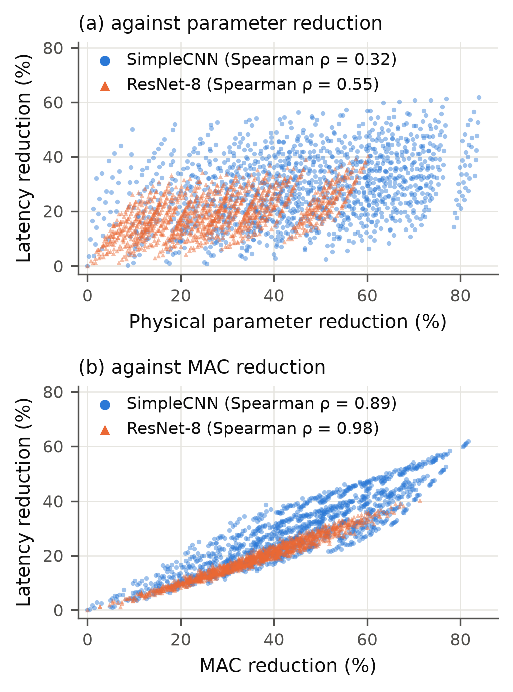
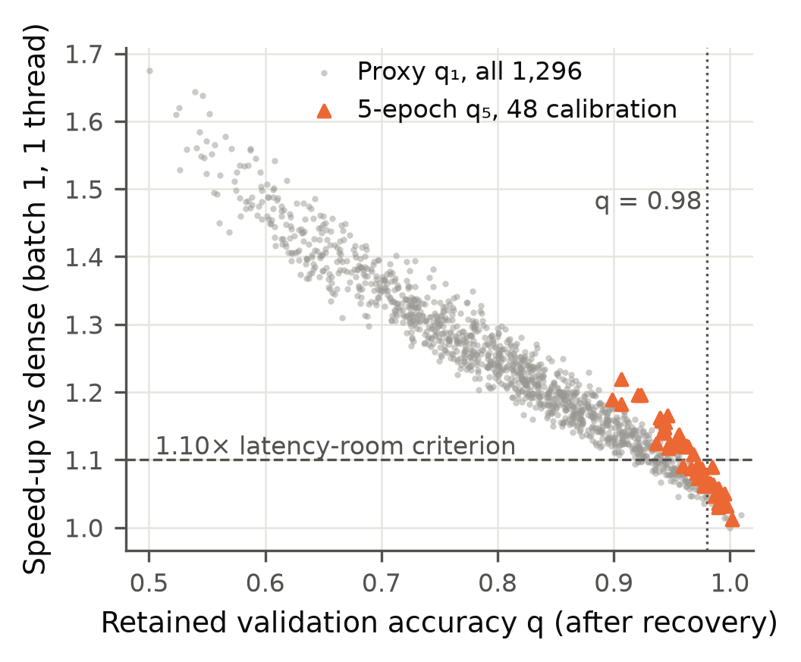
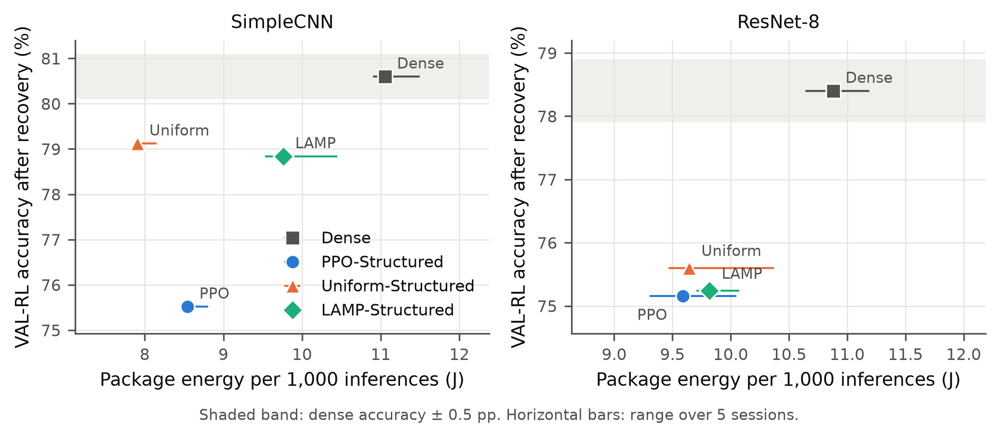
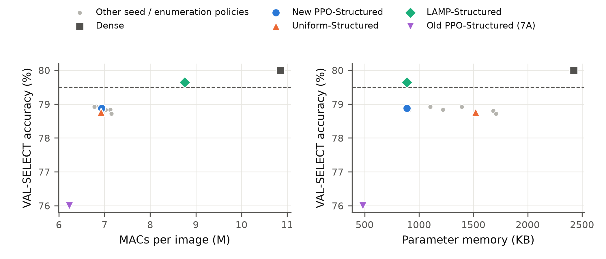

# Chapter 6 — Deployment and Sustainability Analysis

## 6.1 General

This chapter answers the question that masked pruning (Chapter 5) cannot:

> **RQ6. Does model compression translate into real deployment benefit?**

The evidence comes from four later studies (Table 4.7): **Paper 3** measures the CPU latency of every structured
policy (Sections 6.4–6.6); **Phase 7A** realises the learned Phase-5 allocation as a physically smaller network and
measures its CPU package energy (Sections 6.7–6.8); **Phase 7B** searches directly in the structured space (Sections
6.9–6.12); and the **energy confirmation** study tests the frozen Phase-7B model (Section 6.13). Benefit is assessed
at three levels (Section 3.16.2): compression and memory, computation and latency, and operational energy; **an
improvement at one level does not guarantee an improvement at the next**, so each level needs its own measurement,
stated with its accuracy cost.

**Reporting conventions.** Accuracies are configuration-II validation accuracies (2,500 images per split) after the
equal 5-epoch recovery; no test-set number exists for these phases (Section 4.3). Phase 7A's pre-registered accuracy
split is **VAL-RL**; Phase 7B's is **VAL-SELECT**. Both are reported and the split is always named. Latency and energy
were measured on the laptop CPU of Table 4.11 (Sections 4.17–4.18).

## 6.2 From Compression to Deployment Efficiency

A masked network keeps every tensor at its dense shape and stores zeros in place of removed weights; on a CPU with
dense kernels those zeros are still loaded and multiplied unless sparse formats and kernels are used
[@hoefler2021sparsity]. Weight sparsity is therefore a statement about the model, not its hardware cost, and cost
indicators such as parameter count, FLOPs and measured speed can disagree [@dehghani2022misnomer]; the thesis makes no
latency or energy claim for its masked models. The extension instead realises each policy **structurally**, removing
whole channels and neurons to build a smaller dense network [@li2017filters; @he2017channel; @he2024structuredsurvey].
The three levels then become measurable: parameter count, memory and serialised size exactly (Level 1); MACs in closed
form and measured batch-1 CPU latency (Level 2); and CPU package energy per 1,000 inferences from the RAPL hardware
counter [@khan2018rapl], with no TDP model or estimate (Level 3).

## 6.3 Structured Physical Pruning Setup

The structured space is the core space realised physically (Sections 4.6.2 and 4.17): the same six ratios per unit
(1,296 policies per network); each unit keeps max(1, round((1 − r)·C)) channels with the largest L1 norm; in ResNet-8
the stem is a **coupled residual pruning group** and the stage units remove **block-internal channels**. Every
compacted model was checked to contain no masks, to have analytic parameter and MAC counts and to reproduce the
masked-equivalent logits within 10⁻⁴, and accuracy always follows the equal 5-epoch Phase-6 protocol. Latency calibration chose configuration A (batch 1, one thread, one performance core; signal-to-noise ratio 12.3,
relative reduction 61.6%), and each table was timed in five fresh-process sessions with dense anchors and a 10% drift
limit.

## 6.4 Exhaustive CPU Latency Analysis

Paper 3 timed **all 1,296 physically compacted policies** in each of four tables (SimpleCNN and ResNet-8, with 10 and
100 outputs): **5,184 structured policies** in total. Four session attempts exceeded the drift limit and were
repeated; all 20 accepted sessions met it. The median between-session coefficient of variation per shape was
1.2–1.6%, the Spearman correlation of latency gains between sessions 0.96–0.995, and raw and anchor-normalised gains
agreed at Spearman ≥ 0.997. Because dense latency on the table days was about 16% above the calibration day, while the
anchors within each table agreed with its identity shape to within 1%, latency is analysed *relative to the identity
shape of the same table*.

**Table 6.1. Exhaustive structured latency tables: cost metrics against measured latency gain** (Spearman rank
correlation over 1,296 policies per table; latency gain g_T = 1 − T/T_identity).

| Table | Policies | Parameter reduction vs latency gain | MAC reduction vs latency gain | Pairs where the more parameter-sparse policy is slower | Maximum speed-up (unconstrained) |
|---|---|---|---|---|---|
| SimpleCNN, CIFAR-10 | 1,296 | 0.32 | 0.89 | 39.0% | 2.61× |
| SimpleCNN, CIFAR-100 | 1,296 | 0.31 | 0.89 | 39.4% | 2.59× |
| ResNet-8, CIFAR-10 | 1,296 | 0.55 | 0.98 | 30.6% | 1.67× |
| ResNet-8, CIFAR-100 | 1,296 | 0.54 | 0.98 | 30.8% | 1.72× |

The maximum speed-up in every table belongs to the most aggressive policy [5, 5, 5, 5]; these maxima describe the
latency space only and are **not** accuracy-preserving speed-ups (no accuracy constraint is applied; Section 6.6).

**Figure 6.1. Measured latency reduction against (a) physical parameter reduction and (b) MAC reduction, for all
1,296 structured policies of the CIFAR-10 SimpleCNN and ResNet-8 tables (Paper 3).**

## 6.5 Parameter Reduction versus MAC Reduction versus Latency

**Result.** Across all four tables (Table 6.1), the Spearman correlation of latency gain was 0.31–0.55 (weak) with
parameter reduction and 0.89–0.98 (strong) with MAC reduction. In **39.0–39.4%** of SimpleCNN policy pairs and
**30.6–30.8%** of ResNet-8 pairs, the policy with more parameter reduction was *slower*. In the CIFAR-10 SimpleCNN
table, [5, 5, 1, 0], which prunes the first two convolutions at 60%, removes 18.7% of parameters and 69.3% of MACs and
runs **2.08×** faster, whereas the fc-heavy [0, 0, 0, 5], which prunes only the 256-unit hidden layer at 60%, removes
51.1% of parameters but 2.9% of MACs for **1.03×**: the hidden layer holds most of the weights but little of the
arithmetic. These examples describe cost only; pruning the first convolutions at 60% is destructive in this network
(Section 5.4). ResNet-8 correlates more strongly with parameters (0.54–0.55 vs 0.31–0.32) but still has roughly one
inverted pair in three.

**Interpretation and claim boundary.** Parameter sparsity is a weak proxy for CPU latency and MAC reduction a strong
one; measured latency remains the deployment-grounded quantity, because even MACs leave part of the ordering
unexplained (Spearman ρ < 1). These are batch-1, single-thread results on one laptop CPU and do not transfer to other
CPUs, thread counts, batch sizes or accelerators.

## 6.6 Accuracy-Feasible Latency Headroom

Deployment needs the speed-up of policies that also keep accuracy. Paper 3 used the Phase-5 criterion, q₅ ≥ 0.98 in
retained VAL-RL accuracy after the 5-epoch recovery; because the exhaustive 5-epoch landscape was stopped for
computational cost (Section 4.6.3), a 1-epoch accuracy proxy had to reach a Spearman correlation ≥ 0.90 with 5-epoch
recovery. It was **rejected** for SimpleCNN (Spearman ρ(A₁, A₅) = 0.844 over 156 validation pairs; NO-GO) and accepted
for ResNet-8 (0.980 over 31 pairs; GO), so **no accuracy-feasibility claim is made for the SimpleCNN latency tables**;
its 2.61× maximum is an unconstrained figure only. For ResNet-8, too few validation pairs were truly feasible for the
pre-registered threshold rule, so its fallback applied: a pre-committed calibration recovered 48 frozen policies for
the full 5 epochs and set the proxy threshold by a recall-first rule with a fixed 0.005 margin (Table 6.2).

**Table 6.2. ResNet-8 (CIFAR-10): calibrated accuracy-feasible latency headroom.**

| Item | Value |
|---|---|
| Calibration policies (5-epoch recovered) | 48 |
| Truly 5-epoch feasible (q₅ ≥ 0.98) | 14 |
| Proxy threshold τ_proxy | 0.960 |
| Recall / precision at τ_proxy | 1.00 / 0.875 (14 true positives, 2 false positives) |
| Proxy-feasible policies in the 1,296 landscape | 52 |
| Their parameter / MAC reduction | 0–28.9% / 0–18.4% |
| **Best table speed-up among proxy-feasible policies** | **1.098×** |
| Best speed-up among the 14 truly feasible calibration policies | 1.089× ([0, 3, 1, 1]) |
| Proxy-feasible policies with speed-up ≥ 1.10× | 0 |

The 52 proxy-feasible policies are *candidates*; only the 48 calibration policies were confirmed by 5-epoch recovery.

**Figure 6.2. ResNet-8 (CIFAR-10): table speed-up against retained validation accuracy (Paper 3).** Grey: the 1-epoch
proxy q₁ for all 1,296 policies. Orange: 5-epoch q₅ for the 48 calibration policies. Dotted: q = 0.98; dashed: the
1.10× latency-room criterion.

**Decision.** The pre-registered latency-room rule required at least 20 proxy-feasible policies **and** one with a
speed-up ≥ 1.10×; the first held (52), the second did not. **Because the latency-room requirement was not met, no
hardware-aware PPO search was started.** The gap between 1.098× and 1.10× is a threshold fixed in advance, not a
meaningful discontinuity; the substantive finding is that, under the 2% accuracy constraint, the best proxy-feasible
candidate reached a 1.098× speed-up, while the best confirmed five-epoch-feasible calibration policy reached 1.089×.
Neither satisfied the pre-registered 1.10× GO criterion. The accuracy-feasible latency room on this CPU is therefore
small, and for SimpleCNN it could not be established. No hardware-aware reinforcement-learning result exists; Paper 3
contributes a hardware analysis, not an RL success.

## 6.7 Phase 7A — Structured Transfer and Energy Evaluation

**Question.** Does the learned PPO allocation, realised structurally, reduce directly measured CPU energy, and at what
accuracy cost? **Design** (Section 4.9.6): CIFAR-10 SimpleCNN and ResNet-8, each with **Dense** (recovered
identically), **PPO-Structured** (the most frequent Phase-5 C1 policy transferred to structured units: SimpleCNN
[0, 2, 5, 5], 3 of 20 seeds, widths [32, 51, 51, 102]; ResNet-8 [1, 1, 1, 3], 9 of 20 seeds, widths [14, 14, 29, 45],
an approximate mapping), **Uniform-Structured** (MAC-matched, common ratios 0.256 and 0.149) and **LAMP-Structured**
(from the Phase-6 LAMP mask at PPO's zero count). After the identical recovery, RAPL package energy was measured over
five fresh-process sessions per architecture (Section 4.18); the stability pilot passed its 3% rule (dense CV 2.30%
for SimpleCNN and 1.74% for ResNet-8).

**Table 6.3. Phase 7A: accuracy, compression, latency and measured energy.** Δ in pp against the recovered dense model
on VAL-RL, the pre-registered split; latency, energy and EDP are medians over 5 sessions against the same-session dense
anchor.

| Architecture | Method | VAL-RL (Δ) | VAL-SELECT | Params ↓ | MACs ↓ | Latency (ms) | Speed-up | J / 1,000 inf. | Energy ↓ | EDP |
|---|---|---|---|---|---|---|---|---|---|---|
| SimpleCNN | Dense | 80.60 (0) | 80.00 | — | — | 0.7313 | 1.00× | 11.05 | — | 1.000 |
| | PPO-Structured | 75.52 (−5.08) | 76.00 | 80.1% | 42.6% | 0.5711 | 1.28× | 8.54 | 22.8% | 0.603 |
| | Uniform-Structured | 79.12 (−1.48) | 78.48 | 44.7% | 42.5% | 0.5341 | 1.37× | 7.91 | 27.9% | 0.518 |
| | LAMP-Structured | 78.84 (−1.76) | 79.44 | 65.5% | 19.7% | 0.6579 | 1.12× | 9.76 | 12.1% | 0.783 |
| ResNet-8 | Dense | 78.40 (0) | 78.52 | — | — | 0.6984 | 1.00× | 10.88 | — | 1.000 |
| | PPO-Structured | 75.16 (−3.24) | 74.72 | 25.0% | 21.5% | 0.6400 | 1.09× | 9.59 | 13.4% | 0.791 |
| | Uniform-Structured | 75.60 (−2.80) | 76.00 | 16.1% | 19.3% | 0.6459 | 1.07× | 9.64 | 11.8% | 0.818 |
| | LAMP-Structured | 75.24 (−3.16) | 75.72 | 25.0% | 18.2% | 0.6490 | 1.07× | 9.82 | 8.9% | 0.828 |

**Energy results.** **Every pruned model used less package energy than the dense model in 5 of 5 sessions** (exact
one-sided Wilcoxon signed-rank p = 0.031, the smallest attainable with five sessions). The pre-registered decision
rests on that consistency and on the median saving exceeding the noise threshold of twice the dense between-session
coefficient of variation (4.3% for SimpleCNN; 3.7% for ResNet-8); all six pruned models met both. PPO's per-session
saving ranged from 19.5% to 25.7% on SimpleCNN and from 5.6% to 14.5% on ResNet-8, and core-counter and net-of-idle
energy agreed with the package result to within 2 percentage points.

**Latency and EDP.** Every pruned model was faster than the same-session dense model, speed-ups tracking MAC
reduction more closely than parameter reduction. Median package power was 14.6–15.6 W for every model. The normalised energy–delay product (EDP; lower is better) is relative
to the same-session dense model; it is not a carbon metric.

## 6.8 Phase 7A — Accuracy–Energy Trade-off

**Accuracy cost.** Every pruned model lost VAL-RL accuracy (Table 6.3): **the pre-registered ±0.5 pp
accuracy-preservation condition was not met by any pruned method.** On VAL-SELECT, PPO's losses were 4.00 pp
(SimpleCNN) and 3.80 pp (ResNet-8).

**Pre-registered verdicts:** primary success, Case A (accuracy preserved and energy consistently reduced), **not met**
for either architecture; SimpleCNN: Case B (energy reduced, with a measurable accuracy trade-off) **and Case D** (a
baseline offers the better trade-off); ResNet-8: Case B.

**PPO against Uniform on SimpleCNN.** At almost identical MACs (42.6% vs 42.5% removed), MAC-matched Uniform-Structured
was **3.60 pp more accurate** than PPO-Structured on VAL-RL. It also **used less energy in 5 of 5 sessions** (7.91 vs
8.54 J per 1,000 inferences; median per-session difference 8.0%). **PPO does not dominate Uniform in Phase 7A: on
SimpleCNN, Uniform was better on both axes.** PPO concentrated its 80.1% parameter removal in conv3 and the hidden layer, which bought less time than
Uniform's broad channel removal at the same MAC count (Section 6.5).

**Other comparisons** (descriptive: two-sided exact Wilcoxon tests on five session pairs, minimum attainable
p = 0.0625). On SimpleCNN neither PPO nor LAMP dominates: PPO used less energy in 5 of 5 sessions (12.5% median
difference) but was 3.32 pp less accurate. On ResNet-8, PPO, Uniform and LAMP showed **no clear difference**: against
Uniform, accuracy differed by 0.44 pp and PPO used less energy in only 3 of 5 sessions; against LAMP, accuracy
differed by 0.08 pp and PPO used less energy in 4 of 5.

**Figure 6.3. Phase 7A: VAL-RL accuracy after recovery against measured package energy per 1,000 inferences.**
Medians with session ranges; no pruned model lies inside the shaded dense ± 0.5 pp band.

**Interpretation.** Structured realisation made the compression real: parameters, MACs, latency and directly measured
package energy all fell, consistently across sessions. The learned masked allocation did not
transfer well: its structured form lost 5.1 and 3.2 pp of VAL-RL accuracy, and on SimpleCNN plain uniform allocation
was both more accurate and more energy-efficient.

**Claim boundary.**
- Phase 7A does not show accuracy-preserving energy reduction.
- It does not show that PPO is more energy-efficient than Uniform.
- It says nothing about the masked Phase-5/6 models themselves.
- The energy is CPU package energy on one laptop, not whole-system or lifecycle energy.

## 6.9 Motivation for Phase 7B

Phase 7A exposed a design problem, not a measurement problem: a policy learned for *masked* pruning, realised as
channel removal and recovered, was neither accurate nor efficient enough, and for ResNet-8 the masked units do not
match the structured units. Phase 7B was therefore designed **after** Phase 7A, as a separate variant that chooses
structured actions directly; it was not part of the original framework.

## 6.10 Phase 7B — Deployment-Oriented Structured PPO

**Design** (Sections 3.16.3 and 4.9.7). The deployment-oriented structured PPO searches directly in the structured
space of SimpleCNN on CIFAR-10, with an eight-feature state including centred structured sensitivity and the centred
prior (β = 1.0). Its search reward used a *surrogate* (predicted) energy saving, so the name implies no measured energy
result. Feasibility was judged by a 2-epoch recovery proxy on VAL-RL, accepted before the search (Spearman 0.948
against 5-epoch recovery; threshold τ̂ = 0.98849; recall 1.00, precision 0.655). The surrogate,
Ê = −0.117 + 13.762·T_table (J per 1,000 inferences, T in ms), was fitted to directly measured energy of 200 calibration
policies and accepted by cross-validation (Spearman 0.996, median absolute percentage error 1.05%); the first candidate,
MACs alone, had failed (Spearman 0.946 against the required 0.95; lowest-energy-quartile error 8.55% against 5%). The
constraint-first reward used α = 4 (fixed on development seeds), selection took the lowest-predicted-energy feasible
policy, 20 confirmatory seeds (700–719) were run, and every final model received the equal 5-epoch recovery, with
accuracy judged on VAL-SELECT, held out from search and selection. **The surrogate is not measured energy, and it is
not evidence for the energy of any final Phase-7B model.**

**Selection outcome.** Every one of the 20 seeds selected a policy. The primary policy, [2, 2, 2, 5], was selected in
**5 of 20** seeds; its widths **[26, 51, 102, 102]** remove 20% of the convolution channels and 60% of the hidden
neurons. The six other policies (1–4 seeds each) were also recovered and evaluated. The primary policy's proxy
retention, 0.9890, lies just above the threshold: the selections sit at the proxy feasibility boundary.

## 6.11 Phase 7B — Memory and Computation Results

**Table 6.4. Phase 7B: accuracy, memory and computation after the equal 5-epoch recovery (SimpleCNN, CIFAR-10).**
Parameter memory = Σ numel × element size (float32). Latency and energy were **not measured**.

| Model | Widths | VAL-SELECT (Δ pp) | VAL-RL (Δ pp) | Parameter memory | Memory ↓ | MACs (M) | MACs ↓ |
|---|---|---|---|---|---|---|---|
| Dense | [32, 64, 128, 256] | 80.00 (0) | 80.60 (0) | 2,481,448 B | — | 10.85 | — |
| **New PPO [2, 2, 2, 5]** | [26, 51, 102, 102] | **78.88 (−1.12)** | 80.00 (−0.60) | 908,916 B | **63.4%** | 6.94 | **36.0%** |
| Uniform, r = 0.208 | [25, 51, 101, 203] | 78.76 (−1.24) | 79.76 (−0.84) | 1,555,908 B | 37.3% | 6.93 | 36.2% |
| LAMP, s = 56.2% | [32, 58, 103, 94] | 79.64 (−0.36) | 79.12 (−1.48) | 909,932 B | 63.3% | 8.76 | 19.3% |
| Old PPO (7A) [0, 2, 5, 5] | [32, 51, 51, 102] | 76.00 (−4.00) | 75.52 (−5.08) | 493,836 B | 80.1% | 6.23 | 42.6% |

Table 6.4 compares the recovered model with dense, matched baselines and the old Phase-7A model. **Level 1:** the new
PPO model needs **63.4% less parameter memory** (908,916 vs 2,481,448 bytes); its serialised checkpoint is 63.3%
smaller. **Level 2:** it needs **36.0% fewer MACs** (6.94 M vs 10.85 M per image). The seven distinct per-seed
selections all removed between 34.1% and 37.5% of the MACs, but their parameter-memory reduction ranged from 29.5% to
63.4%: the search rewarded predicted energy, which tracks latency and therefore MACs, and the selections differ mainly
in hidden-layer neurons, which change memory a great deal and MACs very little (Section 6.5). **Latency was not
measured for Phase 7B**, so Level 2 is established for MACs only; the Paper-3 table latency was a surrogate input.

## 6.12 Phase 7B — Accuracy Trade-off

**Result on the pre-registered split (VAL-SELECT).** The new PPO model reached 78.88% against the recovered dense
model's 80.00%, a loss of **1.12 pp**; every other per-seed selection lost between 1.08 and 1.28 pp. On the same split
and protocol the old Phase-7A PPO model lost **4.00 pp**, so the redesign reduced the loss by 2.88 pp. Phase 7A's
5.08 pp loss is on VAL-RL, its criterion split, and must not be compared with the 1.12 pp VAL-SELECT figure; on VAL-RL
the new model's loss was 0.60 pp, against 5.08 pp for the old model.

**Joint deployment-efficiency success criterion** (named GREEN-SUCCESS in the pre-registration, Section 4.9.7):
**met by 0 of 20 seeds.** Every selected policy lost more than the allowed 0.5 pp on VAL-SELECT, which alone decides
the outcome; the latency and energy conditions could not be assessed, because no measurement session took place
(Section 6.13). Descriptively, the new PPO model is 0.12 pp more accurate than Uniform on VAL-SELECT at similar MACs
(36.0% vs 36.2% removed) and much lower memory (63.4% vs 37.3%), and 0.76 pp less accurate than LAMP while removing
more MACs (36.0% vs 19.3%) and about the same memory (63.4% vs 63.3%). LAMP-Structured is the only pruned model within
0.5 pp of dense on VAL-SELECT (−0.36 pp); its joint criterion is not assessable, because energy was never measured.

**Figure 6.4. Phase 7B: VAL-SELECT accuracy after the equal 5-epoch recovery against MACs per image (left) and
parameter memory (right).** Dashed: dense accuracy − 0.5 pp (the joint criterion's accuracy condition); grey: the
other per-seed selections and the enumeration reference.

**Interpretation.** Learning directly in the structured space substantially improved the memory–computation–accuracy
trade-off over transferring a masked policy, but did not reach the 0.5 pp criterion; that the selections sit at the
proxy feasibility boundary (proxy precision 0.655) is consistent with the shortfall, although the data do not isolate
the proxy as its cause.

**Claim boundary.**
- Phase 7B shows no measured latency or energy reduction.
- It is not accuracy-preserving.
- It does not beat Uniform or LAMP.
- The joint deployment-efficiency criterion was not achieved.

## 6.13 Direct Energy Confirmation and Measurement Failure

Both attempts to measure Phase-7B energy directly stopped at the pre-registered stability check, before any model
comparison.

**Attempt 1, the Phase-7B confirmatory pilot** (dense model only; limit CV ≤ 3%; N may be doubled once, then STOP).
The first pilot (N = 100,000 per block) gave a coefficient of variation of the six dense blocks of **11.36%**, so N was
doubled; the doubled-N attempt (200,000) was voided by recorded user decision after the CPU-load gate stopped it
during foreground activity; and the permitted rerun with the laptop idle (200,000) gave **4.01%**, still unstable, so
**hardware validation STOPPED**. No confirmatory energy session was run.

**Attempt 2, the separate energy confirmation study.** The protocol was committed before any data, for the frozen
Phase-7B models (all five checkpoint hashes verified), with a fixed 180 s thermal soak and 200,000 inferences per
block. Qualification used the dense model only, 3 fresh runs × 2 blocks = **6 blocks**: energy per 1,000 inferences
ranged from 9.47 to 15.22 J (mean 12.14 J), a coefficient of variation of **19.92%** against the **3%** criterion,
although all runs passed the validity gates (in-block system load 7.6–10.2%, below the 15% limit). The setup was
**not qualified**; there was one permitted attempt and the limit was not relaxed. **No Dense-versus-PPO paired session
ran.**

**Result.** **Direct energy confirmation for Phase 7B remains unresolved.** No estimate from latency or from the
surrogate is substituted.

**What the qualification recorded** (descriptive). Median latency stayed within 1.042–1.052 ms across the six
blocks, but package power ranged from 9.1 to 14.5 W (core PP0 6.7 to 9.7 W, the rest of the package 2.4 to 5.1 W) and
the thermal-zone reading from 72 to 92 °C, the coolest run giving the lowest energy: the instability lay in the
package's power draw under identical work, not in inference timing. Its source is not identified. The same software
counter had passed its pilot in Phase 7A (CV 2.30% and 1.74%); the thesis records this contrast without claiming a
cause. A software counter on a laptop is not a guaranteed-stable instrument, which is why each study had to qualify it
[@jay2023powermeters; @raffin2024dissecting].

## 6.14 Three-Level Sustainability Assessment

Table 6.5 brings the three levels together for Phases 7A and 7B, with the accuracy cost of each.

**Table 6.5. Three-level deployment-efficiency assessment.**

| Level | Metric | Phase 7A evidence (structured transfer) | Phase 7B evidence (deployment-oriented structured PPO) | Conclusion |
|---|---|---|---|---|
| **1. Compression / memory** | parameter count / parameter memory; serialised size | parameters −80.1% (SimpleCNN) and −25.0% (ResNet-8) | parameter memory −63.4%; serialised −63.3% | **Established** in both phases |
| **2. Computation / latency** | MACs; measured batch-1 latency | MACs −42.6% / −21.5%; **measured** speed-up 1.28× / 1.09× | MACs −36.0%; latency **not measured** | MACs established in both; latency measured for 7A only. Paper 3: MACs are a strong latency proxy, parameters a weak one |
| **3. Operational energy** | RAPL package J per 1,000 inferences; EDP | **Measured:** −22.8% / −13.4%, lower in 5/5 sessions; EDP 0.603 / 0.791 | **Unresolved:** pilot CV 11.36% → 4.01%; confirmation CV 19.92% (limit 3%) | Real energy reduction demonstrated in 7A only |
| **Accuracy** (criterion ±0.5 pp) | recovered validation accuracy | **Failed:** VAL-RL −5.08 / −3.24 pp; no pruned method within 0.5 pp; Uniform dominated PPO on SimpleCNN | **Failed:** VAL-SELECT −1.12 pp; 0/20 seeds met the joint criterion | The accuracy trade-off was too large in 7A and reduced, but not removed, in 7B |

**Level 1 does not imply Level 2:** the Phase-7A SimpleCNN PPO model removed 80.1% of the parameters but only 42.6%
of the MACs, and MAC-matched Uniform ran faster. **Level 2 tracked Level 3 in Phase 7A,** because package power was
nearly constant across models. **Level 3 must be measured:** in Phase 7B the instrument could not be qualified, and
neither the MAC reduction nor the energy surrogate substitutes for a measurement. A deployment saving bought with a
material accuracy loss is not presented as a sustainability result.

## 6.15 Answer to RQ6

Compression can translate into real deployment savings, but not automatically, and not at every level at once.
1. **Masked sparsity alone gives no hardware evidence**; physical structured pruning is needed for dense-kernel CPU
   cost to fall.
2. **Even structurally, parameter reduction is a weak guide to latency**: across 5,184 measured structured policies,
   Spearman ρ was 0.31–0.55 for parameter reduction and 0.89–0.98 for MAC reduction, and in 31–39% of policy pairs the
   sparser policy was slower.
3. **Accuracy-feasible headroom is small**: for ResNet-8, the best proxy-feasible candidate reached a 1.098× speed-up,
   while the best confirmed five-epoch-feasible calibration policy reached 1.089×. Neither satisfied the
   pre-registered 1.10× GO criterion, so the hardware-aware search was not started.
4. **Phase 7A: real energy savings, with material accuracy loss**: directly measured CPU package energy fell by 22.8%
   (SimpleCNN) and 13.4% (ResNet-8), with VAL-RL losses of 5.08 and 3.24 pp; on SimpleCNN, MAC-matched uniform
   allocation was both more accurate and more energy-efficient.
5. **Phase 7B: a much better trade-off, but neither criterion met**: parameter memory fell by 63.4% and MACs by 36.0%
   at a 1.12 pp VAL-SELECT loss (4.00 pp for the transferred policy on the same split); no seed met the 0.5 pp accuracy
   criterion, and direct energy confirmation failed its stability qualification.

Deployment benefit must therefore be established separately for memory, computation, latency and energy, each with
its accuracy cost: an improvement at one level is a hypothesis about the next, not evidence for it.

## 6.16 Chapter Summary

Parameter reduction is a weak latency proxy and MAC reduction a strong one, and ResNet-8's accuracy-feasible latency
headroom was too small for a hardware-aware search (Paper 3). Structured pruning reduced directly measured CPU package
energy, but with VAL-RL losses beyond the pre-registered limit (Phase 7A). Learning in the structured space improved
the memory–computation–accuracy trade-off, but no seed met the joint criterion and its energy remains unresolved
(Phase 7B). Chapter 7 discusses these results.
