# A Reinforcement Learning Framework for Layer-Wise Adaptive Neural Network Pruning with Sensitivity-Aware Optimization

[OFFICIAL TITLE PAGE TO BE INSERTED FROM UNIVERSITY TEMPLATE: author name, student ID, degree, department, institution, supervisor, month and year]

[OFFICIAL DECLARATION PAGE TO BE INSERTED FROM UNIVERSITY TEMPLATE]

[APPROVAL / CERTIFICATION PAGE TO BE INSERTED FROM UNIVERSITY TEMPLATE]

[ACKNOWLEDGEMENTS TO BE WRITTEN BY THE AUTHOR]

# Abstract

Neural-network pruning reduces model size and computation, but deciding how much each layer should lose is
difficult, and weight sparsity alone does not establish deployment benefit.

This thesis develops and evaluates a reinforcement-learning framework for layer-wise adaptive pruning. In it, a
Proximal Policy Optimisation (PPO) agent assigns a pruning ratio to each layer or layer group, guided by layer sensitivity. Successive
experiments with pre-specified decision criteria added:
- a centred sensitivity prior;
- archive-based selection of the policies visited during search;
- an accuracy-constrained reward;
- an equal post-pruning recovery protocol.

A later deployment extension realises pruning structurally and measures CPU latency and energy directly. Experiments
used CIFAR-10 and CIFAR-100 with three small convolutional networks.

**Findings.**
- **PPO against simple allocation.** PPO learned non-uniform allocations that substantially outperformed uniform and
  random allocation, by up to approximately 31.4 percentage points of test accuracy over uniform pruning.
- **LAMP.** The deterministic LAMP method remained more accurate before equal recovery.
- **Sensitivity.** Guidance improved search and exploration measures, not final accuracy.
- **Retention.** PPO found high-ranking policies but rarely ended on them. Archive selection restored their retention
  on validation ranking.
- **Reward.** An accuracy-constrained reward reduced destructive over-pruning, although feasibility certified on
  validation data held on the test set in only about two thirds of runs.
- **Equal recovery.** Equal five-epoch recovery narrowed the PPO–LAMP differences to within a pre-registered ±0.5
  percentage-point decision margin in every setting.
- **Latency.** Parameter reduction proved a weak predictor of measured latency compared with reduction in
  multiply–accumulate operations (MACs).
- **Energy of structured pruning.** Structured pruning reduced directly measured CPU package energy, but with accuracy
  losses beyond the pre-registered limit.
- **Deployment-oriented structured agent.** It reduced parameter memory by 63.4% and MACs by 36.0% at a 1.12
  percentage-point validation-accuracy cost. It missed its accuracy criterion, and its direct energy remained
  unresolved because the measurement setup failed its stability qualification.

**Conclusion.** Adaptive pruning is a chain of connected problems: allocation, search guidance, policy retention,
reward alignment, recovery and hardware validation. An improvement at one stage does not guarantee success at the
next. Each must be evaluated with its own evidence before a compression result can be called a deployment-efficiency
result.

**Keywords:** neural network pruning; reinforcement learning; proximal policy optimisation; layer-wise pruning;
sensitivity-aware pruning; structured pruning; model compression; deployment efficiency


[TABLE OF CONTENTS TO BE GENERATED IN THE OFFICIAL TEMPLATE; see final_toc_map.md]

## List of Figures

- Figure 3.1. Overall thesis framework
- Figure 5.1. Test accuracy against total sparsity (Phase 3)
- Figure 5.2. Final-policy pruning ratio per unit (Phase 3)
- Figure 5.3. Unit sensitivity, pruning tolerance and PPO allocation (Phase 3)
- Figure 5.4. Share of runs whose selected policy lies in the top-k of the VAL-RL (I) landscape (Phase 4, Stage C)
- Figure 5.5. ResNet-8 reward alignment: test-accuracy drop below dense against selected-policy sparsity
- Figure 5.6. Rank score of the sampled policy over 512 episodes, C1 (centred prior) vs C2 (no prior) (Phase 5, VAL-RL)
- Figure 5.7. Median selected sparsity of C0, C1 and C2 against the maximum feasible sparsity on VAL-RL (q ≥ τ), by setting (Phase 5)
- Figure 5.8. PPO − LAMP test accuracy before and after equal 5-epoch fine-tuning (Phase 6)
- Figure 6.1. Measured latency reduction against (a) physical parameter reduction and (b) MAC reduction, for all 1,296 structured policies of the CIFAR-10 SimpleCNN and ResNet-8 tables (Paper 3)
- Figure 6.2. ResNet-8 (CIFAR-10): table speed-up against retained validation accuracy (Paper 3)
- Figure 6.3. Phase 7A: VAL-RL accuracy after recovery against measured package energy per 1,000 inferences
- Figure 6.4. Phase 7B: VAL-SELECT accuracy after the equal 5-epoch recovery against MACs per image (left) and parameter memory (right)

## List of Tables

- Table 1.1. Research questions, objectives, contributions and evidence
- Table 2.1. Pruning granularity
- Table 2.2. Comparison of representative pruning-allocation and deployment-aware pruning works
- Table 3.1. Development of the framework across phases
- Table 3.2. Notation
- Table 3.3. Pruning units of the core framework (unstructured)
- Table 3.4. State features by phase
- Table 3.5. Mature core framework (as frozen after Phase 5, evaluated in Phase 6)
- Table 3.6. Three levels of deployment efficiency
- Table 3.7. PPO configuration (identical in Phases 3, 4, 5 and 7B)
- Table 4.1. Datasets and split configurations
- Table 4.2. Data-split usage by phase
- Table 4.3. Network architectures and pruning units (core framework)
- Table 4.4. Dense reference models (accuracy, %)
- Table 4.5. Baseline methods and matching rules
- Table 4.6. PPO configuration by phase
- Table 4.7. Phase-by-phase experimental design
- Table 4.8. Evaluation metrics
- Table 4.9. Pre-registered decision criteria
- Table 4.10. Hardware and software environments
- Table 5.1. Dense reference models (accuracy %, seed-0 reference)
- Table 5.2. Phase 3: P0 minus baseline, test accuracy (pp, mean of 20 paired runs)
- Table 5.4. Retention: the best policy encountered, the terminal policy (S0) and the archive-selected policy (S2A)
- Table 5.5. ResNet-8 reward alignment across Phases 4 and 5 (test accuracy %, mean of 20 runs; sparsity = mean selected masked sparsity)
- Table 5.6. Phase 5 by setting (test accuracy %, mean of 20 runs; differences in pp)
- Table 5.7. Phase 6: test accuracy before → after equal fine-tuning, and the PPO–LAMP and PPO–Global gaps (pp; mean of 20 paired runs; 95% t-CI)
- Table 5.3. Sensitivity guidance across Phases 3–5: exploration endpoints versus final-model endpoints (settings supported / opposite, of 6)
- Table 6.1. Exhaustive structured latency tables: cost metrics against measured latency gain
- Table 6.2. ResNet-8 (CIFAR-10): calibrated accuracy-feasible latency headroom
- Table 6.3. Phase 7A: accuracy, compression, latency and measured energy
- Table 6.4. Phase 7B: accuracy, memory and computation after the equal 5-epoch recovery (SimpleCNN, CIFAR-10)
- Table 6.5. Three-level deployment-efficiency assessment

## List of Abbreviations

Only abbreviations actually used in the Abstract and Chapters 1–8 are listed, in alphabetical order. Method, model
and dataset names are given in their published form. They are expanded only where the published title or abstract states the
expansion; no expansion has been invented.

## General abbreviations

| Abbreviation | Meaning |
|---|---|
| AC | Alternating current (mains power) |
| AI | Artificial intelligence |
| ARM | ARM processor architecture |
| AUC | Area under the curve (trajectory AUC of a search measure) |
| CI | Confidence interval |
| CNN | Convolutional neural network |
| CPU | Central processing unit |
| CSV | Comma-separated values |
| CV | Coefficient of variation |
| DRAM | Dynamic random-access memory |
| EDP | Energy–delay product |
| FLOP | Floating-point operation (FLOPs: floating-point operations) |
| GAE | Generalised advantage estimation |
| GPU | Graphics processing unit |
| HW | Hardware (table header, Chapter 2) |
| JSON | JavaScript Object Notation |
| LLM | Large language model |
| MAC | Multiply–accumulate operation (MACs: multiply–accumulate operations) |
| MKL | Math Kernel Library (Intel oneMKL) |
| MLP | Multilayer perceptron |
| NAS | Neural architecture search |
| NCHW | Tensor layout: batch (N), channels (C), height (H), width (W) |
| NLP | Natural language processing |
| OS | Operating system |
| PDH | Performance Data Helper (Windows performance-counter interface) |
| pp | Percentage point(s) |
| PP0 | RAPL power plane 0 (processor cores) |
| PPO | Proximal Policy Optimisation |
| RAPL | Running Average Power Limit (Intel energy-counter interface) |
| ReLU | Rectified linear unit |
| RGB | Red–green–blue colour channels |
| RL | Reinforcement learning |
| RQ | Research question |
| SB3 | Stable-Baselines3 |
| SD | Standard deviation |
| SHA-256 | Secure Hash Algorithm, 256-bit digest |
| SNR | Signal-to-noise ratio |
| TDP | Thermal design power |
| VAL-RL | Validation split used for sensitivity, reward and PPO training (Chapter 4) |
| VAL-SELECT | Validation split used only to select among candidates already produced (Chapter 4) |

## Method, model and dataset names

| Name | Published form or expansion |
|---|---|
| AMC | AutoML for Model Compression |
| BESA | Blockwise Parameter-Efficient Sparsity Allocation |
| CHEX | CHannel EXploration |
| CIFAR-10, CIFAR-100 | Image-classification datasets of the Canadian Institute for Advanced Research [10 and 100 classes] |
| DDPG | Deep Deterministic Policy Gradient |
| DECORE | Deep Compression with Reinforcement Learning |
| ERK | Erdős–Rényi-kernel layer-wise sparsity allocation |
| GNN | Graph neural network |
| HALP | Hardware-Aware Latency Pruning |
| HAP | Hessian-Aware Pruning |
| HAQ | Hardware-Aware Automated Quantization |
| LAMP | Layer-Adaptive Magnitude-based Pruning (score) |
| LeNet-5, ResNet-8, SimpleCNN | Network architectures (Chapter 4) |
| LSTM | Long short-term memory |
| MNIST, PASCAL VOC, ImageNet | Datasets named in the literature review |
| OPT, LLaMA, Vicuna, Mistral, ViT, MobileNet V1/V2 | Model families named in the literature review |
| OWL | Outlier Weighed Layerwise sparsity |
| PQ Index | Compressibility index named in the literature review |
| QLP | Deep Q-Learning for Pruning |
| SMCP | Soft Masking for Cost-Constrained Channel Pruning |
| SNIP | Single-shot Network Pruning |

## Experiment labels (thesis notation)

| Label | Meaning | Defined in |
|---|---|---|
| C10, C100 | CIFAR-10, CIFAR-100 (in tables) | Chapter 5 |
| C0, C1, C2 | Phase-5 conditions (R0 + centred prior; constrained reward + centred prior; constrained reward, no prior) | Chapter 4 §4.9.3 |
| C1–C6 (Chapters 1 and 8) | Thesis contributions 1–6 | Chapter 1 §1.7 |
| F, K | Phase-4 final pipeline (R0, P2, S2A) and control (R0, P0, S0) | Chapter 4 §4.9.2 |
| H0, H1, H2-A | Paper-3 stages: latency calibration, structured-pruning validation, exhaustive latency tables | Chapter 4 §4.9.5 |
| O1–O6 | Specific research objectives | Chapter 1 §1.6 |
| P0–P3 (Phase 3) | No prior; correct prior; shuffled prior; constant prior | Chapter 4 §4.9.1 |
| P0–P5 (Phase 4) | No prior; Phase-3 prior; centred prior; permuted centred; magnitude-matched conservative; sign-reversed | Chapter 4 §4.9.2 |
| R0, R1a, R1b, R2, R_c | Reward functions | Chapter 4 §4.12 |
| RQ1–RQ6 | Research questions | Chapter 1 §1.5 |
| S0, S1, S2, S2A | Phase-4 search variants (terminal; archive; elite cloning; elite cloning + archive) | Chapter 4 §4.9.2 |
| 7A, 7B, 7B-EC | Phase 7A, Phase 7B, Phase-7B energy confirmation study | Chapter 4 §4.9 |

**Label ambiguity, flagged.** "C1" denotes the Phase-5 *condition* in Chapters 4–7, but *Contribution 1* in Chapter 1
§1.7 and Chapter 8 §8.3. The two meanings never occur in the same section, and each chapter defines its use. At
template formatting, the contributions could be written out as "Contribution 1" to remove the ambiguity. This is a
presentation change only.


# Chapter 1 — Introduction

## 1.1 Background

**The cost of deployment.** Deep neural networks reach high predictive accuracy on many tasks, but the models that do
so are often large. Deploying them has a cost on four fronts:
- the parameter memory needed to store and load them;
- the arithmetic they perform for every input;
- the latency of each prediction;
- the energy drawn by the processor that runs them.

These costs matter most at inference time, which is repeated for every query. Inference energy and its trends have
become a subject of study in their own right [1], [2].

**Pruning.** Network compression seeks to keep a model's accuracy while reducing these costs, through pruning,
quantisation, distillation and efficient architecture design [3]. *Pruning* removes parts of a
trained network that contribute little to its predictions. It is one of the oldest compression techniques
[4], [5], and it remains among the most studied; a recent survey counts thousands of pruning
papers in a few years [6].

**What is removed:**
- **Unstructured (masked) pruning** sets individual weights to zero. The tensors keep their shapes, and the zeros are
  recorded in a mask.
- **Structured pruning** removes whole channels, filters or neurons, so the network becomes physically smaller and
  its layers perform less arithmetic [7].

The first gives fine-grained control. Only the second shrinks the dense computation that general-purpose hardware
actually executes [8].

**How much each layer should lose.** The simplest rule prunes every layer by the same fraction. Layers, however,
differ: in their share of the parameters, in their share of the computation, and in how much accuracy is lost when
they are pruned. This motivates *layer-wise adaptive* pruning, in which each layer receives its own ratio.
Approaches to choosing the ratios include:
- **Magnitude-based rules,** which remove the smallest weights within each layer or across the whole network.
- **Layer-adaptive scores,** such as LAMP, which rescale weight magnitudes so that a single global threshold produces
  a non-uniform allocation [9].
- **Sensitivity-aware methods,** which measure how strongly each layer's pruning affects the loss.
- **Learned allocators,** which search for the ratios directly. Reinforcement learning (RL) agents that choose a ratio
  for each layer, rewarded by the accuracy and compression of the resulting network, are a well-known example
  [10].

This thesis uses Proximal Policy Optimisation (PPO) [11] as such an allocator. It studies what that
allocator contributes, what it needs in order to work, and whether its compression becomes real deployment benefit.

**Why a learned allocator, and what is hard about it.** A learned allocator is attractive for a specific reason. The
quantity it optimises need not be differentiable or expressible as a per-weight score. It can be validation accuracy
after pruning, a hard accuracy constraint, or a measured hardware cost, and the same agent can be pointed at a
different objective without redesigning the method.

This flexibility comes with difficulties of its own:
- **Evaluation cost.** Each candidate allocation must be evaluated, so the search is far more expensive than a
  one-pass rule.
- **Sensitivity to design details.** Policy-gradient methods are sensitive to implementation and training choices
  [12], [13].
- **Sensitivity to the reward.** The outcome depends on how the reward is written.

Whether the flexibility is worth the cost cannot be assumed. It has to be measured against strong deterministic
alternatives.

## 1.2 Motivation

The thesis is motivated by five linked problems. Each concerns a different step between "a network can be pruned" and
"a pruned network is a better deployment choice".

**Problem A: uniform pruning ignores heterogeneous layer sensitivity.** A single ratio for all layers treats a small
early convolution, which every later layer depends on, the same as a large fully connected layer with many redundant
weights. An adaptive allocation should do better, but the question is *how much* better, and against *which*
alternatives. Strong deterministic layer-adaptive methods already exist. A learned allocator has to be compared with
them under controlled conditions, not only with uniform pruning.

**Problem B: a search may find strong policies without retaining them.** An RL agent evaluates many candidate
allocations during training, but what it returns is its final policy. If its distribution drifts away from the best
candidates it has seen, a good search can still end on a mediocre allocation. Reporting only the final policy cannot
distinguish weak search from weak retention.

**Problem C: a reward can encourage excessive pruning.** RL pruning rewards typically trade accuracy against sparsity
at a fixed rate. Such a reward has no point at which accuracy loss becomes unacceptable. A more effective optimiser
may then find exactly the over-pruned models the reward implicitly prefers.

**Problem D: comparisons before equal recovery may overstate differences.** Pruned networks are usually fine-tuned
before use, and fine-tuning can repair much of the damage [14], [15]. A method that
looks better immediately after pruning may simply damage the network less before repair. Its advantage after equal
recovery is a separate question.

**Problem E: sparsity does not necessarily mean speed or energy savings.** A masked network with many zeros still runs
dense computations on a CPU. Even when pruning is structured, the parameters removed and the computation saved need
not coincide, and different cost indicators can disagree [16]. Whether a compressed model is faster
or uses less energy has to be measured, and the measurement must itself be reliable.

These problems form a chain. A study that solves only the first can still return poor allocations, optimise the wrong
trade-off, overstate its advantage, or claim efficiency it does not deliver. The thesis follows the chain from
allocation to measured hardware energy. Each problem is controlled in the design:

| Problem | How the design controls it |
|---|---|
| A | Every baseline is built at exactly the sparsity the agent chose |
| B | Every policy the agent visits is recorded and ranked against an exhaustive landscape |
| C | Rewards are compared on the same landscapes, and the accuracy boundary is made explicit |
| D | Every method receives the same fixed-mask recovery with a shared data stream |
| E | Pruning is realised physically and measured on hardware, with the measuring instrument qualified before any comparison |

## 1.3 Problem Statement

Existing pruning methods often optimise compression and predictive accuracy through fixed rules or single saliency
criteria. Reinforcement learning offers a flexible mechanism for learning non-uniform layer-wise allocations. Its
effectiveness, however, depends on four things beyond the learning algorithm itself:
- the quality of the guidance given to the search;
- whether good policies found during the search are retained;
- whether the reward encodes the intended accuracy–compression trade-off;
- how the pruned models are recovered before comparison.

Moreover, conventional compression metrics, such as the fraction of zero weights, do not by themselves establish
deployment efficiency.

This thesis therefore investigates whether a PPO agent can learn adaptive layer-wise pruning policies, and also:
- what layer-sensitivity information contributes to that learning;
- whether the strongest policies encountered during search are retained;
- how reward design affects pruning aggressiveness;
- how equal post-pruning fine-tuning changes comparisons with deterministic methods;
- whether the resulting compression translates into memory, computation, latency and measured energy benefits.

**Research approach.** The investigation was carried out as a sequence of experimental phases. Each phase's
conditions, seeds, metrics and decision criteria were fixed and committed before its confirmatory data were collected
(Chapter 4). Four design choices make the results auditable:
- **Exhaustive ground truth.** The pruning space of each setting is small enough to enumerate: four pruning units with
  six ratios each give 1,296 policies. Every policy was evaluated once, so the rank of any policy the agent visits or
  returns is known exactly. This allows the thesis to measure search and retention against ground truth, rather than
  only report the final model.
- **Strict data governance.** The training images update weights only. One validation split drives the reward, and a
  second, disjoint split is used only to select among candidates already produced. The test set is read only for
  frozen models.
- **Matched comparisons.** In the core framework, every baseline is built at exactly the number of zeroed weights of
  the PPO model it is compared with. After pruning, every compared model receives an identical recovery protocol.
- **A separate extension.** The deployment questions are addressed by a later extension. It realises pruning
  physically and measures latency and energy directly, under pre-registered stability checks for the measuring
  instrument.

## 1.4 Research Gap

Chapter 2 reviews the literature on pruning criteria, layer-wise allocation, RL-based compression, sensitivity,
recovery, and hardware and energy efficiency. It identifies six narrower gaps. The claim is not that RL has never been
applied to pruning; it has [10]. The gaps concern how such methods are evaluated and what their results
establish.

1. **Adaptive allocation against strong deterministic allocation.** Layer-specific allocation matters, but learned
   allocators are rarely compared with uniform, random, magnitude-based and layer-adaptive baselines built at exactly
   the same sparsity. → RQ1.
2. **Exploration effects versus final-model effects of sensitivity.** Sensitivity is widely used to guide pruning, but
   its effect on the efficiency of a search is seldom separated from its effect on final accuracy, or compared with
   uninformative controls. → RQ2.
3. **Retention of strong policies found during search.** RL pruning is usually judged by its final policy. Whether
   stronger policies were encountered and lost has not been examined systematically for pruning. → RQ3.
4. **Incentives for excessive sparsity in pruning rewards.** Hand-weighted accuracy–sparsity rewards can be exploited
   by capable optimisers [17]. Whether better pruning search exposes this, and whether an
   explicit accuracy constraint controls it, has not been tested directly. → RQ4.
5. **Comparisons without equal recovery.** Differences between pruning methods measured before recovery, or under
   different recovery budgets, may not survive identical post-pruning fine-tuning [18]. → RQ5.
6. **Compression versus deployment efficiency.** Several questions remain empirical:
   - how well parameter and MAC reductions predict measured CPU latency across a whole pruning space;
   - how much latency headroom remains under an accuracy constraint;
   - whether a structured realisation of a learned allocation reduces directly measured energy without material
     accuracy loss.

   Energy measurement on general-purpose CPUs adds its own reliability problem. → RQ6.

## 1.5 Research Questions

The thesis addresses six research questions. **RQ1–RQ5** concern the **core framework**, which uses masked
(unstructured) pruning. **RQ6** concerns the **deployment extension**, which was added after the core framework had
been completed and evaluated.

> **RQ1.** Does PPO learn non-uniform layer-wise pruning allocations that outperform simple allocation strategies, and
> how does it compare with a strong deterministic method such as LAMP?
>
> **RQ2.** Does layer-sensitivity information improve the pruning search process, and does that improvement translate
> into higher final predictive accuracy?
>
> **RQ3.** Does PPO retain the strongest pruning policies encountered during search, and can archive-based policy
> selection improve retention?
>
> **RQ4.** How does reward design influence pruning aggressiveness and the accuracy–compression trade-off?
>
> **RQ5.** How does equal post-pruning fine-tuning affect comparisons between PPO and deterministic pruning methods?
>
> **RQ6.** Do compression gains translate into real deployment benefits in memory, computation, latency and measured
> operational energy?

The questions were not all fixed at the outset. As Chapter 3 describes, each answer exposed the next problem, and the
later questions were posed in response to the earlier results:
- improving the search revealed a retention problem;
- retention revealed reward misalignment;
- a corrected reward made a fair recovery comparison meaningful;
- the deployment question followed.

## 1.6 Research Objectives

**General objective.** To develop and systematically evaluate a sensitivity-aware reinforcement-learning framework for
adaptive layer-wise neural-network pruning, including its search behaviour, its recovery characteristics and its
deployment implications.

**Specific objectives:**

- **O1.** Develop a PPO-based framework for non-uniform layer-wise pruning, and evaluate it against uniform, random,
  global-magnitude, ERK and LAMP allocations at identical sparsity.
- **O2.** Evaluate whether sensitivity guidance improves the pruning search and the final model quality, using
  shuffled, constant, magnitude-matched and sign-reversed controls.
- **O3.** Investigate policy-retention behaviour, and evaluate archive-based selection of the policies visited during
  search.
- **O4.** Analyse reward misalignment, and evaluate an accuracy-constrained reward with validation-based selection.
- **O5.** Assess how an equal, fixed-mask post-pruning recovery protocol affects comparative conclusions between PPO
  and deterministic methods.
- **O6.** Evaluate whether pruning-related compression translates into memory, computation, latency and directly
  measured operational-energy improvements when realised as physically structured networks.

Each objective was addressed by completed, pre-registered experiments (Chapter 4). Table 1.1 maps the objectives to
the research questions, contributions and evidence.

## 1.7 Research Contributions

The thesis makes six contributions. None of them rests on a claim that PPO is the best pruning method.

**C1. An adaptive layer-wise pruning framework, evaluated against strong baselines.**
- **What it is.** A PPO agent that assigns one of six pruning ratios to each of four units per network. It was
  evaluated against uniform, random, global-magnitude, ERK and LAMP allocations built at exactly the sparsity the
  agent chose, across two datasets and three architectures.
- **What it shows.** The agent learns non-uniform allocations that strongly outperform uniform and random allocation.
  The comparison also shows that the deterministic LAMP method remains stronger before recovery.

**C2. A separation of the exploration effect and the final-model effect of sensitivity guidance.** Across three
experimental phases, and against several uninformative controls, the analysis shows that sensitivity's main
measurable contribution is to the *search*: better-ranked policies earlier and fewer destructive ones. Its
contribution to final predictive accuracy was not detectable.

**C3. Identification of a policy-retention problem in RL pruning, and evaluation of archive-based selection.** Using
exhaustive ground-truth landscapes, the thesis shows that the agent visits near-optimal policies but rarely ends on
them. An archive of visited policies, with selection on held-out validation data, restores retention in terms of
validation rank. Its effect on test accuracy is mixed.

**C4. Identification of reward misalignment, and evaluation of an accuracy-constrained reward.**
- **The diagnosis.** Improving search and retention exposed that a fixed-rate accuracy–sparsity reward drives fragile
  networks to over-prune.
- **The correction.** A constraint-first reward, with selection on held-out data, substantially reduced the most
  destructive over-pruning.
- **The limitation.** Validation feasibility did not reliably transfer to the test set.

**C5. A controlled equal-recovery analysis.** Every compared model received an identical fixed-mask fine-tuning
protocol, with shared seeds and data order, at identical sparsity. This shows how much of the difference between
pruning methods remains after recovery. The differences became small. The thesis's main methodological
recommendation for pruning comparisons follows from this analysis.

**C6. A deployment analysis that keeps four quantities apart:** parameter compression, MAC reduction, measured
latency and directly measured operational energy.
- **Latency.** An exhaustive latency analysis of every structured policy of two networks and two output sizes.
- **Energy of a transferred allocation.** Direct CPU package-energy measurement of a structured realisation of the
  learned allocation.
- **A redesigned agent.** A deployment-oriented structured PPO that learns physical channel allocations directly.
- **Measurement qualification.** Pre-registered qualification of the energy instrument, reported including its
  failure.

**Novelty.** The novelty does not lie in a new pruning criterion, or in a claim that PPO outperforms existing methods.
It lies in **treating adaptive pruning as a sequence of connected optimisation and validation problems, rather than
evaluating only the final compressed model.** These problems are:
1. allocation;
2. exploration;
3. policy retention;
4. reward alignment;
5. recovery;
6. deployment translation;
7. hardware validation.

The thesis examines each with its own experiment, and each with decision criteria fixed before the confirmatory data
were collected. The contribution is methodological and analytical: it shows how a weakness at one stage can hide or
reverse the effect of improvements at another.

**Table 1.1. Research questions, objectives, contributions and evidence.**

| RQ | Objective | Contribution | Evidence |
|---|---|---|---|
| RQ1 | O1 | C1 | Chapter 5 (Phase 3; Phases 4–5 LAMP comparisons) |
| RQ2 | O2 | C2 | Chapter 5 (Phases 3, 4, 5) |
| RQ3 | O3 | C3 | Chapter 5 (Phase 4) |
| RQ4 | O4 | C4 | Chapter 5 (Phases 4, 5) |
| RQ5 | O5 | C5 | Chapter 5 (Phase 6) |
| RQ6 | O6 | C6 | Chapter 6 (Paper 3, Phases 7A, 7B, energy confirmation) |

**Preview of the main findings.** Chapters 5–7 report and discuss the results in full. In brief:
- **PPO against simple allocation.** PPO's learned allocations substantially outperformed uniform pruning (by up to
  about 31.4 percentage points of test accuracy) and random pruning in the studied settings.
- **LAMP.** LAMP remained the stronger method before equal recovery.
- **Sensitivity.** Sensitivity guidance improved exploration but not final accuracy.
- **Archive.** Archive selection restored validation-rank retention. Its test effect was mixed.
- **Reward.** The accuracy-constrained reward substantially reduced destructive over-pruning. Its validation-certified
  feasibility, however, held on the test set in only about two thirds of runs.
- **Equal recovery.** It greatly narrowed the differences between PPO and LAMP. They fell within a pre-registered
  confidence-interval margin in every setting, although LAMP remained slightly ahead in three.
- **Latency proxies.** On the deployment side, parameter reduction was a weak predictor of CPU latency compared with
  MAC reduction.
- **Measured energy (Phase 7A).** Physically structured pruning reduced directly measured CPU package energy, but with
  a substantial accuracy cost. On one network, a simple uniform allocation was the better choice.
- **The redesigned agent (Phase 7B).** It reduced parameter memory by 63.4% and MACs by 36.0% at a validation-accuracy
  cost of 1.12 percentage points. It missed the pre-registered accuracy criterion, and its direct energy could not be
  confirmed.

## 1.8 Scope and Boundaries

**Included in the scope:**
- **Datasets:** CIFAR-10 and CIFAR-100 image classification.
- **Networks:** three small convolutional networks (SimpleCNN, a CIFAR adaptation of LeNet-5, and ResNet-8), each
  with four pruning units and six pruning ratios.
- **Learning algorithm:** PPO.
- **Core framework:** masked (unstructured) pruning, with exhaustive evaluation of all 1,296 policies per setting as
  ground truth.
- **Deployment extension:** physically structured pruning on a subset of these settings.
- **Hardware evaluation:** parameter memory, MACs, batch-1 CPU latency, and CPU package energy measured through the
  processor's energy counters, on one laptop CPU.

**Not established by this thesis:**
- behaviour at ImageNet scale, or for larger CNNs, transformers or large language models;
- performance on GPUs, mobile processors, edge accelerators or cloud inference;
- whole-system or wall-plug energy, memory energy, or training energy;
- any carbon-footprint, lifecycle or environmental-impact claim.

The energy evaluation is a sustainability-oriented evaluation of operational inference energy, not an environmental
assessment.

**Boundaries that the reader should keep in mind throughout:**
- PPO is **not** presented as universally better than deterministic pruning. LAMP remains a strong baseline, and was
  more accurate than PPO before recovery in nearly every setting.
- Sensitivity guidance is, on the evidence, primarily an **exploration aid**.
- Archive selection is a **validation-retention mechanism**, not a generalisation mechanism.
- Validation-based accuracy constraints **do not guarantee** feasibility on the test set.
- The ±0.5 percentage-point rule used after equal recovery is a pre-registered confidence-interval decision rule, and
  **not** a formal statistical equivalence test.
- **Phase 7A** directly measured energy reductions, but every pruned model lost more accuracy than the criterion
  allowed.
- **Phase 7B's** direct energy remains **unresolved**, because the measurement setup failed its stability check. No
  latency or energy reduction is claimed for it.

## 1.9 Thesis Organisation

The thesis is organised as follows:
- **Chapter 1, Introduction:** the background, motivation, problem, research gap, questions, objectives,
  contributions and scope.
- **Chapter 2, Literature Review:** neural-network compression; unstructured and structured pruning; layer-wise and
  layer-adaptive allocation, including LAMP; reinforcement learning for compression and PPO; sensitivity-aware
  pruning; search and policy selection; post-pruning recovery; hardware-aware compression; and energy measurement. It
  ends with the six research gaps.
- **Chapter 3, Proposed Framework:** the framework, presented in the order in which it developed. It covers the
  layer-wise pruning representation, the RL formulation, sensitivity and the two sensitivity priors, archive
  selection, the accuracy-constrained reward and the equal-recovery protocol. The later deployment-oriented structured
  extension is presented separately.
- **Chapter 4, Experimental Setup:** datasets and the two validation configurations, architectures and dense
  references, pruning units, baselines and matching rules, PPO configuration, the conditions of every phase, metrics,
  statistical decision rules, hardware and software, the latency and energy protocols, and reproducibility.
- **Chapter 5, Results of the Core Framework:** Phases 3–6, answering RQ1–RQ5.
- **Chapter 6, Deployment and Sustainability Analysis:** the exhaustive latency analysis, the structured transfer with
  measured energy, the deployment-oriented structured PPO and the energy-confirmation attempt, answering RQ6.
- **Chapter 7, Discussion:** interpretation of the findings across phases, the limitations and the thesis's overall
  contribution.
- **Chapter 8, Conclusion and Future Work:** a summary of the answers to the research questions, and the future work
  they motivate.

## 1.10 Chapter Summary

**The problem.** This chapter introduced the problem of compressing neural networks so that they are cheaper to
deploy. It argued that adaptive layer-wise pruning is a chain of connected problems rather than a single choice of
ratio:
- deciding where to prune;
- guiding and retaining the search;
- encoding the intended trade-off;
- comparing methods after equal recovery;
- confirming that compression becomes real hardware savings.

**The thesis.** It addresses these problems through six research questions and six objectives, with six
contributions:
- **RQ1–RQ5** concern a PPO-based, sensitivity-aware core framework using masked pruning.
- **RQ6** concerns a later deployment extension using structured pruning and direct hardware measurement.

**The framing.** The thesis's novelty is methodological. It treats pruning as a sequence of optimisation and
validation problems, each evaluated on its own evidence and including its negative results. It does not claim
superiority over existing methods, and its scope is limited to small CNNs, CIFAR data and one CPU platform.

Chapter 2 reviews the literature on which these questions build.


# Chapter 2 — Literature Review

This chapter reviews the research on which the thesis builds and identifies the questions it leaves open. It begins
with neural network compression in general (Section 2.1) and the distinction between unstructured and structured
pruning (Section 2.2). It then turns to the central problem of the thesis: how much of each layer to prune
(Sections 2.3–2.5). Sections 2.6–2.9 review reinforcement learning (RL) for compression, the PPO algorithm, the use of
sensitivity information, and the search-and-selection problem that any learned pruning policy faces. Section 2.10
covers post-pruning recovery. Sections 2.11–2.13 cover the deployment side: hardware-aware compression, the
relationship between cost metrics and real latency, and energy measurement. Section 2.14 draws these threads together
into the research gap that motivates the thesis.

Citations in this draft are written as bracketed citation keys. Each key resolves to an entry in
`results/thesis_final_writing/reference_audit.md`, and the keys are converted to numbered IEEE references when the
thesis is assembled.

## 2.1 Neural Network Compression

The accuracy gains of deep neural networks have come with growing parameter counts, arithmetic cost and memory
traffic. This makes deployment expensive on servers and difficult on resource-limited devices
[3], [8]. Neural network compression aims to reduce one or more of these costs
while keeping predictive quality close to that of the original model. The main families are:

- **pruning**, which removes parameters or structures;
- **quantisation**, which lowers numerical precision;
- **knowledge distillation**, which trains a smaller model to imitate a larger one;
- **efficient architecture design**, sometimes automated through neural architecture search.

Several recent surveys organise this field [3], [6], [7].

Pruning is among the oldest of these ideas. Early work removed weights according to an estimate of how much the
training loss would increase without them, using second-order information [4]. Later work showed that
simply removing small-magnitude weights and retraining could reduce the parameter count of large convolutional
networks many times over with little accuracy loss [5]. The lottery ticket hypothesis then argued that
dense networks contain sparse subnetworks that train to comparable accuracy, which renewed interest in why pruning
works [19].

The field is now very large. One recent survey counts more than three thousand pruning papers published between 2020
and 2024 [6]. Pruning and quantisation are also often compared directly. A systematic study
found that quantisation usually gives a better accuracy–compression trade-off than pruning, except at very high
compression ratios [20]. This thesis restricts itself to pruning, because its research
questions concern *where* capacity should be removed. Quantisation is complementary and is not studied.

Two observations from this literature shape the thesis.

1. **"Efficiency" is not a single quantity.** A pruned model may need less storage, fewer arithmetic operations, less
   time per inference or less energy, and these do not necessarily move together [8], [16]. Sections 2.11–2.13 return to this point.
2. **Reported compression results are hard to compare.** Studies differ in architectures, datasets, training budgets
   and fine-tuning protocols, and these differences can be larger than the differences between pruning methods
   [18], [21]. This motivates the controlled comparisons in this thesis.

## 2.2 Unstructured and Structured Pruning

Pruning methods are commonly classified by the *granularity* of what they remove (Table 2.1).

**Table 2.1. Pruning granularity.**

| Granularity | What is removed | Resulting model | Typical deployment benefit |
|---|---|---|---|
| Unstructured (weight-level) | Individual weights | Same tensor shapes, with a sparse mask | Smaller compressed storage; speed-up only with sparse kernels or hardware support |
| Semi-structured (e.g. N:M) | Fixed patterns of weights within small blocks | Same shapes, regular sparsity pattern | Speed-up on hardware that supports the pattern |
| Structured (channel, filter, neuron) | Whole channels, filters or neurons | Physically smaller dense tensors | Fewer MACs and smaller dense kernels, usable by standard libraries |

**Unstructured pruning** removes individual weights. Because the choice of which weights to keep is unconstrained, it
can reach high sparsity at a given accuracy [5], [8]. The resulting model, however,
keeps its original tensor shapes, with zeros stored and computed unless sparse storage formats and sparse kernels are
used. On general-purpose hardware such kernels are effective only at high sparsity and favourable sparsity patterns, so
weight-level sparsity often brings little or no reduction in latency [7], [8].

**Structured pruning** removes whole structures such as convolutional filters, channels or fully connected neurons
[22]–[24]. The pruned network is a smaller dense network: it can be executed by
standard dense libraries and directly reduces MACs and memory traffic. That is why the structured-pruning survey of He
and Xiao describes structured pruning as the route to "realistic acceleration" [7]. The price is
a coarser search space. Removing a channel removes all of its weights at once, and accuracy typically degrades faster
than with unstructured pruning at the same parameter reduction.

**Recent work on structured pruning** has concentrated on two problems.

- **Dependency handling.** In residual and attention architectures, removing a channel in one layer forces matching
  removals elsewhere. DepGraph models these dependencies as a graph so that coupled parameters are pruned together
  across arbitrary architectures [25]. Isomorphic pruning compares the importance of sub-structures
  only within groups of the same computational topology, because heterogeneous structures have incomparable
  parameter scales [26].
- **Pruning during training.** CHEX repeatedly prunes and regrows channels during training instead of pruning a
  fully trained model once [27]. OTOv2 trains and compresses a model in a single pass without separate
  fine-tuning [28]. Submodular structured pruning offers guarantees in a limited-data setting
  [29].

**Random structure as a baseline.** A benchmark of channel pruning found that random search over channel configurations works well
compared with other channel-pruning methods, and that no clear winner emerged among channel-importance criteria in
that setting [30]. This is a reminder that *how much* to prune in each layer, together with the training
protocol, can matter as much as *which* channels are removed.

**Relevance to this thesis.** The core framework (Chapters 3–5) uses magnitude-based *unstructured* masks within each
layer and learns the per-layer ratio. This choice made exhaustive evaluation of the policy space possible. The
deployment extension (Chapter 6) realises the same kind of per-layer allocation as *physically structured* networks,
so that memory, MACs, latency and energy can be measured. The gap between the two realisations is itself one of the
findings of Chapter 6.

## 2.3 Layer-Wise Adaptive Pruning

A pruning method must decide not only *which* parameters to remove but also *how many* to remove from each layer: the
layer-wise sparsity allocation. The simplest choice applies the same ratio to every layer (uniform pruning). Layers
differ, however, in size, position and redundancy. Early layers of a convolutional network are small and often
fragile, while large fully connected or late convolutional layers often contain many redundant parameters. A uniform
allocation therefore over-prunes some layers and under-prunes others. A sizeable literature shows that the allocation
itself is a first-order factor in pruned-model quality [9], [31], [32].

Approaches to the allocation problem fall into four broad classes.

1. **Rule-based allocations** fix the ratios from layer properties. An example is the Erdős–Rényi-Kernel (ERK)
   allocation, which scales density with the layer's fan-in and fan-out and was popularised in sparse training
   [33].
2. **Global ranking** applies one importance threshold across all layers, so that allocation emerges from where
   low-importance weights happen to lie. Global magnitude pruning is the simplest such method.
3. **Score-normalised global ranking** rescales importance scores so that a single global threshold produces a
   better allocation. LAMP is the best-known example (Section 2.5) [9].
4. **Search- or learning-based allocation** treats the per-layer ratios as variables to optimise, using RL
   [10], [34], learned global filter ranking [35], fast sub-network evaluation
   [36] or bi-level optimisation [37].

Recent results have sharpened the importance of allocation. In sparse training, randomly pruned networks can be
competitive provided that the per-layer ratios are sensible; the layer-wise ratio, rather than the precise mask, was a
key factor [31]. A theoretical analysis complements this, explaining when random masks with
appropriate layer-wise densities can approximate target networks [32]. The same question has
reappeared in large language models. One-shot LLM pruning methods traditionally prune every layer to the same
sparsity, but OWL allocates higher sparsity to layers with fewer outlier activations and improves markedly at high
sparsity [38]. BESA learns block-wise sparsity allocations under a global budget [39]. Other work
proposes a sparsity-based compressibility index (PQ Index) to guide adaptive pruning [40].

**What remains less studied** is how a *learned* allocation behaves compared with cheap deterministic allocations
once confounding factors are controlled. Those factors are the sparsity level, the recovery budget and the selection
procedure. Learned allocators are usually reported against published numbers of other methods, obtained under
different protocols. The comparison is rarely made at the exact sparsity chosen by the learned method and under
identical recovery. This is the setting of Research Question 1.

## 2.4 Magnitude-Based and Deterministic Pruning

**Magnitude pruning** removes the weights of smallest absolute value. Despite its simplicity it remains one of the
strongest and most widely used baselines [5], [18]. It requires no data, no gradients and
no search, and it combines easily with any allocation rule.

Variants differ in the *scope* over which magnitudes are compared:

- **Layer-wise magnitude pruning** removes a fixed fraction within each layer, so it needs an external allocation.
- **Global magnitude pruning** compares magnitudes across all layers. Because weight scales differ between layers, it
  can prune some layers almost completely, which is especially harmful in small layers.

A recurring finding of systematic evaluations is that carefully tuned simple methods are hard to beat. ShrinkBench
documented that many papers compare against weak or inconsistently configured baselines, and that simple
magnitude-based pruning remains competitive with many more complex methods when evaluated consistently
[18]. Re-examinations of
structured pruning found that training a pruned architecture from scratch can match fine-tuning an inherited one,
which questions how much the specific inherited weights matter [41]. Benchmarks of sparse networks
on harder tasks have also shown that apparent gains can vanish under more demanding evaluation
[21].

**Deterministic methods** (magnitude pruning, global ranking, ERK, LAMP) have three practical advantages over learned
allocators: they are cheap, reproducible and free of search hyperparameters. Any learned method must therefore
justify its additional cost against them. The thesis compares PPO against Uniform, Random, global magnitude, ERK and
LAMP at the same sparsity as each PPO run, rather than against numbers reported elsewhere.

## 2.5 LAMP and Related Layer-Adaptive Methods

Layer-Adaptive Magnitude-based Pruning (LAMP) rescales each weight's magnitude by the magnitudes of the weights in
the same layer that would survive if it were pruned. This yields a score that reflects the model-level ℓ2 distortion
caused by pruning [9]. A single global threshold on the LAMP score then produces a layer-wise allocation
automatically, without hyperparameters and with negligible computation. In its original evaluation, LAMP
consistently outperformed popular existing schemes for layer-wise sparsity selection under various
image-classification setups. It also
remained strong under weight rewinding, where the connectivity-oriented allocation, the strongest baseline overall,
fell behind even simple global magnitude pruning [9].

LAMP matters to this thesis for two reasons. First, it is a strong *deterministic* answer to exactly the problem a
learned allocator addresses: how to distribute sparsity across layers. Second, it costs almost nothing to compute,
whereas an RL search requires thousands of pruned-model evaluations. LAMP is therefore the natural benchmark against
which the practical value of RL-based allocation must be judged.

Related layer-adaptive methods include:

- **Learned global ranking**, which learns a single ranking of filters across layers, from which architectures with
  different accuracy–latency trade-offs follow by pruning the lowest-ranked filters [35];
- **Outlier-based allocations for LLMs** [38];
- **Block-wise learned allocations** [39].

**Limitation shared by these comparisons.** The original comparisons of these methods, like those of most allocators,
were made under each paper's own training and fine-tuning protocol. Chapter 5 of this thesis compares PPO and LAMP
both before and after identical recovery, so that the contribution of allocation can be separated from the
contribution of fine-tuning.

## 2.6 Reinforcement Learning for Neural Network Compression

Compression decisions can be framed as sequential decisions. An agent visits the layers of a network one by one,
chooses a compression ratio for each, and receives a reward that reflects the accuracy and cost of the compressed
model. This view connects compression to neural architecture search, where an RL controller was first used to
generate architectures and was rewarded by their validation accuracy [42].

**AMC** made the formulation concrete for pruning [10]. A DDPG agent receives an embedding of each layer and
outputs a continuous sparsity ratio. The reward combines accuracy with resource constraints. AMC reported better
accuracy than hand-crafted compression at a given FLOPs reduction, and measured speed-ups on a GPU and on mobile
hardware [10]. Platform-aware methods such as NetAdapt and HAQ extended the idea by placing measured latency
or hardware feedback inside the optimisation loop [43], [44].

Recent RL-based pruning research has explored several directions (Table 2.2):

- **Q-learning allocation.** QLP uses deep Q-learning to choose layer-wise sparsity ratios. It can revisit layers and
  prune them gradually instead of making a single first-to-last pass [34].
- **Lookahead search.** RL guided by a lookahead search has been used to select the filters to remove in channel
  pruning [45].
- **Per-channel agents.** DECORE assigns a lightweight agent to each channel and trains the agents with a policy
  gradient method, so that channel retention is learned jointly with the network [46].
- **Topology embeddings.** GNN-RL embeds the network's computational graph with a graph neural network and uses RL to
  find a compression policy; it reports results on ResNet, VGG, MobileNet and ShuffleNet models [47].
- **Joint training and pruning.** An RL agent sets layer pruning ratios while the network is being trained, rather
  than after a full pre-training run [48].

These methods show that RL can find competitive allocations and can incorporate non-differentiable objectives. Three
common features of their evaluation, however, leave questions open.

1. **Final-policy evaluation.** They are usually judged by the quality of the final policy, typically after a
   method-specific fine-tuning procedure. Whether the agent *retained* the best policy it encountered during search is
   rarely examined, even though the search may visit many policies that are better than the one it ends on.
2. **Hand-built rewards.** The rewards combine accuracy and cost terms with hand-chosen coefficients. How those
   coefficients shape pruning aggressiveness, and whether better search exploits weaknesses in the reward, is
   seldom analysed systematically.
3. **Comparisons under different protocols.** Comparisons with deterministic allocators are often made against
   published results obtained under different recovery budgets, which makes it hard to attribute gains to the
   allocation itself.

The thesis addresses these three points directly (Research Questions 3, 4 and 5).

**Table 2.2. Comparison of representative pruning-allocation and deployment-aware pruning works.** "Struct." =
structured pruning; "Sens." = an explicit sensitivity or saliency signal drives allocation; "HW metric" = a measured
or table-based hardware metric (latency, throughput) enters the method or its evaluation; "Energy" = inference energy
measured on hardware. Datasets and models are as stated in each paper's abstract. Limitations are stated relative to
the questions of this thesis.

| Work | Year | Pruning type | Selection / optimisation | Layer-adaptive | Sens. | RL | Struct. | HW metric | Energy | Datasets / models | Main limitation (for this thesis' questions) |
|---|---|---|---|---|---|---|---|---|---|---|---|
| Energy-aware pruning [49] | 2017 | Weight | Energy-model-guided greedy | Yes | No | No | No | Energy model | Estimated (model calibrated on hardware) | ImageNet CNNs (AlexNet, GoogLeNet) | Energy is modelled, not measured per inference |
| AMC [10] | 2018 | Weight / channel | DDPG agent per layer | Yes | No | Yes | Both | Latency (GPU, mobile) | No | ImageNet VGG-16, MobileNet | Final-policy evaluation; reward coefficients fixed by hand |
| NetAdapt [43] | 2018 | Filter | Iterative, measured-latency-driven | Yes | No | No | Yes | Measured latency | No | ImageNet MobileNet V1/V2 | Platform-specific measurement loop at each step |
| LAMP [9] | 2021 | Weight | Rescaled-magnitude global threshold | Yes | Distortion score | No | No | No | No | Image-classification CNNs | Unstructured: no direct latency benefit |
| QLP [34] | 2022 | Weight | Deep Q-learning, multi-pass | Yes | No | Yes | No | No | No | CIFAR-10 ResNet-32/56; ImageNet ResNet-50, MobileNet-v1 | Unstructured masks; deployment effect not measured |
| Lookahead RL [45] | 2022 | Channel | RL with lookahead search | Yes | No | Yes | Yes | No | No | MNIST, CIFAR-10, ImageNet | Final-policy evaluation |
| DECORE [46] | 2022 | Channel | Per-channel policy-gradient agents | Yes | No | Yes | Yes | FLOPs / memory constraints | No | CIFAR-10 ResNet-110, VGG; ImageNet ResNet-50 | FLOPs used as cost, not measured latency |
| GNN-RL [47] | 2022 | Channel | GNN embedding + RL | Yes | Topology | Yes | Yes | FLOPs-constrained | No | ResNet, VGG-16, MobileNet-v1/v2, ShuffleNet | Cost measured as FLOPs |
| HAP [50] | 2022 | Structured | Second-order (Hessian) sensitivity | Yes | Yes | No | Yes | No | No | CIFAR-10 PreResNet29; ImageNet ResNet-50 | Sensitivity used for selection; no search or retention question |
| HALP [51] | 2022 | Channel | Latency-constrained knapsack | Yes | Saliency | No | Yes | Latency lookup table | No | ImageNet ResNet-50/101; VOC detection | Needs per-device latency tables; energy not measured |
| SMCP [52] | 2022 | Channel | Soft masking under a cost constraint | Yes | Saliency | No | Yes | Cost (latency) constraint | No | ImageNet, PASCAL VOC | Energy not measured |
| CHEX [27] | 2022 | Channel | Prune-and-regrow during training | Yes | No | No | Yes | FLOPs | No | ImageNet ResNet-50; detection, segmentation | FLOPs as cost |
| DepGraph [25] | 2023 | Structured (any) | Dependency graph + norm criterion | Yes | No | No | Yes | No | No | CNNs, ViT, GNN, LSTM | Grouping, not allocation search |
| OTOv2 [28] | 2023 | Structured | Train-once optimiser | Yes | No | No | Yes | No | No | VGG, ResNet, ConvNeXt, DenseNet; CIFAR-10/100, ImageNet | Allocation implicit in training |
| OWL [38] | 2024 | Weight | Outlier-ratio layer allocation | Yes | Outlier statistic | No | No | Inference speed (sparse engine) | No | LLaMA, Vicuna, OPT, Mistral | LLM-specific signal |
| RL agent + joint training [48] | 2024 | Channel | RL agent sets layer ratios during training; accuracy reward | Yes | No | Yes | Yes | No | No | CIFAR-10, ImageNet; ResNets, MobileNets | Final-policy evaluation |
| **This thesis** | — | Weight (core); channel (extension) | PPO + centred sensitivity prior + archive + constrained reward | Yes | Yes | Yes | Extension | Measured CPU latency | RAPL (7A); unresolved (7B) | CIFAR-10/100; SimpleCNN, LeNet-5, ResNet-8 | Small models; one CPU platform; LAMP remains stronger before recovery |

## 2.7 PPO-Based Optimisation

Proximal Policy Optimisation (PPO) is an on-policy policy-gradient algorithm. It stabilises learning by limiting how
far each update can move the policy, using a clipped surrogate objective [11]. It is commonly combined
with generalised advantage estimation [53]. PPO is popular because it is comparatively insensitive to
hyperparameters, handles discrete and continuous actions, and has mature, well-tested implementations such as
Stable-Baselines3 [54], which this thesis uses.

Large empirical studies have qualified this picture.

- **Implementation details.** Code-level choices that are not part of the algorithm's description (for example
  value-function clipping and reward normalisation) can account for a large share of PPO's reported advantage over
  related methods [12].
- **Design choices.** A study of more than fifty design choices in on-policy actor-critic methods found that many
  settings matter considerably and offered practical recommendations [13].
- **Multi-agent settings.** PPO has proved surprisingly strong in cooperative multi-agent games, where it had been
  assumed to be less sample-efficient than off-policy methods [55].

The conclusion relevant here is that PPO is a reasonable and well-understood optimiser. Its behaviour must still be
examined empirically rather than assumed, especially in an unusual setting such as pruning allocation.

The pruning task differs from typical RL benchmarks in three ways.

1. **Short episodes.** An episode consists of a handful of decisions, one per prunable unit, so the problem resembles
   a contextual combinatorial search more than long-horizon control.
2. **Expensive, noisy reward.** The reward requires evaluating a pruned model on held-out data, and its noise comes
   from a finite validation set.
3. **Small, enumerable space in this thesis.** With four units and six ratios there are 1,296 policies, so the full
   reward landscape can be computed and each PPO run compared against the exact optimum.

The last feature is unusual in the RL-for-compression literature. It allows the thesis to measure search quality
(how highly ranked are the policies PPO visits?) separately from final-policy quality (how highly ranked is the policy
it ends on?).

## 2.8 Sensitivity-Aware Pruning

**Sensitivity** describes how much a model's loss or accuracy changes when a parameter, structure or layer is pruned.
It is one of the oldest ideas in pruning.

- **Second-order estimates.** Optimal Brain Damage estimated weight saliency from second-order derivatives of the
  loss [4]. Modern second-order structured methods capture correlations across structures with
  Hessian-vector products [56]. Hessian-aware pruning uses second-order sensitivity to decide which
  structures to prune and which to replace [50]. Global structural pruning of vision transformers uses a
  Hessian-aware saliency to redistribute parameters across blocks [57].
- **First-order (Taylor) estimates.** These approximate the loss change caused by removing a filter or neuron from
  gradients [58], [59].
- **Connection sensitivity at initialisation.** SNIP scores connections by their effect on the loss before training
  [60].
- **Post-training compression for large models.** Optimal Brain Compression and SparseGPT build on second-order
  reconstruction for accurate one-shot compression [61], [62]. Wanda shows that a
  simple weight-times-activation score is a strong alternative [63].

In most of this work, sensitivity is used *directly as the pruning criterion*: it decides which elements to remove or
how many. A different use is to provide sensitivity as *guidance to a search procedure* (a feature in the agent's
state or a prior over its actions), while the search itself decides the allocation. In that role, sensitivity can
help in two distinct ways:

- it can make the search more efficient, finding good policies sooner or avoiding destructive ones;
- it can lead to a better final model.

These need not coincide. A search may be made faster without being made better at its end point, especially if
another component (selection, reward or recovery) is the bottleneck. Studies that add sensitivity to an RL or search
pipeline usually report the final accuracy of the combined method, which does not reveal which of the two effects
occurred. Research Question 2 separates them. It measures exploration quality (rank-based and accuracy-based areas
under the search trajectory, and the frequency of destructive policies) separately from final accuracy. It also
compares a correct sensitivity prior with shuffled and constant controls.

## 2.9 Search and Policy Selection in Pruning

Any search-based pruning method has to answer a question that is easy to overlook: *which* of the policies
encountered during search is returned? An RL agent visits many policies during training. The one it ends on, the
terminal or greedy policy, is not necessarily the best one it saw.

The issue is well known in neighbouring fields.

- **Neural architecture search.** An evaluation of the NAS search phase found that state-of-the-art NAS algorithms performed, on
  average, similarly to a random selection policy, and that weight sharing degraded the ranking of candidates. This
  reveals a gap between the search process and the final selection [64].
- **Reinforcement learning.** Self-imitation learning reuses the agent's own best past trajectories to steer learning
  towards them [65]. Go-Explore keeps an explicit archive of states it has reached and returns to promising
  ones before exploring further, which overcomes the failure of agents to revisit good states
  [66].
- **Pruning.** Evaluating sub-networks is costly, so proxies are needed. EagleEye showed that a fast evaluation step
  using adaptive batch-normalisation statistics correlates much better with final accuracy than direct evaluation of
  the pruned weights [36]. In NAS, reduced-training and "zero-cost" proxies are evaluated by how well they
  preserve the ranking of candidates [67].

Two lessons follow for RL-based pruning:

- what the agent *retains* can differ substantially from what it *finds*;
- the selection step itself needs validation data separate from the data that drives the search, or it will favour
  candidates that overfit the search signal.

The thesis studies both. It measures how often the terminal PPO policy is among the top-ranked policies, compared with
the best policy PPO visited. It then introduces archive-based selection, in which the best visited policies are kept
and re-ranked on a held-out selection split (Research Question 3). It also documents where this improves validation
ranking without improving test accuracy.

## 2.10 Post-Pruning Recovery and Fine-Tuning

Pruning usually reduces accuracy, which is then partly or wholly recovered by further training. The recovery
procedure is not a detail.

- **Rewinding.** Weight rewinding and learning-rate rewinding can recover more accuracy than conventional
  low-learning-rate fine-tuning [14]. Later work traced much of this effect to the learning-rate
  schedule used during retraining [15].
- **Inherited weights.** Some structured-pruning results suggest that the inherited weights matter less than the
  pruned architecture, since training from scratch can match fine-tuning [41].
- **Benchmarks.** ShrinkBench identified inconsistent fine-tuning budgets as a major source of incomparable results
  [18].
- **Recovery budgets in large models.** Retraining is costly enough that some methods avoid it entirely
  [62], [68]. Others use a small amount of recovery training [69]
  or substantial continued pre-training after structured pruning [70].
- **Effects beyond accuracy.** Pruning can affect a model in ways that test accuracy does not reveal: changes in
  behaviour under distribution shift [71], disparate effects across groups [72], and
  transfer performance [73].

The consequence for method comparison is direct. If two pruning methods are compared before recovery, the comparison
measures the immediate damage done by pruning. If they are compared after recovery with different budgets, it
partly measures the budgets. Only a comparison under **identical** recovery isolates the effect of the allocation or
criterion. The thesis therefore holds the recovery protocol fixed across methods (same optimiser, learning rate,
schedule, epochs and data order) and keeps the pruning mask fixed. It compares methods both before and after recovery
(Research Question 5).

## 2.11 Hardware-Aware Neural Network Compression

Hardware-aware methods put a hardware cost, rather than a proxy such as parameter count, into the optimisation.

- **Measured or table-based latency.** NetAdapt adapts a network to a target platform using measured latency
  [43]. HAQ uses hardware feedback to choose per-layer quantisation precision [44].
  Platform-aware NAS includes measured device latency in the search objective [74]. Once-for-all
  trains a single network from which specialised sub-networks are drawn for different hardware constraints
  [75].
- **Structured pruning under a latency budget.** HALP formulates pruning as a knapsack problem that maximises
  retained saliency subject to a latency budget estimated from per-device lookup tables [51]. SMCP extends
  this with soft masks that let pruned channels return during training while respecting a cost constraint
  [52].

These methods share a premise: the relationship between what is removed and what is gained on hardware is not simple
enough to be captured by parameter counts. They also share a cost. Hardware-aware optimisation needs a hardware
model or measurement loop for each target device. Its benefit depends on there being enough *accuracy-feasible*
headroom, meaning cheaper configurations that still meet the accuracy requirement. The thesis treats that headroom
as an empirical question to be answered before any hardware-aware optimisation is attempted (Chapter 6). It measures
the latency of every structured configuration in its search space and checks whether accuracy-feasible
configurations offer enough room for a hardware-aware RL agent to exploit.

## 2.12 Parameter Count vs MACs/FLOPs vs Real Latency

The cost of a neural network can be described at three levels:

1. **parameter count**, or parameter memory;
2. **arithmetic count**, as multiply–accumulate operations (MACs) or floating-point operations (FLOPs);
3. **measured runtime** on specific hardware.

These levels are related but not interchangeable.

- **FLOPs are not speed.** ShuffleNet V2 showed early that networks with similar FLOPs can differ markedly in speed,
  because memory access cost and degree of parallelism also matter [76].
- **The efficiency misnomer.** Dehghani et al. argued that common cost indicators — parameter count, FLOPs and
  throughput — are often assumed to be correlated. In fact they can disagree, so reporting only one can give a
  misleading picture of efficiency [16].
- **Sparsity does not translate into speed.** Unstructured sparsity reduces parameter count but not necessarily
  runtime, unless the hardware and kernels exploit it [8]. Even structured reductions translate
  into speed-ups that depend on layer shapes and library kernels [7], [51].
- **Model-level latency studies.** NetAdapt showed that optimising indirect metrics such as MACs or weights need not
  reduce direct metrics such as latency and energy [43]. Recent LLM work reports speed-ups only when
  a sparse inference engine supports the sparsity pattern [38].

**What is less common** is an *exhaustive* measurement within one search space: how well parameter reduction and MAC
reduction predict measured latency across *all* configurations a pruning method could choose. Such a measurement
shows how often a sparser configuration is actually slower, and how much latency headroom exists among
configurations that meet an accuracy requirement. Chapter 6 reports such an analysis for all 1,296 structured
configurations of two architectures.

## 2.13 Energy-Efficient and Sustainable Neural Network Inference

**The energy cost of machine learning** has become a research topic in its own right. Early analyses drew attention
to the energy and carbon cost of training large NLP models [77]. Researchers were urged to report
efficiency alongside accuracy, with the label "Green AI" used for this agenda [78]. Frameworks for
the systematic reporting of energy and carbon footprints followed [79]. Industrial analyses have
discussed the environmental implications of AI across the full model lifecycle [80]. They have also
argued that best practices can substantially reduce training energy and emissions [81]. Carbon
estimates for large models depend on lifecycle assumptions as much as on measured energy [82].

**Inference** has received growing attention because it is repeated for every query.

- Once hardware efficiency gains and consolidated algorithms are taken into account, inference energy has grown much
  more slowly than parameter-count trends would suggest [1].
- A systematic comparison of inference cost, measured as the energy needed for 1,000 inferences, found
  multi-purpose generative models to be orders of magnitude more expensive than task-specific models
  [2].
- Benchmarks of LLM inference energy on two GPU generations and multi-GPU configurations show how strongly energy
  depends on hardware and deployment configuration [83].
- Fine-tuning, although cheap per run, contributes to energy use because it is performed so often
  [84].
- MLPerf Power defines a methodology for measuring the energy efficiency of ML systems from microwatt devices to
  data-centre clusters, and emphasises the role of system-level interactions [85].

**Energy-aware pruning.** Within pruning, energy-aware pruning used an energy model, calibrated from hardware
measurements, to guide which layers to prune. It showed that reductions in model size or computation did not
necessarily reduce energy [49].

**Measurement is central and difficult.**

- **Software power meters.** On CPUs, Intel's Running Average Power Limit (RAPL) interface exposes energy counters for
  the processor package and its domains without additional hardware. Early experience reports discussed its accuracy
  and practical pitfalls [86]. A comparison of software-based power meters distinguished tools that
  *measure* through hardware interfaces from tools that *estimate* from models such as thermal design power (TDP)
  [87]. A recent comparative analysis of RAPL-based measurement mechanisms found that they differ
  mainly in usability and robustness, and that RAPL is more accurate than statistical estimation models
  [88].
- **Package scope.** RAPL measures the *package*, not the program. Any other activity in the package (other cores,
  integrated graphics, uncore components, thermal state) enters the measurement. Stable measurement therefore
  requires controlled conditions, repeated runs and an explicit stability criterion.

Two distinctions from this literature shape the thesis' treatment of sustainability (Chapter 6):

- **Measured versus estimated energy.** The thesis reports only directly measured package energy, never TDP-based or
  model-based estimates. Where measurement could not be qualified as stable, it reports energy as unresolved.
- **Operational energy versus environmental impact.** Inference energy measured on one processor is one component of
  a model's environmental footprint. Converting it into carbon or lifecycle impact needs further data and
  assumptions [80], [82]. The thesis therefore makes no environmental or carbon claims.
  It uses "sustainability" only in the narrow, measurable sense of reduced memory, computation and measured
  operational energy.

## 2.14 Research Gap

The literature reviewed above establishes that layer-wise allocation is important, that RL can produce competitive
allocations, that sensitivity carries useful information, and that compression metrics do not straightforwardly
become deployment efficiency. Six narrower questions remain open. Together they define the gap this thesis
addresses.

1. **Adaptive allocation versus strong deterministic allocation, under controlled conditions.** Layer-specific
   allocation clearly matters [9], [31], [38], but learned allocators are usually
   compared with deterministic ones under different protocols. It is not clear how a learned PPO allocation compares
   with Uniform, Random, global magnitude, ERK and LAMP when every baseline is built at exactly the sparsity the agent
   chose. → *Research Question 1.*

2. **The separate contributions of sensitivity to exploration and to final accuracy.** Sensitivity is widely used as a
   pruning criterion [50], [56], [59]. When it is used to *guide* a
   search, its effect on search efficiency is rarely separated from its effect on final accuracy, or compared with
   uninformative controls. → *Research Question 2.*

3. **Retention of the best policies found during search.** RL-based pruning is usually judged by its final policy
   [10], [34], [46], [48]. Whether the optimiser actually retains the
   best policies it encounters, a failure mode documented in neighbouring fields [64], [66], has not been examined systematically for pruning. → *Research Question 3.*

4. **Hidden incentives in pruning rewards.** Pruning rewards combine accuracy and sparsity with hand-chosen weights.
   RL research shows that more capable optimisers exploit misspecified rewards more strongly [17], [89], and constrained formulations exist for this reason [90], [91].
   Whether better pruning search exposes such incentives, and whether an explicit accuracy constraint controls
   them, has not been tested directly. → *Research Question 4.*

5. **Comparisons before equal recovery.** Recovery procedures strongly affect pruned accuracy [14], [15], [18]. Differences between pruning methods measured before recovery, or under
   different recovery budgets, may therefore overstate the differences that remain after identical recovery.
   → *Research Question 5.*

6. **Compression metrics versus deployment efficiency.** Parameter sparsity, MACs, latency and energy can disagree
   [16], [43], [49], [76]. How strongly parameter and
   MAC reductions predict measured CPU latency across a whole pruning search space, how much accuracy-feasible
   latency headroom exists, and whether structured realisation of a learned allocation reduces *directly measured*
   energy without material accuracy loss all remain empirical questions. Energy measurement on general-purpose CPUs
   adds its own reliability problem [86], [88]. → *Research Question 6.*

The thesis addresses these six questions in sequence. Each answer exposed the next problem. Improving search revealed
a retention problem, solving retention revealed reward misalignment, and controlling the reward raised the question of
how much of the remaining difference between methods survives equal recovery. The deployment questions came last.
Chapter 3 describes the framework that emerged from this sequence, and indicates which components were part of the
original design and which were introduced in response to diagnostic results.


# Chapter 3 — Proposed Framework

## 3.1 Chapter Overview

This chapter describes the methodology developed in this thesis: a reinforcement learning (RL) framework that learns
layer-wise pruning allocations with Proximal Policy Optimisation (PPO), guided by layer sensitivity.

The framework was not designed in one step. It was built and revised across a sequence of pre-registered
experimental phases, and several of its components were added because a diagnostic analysis of an earlier version
exposed a specific weakness. The chapter therefore presents the framework **chronologically**. Each component is
introduced together with the phase in which it entered and the problem it was meant to address. Table 3.1
summarises this development. Figure 3.1 shows the resulting structure: the core framework on the left, and on the
right the deployment-oriented extension, which was added later and is treated separately.

The chapter describes *what* each component does and *why* it was introduced. It does not report how well the
components performed. Experimental outcomes are given in Chapter 5 (core framework, Research Questions 1–5) and
Chapter 6 (deployment extension, Research Question 6). The experimental protocols themselves — datasets, splits,
seeds, statistics and measurement procedures — are specified in Chapter 4.

**Table 3.1. Development of the framework across phases.** "Search" components affect which pruning policy is
found or selected; "evaluation" components affect how a selected policy is assessed.

| Component | Phase introduced | Role | Motivation |
|---|---|---|---|
| Layer-wise pruning units, discrete ratio actions, PPO agent | initial design (frozen in Phase 3) | search | learn a non-uniform allocation instead of one uniform ratio |
| Accuracy–sparsity reward R0 | initial design (frozen in Phase 3) | search | reward retained accuracy and compression jointly |
| Normalised layer sensitivity | initial design (frozen in Phase 3) | search (guidance) | identify layers whose pruning is most damaging |
| Soft sensitivity prior on action logits | initial design; evaluated in Phase 3 | search (guidance) | bias the agent towards gentler pruning of sensitive layers |
| Centred sensitivity prior | Phase 4 | search (guidance) | remove the shared "prune less" pressure, keeping only *relative* sensitivity |
| Elite behavioural cloning (Phase 4 only) | Phase 4 | search | steer PPO towards the best policies it has visited; dropped from Phase 5 on |
| Archive of visited policies and held-out selection | Phase 4 | search (selection) | the terminal PPO policy may be worse than policies visited during search |
| Accuracy-constrained reward | Phase 5 | search | the accuracy–sparsity trade-off reward encouraged excessive pruning |
| Constraint-aware archive selection | Phase 5 | search (selection) | choose the most compressed candidate that meets the accuracy constraint on held-out data |
| Equal fixed-mask recovery | Phase 6 | evaluation | compare methods after identical fine-tuning |
| Physical structured realisation; memory, MAC, latency and energy measurement | Paper 3, Phase 7A | evaluation (extension) | test whether compression becomes deployment efficiency |
| Structured, energy-aware PPO | Phase 7B | search (extension) | learn directly in the structured deployment space |

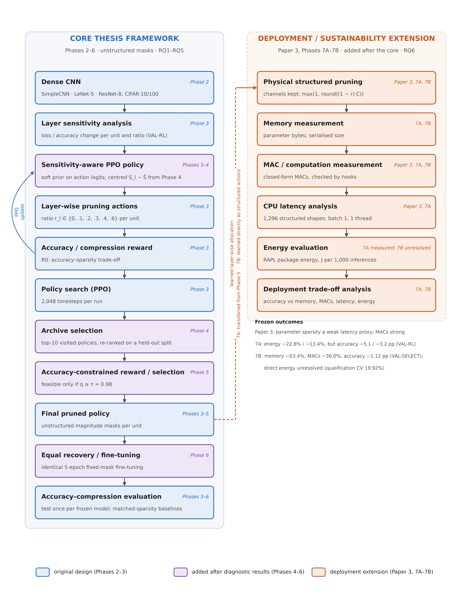

**Figure 3.1. Overall thesis framework.**
- **Left panel:** the core framework (Phases 2–6), working with unstructured pruning masks. Each component is tagged
  with the phase that introduced it. Blue marks the original design; purple marks components added after diagnostic
  results.
- **Right panel:** the deployment and sustainability extension (Paper 3, Phases 7A–7B), added after the core
  framework.
- **Dashed arrow:** in Phase 7A the learned layer-wise allocation is transferred to the extension. In Phase 7B it is
  learned directly as structured actions.

The chapter is organised as follows:
- **Sections 3.2–3.3:** the pruning problem and its layer-wise representation.
- **Sections 3.4–3.7:** the RL formulation, state, actions and initial reward.
- **Sections 3.8–3.10:** layer sensitivity and the two sensitivity priors.
- **Sections 3.11–3.13:** the retention problem and archive selection, then reward misalignment and the constrained
  reward.
- **Sections 3.14–3.15:** the mature core framework and the equal-recovery protocol.
- **Section 3.16:** the deployment extension.
- **Sections 3.17–3.18:** the algorithms and the computational workflow.

Table 3.2 lists the notation used throughout the thesis.

**Table 3.2. Notation.**

| Symbol | Meaning |
|---|---|
| M | trained dense network (the reference model) |
| N_L | number of pruning units (N_L = 4 for every architecture in this thesis) |
| l | index of a pruning unit, l = 1, …, N_L |
| 𝓡 | ratio set {0, 0.1, 0.2, 0.3, 0.4, 0.6} |
| a_l | action at unit l, a_l ∈ {0, …, 5} |
| r(a) | pruning ratio of action a: r(0..5) = 0, 0.1, 0.2, 0.3, 0.4, 0.6 |
| r_l | pruning ratio assigned to unit l, r_l = r(a_l) |
| **r** | pruning policy (allocation), **r** = [r_1, …, r_{N_L}]; equivalently the action vector **a** |
| M_**r** | network M pruned by policy **r** |
| s_l | state observed by the agent before deciding unit l |
| π_θ(a \| s) | PPO policy with parameters θ |
| S_l | normalised sensitivity of unit l, S_l ∈ [0, 1] |
| S̄ | mean sensitivity over units, S̄ = (1/N_L) Σ_l S_l |
| S̃_l | centred sensitivity, S̃_l = S_l − S̄ |
| c_l | prior coefficient of unit l (P1: c_l = 0.5·S_l; centred prior: c_l = 1.0·S̃_l) |
| A_b | accuracy of the dense reference on the reward split (VAL-RL) |
| A_p | accuracy of the pruned network M_**r** on the same split |
| q | retained accuracy, q = A_p / A_b |
| ρ | sparsity: percentage of zero weights over all convolutional and fully connected weights |
| D | number of distinct actions in **a** |
| R | episode reward |
| τ | retained-accuracy threshold of the constrained reward (τ = 0.98 in Phase 5) |
| 𝒜 | archive of unique visited policies |
| C_l | number of output channels (or neurons) of unit l before structured pruning |
| k_l | number of channels kept by structured pruning of unit l |
| MAC(**r**) | multiply–accumulate operations per image of the pruned network |
| T(**r**) | measured batch-1 CPU latency per inference (ms) |
| E(**r**) | measured CPU package energy per 1,000 inferences (J) |
| Ê(**r**) | surrogate (predicted) energy per 1,000 inferences, used only inside the Phase-7B search |

The letter L is deliberately not used on its own. N_L is the number of pruning units and T is latency.

## 3.2 Problem Formulation

Let M be a trained convolutional network whose prunable convolutional and fully connected layers are grouped into
N_L **pruning units**. A pruning policy assigns each unit a pruning ratio:

$$\mathbf{r} = [r_1, r_2, \ldots, r_{N_L}], \qquad r_l \in \mathcal{R} = \{0, 0.1, 0.2, 0.3, 0.4, 0.6\}. \tag{3.1}$$

Applying **r** to M yields the pruned network M_**r**. The uniform policy, r_1 = … = r_{N_L}, is one point in this
space. The framework searches for **non-uniform** allocations, because the units of a network differ in four ways:

- **Parameter contribution.** A small early convolution and a large fully connected layer hold very different shares
  of the weights.
- **Computation.** The arithmetic cost of a unit depends on its spatial resolution as well as its weight count.
- **Sensitivity.** Removing the same fraction of weights damages some units much more than others.
- **Downstream effect.** Pruning one unit changes the inputs of every later unit.

The amount of compression is measured by the sparsity ρ: the percentage of zero-valued weights over **all**
convolutional and fully connected weight tensors of the network, including the output classifier, which is never
pruned:

$$\rho(M_{\mathbf r}) = 100 \cdot \frac{\sum_{t} \#\{w \in t : w = 0\}}{\sum_t |t|}, \tag{3.2}$$

where t ranges over every Conv2d and Linear weight tensor. Biases and batch-normalisation parameters are not counted
and are never pruned.

**The goal** is conceptual, not a guaranteed optimum:

> *find a layer-wise policy **r** that balances predictive performance and compression, as specified by the reward
> and constraints in force.*

Formally, the agent maximises the expected episode reward,

$$\max_{\theta} \; \mathbb{E}_{\mathbf a \sim \pi_\theta}\big[ R(M_{\mathbf r(\mathbf a)}) \big], \tag{3.3}$$

where the reward R encodes the trade-off (Sections 3.7 and 3.13). Equation (3.3) defines what PPO optimises. It
does not claim that PPO finds the best policy: the policy space is searched stochastically, and the policy finally
returned is chosen by a separate selection rule (Sections 3.11–3.13). The thesis can measure how close the returned
policy comes to the best one, because in the experimental settings the space is small enough to enumerate
(Section 3.6).

## 3.3 Layer-Wise Pruning Representation

**Pruning units.** Each architecture registers exactly four pruning units (Table 3.3), so every setting has the same
action space. A unit consists of one or more weight tensors. A pruning action applies the same ratio to every tensor
in the unit. The output classifier is excluded in every architecture.

**Table 3.3. Pruning units of the core framework (unstructured).**

| Architecture | Unit 1 | Unit 2 | Unit 3 | Unit 4 | Never pruned |
|---|---|---|---|---|---|
| SimpleCNN | conv1 (`features.0`) | conv2 (`features.3`) | conv3 (`features.6`) | fc1 (`classifier.1`) | output layer (`classifier.3`) |
| LeNet-5 | conv1 | conv2 | fc1 | fc2 | output layer |
| ResNet-8 | stem convolution | stage 1 (both block convolutions) | stage 2 (both block convolutions and the 1×1 shortcut) | stage 3 (both block convolutions and the 1×1 shortcut) | output layer |

**Within-unit pruning (core framework).** In the core framework (Phases 3–6), a ratio r_l is applied as **L1
unstructured** pruning to every tensor of unit l: the round(r_l · |t|) smallest-magnitude weights of each tensor t are
masked to zero, using PyTorch's pruning reparameterisation [92]. The tensor shapes are unchanged.
The mask can be frozen during later fine-tuning (Section 3.15).

This choice keeps every pruned network a masked copy of the same dense network. It also allows the full policy space
of each setting to be evaluated once and cached, which is the basis of the exhaustive diagnostics used throughout the
thesis.

**Same actions, different structural meaning.** The four units cover different structures in different
architectures:
- **SimpleCNN:** a unit is a single layer.
- **ResNet-8:** a unit is a residual stage, so one action prunes several tensors at once.

When the deployment extension later realises policies as physically smaller networks (Section 3.16), the ResNet-8
units must be redefined around the residual coupling. The action indices keep their meaning as ratios, but the
structures they act on change. The two definitions should not be read as interchangeable.

## 3.4 Reinforcement Learning Formulation

Choosing **r** is represented as a **finite-horizon sequential decision process** with one decision per pruning unit.
An episode visits the units in their fixed order l = 1, …, N_L (Algorithm 3.1). At step l:

1. the agent observes a state s_l describing unit l and the decisions taken so far (Section 3.5);
2. it samples an action a_l ∼ π_θ(· | s_l) from the discrete action set (Section 3.6);
3. the environment applies ratio r(a_l) to unit l of the working copy of the network;
4. the next state s_{l+1} is formed from unit l + 1 and the updated history.

After the last unit (N_L = 4 steps), the pruned network M_**r** is evaluated on the reward split and the episode
reward R is paid. All intermediate rewards are zero. Each episode starts again from an unpruned copy of M.

The transition is deterministic given the actions, because pruning the same unit by the same ratio always produces
the same mask. The terminal reward depends only on the complete action vector. The state at each step summarises the
current unit and the cumulative pruning, but not the full history. The thesis does not claim that this state is a
sufficient statistic, so it does not claim the process is strictly Markov in the state. It is treated as a
sequential decision problem that PPO can optimise in practice.

**Why RL rather than enumeration?** With four units and six actions the space can be enumerated (Section 3.6), and
the thesis does so in order to *evaluate* the search. RL is used because the intended framework does not depend on
enumeration. The same agent and reward apply unchanged to architectures whose policy space is far too large to
enumerate, and to non-differentiable objectives such as measured hardware cost. The small settings serve as a
laboratory in which the behaviour of the search can be measured against ground truth.

## 3.5 State Representation

**Core framework (Phases 3–6).** The state is the seven-feature vector of the historical environment
(`src/rl`, `unit_state`), computed for the current unit l of N_L units:

$$s_l = \Big[\, \tfrac{l-1}{N_L-1},\;\; \log(1+n_l),\;\; \tfrac{n_l}{\max_j n_j},\;\; \overline{|w_l|},\;\; \sigma(w_l),\;\; \textstyle\sum_{j<l} r_j,\;\; \sigma^{\text{slot}}_l \,\Big], \tag{3.4}$$

where:
- n_l is the number of weights in unit l;
- \overline{|w_l|} and σ(w_l) are the mean absolute value and the standard deviation of its current weights;
- Σ_{j<l} r_j is the cumulative pruning ratio chosen so far;
- σ^slot_l is a sensitivity slot.

**The sensitivity slot was set to 0 in every condition of Phases 3, 4 and 5.** This was fixed in each phase's
pre-registration. In the core framework, sensitivity therefore never entered PPO through its *observation*. It
influenced action selection only through the soft action prior (Sections 3.9–3.10). After the last unit the state is
a zero vector.

**Deployment extension (Phase 7B).** The structured, energy-aware agent of Phase 7B (Section 3.16.3) uses a
different, eight-feature state, which does include centred sensitivity. The two state definitions are listed
separately in Table 3.4 and must not be mixed.

**Table 3.4. State features by phase.**

| # | State feature | Meaning | Phases used |
|---|---|---|---|
| 1 | (l − 1)/(N_L − 1) | position of the current unit | 3, 4, 5 |
| 2 | log(1 + n_l) | log weight count of the unit | 3, 4, 5 |
| 3 | n_l / max_j n_j | relative weight count | 3, 4, 5 |
| 4 | mean \|w_l\| | mean weight magnitude (current, masked weights) | 3, 4, 5 |
| 5 | σ(w_l) | weight standard deviation | 3, 4, 5 |
| 6 | Σ_{j<l} r_j | cumulative pruning ratio so far | 3, 4, 5 |
| 7 | sensitivity slot | **set to 0 in all Phase 3–5 conditions** | 3, 4, 5 (constant 0) |
| 1′ | (l − 1)/(N_L − 1) | position of the current unit | 7B |
| 2′ | log(1 + C_l) | log channel count of the unit | 7B |
| 3′ | unit share of dense parameters | parameter contribution | 7B |
| 4′ | unit share of dense MACs | computational contribution | 7B |
| 5′ | S̃_l | centred structured sensitivity | 7B |
| 6′ | r_{l−1} | ratio chosen for the previous unit | 7B |
| 7′ | mean_{j<l} r_j | mean ratio chosen so far | 7B |
| 8′ | Ê(partial policy) / Ê(dense) | predicted energy of the policy so far (remaining units at ratio 0), relative to dense | 7B |

## 3.6 Action Space

At each unit the agent chooses one of six actions, which map to pruning ratios:

$$r(a) \in \{0,\; 0.1,\; 0.2,\; 0.3,\; 0.4,\; 0.6\}, \qquad a \in \{0, 1, 2, 3, 4, 5\}. \tag{3.5}$$

That is, 0%, 10%, 20%, 30%, 40% or 60% of the unit's weights (core framework) or channels (structured extension). All
actions are always available; no action is masked.

A policy is the sequence of the four unit actions. The number of distinct policies is therefore

$$|\mathcal{R}|^{N_L} = 6^4 = 1{,}296 \tag{3.6}$$

in every setting. The highest single ratio is 0.6, so even the most aggressive policy [5, 5, 5, 5] leaves 40% of every
pruned tensor. The excluded classifier is never pruned, which caps the achievable total sparsity ρ of each
architecture below 60%.

The small space is a deliberate property of the experimental design. Every one of the 1,296 policies can be evaluated
once per setting and stored. This gives an exact reward landscape, so each policy's rank among all 1,296 is known.
Because of this, the thesis can measure:
- how good the policies are that PPO *visits*;
- how good the policy is that it *returns*;
- where the reward's own optimum lies.

The same count of 1,296 holds for every architecture, but the policies do not correspond across architectures. In
SimpleCNN, an action on unit 2 masks the selected fraction of the weights of a single convolution. For ResNet-8, an
action is applied to a residual-stage weight group, where the selected pruning ratio masks the corresponding fraction
of weights across the convolutional layers associated with that group; the residual stage itself is not structurally
removed (Table 3.3).

## 3.7 Initial Reward Function

The initial reward R0 was inherited from the original framework and frozen in Phase 3. It is paid at the end of each
episode:

$$R_0 = 1.5 \cdot \frac{A_p}{A_b} \; + \; \lambda_s \cdot \rho \; + \; 0.05 \cdot D, \qquad \lambda_s = 0.01. \tag{3.7}$$

| Symbol | Meaning |
|---|---|
| A_p | accuracy (%) of the pruned network M_**r** on the reward split (VAL-RL) |
| A_b | accuracy (%) of the dense reference on the same split, fixed per setting; A_p/A_b is the retained accuracy q |
| ρ | sparsity in **percent**, as defined in Equation (3.2) (global, parameter-based, over all Conv2d/Linear weights including the classifier) |
| D | number of distinct actions in the episode's action vector (1 to 4) |
| 1.5 | weight on retained accuracy |
| λ_s = 0.01 | weight per percentage point of sparsity |
| 0.05 | small bonus per distinct action |

The coefficients are fixed and were not tuned in any phase.

The **accuracy term** rewards keeping the pruned network close to the dense one. The **sparsity term** rewards
compression linearly. The **diversity term** gives a small bonus for using several different ratios. It was part of
the original design and acts as a mild incentive against trivially uniform policies.

One detail of the implementation history matters for reproducibility. The original notebook used λ_s = 0.04; the
library default still carries that value. Every frozen phase of this thesis (Phases 3, 4 and the R0 control in
Phase 5) uses λ_s = 0.01. The Phase-4 pre-registration records this correction explicitly.

Equation (3.7) trades accuracy against sparsity at a fixed exchange rate. It contains no threshold below which
accuracy loss becomes unacceptable. Section 3.13 returns to this point.

## 3.8 Layer Sensitivity Analysis

The sensitivity of a unit measures how much the network's loss increases when that unit alone is pruned. For the
core framework it is computed once per setting on the dense reference model, using only the reward split (VAL-RL),
never the selection split or the test set. The procedure (`src/sensitivity`, `loss_sensitivity`) is:

1. **Baseline loss.** Evaluate the dense model's mean cross-entropy loss L_0 on VAL-RL.
2. **Single-unit probes.** For each unit l and each probe ratio r ∈ {0.1, 0.2, 0.4, 0.6}, prune *only* unit l by r
   (L1 unstructured, as in Section 3.3), leaving every other unit dense. Evaluate the loss L_{l,r}.
3. **Raw sensitivity.** Average the relative loss increases over the probe ratios:

$$S_l^{\text{raw}} = \frac{1}{4} \sum_{r \in \{0.1, 0.2, 0.4, 0.6\}} \frac{L_{l,r} - L_0}{L_0}. \tag{3.8}$$

4. **Normalisation.** Min–max normalise across the units of the network:

$$S_l = \frac{S_l^{\text{raw}} - \min_j S_j^{\text{raw}}}{\max_j S_j^{\text{raw}} - \min_j S_j^{\text{raw}}} \in [0, 1]. \tag{3.9}$$

The most sensitive unit thus has S_l = 1 and the least sensitive has S_l = 0. Larger values mean that pruning the
unit raises the loss more. The normalisation makes sensitivities comparable across architectures, at the cost of
discarding their absolute scale. The probes use a loss-based measure, rather than accuracy, so that small
degradations that do not yet change predictions are still registered.

**Versions across phases.**
- **Phases 3 and 4:** computed on the 3,000-image VAL-RL split.
- **Phase 5:** recomputed on the redrawn 2,500-image VAL-RL split (Chapter 4).
- **Phase 7B:** the same definition, but with each unit pruned *structurally* (whole channels removed; Section 3.16),
  computed on the 2,500-image VAL-RL split.

In every case only VAL-RL data are used.

The single-unit probes measure each unit in isolation. They do not capture interactions between units, so
sensitivity is treated as *guidance* for the search, not as a substitute for it.

## 3.9 Sensitivity-Guided Action Prior

In the initial design, sensitivity guides the agent through a **soft prior on the action logits**. Let z_l(a) be the
logit that the PPO actor network assigns to action a at unit l. Before the action distribution is formed, the logits
are shifted:

$$\tilde z_l(a) = z_l(a) \; - \; c_l \cdot \frac{r(a)}{0.6}, \qquad \pi_\theta(a \mid s_l) = \operatorname{softmax}_a\big(\tilde z_l(a)\big). \tag{3.10}$$

Here c_l is the prior coefficient of unit l, and r(a)/0.6 rescales the ratio so that the most aggressive action has
weight 1. In Phase 3, c_l = β·S_l with β = 0.5 (condition P1, "correct prior"). The implementation
(`src/rl`, `SoftPriorPolicy`) identifies the current unit from the first state feature. It subtracts the
pre-computed matrix B[l, a] = c_l · r(a)/0.6 from the logits in every forward pass, both when actions are sampled and
when log-probabilities are evaluated during the PPO update.

The prior has the following effects:

- The penalty grows with both the unit's sensitivity and the aggressiveness of the action. Sensitive units are pushed
  towards small ratios; insensitive units (S_l near 0) are almost unaffected.
- Action 0 (no pruning) is never penalised.
- The prior **shifts preferences but does not replace the learned policy**. Every action keeps a non-zero
  probability, and the actor network can learn logits that override the prior. With c_l = 0 the policy is exactly
  standard PPO.

Phase 3 tested this prior against three controls with the same strength β = 0.5:
- **P0:** no prior.
- **P2, shuffled prior:** each unit receives another unit's sensitivity.
- **P3, constant prior:** every unit receives the mean sensitivity.

The controls separate the effect of *layer-specific* information from the effect of a generic bias towards lighter
pruning.

## 3.10 Centred Sensitivity Prior

The prior of Section 3.9 has a property that limits what it can show. Since every S_l ≥ 0, the total penalty
Σ_l c_l = β·Σ_l S_l is positive. The correct, shuffled and constant priors all carry the **same total
conservatism**: they all push the agent towards lighter pruning overall, and differ only in how that pressure is
distributed. Any benefit they share could come from this common "prune less" pressure rather than from information
about *which* units are sensitive.

Phase 4 therefore introduced a **centred** prior. It keeps only relative sensitivity:

$$\tilde S_l = S_l - \bar S, \qquad \bar S = \frac{1}{N_L}\sum_{j=1}^{N_L} S_j, \qquad c_l = 1.0 \cdot \tilde S_l, \tag{3.11}$$

used in Equation (3.10) in place of c_l = 0.5·S_l. Its coefficients sum to zero (Σ_l c_l = 0), so the prior carries
no net conservatism:

- **S̃_l > 0** (more sensitive than average): aggressive actions on unit l are penalised.
- **S̃_l < 0** (less sensitive than average): the penalty becomes a bonus, and aggressive actions on unit l are
  favoured.
- **Action 0** is unchanged, and low ratios are changed only slightly.

The prior therefore redistributes pruning from sensitive to insensitive units instead of reducing pruning
everywhere. This centred prior (condition "P2" in the Phase-4 and Phase-5 records) became the standard prior of the
core framework from Phase 4 onward.

Phase 4 evaluated it against controls built to isolate its mechanism:
- the Phase-3 prior;
- a centred prior whose values are permuted across units;
- a pure-conservatism prior, magnitude-matched with c_l = mean_j |S̃_j| for every unit;
- a sign-reversed prior, c_l = −S̃_l.

The sensitivity state slot remained 0 (Section 3.5). Sensitivity therefore acts on the search only through this prior.

## 3.11 Policy-Retention Problem

The initial design returns the agent's **terminal policy**: after training, the deterministic policy
a_l = argmax_a π_θ(a | s_l) is rolled out once, and the resulting action vector is the selected pruning policy.

This rule overlooks a methodological problem. During training, PPO samples hundreds of episodes, each of which
evaluates a complete policy. The policy that the agent's distribution has converged to at the end of training need
not be the best policy it sampled along the way. A stochastic policy-gradient method updates its distribution on
noisy, high-variance reward estimates. It can sample an excellent policy early and then drift towards a region of
high but not maximal average reward. Selecting only the terminal policy discards that information. The information
has already been paid for: every sampled policy required a full evaluation of a pruned network.

Because the reward landscape of each setting is known exactly (Section 3.6), the problem can be stated precisely. It
is the gap between:
- the rank of the **best policy sampled** during a run; and
- the rank of the **policy finally returned**.

When the first is consistently better than the second, the limitation lies in *retention and selection*, not in
exploration. Phase 4 identified this gap as a separate problem from search quality, and introduced archive-based
selection to address it.

## 3.12 Archive-Based Policy Selection

### 3.12.1 Archive (Phase 4)

During each PPO run, an **archive** 𝒜 records every unique policy sampled in a training episode. For each archived
policy it stores:

- the action vector **a**;
- its reward on the reward split (VAL-RL), which is the reward the agent was trained on;
- the index of the episode in which the policy was first sampled.

Duplicates are not stored twice: a policy sampled again keeps its first entry. Recording is read-only. It does not
change the training process and draws no random numbers.

### 3.12.2 Selection rule (Phase 4)

At the end of training, the archive is reduced to a candidate set and one candidate is selected on held-out data:

$$\mathcal{C} = \operatorname{top}_{10}\big\{ \mathbf a \in \mathcal{A} \text{ by } R_{\text{VAL-RL}}(\mathbf a) \big\}, \qquad \mathbf a^{\star} = \arg\max_{\mathbf a \in \mathcal{C}} R_{\text{VAL-SELECT}}(\mathbf a). \tag{3.12}$$

- 𝒞 is the 10 unique archived policies with the highest VAL-RL reward. Ties go to the earlier discovery.
- **a**⋆ is the candidate with the highest score on the **selection split** (VAL-SELECT) under the same reward
  formula. Ties go to the higher VAL-RL reward, then to earlier discovery.

The selection split is disjoint from the reward split and is never used during training. It is used only to choose
among candidates that the search has already produced (Chapter 4).

The two-stage rule addresses two risks:
- relying only on the final policy (Section 3.11);
- relying only on the best VAL-RL reward, which would favour candidates whose reward is inflated by noise in the
  reward split.

**Archive selection is a retention and selection mechanism based on validation evidence.** It decides which visited
policy is returned. It does not change what the agent learns, and its correctness is defined relative to the
validation splits, not the test set.

### 3.12.3 Elite behavioural cloning (Phase 4 only)

Phase 4 also tested a training-time complement to the archive. The best policies seen so far were used as additional
supervised targets for the PPO actor:

$$\mathcal{L} = \mathcal{L}_{\text{PPO}} + \eta \, \mathcal{L}_{\text{elite}}, \qquad \mathcal{L}_{\text{elite}} = -\frac{1}{4K} \sum_{e=1}^{K} \sum_{l=1}^{4} \log \pi_\theta\big(a^{(e)}_l \mid s^{(e)}_l\big), \tag{3.13}$$

- (s^(e)_l, a^(e)_l) are the state–action pairs of the K = 5 best unique VAL-RL-reward policies seen so far;
- η = 0.1;
- the term is active once at least five unique policies have been seen.

The PPO network remains the decision maker. The Phase-4 final pipeline combined this term with the archive rule
(condition S2A). Phase 5 removed behavioural cloning and kept the archive, so the mature core framework does not
include Equation (3.13). It is described here for historical completeness.

### 3.12.4 Constraint-aware selection (Phase 5)

When the reward was changed to the accuracy-constrained form (Section 3.13), the selection rule changed with it. The
candidates are still the top 10 archived policies by VAL-RL reward. The archive of all runs is frozen and hashed
*before* any VAL-SELECT evaluation. Among the candidates, the selected policy is

$$\mathbf a^{\star} = \arg\max_{\mathbf a \in \mathcal{C}} \Big\{ \rho(\mathbf a) \;:\; q_{\text{VAL-SELECT}}(\mathbf a) \geq \tau \Big\}, \tag{3.14}$$

that is, the **most compressed candidate whose retained accuracy on the selection split meets the threshold**. The
rule handles edge cases as follows:
- **Ties** go to higher VAL-SELECT accuracy, then higher VAL-RL reward, then earlier discovery.
- **Fallback:** if no candidate meets the threshold, the candidate with the highest q_VAL-SELECT is chosen, and the
  fallback is reported.

This rule makes the selection objective match the constraint used in training. Training rewards compression inside
the feasible region; selection then confirms feasibility on held-out data.

## 3.13 Reward Misalignment and Accuracy-Constrained Reward

### 3.13.1 Why R0 can encourage excessive pruning

Equation (3.7) converts accuracy and sparsity into one scalar at a fixed rate. Under R0, an extra percentage point of
sparsity is worth 0.01, and an extra percentage point of retained accuracy is worth 0.015. A policy that gives up
some accuracy for enough sparsity can therefore score *higher* than a gentler policy, however damaging the accuracy
loss is in practice. R0 has no region in which accuracy loss becomes unacceptable. Whether its optimum is a
reasonable model depends on each setting's accuracy–sparsity landscape. In fragile architectures, the reward-optimal
policy can be one a practitioner would reject.

A weak optimiser hides this problem, because it rarely finds the reward-optimal region. Once search and retention
improve (Sections 3.10–3.12), the agent becomes better at finding exactly what the reward specifies. This is a
pruning instance of the general observation that more capable optimisers exploit misspecified rewards more strongly
[17], [89]. Phase 4 also tested alternative trade-off rewards, with sparsity
targets and normalised axes. None met its pre-registered criterion, so R0 was retained for Phase 4, and Phase 5
redesigned the reward around an explicit constraint.

### 3.13.2 Accuracy-constrained reward (Phase 5)

The Phase-5 reward is constraint-first. With q = A_p/A_b on VAL-RL and the sparsity ρ written as a fraction
(ρ/100):

$$R_{\text{c}} = \begin{cases} 1 + \dfrac{\rho}{100} + \varepsilon \, q, & q \geq \tau, \\[1.2ex] -\kappa \, (\tau - q), & q < \tau, \end{cases} \qquad \tau = 0.98,\;\; \varepsilon = 0.01,\;\; \kappa = 10. \tag{3.15}$$

| Symbol | Meaning |
|---|---|
| τ = 0.98 | retained-accuracy threshold: a policy is *feasible* if it keeps at least 98% of the dense VAL-RL accuracy. It was chosen before any PPO run, by a pre-registered rule on the VAL-RL landscapes (Chapter 4); the test set was not used. |
| 1 | offset that makes every feasible reward larger than every infeasible one |
| ρ/100 | compression reward, paid only inside the feasible region |
| ε·q, ε = 0.01 | small tie-breaker that prefers higher accuracy among equally sparse feasible policies |
| κ = 10 | penalty slope for infeasible policies, proportional to the shortfall below τ |

There is no diversity term.

The design principle is that **compression is rewarded only inside the acceptable-accuracy region**:
- Any feasible policy (reward ≥ 1) is worth more than any infeasible one (reward < 0).
- Among feasible policies, more sparsity is better.
- Among infeasible policies, smaller accuracy shortfalls are penalised less. This keeps a learning signal pointing
  back towards the feasible region instead of a flat penalty.

Under Equation (3.15), the reward-optimal policy is the most compressed feasible policy on VAL-RL. It is the
policy that matches a stated tolerance of 2% relative accuracy loss on VAL-RL.

Two limitations are inherent to the design and are examined empirically in Chapter 5:
- **Validation feasibility.** The constraint is defined on a validation split, so feasibility on VAL-RL does not imply
  feasibility on unseen data.
- **Unit of τ.** τ is a *relative* threshold on retained accuracy; it is not an absolute accuracy bound.

In Phase 5, sensitivity guidance (the centred prior of Section 3.10) was kept as an exploration mechanism. One
condition used the prior and an otherwise identical condition did not, so its contribution could be measured
separately.

## 3.14 Final Core Framework

The mature core framework combines the components that survived the diagnostic sequence. Table 3.5 separates
**search** components, which determine the selected policy, from **evaluation** components, which determine how a
selected policy is assessed.

**Table 3.5. Mature core framework (as frozen after Phase 5, evaluated in Phase 6).**

| Stage | Component | Type | Section |
|---|---|---|---|
| 1 | Dense reference model M, trained once per setting | input | 3.2 |
| 2 | Normalised loss sensitivity S_l on VAL-RL | search (guidance) | 3.8 |
| 3 | PPO over four units with six ratio actions; seven-feature state (sensitivity slot 0) | search | 3.4–3.6 |
| 4 | Centred sensitivity prior, c_l = 1.0·S̃_l, on the action logits | search (guidance) | 3.10 |
| 5 | Accuracy-constrained reward R_c with τ = 0.98 on VAL-RL | search | 3.13 |
| 6 | Archive of unique visited policies; top-10 candidates by VAL-RL reward | search (retention) | 3.12 |
| 7 | Constraint-aware selection on VAL-SELECT | search (selection) | 3.12.4 |
| 8 | Selected pruning policy **a**⋆, applied as unstructured masks | output | 3.3 |
| 9 | Equal fixed-mask recovery (5 epochs, identical for every method) | **evaluation** | 3.15 |
| 10 | Test evaluation, once per frozen model; matched-sparsity baselines | **evaluation** | Chapter 4 |

The mature framework differs from the initial version in four respects:
1. the prior is centred;
2. the returned policy is chosen from an archive on held-out data, not taken from the terminal policy;
3. the reward is constraint-first rather than a fixed trade-off;
4. the selection rule enforces the same constraint on held-out data.

Behavioural cloning was tested in Phase 4 and dropped. The state is unchanged throughout.

Equal recovery (stage 9) is **not part of PPO's decision making**. The agent's reward is always computed on the
pruned network *without* fine-tuning. Recovery is applied only after a policy has been selected, identically to every
compared method, so that the final comparison reflects the allocation rather than differences in recovery budgets.

## 3.15 Equal Recovery and Fine-Tuning Protocol

Pruning methods differ in how much accuracy they lose *immediately*. In deployment, however, a pruned network is
normally fine-tuned before use, and recovery can reduce or reverse those differences
[14], [15]. To compare allocations fairly after recovery, Phase 6 applied one fixed
protocol to every compared model (`experiments/phase6/phase6_lib.py`, `PROTOCOL` and `finetune`).

**Optimiser and schedule:**
- Adam with learning rate 1×10⁻⁴, β = (0.9, 0.999), ε = 1×10⁻⁸ and no weight decay.
- Cosine annealing to zero over E epochs, stepped once per epoch:

$$\eta_e = \tfrac{1}{2}\,\eta_0 \big(1 + \cos(\pi e / E)\big), \qquad \eta_0 = 10^{-4},\; e = 0, \ldots, E-1. \tag{3.16}$$

**Budget and data:**
- E = 5 epochs, fixed in advance by a timing rule (Chapter 4).
- Batch size 128.
- Augmentation: random 32×32 crop with 4-pixel zero padding, plus random horizontal flip.

**Mask:**
- The pruning mask is **frozen**, using PyTorch's pruning reparameterisation. Masked weights stay exactly zero.
- The mask and per-layer zero counts are checked after every epoch.
- No pruned weight may regrow, and no new weight may be pruned.

**Batch normalisation:**
- Training mode during fine-tuning, so running statistics are updated identically for every method.
- Evaluation mode for every evaluation.

**Seeds and selection:**
- Fine-tuning seed = policy seed + 100.
- The PPO, LAMP and global-magnitude models that form one comparison triple share the fine-tuning seed, and hence
  the same data order.
- No checkpoint selection: the model after the final epoch is used.

The protocol is deliberately modest and identical across methods. It does not attempt to maximise any method's
recovered accuracy, which would require method-specific tuning. Instead it gives every allocation the same
opportunity to recover.

The same protocol is reused in the deployment extension:
- **Phase 7A:** 5 epochs, seed 600, one shared data stream.
- **Phase 7B:** 5 epochs for final models. The Phase-7B accuracy proxy (Section 3.16.3) uses the same procedure
  shortened to 2 epochs.

In those phases it is applied to physically compacted networks, which have no masks to freeze.

## 3.16 Deployment-Oriented Structured Extension

> **This section describes a later extension.** It was developed after the core framework (Phases 3–6) had been
> completed and evaluated. Its purpose is to test whether the compression produced by layer-wise pruning becomes
> real deployment efficiency (Research Question 6). It is not part of the original design, and the energy-aware
> agent of Section 3.16.3 is a separate, deployment-oriented variant evaluated on its own terms. It is not the final
> form of the core method.

### 3.16.1 From masks to physical structure

The core framework produces **unstructured** masks: the pruned network has the same tensor shapes as the dense one,
with zeros in place of removed weights. On general-purpose CPUs such zeros are still stored and multiplied unless
sparse kernels are used, so parameter sparsity need not reduce latency or energy
[7], [8].

The extension therefore realises a layer-wise allocation as a **physically smaller dense network**, using structured
channel (filter) and neuron removal [22], [23]. For a unit with C_l output channels or neurons
and ratio r_l, the number of channels kept is

$$k_l = \max\!\big(1, \operatorname{round}((1 - r_l)\, C_l)\big), \tag{3.17}$$

and the k_l channels with the largest L1 filter norms are kept (ties go to the lower index). Importance is always
computed on the dense model, so the result does not depend on the order in which units are compacted
(`src/pruning/structured_units.py`).

**Propagation.** Removing an output channel also removes the corresponding input channel of every layer that reads
it:
- in SimpleCNN, the next convolution or, through the flatten operation, the corresponding columns of the first fully
  connected layer;
- the input of the output classifier, when hidden neurons of the last hidden layer are removed.

The output layer itself is never pruned.

**Residual coupling (ResNet-8).** In a residual network, every layer that writes to or reads from the same residual
stream must keep the same channel set. The structured units of ResNet-8 are therefore defined differently from the
unstructured units of Table 3.3:

- **Stem unit.** It controls the stage-1 residual width. The stem convolution and the second convolution of the
  stage-1 block (both write the stream), and every layer that reads it, are cut on one shared channel set. The
  channels are ranked by the combined L1 norm of the two filters that write each channel.
- **Stage units.** Each stage unit removes only *block-internal* channels: the outputs of the block's first
  convolution and the matching inputs of its second convolution.

The stage-2 and stage-3 output widths and the classifier are not pruned. The same action index therefore has a
different structural meaning in ResNet-8 than in SimpleCNN, and a policy learned for unstructured ResNet-8 units maps
onto the structured units only approximately.

### 3.16.2 Measurement: three levels of deployment efficiency

A compacted network can be assessed at three related but non-interchangeable levels (Table 3.6). The levels are used
throughout Chapter 6. A result at one level does not establish a result at the next.

**Table 3.6. Three levels of deployment efficiency.**

| Level | Quantity | Definition in this thesis |
|---|---|---|
| 1. Memory / compression | parameter memory | Σ over parameters of (number of elements × element size) in bytes; serialised checkpoint size as a secondary measure |
| 2. Computation | MACs; latency T(**r**) | multiply–accumulate operations per image of all convolutional and linear layers, from a closed form checked against forward hooks; measured batch-1 CPU latency |
| 3. Operational energy | E(**r**) | CPU package energy per 1,000 inferences, read from the Intel RAPL counters through the Windows Energy Meter Interface; no TDP-based or modelled estimate |

The measurement protocols (pinned core, thread counts, warm-up, sessions, stability criteria) are specified in
Chapter 4.

### 3.16.3 Two uses of the extension

**(a) Structured transfer of the learned allocation (Phase 7A).** Phase 7A asks whether an allocation learned for
*masked* pruning transfers to *structured* deployment. The workflow is:

1. Take the most frequently selected Phase-5 policy of the mature core framework.
2. Interpret its action indices as structured ratios (Equation 3.17).
3. Build the physically compacted network.
4. Recover it with the equal protocol of Section 3.15.
5. Measure memory, MACs, latency and energy, against a dense model and structured comparators recovered identically.

The PPO agent is not retrained in this workflow. Phase 7A therefore tests the transfer of an allocation, not a new
search.

**(b) Structured, energy-aware PPO (Phase 7B).** Phase 7B redesigns the agent to search directly in the structured
space of one architecture (SimpleCNN):

- **Actions.** Structured ratios per unit (Equation 3.17), so every action vector is a physical channel-width
  configuration.
- **State.** The eight features of Table 3.4 (rows 1′–8′), including centred structured sensitivity S̃_l.
- **Prior.** The centred prior of Equation (3.10), with c_l = 1.0·S̃_l, computed from structured sensitivity.
- **Accuracy proxy.** Training every candidate to full recovery would be too expensive, so feasibility is judged by
  an accuracy proxy q̂ = A_2/A_2,dense. Here A_2 is the VAL-RL accuracy after a 2-epoch version of the recovery
  protocol, and A_2,dense is the same quantity for the dense model. The proxy and its threshold τ̂ were validated
  against 5-epoch recovery before the search (Chapter 4).
- **Energy surrogate.** Measuring energy inside the search is not feasible, so the reward uses a surrogate fitted
  before the search to directly measured energies of sampled policies. The accepted surrogate is linear in the
  policy's measured batch-1 latency T_table (Paper 3 latency tables):

$$\hat E(\mathbf r) = a + b \cdot T_{\text{table}}(\mathbf r), \qquad a = -0.117,\; b = 13.762 \;\; (\text{J per 1,000 inferences; } T \text{ in ms}). \tag{3.18}$$

  The surrogate makes the search computationally feasible. **It is not a measurement**, and a predicted saving is
  never reported as an energy result. Any energy claim about a final model requires direct hardware measurement
  under a qualified protocol (Chapter 6).
- **Reward.** Constraint-first, as in Equation (3.15), with the compression term replaced by the predicted energy
  saving:

$$R_{\text{7B}} = \begin{cases} 1 + \alpha \, \dfrac{\hat s(\mathbf r)}{s_{\max}} + \varepsilon \, \hat q, & \hat q \geq \hat\tau, \\[1.2ex] -\kappa\,(\hat\tau - \hat q), & \hat q < \hat\tau, \end{cases} \qquad \hat s(\mathbf r) = 1 - \frac{\hat E(\mathbf r)}{\hat E(\text{dense})}, \tag{3.19}$$

  where:
  - s_max is the largest predicted saving over the 1,296 policies;
  - α = 4 was fixed on development seeds before the confirmatory runs;
  - ε = 0.01 and κ = 10, as in Phase 5.
- **Feasible archive and selection.** Every unique *feasible* policy visited is archived. The selected policy is the
  one with the lowest predicted energy. Policies within 1% of the minimum count as tied; ties go to higher proxy
  accuracy, then fewer MACs, then lower parameter memory, then the smaller action vector.
- **Seeds.** Confirmatory runs used 20 seeds fixed in a pre-registration. The primary policy is the one selected most
  often across seeds.

Phase 7B thus carries the core framework's ideas into the deployment setting: sensitivity guidance, a
constraint-first reward, an archive with held-out-style selection, and equal recovery. It adds a proxy and a
surrogate, which are needed only to make the search affordable. Its evaluation criteria (accuracy, memory, MACs,
latency and measured energy) are defined in Chapter 4, and its outcomes are reported in Chapter 6.

## 3.17 Overall Algorithm

Algorithm 3.1 summarises the mature core framework. Algorithm 3.2 summarises the deployment extension's evaluation
workflow. They are kept separate so that the core framework is not confused with the extension.

**Algorithm 3.1 — Sensitivity-aware adaptive pruning with archive selection and accuracy constraint (core framework).**

```
Input:  trained dense network M with pruning units 1..N_L; ratio set R = {0, .1, .2, .3, .4, .6};
        reward split VAL-RL; selection split VAL-SELECT; threshold tau = 0.98;
        PPO hyper-parameters (Table 3.7); episodes E_ep = 512; archive size K_c = 10
Output: selected pruning policy a*; pruned network M_a*

 1  A_b <- accuracy of M on VAL-RL
 2  for each unit l: S_raw[l] <- mean_{r in {.1,.2,.4,.6}} (Loss(M with only unit l pruned by r) - Loss(M)) / Loss(M)   (3.8)
 3  S <- min-max normalise S_raw; c[l] <- 1.0 * (S[l] - mean(S))                                                        (3.9),(3.11)
 4  initialise PPO actor-critic pi_theta, V_phi; archive Arch <- empty map
 5  for episode = 1 .. E_ep:
 6      M' <- copy of M; actions <- []
 7      for l = 1 .. N_L:
 8          s_l <- state of unit l (seven features; sensitivity slot = 0)                                                (3.4)
 9          logits <- actor(s_l) - c[l] * r(a)/0.6 for every action a                                                    (3.10)
10          a_l ~ softmax(logits); prune every tensor of unit l of M' by r(a_l) (L1 unstructured); append a_l
11      A_p <- accuracy of M' on VAL-RL; rho <- sparsity of M' (all conv/linear weights)                                 (3.2)
12      R <- R_c(A_p / A_b, rho; tau)                                                                                    (3.15)
13      if actions not in Arch: Arch[actions] <- (R, episode)
14      store transitions (rewards 0 at l < N_L, R at l = N_L); every 64 steps: PPO update (clipped objective)            (3.20)
15  C <- the 10 entries of Arch with the highest R (ties: earlier episode)                                               (3.12)
16  freeze C; evaluate every candidate on VAL-SELECT
17  a* <- argmax rho over {a in C : q_VAL-SELECT(a) >= tau}; ties: higher VAL-SELECT accuracy, higher R, earlier;
        if the set is empty: a* <- argmax q_VAL-SELECT (reported fallback)                                               (3.14)
18  M_a* <- M pruned by a*
19  [evaluation] recover M_a* with the equal fixed-mask protocol (5 epochs; Section 3.15), identically for every method
20  [evaluation] evaluate on the test set once, after the model is frozen
```

Steps 1–18 are search. Steps 19–20 are evaluation and do not influence the selected policy. The earlier versions of
the framework are obtained by substituting:

| Version | Prior coefficient | Reward | Selection |
|---|---|---|---|
| Phase 3 | c_l = 0.5·S_l | R0 (Equation 3.7) | terminal deterministic policy (steps 15–17 replaced) |
| Phase 4 | c_l = 1.0·S̃_l | R0 | Equation (3.12); behavioural cloning (Equation 3.13) added to the PPO loss |

**Algorithm 3.2 — Deployment-oriented structured evaluation (extension; Phases 7A–7B).**

```
Input:  dense network M; a structured policy a (7A: transferred from the core framework;
        7B: selected by the structured, energy-aware PPO); comparator policies; recovery protocol
Output: accuracy, parameter memory, MACs, latency and measured energy of each model

 1  for each model (dense, a, comparators):
 2      k_l <- max(1, round((1 - r(a_l)) * C_l)) for every unit; keep the k_l channels with largest L1 norm          (3.17)
 3      build the physically compacted network; propagate removed channels to the layers that read them
        (ResNet-8: shared channel set across the residual stream)
 4      recover with the equal protocol (5 epochs, identical seed and data stream); record VAL-RL / VAL-SELECT accuracy
 5      Level 1: parameter memory (bytes) and serialised size
 6      Level 2: MACs (closed form, hook-checked); batch-1 CPU latency
 7  qualify the energy instrument on the dense model (pre-registered stability criterion)
 8  if qualified: Level 3: paired sessions of package energy per 1,000 inferences, dense anchor in every session
    else: report energy as unresolved (no estimate is substituted)
```

**Table 3.7. PPO configuration (identical in Phases 3, 4, 5 and 7B).**

| Setting | Value |
|---|---|
| Implementation | Stable-Baselines3 PPO [54] |
| Actor and critic | MLP with two hidden layers of 64 units, tanh activations, orthogonal initialisation |
| Optimiser | Adam, learning rate 3×10⁻⁴ |
| Rollout length / minibatch / epochs per update | n_steps = 64, batch size 32, 10 epochs |
| Discount γ / GAE λ | 0.99 / 0.95 |
| Clipping range ϵ | 0.2 |
| Entropy coefficient / value coefficient / gradient clipping | 0.01 / 0.5 / 0.5 |
| Training budget | 2,048 timesteps = 512 episodes of 4 steps per run |
| Threads | 1 per run |

**PPO objective.** PPO [11] updates the actor by maximising the clipped surrogate objective, with
advantages estimated by generalised advantage estimation [53]:

$$\mathcal{L}^{\text{PPO}}(\theta) = \mathbb{E}_t\!\Big[\min\!\big(\kappa_t(\theta)\hat A_t,\; \operatorname{clip}(\kappa_t(\theta), 1-\epsilon, 1+\epsilon)\hat A_t\big)\Big] - c_v\,\mathbb{E}_t\big[(V_\phi(s_t) - \hat R_t)^2\big] + c_e\,\mathbb{E}_t\big[\mathcal{H}(\pi_\theta(\cdot\mid s_t))\big], \tag{3.20}$$

where:
- κ_t(θ) = π_θ(a_t | s_t) / π_θold(a_t | s_t) is the probability ratio;
- Â_t is the advantage estimate;
- R̂_t is the return target;
- 𝓗 is the policy entropy;
- ϵ = 0.2, c_v = 0.5 and c_e = 0.01 (Table 3.7).

The sensitivity prior enters through π_θ, since the shifted logits of Equation (3.10) define the distribution in both
κ_t and 𝓗. The behavioural-cloning term of Equation (3.13) is added to the loss only in the Phase-4 S2 runs.

## 3.18 Computational Workflow and Reproducibility

Three design choices make the framework's behaviour measurable and its results reproducible. Their implementation
details are given in Chapter 4.

1. **Exhaustive landscapes as a reference.** In every setting, all 1,296 policies are evaluated once on the reward
   split and once on the selection split, at one thread. PPO's terminal evaluations are read from this cache. The
   cache returns exactly the value a live evaluation would. It is built to consume the global random stream exactly
   as an uncached run does, so cached and uncached runs are identical. This turns each PPO run into an *auditable
   search* over a known space. Every policy it visits or returns has a known rank.
2. **Strict separation of data roles.**
   - The training split updates weights only.
   - The reward split (VAL-RL) drives sensitivity, reward and training.
   - The selection split (VAL-SELECT) is used only to choose among frozen archive candidates.
   - The test set is read once per model, after the model is frozen and hashed.

   The archive is frozen before any selection-split evaluation, and the final policy list is frozen before any test
   evaluation.
3. **Fixed, pre-registered configurations.** Every phase fixed before its confirmatory runs:
   - reward constants, prior coefficients, thresholds, seeds and selection rules;
   - the recovery protocol and decision criteria.

   No constant was tuned on test data, and no threshold was changed after results were seen. The library
   implementation was verified to reproduce the historical environment bit for bit (Phase 2).

**Computational cost.** For one run:
- 512 training episodes, each needing one pruned-network evaluation, which comes from the cache in the experiments;
- 64-step PPO updates;
- for the core framework, one VAL-SELECT evaluation of 10 archived candidates.

Equal recovery costs 5 training epochs per model. The deployment extension adds structured compaction, hardware
measurements and, in Phase 7B, a proxy landscape of 2-epoch recoveries for all 1,296 structured policies. This cost,
compared with deterministic methods that need no search, is discussed in Chapter 7.

## 3.19 Chapter Summary

This chapter presented the framework in the order in which it was developed.

- **Initial design.** The core is a finite-horizon decision process in which a PPO agent assigns one of six pruning
  ratios to each of four units. It observes a seven-feature state and receives a terminal reward. The initial reward
  R0 trades retained accuracy against global sparsity at a fixed rate. Sensitivity was measured by single-unit loss
  probes and entered the agent only as a soft prior on the action logits, never as an active state feature.
- **Phase 4** centred the prior, so that it expresses relative sensitivity without net conservatism. It also
  identified the gap between the policies PPO visits and the policy it returns, and added an archive with held-out
  selection.
- **Phase 5** replaced the fixed trade-off with a constraint-first reward, which pays for compression only when at
  least 98% of the dense accuracy is retained, and matched the selection rule to that constraint.
- **Phase 6** added no search component. It fixed an equal, mask-preserving recovery protocol so that all methods
  could be compared after identical fine-tuning.
- **Deployment extension.** Separately and later, the extension realises allocations as physically smaller networks
  and evaluates them at three levels: memory, computation and measured energy. Phase 7A transfers the core
  framework's allocation to structured form. Phase 7B redesigns the agent to search directly in the structured
  space, using a validated accuracy proxy and a latency-based energy surrogate, neither of which is treated as a
  measurement.

Chapter 4 specifies the experimental setup used to evaluate each component, and Chapters 5 and 6 report the results.


# Chapter 4 — Experimental Setup

## 4.1 Experimental Design Overview

Chapter 3 defined the framework. This chapter specifies how it was evaluated, in enough detail for every experiment
to be reproduced and audited. It reports no results. A fixed design constant or a pre-registered stopping outcome is
stated where the design cannot be understood without it. Outcomes appear in Chapter 5 (core framework, Phases 3–6)
and Chapter 6 (deployment extension).

**Pre-registration.** Every phase committed its conditions, seeds, metrics, statistical tests and decision criteria to
the repository before any confirmatory run. Each phase treats the earlier phases as frozen evidence, read only and
verified by hash.

**Preparatory phases.** Two phases precede the experiments reported here:
- **Phase 1** audited an earlier pipeline. It found that the test set had been used for reward, sensitivity and epoch
  selection, and labelled that pipeline superseded. All reported experiments follow the leakage-guarded protocol
  adopted after the audit (Section 4.3).
- **Phase 2** fixed the splits, trained the dense references and verified the shared code library.

**Two experimental blocks:**
1. **Core framework (Phases 3–6).** Mask-based pruning on six architecture–dataset settings, run on a desktop CPU.
2. **Deployment extension (Paper 3, Phases 7A and 7B, and an energy confirmation study).** Physically compacted
   networks, measured on a laptop CPU.

## 4.2 Datasets

The experiments use CIFAR-10 and CIFAR-100 [93].

**Data.** Both datasets consist of 32×32 RGB images: 50,000 official training images and 10,000 official test
images. CIFAR-10 has 10 classes. CIFAR-100 is used with its 100 fine labels.

**Preprocessing.** Images are scaled to [0, 1] and normalised per channel. The constants are computed on the official
50,000-image training file; no test image enters them.

| Dataset | Mean (R, G, B) | Standard deviation (R, G, B) |
|---|---|---|
| CIFAR-10 | 0.4914, 0.4822, 0.4465 | 0.2470, 0.2435, 0.2616 |
| CIFAR-100 | 0.5071, 0.4865, 0.4409 | 0.2673, 0.2564, 0.2762 |

**Augmentation.** All training uses random 32×32 crops with 4-pixel zero padding and random horizontal flips. This
covers dense training (Phase 2) and every fine-tuning or recovery run (Phases 6, 7A, 7B and Paper 3). Evaluation is
never augmented. Pruning without fine-tuning (Phases 3–5) involves no training.

**Which experiments use which dataset:**
- **Both datasets:** Phases 2–6, and the Paper 3 latency tables.
- **CIFAR-10 only:** the Paper 3 accuracy and proxy experiments, Phase 7A, Phase 7B and the energy confirmation study.

## 4.3 Dataset Partitioning and Validation Protocol

### 4.3.1 Training, validation and test

For both datasets, a fixed permutation of the 50,000 training indices (`torch.randperm`, seed 42) assigns:
- 45,000 images to **training**;
- the last 5,000 to **validation**.

The official 10,000 images are the **test** set. CIFAR-10 and CIFAR-100 use identical index lists, recorded with
hashes in split manifests.

### 4.3.2 Two validation configurations

The validation set is split into two class-stratified, disjoint parts with fixed roles:
- **VAL-RL** (reward split) drives sensitivity, rewards and PPO training.
- **VAL-SELECT** (selection split) only chooses among candidates the search has already produced.

The sizes changed once (Table 4.1). The change was declared in the Phase-5 design commitments before any Phase-5
data existed.

- **Configuration I (Phases 3–4): 3,000 / 2,000.** Each class gives about 60% of its validation images to VAL-RL.
  Per-class sizes use largest-remainder rounding, and positions are drawn by per-class permutation (seed 20260928).
  The phase records call these splits V_RL and V_SELECT.
- **Configuration II (Phase 5 onward): 2,500 / 2,500.** The same rule with seed 20260930. Per class, the two halves
  differ by at most one image.

**Why the configuration changed.** The Phase-5 design review found a bias in Phase 4: its final search variant had
been chosen by the VAL-SELECT rank of policies that the archive had itself selected on VAL-SELECT. Phase 5 removed the
bias in three ways:
1. a new balanced split;
2. conditions fixed in advance, so no method was chosen from data;
3. no inference about conditions from the VAL-SELECT metrics of VAL-SELECT-selected policies.

**Overlap with configuration I.** Of the 3,000 configuration-I VAL-RL images, 1,521 (CIFAR-10) and 1,515 (CIFAR-100)
fall into the new VAL-SELECT. Sensitivity was therefore recomputed rather than reused.

**Naming.** Throughout the thesis, VAL-RL and VAL-SELECT name *roles*, and the configuration is stated with every
accuracy. Accuracies from different configurations, or from different splits, are never compared.

**Table 4.1. Datasets and split configurations.**

| Item | CIFAR-10 | CIFAR-100 |
|---|---|---|
| Image size / classes | 32×32 RGB / 10 | 32×32 RGB / 100 (fine) |
| Training / full validation | 45,000 / 5,000 | 45,000 / 5,000 |
| Configuration I (Phases 3–4): VAL-RL / VAL-SELECT | 3,000 / 2,000 (seed 20260928) | 3,000 / 2,000 (seed 20260928) |
| Configuration II (Phase 5 on): VAL-RL / VAL-SELECT | 2,500 / 2,500 (seed 20260930) | 2,500 / 2,500 (seed 20260930) |
| Test | official 10,000 | official 10,000 |

### 4.3.3 Use of each split by phase

Table 4.2 gives the role of every split in every phase. Three rules hold throughout:
- training images only update weights;
- the reward split never selects the returned policy;
- the test set never informs a search, selection or design choice.

**Table 4.2. Data-split usage by phase.**

| Phase | Training | VAL-RL | VAL-SELECT | Test |
|---|---|---|---|---|
| 2 Dense references | weight updates | — (full validation selects the epoch) | — | once per hashed reference |
| 3 | not used | I: sensitivity, reward, landscape, exploration metrics | not used | once per frozen final policy and matched baseline; confirmatory |
| 4 | not used | I: reward, training, search metrics, Stage-A/B selections | I: archive re-ranking, held-out ranks, Stage-C selection | locked until all selections and final policies were frozen; confirmatory |
| 5 | not used | II: sensitivity, choice of τ, reward, training, archive candidates | II: selection among frozen candidates only | after the final-policy list was committed; confirmatory |
| 6 | fine-tuning | II: recorded per epoch; no selection | II: recorded per epoch; no selection | after the 480 final checkpoints were committed; confirmatory |
| Paper 3 | recovery | II: recovered accuracy, proxy validation, threshold calibration | II: stored, not analysed | not read |
| 7A | recovery | II: **primary** accuracy criterion | II: secondary | not used |
| 7B | proxy and final recovery | II: sensitivity, proxy, reward, archive | II: held out; **final** accuracy criterion | never read |
| 7B energy confirmation | — | — | 7B values, read only | — |

**Two consequences for interpretation:**
- **Phase 7A.** The transferred policy was trained on VAL-RL rewards and selected on VAL-SELECT in Phase 5. Its
  validation accuracy may therefore be optimistically biased relative to the baselines. The Phase-7A pre-registration
  records this bias.
- **Phases 7A and 7B.** No frozen test protocol existed for the new structured models, so these phases report
  validation accuracy only.

## 4.4 Neural Network Architectures

The three networks are defined in the shared library (`src/models`). Where an implementation differs from the
canonical design, the implementation is described.

**SimpleCNN** (the historical network of the thesis):
- three 3×3 convolutions (padding 1, with bias) with 32, 64 and 128 filters, each followed by ReLU and 2×2
  max-pooling;
- flattening to 2,048 features;
- a 256-unit fully connected hidden layer with ReLU;
- an output layer of C units.

It has no batch normalisation and no dropout. The module names match the historical code, so the original checkpoint
loads unchanged.

**LeNet-5, adapted to CIFAR.** The LeNet-5 topology [94] for three-channel 32×32 input:
- two 5×5 valid convolutions with 6 and 16 filters, each followed by ReLU and 2×2 max-pooling;
- fully connected layers 400 → 120 → 84 with ReLU;
- an output layer of C units.

The adaptation uses ReLU and max-pooling instead of the original sigmoidal units and trainable subsampling.

**ResNet-8.** The CIFAR residual network [95] with n = 1, i.e. 6n + 2 = 8 weight layers:
- a 16-channel 3×3 stem convolution with batch normalisation;
- three single-BasicBlock stages with 16, 32 and 64 channels and strides 1, 2 and 2. Each block has two 3×3
  convolutions with batch normalisation;
- shortcuts: identity in stage 1, and a 1×1 projection with batch normalisation in stages 2 and 3;
- global average pooling and an output layer of C units.

Convolutions have no bias and use Kaiming-normal (fan-out) initialisation. A pre-registered fallback network for an
over-budget ResNet-8 was not needed.

**Table 4.3. Network architectures and pruning units (core framework).** Counts are CIFAR-10 / CIFAR-100. "Weights"
are the Conv2d and Linear weights, the denominator of sparsity (Equation 3.2).

| Architecture | Datasets | Pruning units (share of prunable weights) | Dense parameters | Weights (prunable) | Main role |
|---|---|---|---|---|---|
| SimpleCNN | C10, C100 | conv1 0.14%, conv2 2.99%, conv3 11.94%, fc1 84.93% | 620,362 / 643,492 | 619,872 / 642,912 (617,312) | all phases; the only network of Phase 7B |
| LeNet-5 | C10, C100 | conv1 0.74%, conv2 3.94%, fc1 78.78%, fc2 16.54% | 62,006 / 69,656 | 61,770 / 69,330 (60,930) | core phases 3–6 only |
| ResNet-8 | C10, C100 | stem 0.56%, stage 1 6.01%, stage 2 18.69%, stage 3 74.74% | 78,042 / 83,892 | 77,360 / 83,120 (76,720) | core phases; Paper 3; Phase 7A |

In every architecture, the output layer, biases and batch-normalisation parameters are never pruned.

## 4.5 Dense Reference Models

Each setting has one dense **reference model**, the starting point of every pruning method in that setting. The
references were trained in Phase 2 under a protocol committed before any training run:
- Adam, learning rate 10⁻³, β = (0.9, 0.999), ε = 10⁻⁸, no weight decay;
- cosine annealing to zero over 30 epochs, stepped per epoch;
- batch 128, cross-entropy loss, the augmentation of Section 4.2;
- seeds 0, 1 and 2. The seed sets the initial weights; a generator with seed + 10⁶ sets data order and augmentation;
- the epoch with the highest full-validation accuracy is kept. Its weights are hashed, and only then is the test set
  read, once.

**Reference rule.** The seed-0 model is the reference, fixed by rule before training. Seeds 1 and 2 only measure
dense-training variability.

**Exception.** The CIFAR-10 SimpleCNN reference is the historical checkpoint: Adam at 10⁻³ for 10 epochs, final epoch.
It was reused rather than retrained, and this recipe difference is disclosed.

**Limitation.** Epoch selection used the full validation set, which was later split into VAL-RL and VAL-SELECT. This
affects every method of a setting identically.

**Use.** Every later phase asserts the reference hash before use (Table 4.4). In Phases 6, 7A and 7B, a dense model
fine-tuned with the same protocol as the pruned models is an additional reference, separating recovery from the
effect of extra training. Its accuracy is measured within each phase and reported with that phase's results.

**Table 4.4. Dense reference models (accuracy, %).** The VAL-RL columns are the denominators A_b of retained accuracy
in Phases 3–4 (configuration I) and Phase 5 (configuration II).

| Setting | Checkpoint | SHA-256 | Full validation | Test | VAL-RL (I) | VAL-RL (II) |
|---|---|---|---|---|---|---|
| CIFAR-10 SimpleCNN | historical, 10 epochs | `ca28f834` | 77.32 | 77.03 | 76.9667 | 76.88 |
| CIFAR-10 LeNet-5 | seed 0 | `5ca6e0fc` | 64.32 | 64.96 | 64.3000 | 64.20 |
| CIFAR-10 ResNet-8 | seed 0 | `41fc5ee5` | 78.72 | 78.69 | 78.5333 | 78.92 |
| CIFAR-100 SimpleCNN | seed 0 | `d75dd19c` | 49.08 | 50.50 | 50.3667 | 48.96 |
| CIFAR-100 LeNet-5 | seed 0 | `8e1b1aee` | 32.58 | 32.28 | 33.3000 | 32.76 |
| CIFAR-100 ResNet-8 | seed 0 | `8b84bfad` | 43.48 | 43.99 | 43.7667 | 43.76 |

Paper 3, Phase 7A and Phase 7B start from the CIFAR-10 SimpleCNN and ResNet-8 references above. The Paper 3 latency
tables also use the CIFAR-100 references.

## 4.6 Pruning Units and Policy Spaces

### 4.6.1 Masked pruning units (core framework)

Each architecture has four units (Table 4.3), each consisting of one or more weight tensors. An action applies its
ratio r ∈ {0, 0.1, 0.2, 0.3, 0.4, 0.6} as **L1 unstructured** pruning to *each* tensor of the unit: the round(r·|t|)
smallest-magnitude weights of tensor t are masked to zero, and the shapes are unchanged (Section 3.3).

| Architecture | Units |
|---|---|
| SimpleCNN | three convolutions, and the 256-unit hidden layer |
| LeNet-5 | two convolutions, and two hidden fully connected layers |
| ResNet-8 | the stem convolution, and three **residual-stage weight groups** |

The ResNet-8 stage groups are defined as follows:
- stage 1: the two block convolutions;
- stages 2 and 3: the two block convolutions plus the 1×1 projection.

A stage action masks the same fraction of weights in each of these tensors. It removes no stage, block or channel.

**Destructive action.** For the exploration endpoints, a policy is *destructive* if it prunes the setting's most
sensitive unit by 40% or more. The most sensitive unit has the highest raw sensitivity (Equation 3.8), with ties going
to the earliest unit. The rule was fixed before any PPO run.

### 4.6.2 Physically compacted structured units (deployment extension)

Here a ratio removes whole channels or neurons. A unit keeps k = max(1, round((1 − r)·C)) channels, those with the
largest L1 norm on the dense model (Equation 3.17), and the network is rebuilt with smaller layers.

**SimpleCNN** (C = 32, 64, 128, 256):
- conv1–conv3 remove output filters. The next layer loses the matching inputs; after conv3, the first fully connected
  layer loses 16 flattened columns per channel.
- fc1 removes hidden neurons, and the output layer loses the matching inputs.

**ResNet-8** (C = 16, 16, 32, 64):
- **Stem: a coupled residual pruning group.** It sets the stage-1 residual width. One shared channel set cuts every
  tensor that writes or reads the residual stream before stage 2:
  - writers: the stem convolution and the second stage-1 convolution, each with its batch normalisation;
  - the identity shortcut of stage 1;
  - readers: the inputs of the first stage-1 convolution, the first stage-2 convolution and the stage-2 projection.

  Channels are ranked by the summed L1 norms of the two writing filters.
- **Stages 1–3: block-internal channel groups.** These are the outputs of the block's first convolution and its batch
  normalisation, and the matching inputs of the block's second convolution.
- The stage-2 and stage-3 output widths and the output layer are not pruned.

**The masked and structured ResNet-8 units are different objects.** For example, the masked stage-2 unit covers three
convolutions, whereas the structured stage-2 unit removes only block-internal channels. A masked ResNet-8 policy
therefore maps onto structured units only approximately; Phase 7A records this as a limitation. For SimpleCNN the
mapping is direct.

**Integrity checks on every compacted model:**
- no masks remain;
- parameter and MAC counts equal the analytic values;
- logits agree with the masked-equivalent model within 10⁻⁴;
- outputs are identical after reloading.

### 4.6.3 Policy spaces and enumeration

Every setting has 6⁴ = 1,296 policies. The thesis uses this space in three distinct ways:

1. **PPO search.** One run samples 512 episodes, so it evaluates at most 512 policies, about 40% of the space. The
   agent sees only the rewards of the policies it samples.
2. **Exhaustive diagnostic enumeration** of masked policies without fine-tuning. All 1,296 policies were evaluated on:
   - configuration-I VAL-RL (Phase 3);
   - configuration-I VAL-SELECT (Phase 4);
   - both configuration-II splits (Phase 5).

   These **landscapes** are an exact cache for PPO's terminal evaluations and the reference that defines each policy's
   rank. They are never computed on the test set.
3. **Structured enumerations.**
   - Paper 3 timed all 1,296 structured shapes for SimpleCNN and ResNet-8, each with 10 and 100 output classes: four
     tables, 5,184 shapes.
   - Phase 7B recovered all 1,296 structured SimpleCNN policies with a 2-epoch protocol, as a proxy cache.

**Not enumerated:**
- **Fully recovered accuracy.** An exhaustive 5-epoch landscape planned in Paper 3 (5,184 policies) was stopped for
  compute after 126 CIFAR-10 SimpleCNN policies, which serve only as pilot data. Fully recovered accuracy is therefore
  known only for sampled or selected policies.
- **Energy.** Measured only for the models named in Section 4.18.

## 4.7 Baseline Pruning Methods

### 4.7.1 Core-framework baselines

The baselines are one-shot methods from `src/pruning`. Each is calibrated to an exact number K of zeroed weights,
taken from the prunable tensors only, so the output layer stays dense. Integer per-tensor counts use largest-remainder
rounding so that they sum to K.

- **Uniform:** every prunable tensor loses the fraction K/N of its smallest-magnitude weights, where N is the number of
  prunable weights. Deterministic.
- **Random:** uniform allocation, with the removed weights drawn at random inside each tensor. Ten mask seeds
  (1000–1009) are used, summarised by their mean accuracy.
- **Global magnitude:** the K smallest-magnitude weights over all prunable tensors. Deterministic. It is a standard
  reference point in pruning evaluations [18].
- **ERK** [33]: tensor t receives density d_t = min(1, ε·(sum of its dimensions)/n_t), with ε solved so
  that N − K weights are kept. Saturated tensors are fixed dense and ε is re-solved. Within each tensor the
  smallest-magnitude weights are removed. Deterministic.
- **LAMP** [9]: each weight receives the score w_(u)² / Σ_{v≥u} w_(v)² within its magnitude-sorted tensor,
  and the K smallest scores network-wide are removed. Every tensor keeps its largest weight. Deterministic.

The methods differ in mechanism:
- LAMP and ERK are layer-adaptive allocation rules;
- uniform and random are fixed allocations;
- global magnitude is one network-wide threshold.

They are referred to by name, not collectively as heuristics.

### 4.7.2 Deployment-extension comparators

These comparators are kept separate from the core baselines:
- **Uniform-Structured:** one common channel ratio for all four units.
- **LAMP-Structured:** a LAMP allocation translated into per-unit structured ratios.
- **Old PPO (Phase 7B only):** the frozen Phase-7A structured transfer of the Phase-5 policy.
- **New structured PPO (Phase 7B only):** the policy learned directly in the structured space.

### 4.7.3 Matching rules

The matching rule differs between comparisons (Table 4.5). In the core framework, "matched" always means an
**identical zero count**, which is the same as identical sparsity ρ. In the extension, MACs or parameter counts are
matched, and only approximately, because channel counts are integers.

**Table 4.5. Baseline methods and matching rules.**

| Comparison | Methods | Matching rule | Exactness |
|---|---|---|---|
| Phase 3 | P0 vs Uniform, Random, Global, ERK, LAMP | zero count of each PPO run's final model; PPO chooses its own sparsity, so there is no common target | exact, asserted |
| Phase 3, descriptive | the five baselines | fixed sparsity grid 10–60% | curves only; never treated as matched |
| Phase 4 | F, K vs LAMP, Global; F, K vs Uniform, ERK, Random | zero count of each distinct selected model | exact |
| Phase 5 | C0, C1, C2 vs LAMP, Global | zero count of each selected policy | exact (mismatch 0) |
| Phase 6 | PPO vs LAMP, Global, dense control | zero count per (setting, policy seed) | exact (mismatch 0, 120/120 triples) |
| Phase 7A | PPO vs Uniform-Structured | **MACs**: common ratio on a 0.001 grid minimising \|MACs − MACs_PPO\| (ties: smaller ratio) | approximate; residual gap recorded |
| Phase 7A | PPO vs LAMP-Structured | Phase-6 LAMP mask at PPO's zero count; per-unit sparsity realised as structured ratios | approximate; not MAC-matched |
| Phase 7B | new PPO vs Uniform-Structured | **MACs**, 0.001 grid over [0, 0.9] | approximate |
| Phase 7B | new PPO vs LAMP-Structured | **parameter count**: LAMP sparsity on a 0.1% grid over [0, 90]%, realised structurally; closest parameter count (ties: smaller sparsity) | approximate |
| Phase 7B | new PPO vs old PPO | none (frozen Phase-7A checkpoint) | not matched |

## 4.8 PPO Training Configuration

Every agent uses Stable-Baselines3 2.8.0 [54]. It runs PPO [11] with generalised advantage
estimation [53] and the hyper-parameters of Table 3.7, identical in every phase. Table 4.6 shows what
differs.

**Fixed in every phase:**
- **Threads.** One thread per run and per evaluation. In Phases 3–6 the runs were spread over four worker processes.
- **Evaluation cache.** Terminal evaluations come from the exact landscape. The environment still creates the
  evaluation data loader at each terminal step, so the random stream matches an uncached run; the implementation
  checks verified this.

**Table 4.6. PPO configuration by phase.**

| Item | Phase 3 | Phase 4 | Phase 5 | Phase 7B |
|---|---|---|---|---|
| Network; lr; n_steps; batch; epochs | MLP [64, 64] tanh; 3×10⁻⁴; 64; 32; 10 | same | same | same |
| γ; GAE λ; clip; entropy; value; grad norm | 0.99; 0.95; 0.2; 0.01; 0.5; 0.5 | same | same | same |
| Budget; threads | 2,048 steps = 512 episodes; 1 | same | same | same |
| Environment; state | masked; 7 features, sensitivity slot 0 | same | same | structured SimpleCNN; 8 features with centred sensitivity |
| Prior | P0–P3, uncentred, β = 0.5 | P0–P5; P2 centred, β = 1.0 | P2 (C0, C1); none (C2) | centred structured, β = 1.0 |
| Reward | R0 | R0, R1a, R1b, R2 | R0 (C0); R_c, τ = 0.98 (C1, C2) | R_7B, α = 4 |
| Evaluation cache | VAL-RL (I) landscape | same | VAL-RL (II) landscape | 2-epoch proxy landscape |
| Extra loss | none | elite behavioural cloning in S2 (K = 5, η = 0.1) | none | none |
| Returned policy | terminal | terminal (S0, S2) or archive (S1, S2A) | archive | feasible archive |
| Seeds | 300–319 | 400–419 | 500–519 | 900–904 (development); 700–719 (confirmatory) |

**Seeds.** The Phase 3–5 seeds were verified unused by any earlier PPO run. The one exception is a 64-timestep smoke
test with seed 300 in the Phase-2 checks, which had no experimental purpose and whose output was not recorded. Within a
phase, seeds are shared across conditions and settings, so comparisons are paired. No seed was removed, replaced or
added.

**Elite behavioural cloning (Phase 4).** S2 runs use a copy of the SB3 PPO update with one added term, η·𝓛_elite
(Equation 3.13). Its parameters are:
- the K = 5 best unique VAL-RL-reward policies seen so far;
- η = 0.1;
- activation once five unique policies exist.

**Methodological role.** It tested whether pulling the actor towards its best visited policies improves retention
*during* training, as a complement to selecting from an archive *after* training. The PPO network remains the decision
maker. With η = 0, the implementation is bit-identical to standard PPO.

**Scope.** It belongs to the final Phase-4 pipeline (S2A) and was dropped from Phase 5 onward.

## 4.9 Experimental Conditions by Phase

Table 4.7 summarises the design of each phase. The subsections define the conditions exactly.

**Table 4.7. Phase-by-phase experimental design.**

| Phase | Research purpose | Datasets | Architectures | Conditions | Seeds | Runs | Primary output |
|---|---|---|---|---|---|---|---|
| 3 | PPO vs baselines; sensitivity prior | C10, C100 | all three | P0, P1, P2, P3 | 300–319 | 480 | test accuracy vs matched baselines; exploration endpoints |
| 4 | reward, centred prior, retention | C10, C100 | all three | Stage A: 4 rewards; B: 6 priors; C: 4 search variants | 400–419 | 1,200 | stage selections; search quality; final pipeline vs control and LAMP |
| 5 | accuracy-constrained reward | C10, C100 | all three | C0, C1, C2 | 500–519 | 360 | constraint, search and accuracy endpoints |
| 6 | equal fixed-mask recovery | C10, C100 | all three | PPO, LAMP, global, dense control | fine-tuning 600–619 | 480 (+6 repeats) | accuracy before and after equal fine-tuning |
| Paper 3 | structured CPU latency | C10, C100 (latency); C10 (accuracy) | SimpleCNN, ResNet-8 | 1,296 shapes per table | recovery seed 600 | 5,184 shapes | latency tables; GO/NO-GO for hardware-aware PPO |
| 7A | structured transfer, measured energy | C10 | SimpleCNN, ResNet-8 | Dense, PPO-, Uniform-, LAMP-Structured | recovery seed 600 | 8 models; 5 sessions per architecture | accuracy, memory, MACs, latency, energy |
| 7B | structured, energy-aware PPO | C10 | SimpleCNN | new PPO; Dense, Uniform-, LAMP-Structured, old PPO | 900–904; 700–719 | 20 searches; 11 recovered models | accuracy, memory, MACs; planned latency and energy |
| 7B energy confirmation | direct energy of frozen 7B models | C10 | SimpleCNN | Dense vs new PPO | — | 6 qualification blocks; 10 sessions planned | qualification; planned paired energy |

### 4.9.1 Phase 3

Phase 3 compared PPO with the baselines across six settings (2 datasets × 3 architectures) under four conditions:

| Condition | Prior |
|---|---|
| **P0, plain PPO** | none |
| **P1, correct prior** | c_l = 0.5·S_l |
| **P2, shuffled** | S permuted per seed so that every unit receives another unit's value |
| **P3, constant** | every unit receives the mean of S |

With 20 seeds, the design has 480 runs. The returned policy is the terminal deterministic policy. Models are pruned
without fine-tuning, and the baselines are built after all PPO runs finish.

**Four separate questions:**
- **A.** PPO vs uniform.
- **B.** PPO vs global magnitude, LAMP, ERK and random.
- **C.** Does the correct prior improve exploration? The primary endpoint is the VAL-RL accuracy AUC.
- **D.** Does the correct prior improve the final model? The endpoint is test accuracy in excess of matched global
  magnitude, compared as P1 − P0.

**Label note.** "P2" is the *shuffled* prior in Phase 3 and the *centred* prior in Phases 4–5. The phase is always
stated.

### 4.9.2 Phase 4

Phase 4 used a staged design with mechanical, validation-only selections, on seeds 400–419.

- **Stage A, reward.** R0, R1a, R1b and R2 (Section 4.12), with P0 and the terminal policy: 480 runs.
  - A redesigned reward qualified only if it at least halved the cross-setting spread of final sparsity (with a
    seed-bootstrap upper bound below 1), **and** kept VAL-RL retention ≥ 0.95 in at least five settings.
  - Otherwise R0 was kept.
- **Stage B, prior.** 600 new runs under the Stage-A reward:

  | Prior | Coefficient |
  |---|---|
  | P0 | none |
  | P1 | c_l = 0.5·S_l (the Phase-3 prior) |
  | P2 | c_l = 1.0·(S_l − S̄) (centred) |
  | P3 | P2 permuted across units |
  | P4 | c = 1.0·mean_l \|S_l − S̄\| for every unit (pure conservatism, magnitude-matched) |
  | P5 | c_l = −1.0·(S_l − S̄) (sign-reversed) |

  P1 and P2 were each tested against P0 on reward-rank AUC. A prior was eligible if it was supported in at least three
  settings with none opposite. The eligible prior supported in more settings was carried forward (tie: larger mean
  effect size d_z). If neither was eligible, P0 was.
- **Stage C, search.** 120 new runs:
  - **S0:** terminal policy;
  - **S1:** archive rule on the S0 runs;
  - **S2:** elite behavioural cloning with the terminal policy;
  - **S2A:** elite behavioural cloning with the archive rule.

  The winner had the lowest mean, over settings, of the median VAL-SELECT rank of the selected policy.

**Stage outcomes.** The selections kept R0 (no redesigned reward qualified), chose prior P2 and chose search variant
S2A. They define:
- the final pipeline **F = (R0, P2, S2A)**;
- the control **K = (R0, P0, S0)**, the Phase-3 configuration on fresh seeds.

### 4.9.3 Phase 5

Phase 5 used configuration II and fixed three conditions in advance:
- **C0:** R0 + P2 + archive, selecting by the highest R0 score on VAL-SELECT. This is the Phase-4 pipeline without
  behavioural cloning.
- **C1 (proposed):** R_c with τ = 0.98, P2, and constraint-aware selection (Equation 3.14).
- **C2:** as C1, without a prior.

With seeds 500–519 the design has 360 runs. C1 − C2 is the sensitivity ablation, and C1 − C0 is the reward
comparison.

**Choice of τ.** τ was chosen before any run, by a rule applied to the VAL-RL landscapes only: the largest value in
{0.95, 0.97, 0.98, 0.99} giving every setting at least 20 feasible policies, including one with ≥ 10% sparsity. The
rule gave τ = 0.98.

### 4.9.4 Phase 6

Phase 6 is a controlled recovery experiment. It tests whether accuracy differences persist when every pruned model
receives the same fine-tuning budget at exactly the same sparsity.

**Methods:**
- **PPO:** the frozen Phase-5 C1 policy of each (setting, policy seed).
- **LAMP and global magnitude:** applied at PPO's exact zero count.
- **Dense control:** fine-tuned with the same protocol.

**Phase 6 contains no uniform, ERK or random method, and no Phase-5 C0 or C2 policy.** The pre-registration excluded
them to keep the primary comparison within the fixed compute budget.

**Run matrix.**
- 360 pruned runs plus 120 dense controls.
- The four runs of each (setting, policy seed) share the fine-tuning seed (policy seed + 100), the minibatch order and
  the augmentation. A stored data-stream hash checks this.
- Six reproduction runs repeat seed 500's PPO run in each setting.
- Masks are fixed and cannot regrow, and no checkpoint is selected (Section 4.13).

**Unit of analysis.** The policy seed, with n = 20 per setting. Several seeds selected the same policy, so a
cluster-level sensitivity analysis uses one value per distinct policy. It is tested only where there are at least six
distinct policies.

### 4.9.5 Paper 3

Paper 3 tested whether structured compression becomes CPU latency, through a sequence of pre-registered decisions:

- **H0, calibration.** Six SimpleCNN shapes were timed under three configurations (Section 4.17). The rule selected the
  primary configuration.
- **H1, validation.** 50 checks of structured compaction, MAC and FLOP counters, and structured sensitivity. The
  Phase-2 library checks were rerun on the laptop.
- **H2-A, latency tables.** All 1,296 structured shapes for SimpleCNN and ResNet-8, each with 10 and 100 output classes:
  4 tables, 5,184 shapes.
- **Recovered accuracy (CIFAR-10).**
  - A 1-epoch recovery proxy was validated against 5-epoch recovery on frozen samples: 156 SimpleCNN and 31 ResNet-8
    policy pairs. An architecture could proceed only if the Spearman correlation was ≥ 0.90.
  - The protocol's Youden-J [96] threshold rule required at least three truly feasible validation pairs. ResNet-8 had
    fewer, which triggered the pre-registered fallback to a decision by the principal investigator. A pre-committed
    calibration on 48 frozen ResNet-8 policies then set the threshold, by a recall-first rule with a 0.005 margin.
  - A latency-room rule then required at least 20 proxy-feasible policies and one with a speed-up ≥ 1.10×.

**Stopping outcomes** (values in Chapter 6):
- SimpleCNN did not meet the proxy-validity criterion.
- ResNet-8 met it and passed calibration, but not the latency-room rule.

The rules therefore stopped hardware-aware PPO before any run, and **no hardware-aware reinforcement learning was
run.** Paper 3 contributes the latency tables and the cost-metric analysis built on them.

### 4.9.6 Phase 7A

Phase 7A uses CIFAR-10, SimpleCNN and ResNet-8, with four methods per architecture:
- **Dense:** the reference, recovered with the same protocol.
- **PPO-Structured:** the most frequent Phase-5 C1 selected policy over seeds 500–519 (ties: smaller action vector).
  Its action indices are read as structured ratios.
- **Uniform-Structured:** MAC-matched to PPO.
- **LAMP-Structured:** derived from the Phase-6 LAMP mask.

Every model receives the equal 5-epoch recovery with seed 600, and its energy is then measured in five sessions
(Section 4.18).

**Fixed criteria:**
- **Accuracy:** |A_method − A_dense,recovered| ≤ 0.5 pp on VAL-RL.
- **Consistent energy reduction:** lower energy than the same-session dense model in 5 of 5 sessions, **and** a median
  saving above a noise threshold of twice the dense model's between-session coefficient of variation.
- **Cases:**
  - **A:** both criteria hold. This is the primary success.
  - **B:** consistent energy reduction with more than 0.5 pp loss.
  - **C:** accuracy within 0.5 pp but no consistent reduction.
  - **D:** a baseline has the better trade-off.
- **Better trade-off:** either accuracy within 0.5 pp of the other method and lower energy in 5 of 5 sessions, or
  accuracy higher by more than 0.5 pp with median energy not higher.

### 4.9.7 Phase 7B

Phase 7B uses SimpleCNN on CIFAR-10 only.

**Stage A (development).** Completed before the final pre-registration:
- implementation;
- validation of the accuracy proxy and the energy surrogate (Section 4.18.3);
- the 2-epoch proxy landscape;
- tuning of α ∈ {0.5, 1, 2, 4} on seeds 900–904. The rule took the lowest median predicted energy of the selected
  policies, ties going to the smaller α, and gave α = 4.

β = 1.0, κ = 10, ε = 0.01, the 1% tie band and the selection rule were fixed in the design and not tuned.

**Stage B (confirmatory).** 20 seeds (700–719), all reported.
- **Agent:**
  - structured actions;
  - the eight-feature state of Table 3.4;
  - the centred prior from structured sensitivity, computed on VAL-RL with probes at {0.1, 0.2, 0.4, 0.6}.
- **Feasibility:** the 2-epoch proxy q̂ = A_2/A_2,dense with τ̂ = 0.98849. The proxy's target was 5-epoch VAL-RL
  accuracy within 0.5 pp of the recovered dense model.
- **Reward:** Equation (3.19).
- **Selection:** from the feasible archive (Section 4.11).
- **Recovery:** every final model receives the equal 5-epoch recovery: dense, the primary new-PPO policy, the other
  distinct per-seed selections, and Uniform- and LAMP-Structured. The old PPO checkpoint is reused read only.

**Joint deployment-efficiency success criterion.** The pre-registration names it *GREEN-SUCCESS*. A model succeeds only
if all five conditions hold at once:
1. VAL-SELECT accuracy at least the recovered dense VAL-SELECT accuracy minus 0.5 pp;
2. parameter-memory reduction > 0;
3. MAC reduction > 0;
4. latency reduced: the median is below dense, and the model is faster in 5 of 5 sessions;
5. measured energy reduced beyond noise: lower in 5 of 5 sessions, and a median saving above twice the dense model's
   between-session coefficient of variation.

There is no override. An empty archive counts as failure, and the success frequency over the 20 seeds is also
defined. The thesis calls this rule the **joint deployment-efficiency criterion**.

### 4.9.8 Phase 7B energy confirmation

This separate protocol was written after Phase 7B had closed. It does not alter Phase 7B, its verdicts or its failed
pilot criterion.

**Sequence:**
1. The five checkpoint hashes are verified.
2. The instrument is qualified on the dense model (Section 4.18.5).
3. Only after qualification: ten paired Dense and new-PPO sessions, five in each order, assigned by a seeded
   permutation.

**Energy confirmation rule.** All four conditions must hold:
1. the setup qualified;
2. the PPO model used less energy in at least 8 of the 10 sessions;
3. the median saving exceeded the noise threshold;
4. a leave-one-session-out check held for every omitted session.

## 4.10 Sensitivity Conditions and Controls

Sensitivity enters the core framework only through the prior: the state slot is 0 throughout Phases 3–5
(Section 3.5). The controls separate three explanations of an effect of the prior:

| Explanation | Control | Phase |
|---|---|---|
| layer-specific information | priors that keep the overall pressure but scramble its unit assignment: shuffled P2; permuted P3 | P2 in Phase 3; P3 in Phase 4 |
| generic conservatism | pressure without sensitivity information: constant P3; magnitude-matched P4 | P3 in Phase 3; P4 in Phase 4 |
| direction | sign-reversed P5 | Phase 4 |

The centred P2 of Phase 4 removes net conservatism by construction. The sensitivity-specific statement held in a
setting only if P2 beat **both** P3 and P4 there.

Phase 5 compares C1 with C2 under the same reward. Phase 7B ran no prior-free control.

**Sensitivity vectors:**
- configuration-I VAL-RL, frozen for Phases 3–4;
- recomputed on configuration-II VAL-RL in Phase 5;
- structured probes on configuration-II VAL-RL in Phase 7B.

None uses VAL-SELECT or test data.

## 4.11 Archive and Selection Protocols

**Phase 3.** The terminal deterministic policy. No archive is kept.

**Phase 4.** The archive records every unique sampled policy, with its VAL-RL reward and first episode.
- S0 and S2 return the terminal policy.
- S1 and S2A take the top 10 by VAL-RL reward and return the highest VAL-SELECT score under the same reward
  (Equation 3.12).

**Phase 5.** The steps follow a fixed order:
1. The archive of all 360 runs was frozen and hashed before any VAL-SELECT evaluation.
2. The candidates were then evaluated on VAL-SELECT, and each result had to equal the VAL-SELECT landscape.
3. Selection:
   - **C1 and C2:** Equation (3.14), with its tie-break and reported fallback;
   - **C0:** the highest R0 score on VAL-SELECT.
4. The final-policy list was committed before the test set was read.

**Phase 7B.** The archive holds every distinct proxy-feasible policy visited.
- **Per seed:** the lowest predicted energy is selected. Policies within 1% count as tied; ties go to higher proxy
  accuracy, then fewer MACs, then lower parameter memory, then the smaller action vector.
- **Primary new-PPO model:** the most frequent selection over the 20 seeds.
- **Enumeration reference:** the same rule applied to every proxy-feasible landscape policy. It is reported, but it is
  not a method.

VAL-SELECT plays no part in Phase-7B selection.

## 4.12 Reward Configurations

All rewards are computed on VAL-RL from the pruned network without fine-tuning; Phase 7B uses its 2-epoch proxy.

| Reward | Definition | Used in |
|---|---|---|
| R0 | 1.5·A_p/A_b + 0.01·ρ(%) + 0.05·D (Equation 3.7) | Phases 3 and 4; Phase 5 C0 |
| R1a | 1.5·A_p/A_b − κ_a·\|ρ − 50\| + 0.05·D | Phase 4 Stage A |
| R1b | 1.5·A_p/A_b − κ_b·\|ρ − ρ*_s\| + 0.05·D, with ρ*_s the largest sparsity retaining ≥ 95% of VAL-RL accuracy | Phase 4 Stage A |
| R2 | 1.5·(A_p − A_60)/(A_b − A_60) + 1.5·ρ/ρ_60 + 0.05·D, anchored on the maximal policy [5,5,5,5] | Phase 4 Stage A |
| R_c | constraint-first, τ = 0.98 (Equation 3.15) | Phase 5 C1, C2 |
| R_7B | constraint-first on the proxy, predicted energy saving, α = 4 (Equation 3.19) | Phase 7B |

κ_a and κ_b were each set before any run: the smallest value in {0.005, 0.01, 0.02, 0.04, 0.08} whose VAL-RL reward
optimum lies within ±5 pp of its target in all six settings.

Only R0 and R_c enter the mature core framework.

## 4.13 Recovery and Fine-Tuning Protocol

The Phase-6 protocol (Section 3.15) is used unchanged in every later phase:
- Adam at 10⁻⁴, β = (0.9, 0.999), ε = 10⁻⁸, weight decay 0, with a new optimiser per run;
- cosine annealing to 0, stepped per epoch;
- batch 128 on the 45,000 training images, with crop and flip;
- batch normalisation in training mode during fine-tuning and evaluation mode for every evaluation;
- one thread;
- no checkpoint selection: the final epoch is the result.

**E = 5.** It was fixed before any confirmatory run by a timing rule: E = 5 if the projected Phase-6 wall time was at
most 30 hours, otherwise E = 3. The projection, from a pilot that used no accuracy, was 29.44 hours. No 10-epoch
schedule was run.

**Masked models (Phase 6).** The mask is fixed by PyTorch's pruning reparameterisation [92]. Three
things are asserted after every epoch: the mask hash, the absence of non-zero masked weights, and the per-layer zero
counts.

**Compacted models (Paper 3, 7A, 7B).**
- There is no mask. Instead, the tensor shapes after recovery must equal those before.
- Every model uses recovery seed 600 with data generator 600 + 10⁶, so all models of a phase see the same minibatch
  sequence.

**Proxies.**
- **Paper 3.** The 1-epoch proxy is exactly the first epoch of the 5-epoch protocol, because the schedule is stepped
  per epoch.
- **Phase 7B.** The 2-epoch proxy is a separate run with the cosine schedule over two epochs, on the same seed and data
  stream.

Final accuracy claims always use 5-epoch models.

## 4.14 Evaluation Metrics

Table 4.8 lists the metrics. Accuracy always names its split, and every reduction names its reference.

**"Sparsity" is not a synonym for all compression measures.** Four notions are kept apart:
1. **Masked weight sparsity ρ** (core framework). The percentage of zero weights over all Conv2d/Linear weights,
   including the never-pruned output layer (Equation 3.2). Shapes are unchanged.
2. **Channel removal ratio r_l** (extension). The fraction of a unit's channels removed, leaving k_l kept
   (Equation 3.17).
3. **Physical parameter reduction** (extension). 1 − P/P_dense over all parameters, including biases and batch
   normalisation. Phase 7B reports it as parameter memory in bytes.
4. **MAC reduction** (extension). 1 − MAC/MAC_dense.

The per-unit sparsity (zeros divided by the unit's weights) is used only to translate LAMP allocations into structured
ratios.

**Table 4.8. Evaluation metrics.** ↑ higher is better; ↓ lower is better.

| Group | Metric (symbol) | Definition | Phases | Better |
|---|---|---|---|---|
| Predictive | accuracy (A) | top-1 accuracy (%) on a named split | all | ↑ |
| | retained accuracy (q) | A / A_ref, with A_ref the dense or recovered dense model on the same split | 3–7B | ↑ |
| | accuracy difference (Δ) | A − A_ref, or method minus baseline (pp) | all | ↑ |
| | recovery; gap change ΔG | A_post − A_pre; (A_PPO − A_base) after minus before fine-tuning | 6 | ↑ |
| | retention gap | VAL-SELECT retention minus test retention | 6 | ↓ |
| | proxy accuracy (q̂) | A_E / A_E,dense on VAL-RL after an E-epoch recovery (E = 1 in Paper 3, 2 in 7B) | Paper 3, 7B | ↑ |
| Compression | masked sparsity (ρ) | Equation 3.2 | 3–6 | context |
| | parameter reduction | 1 − P/P_dense | Paper 3, 7A, 7B | ↑ |
| | parameter memory | Σ numel × element size (bytes, float32) | 7B | ↓ |
| | serialised size | saved state-dict bytes | 6, 7A, 7B | ↓ |
| Computation | MACs; FLOPs | Conv2d/Linear multiply–accumulates per image, closed form checked against hooks; FLOPs = 2 × MACs | Paper 3, 7A, 7B | ↓ |
| Deployment | latency (T) | median per-inference batch-1 time (ms) | Paper 3, 7A, 7B-EC | ↓ |
| | speed-up; latency gain (g_T) | T_ref / T; 1 − T/T_identity within one table | Paper 3, 7A | ↑ |
| Energy | E | package J / N × 1,000 for a block of N inferences | 7A, 7B-EC | ↓ |
| | energy per inference | package J / N | 7A, 7B-EC | ↓ |
| | energy saving | 100·(1 − E/E_dense), same-session dense model | 7A, 7B-EC | ↑ |
| | EDP | (J/inference × latency) normalised to the same-session dense model; not a carbon metric | 7A, 7B-EC | ↓ |
| | predicted energy (Ê) | Equation 3.18; inside the search only, never a result | 7B | — |
| Search | reward rank; rank score | rank among the 1,296 landscape policies (1 = best; ties get the minimum rank); (1,296 − rank)/1,295 | 3–5 | ↓; ↑ |
| | constrained rank | rank under R_c on the VAL-RL landscape (common yardstick for C0–C2) | 5 | ↓ |
| | best-seen and selected rank | minimum rank over the 512 sampled policies; rank of the returned policy | 4, 5 | ↓ |
| | top-k reach; first entry | best-seen or selected policy within the top k (100, 50, 20, 10, 5, optimum); first episode reaching it (censored at 513) | 4, 5 | ↑; ↓ |
| | trajectory AUC | trapezoidal integral over episodes of the sampled policy's rank score, VAL-RL accuracy or utility, normalised by the episode span | 3–5 | ↑ |
| | destructive frequency | share of sampled policies that are destructive (Section 4.6.1) | 3–5 | ↓ |
| | frontier regret; feasible-sample rate | best accuracy at equal or higher sparsity minus own accuracy; share of samples with q ≥ τ | 4; 5 | ↓; ↑ |

## 4.15 Statistical Analysis and Decision Criteria

### 4.15.1 Paired tests (Phases 3–6)

**Pairing and test.** Comparisons are paired by seed, with n = 20 per setting. The primary test is the **exact
two-sided sign-flip test** over all 2²⁰ sign patterns.

**Reported with every comparison:**
- mean, standard deviation and median;
- the 95% t-interval (df 19);
- a bootstrap 95% interval (10,000 resamples in Phase 3);
- the effect size d_z;
- the exact Wilcoxon signed-rank p [97] (Phases 3 and 4);
- wins, ties and losses.

**Multiplicity.** Holm's step-down correction [98] is applied within each pre-registered family.

**Outcome of one comparison:**
- **supported:** the hypothesised direction, a Holm-adjusted p < 0.05, **and** a 95% t-interval excluding 0;
- **opposite:** the same criteria in reverse;
- **inconclusive:** otherwise.

**Cross-setting classes (Phases 3–4):**
- **STRONG:** supported in ≥ 5 of 6 settings and opposite in none;
- **MODERATE:** supported in 3–4 and opposite in none;
- **LIMITED:** supported in 1–2, or in ≥ 3 with one opposite;
- **NOT SUPPORTED:** supported in none.

A statement opposite in ≥ 3 settings is also labelled REVERSED. No subset result is described as general.

**Families by phase:**
- **Phase 3:** families A (6), B (24), C (6), C-specificity (12), one family per C-secondary endpoint, and D (6).
  McNemar counts are supportive only.
- **Phase 4:** reward, prior, search and final-model families. It also includes a seed bootstrap for Stage A and a
  **one-sided non-inferiority test** of F against LAMP with a 0.5 pp margin: a Holm-corrected sign-flip test on
  d + 0.5, plus a lower t-bound above −0.5.
- **Phase 5:**
  - C1 − C0 on test accuracy (6);
  - C1 − C2 on four primary exploration endpoints (24): reward-rank AUC, VAL-RL accuracy AUC, and the first episodes
    in the top 20 and top 10;
  - C1 − C2 secondary endpoints (18);
  - C1 − LAMP and its gap change (6 each).

  C1 − global magnitude was pre-registered as **descriptive**.
- **Phase 6:**
  - recovery, dense-control and pruning-specific recovery families;
  - PPO vs LAMP and PPO vs global (12 each);
  - retention gap.

  Architecture dependence compares different experiments, so it uses an unpaired permutation test (100,000
  permutations) with a Welch interval. A seed-paired version is a sensitivity analysis.

### 4.15.2 The ±0.5 pp rule of Phase 6

Phase 6 reports statistical support and practical size separately, with a fixed 0.5 pp margin:
- a difference is *practically relevant* only if |mean| ≥ 0.5 pp;
- two methods lie **within the ±0.5 pp margin** if the 95% t-interval of their paired difference lies inside
  (−0.5, +0.5) pp;
- a supported difference below 0.5 pp is *statistically detectable but small*.

This is a **pre-registered confidence-interval inclusion rule**, not a formal statistical equivalence test. A formal
test, such as two one-sided tests with a justified margin and stated error rate, was not pre-registered. The
pre-registration calls the rule "practically equivalent". The thesis writes "within the ±0.5 pp margin" so that it is
not read as a formal equivalence claim.

### 4.15.3 Deployment-extension statistics

**Paper 3** is descriptive and rank-based:
- Spearman rank correlations of latency gain with parameter reduction and with MAC reduction, over all 1,296 shapes;
- the fraction of policy pairs in which the policy with more parameter reduction is slower;
- the H0 signal-to-noise rule.

Proxy validity uses Spearman correlation, error, bias, top-10 overlap and a confusion matrix.

**Phases 7A and 7B:**
- summaries over sessions: median, mean, standard deviation and interquartile range;
- each method against dense: an **exact one-sided Wilcoxon signed-rank test** on five paired sessions. Its minimum
  attainable p is 0.031, so p-values are secondary to the 5-of-5 consistency rule and the noise threshold;
- between methods: exact two-sided Wilcoxon tests, reported descriptively.

**Energy confirmation.** An exact Wilcoxon test and a sign test on ten pairs were pre-registered; t-tests were
excluded.

No other significance test was used.

### 4.15.4 Pre-registered decision rules

**Table 4.9. Pre-registered decision criteria.** The commit is the one that first added the governing file.

| Experiment | Frozen rule | Purpose | Source (commit) |
|---|---|---|---|
| Phase 2 | seed-0 reference; best full-validation epoch; test once after hashing | dense references | `cpu_dense_training_protocol.md` (`366d21ae`) |
| Phase 3 | outcome and class rules; four separate questions | PPO vs baselines; prior | `phase3_preregistration.md` (`2dbcc770`) |
| Phase 4 | mechanical Stage A–C selections; criteria A–E (reward, specific prior, search, final model, LAMP) | reward, prior, retention | `phase4_preregistration.md` (`f52e87d9`) |
| Phase 5 | τ rule; criteria A–F (accuracy safety, compression, search, sensitivity, final model, LAMP) | constrained reward | `phase5_preregistration.md` (`3cbaec1a`) |
| Phase 6 | E timing rule; criteria A–F (fairness, recovery, competitiveness, generalisation, sparsity preservation, reproducibility); ±0.5 pp rule | equal recovery | `phase6_preregistration.md` (`b1b5396f`) |
| Paper 3 H0 | SNR ≥ 5, reduction ≥ 10%, positive in every session; order A, C, B | primary latency configuration | `h0_protocol.md` (`c2dcb22a`) |
| Paper 3 H2, proxy | table protocol; proxy GO iff Spearman ≥ 0.90; Youden threshold with fallback | latency tables; proxy | `paper3_preregistration.md` (`45936846`); `paper3_proxy_protocol.md` (`ec7a7f27`) |
| Paper 3 ResNet-8 | ≥ 5 feasible calibration policies; threshold rule; latency room (≥ 20 feasible, one ≥ 1.10×) | GO/NO-GO for hardware-aware PPO | `resnet8_threshold_calibration_protocol.md` (`5b127804`) |
| Phase 7A | ±0.5 pp on VAL-RL; consistent energy reduction; Cases A–D; pilot CV ≤ 3% | transfer and energy | `preregistration.json` (`b8c27665`) |
| Phase 7B Stage A | proxy acceptance; surrogate acceptance; calibration pilot CV ≤ 4%; α rule | development | `phase7b_design.md` (`f5abe039`) |
| Phase 7B Stage B | joint deployment-efficiency criterion; comparison rule; pilot CV ≤ 3%, N doubled once, then STOP | confirmatory | `phase7b_final_preregistration.json` (`0e101d55`) |
| 7B energy confirmation | qualification CV ≤ 3%, one attempt; energy confirmation rule | direct energy | `protocol.json` (`df233be0`) |

## 4.16 Hardware and Software Environment

All experiments ran on CPUs with CPU-only PyTorch builds; no GPU was used (Table 4.10).

**Table 4.10. Hardware and software environments.**

| Item | Core framework (Phases 2–6) | Extension (Paper 3, 7A, 7B, energy confirmation) |
|---|---|---|
| CPU | Intel Core i5-6400 @ 2.70 GHz, 4 logical CPUs (desktop) | Intel Core i7-1260P (laptop): 4 performance cores × 2 threads (logical 0–7), 8 efficiency cores (8–15) |
| Memory | not recorded | 15.7 GB |
| OS | Windows 11, build 22621 | Windows 11 Home, build 26200 |
| Python; PyTorch | 3.11.9; 2.7.1+cpu (torchvision 0.22.1+cpu) | 3.11.9; 2.7.1+cpu with oneDNN 3.7.1 and oneMKL 2025.1 |
| Other libraries | Stable-Baselines3 2.8.0, sb3-contrib 2.8.0, Gymnasium 1.2.3, NumPy 2.2.2, pandas 2.2.3, ptflops 0.7.5, psutil 7.2.2 | Stable-Baselines3 2.8.0 in the pinned environment; the 7B records do not store package versions separately |
| Threads | 1 per run (dense training: 4) | 1 intra-op, 1 inter-op |
| Power | mains | AC required; Balanced plan |

Package versions are pinned in `requirements_locked.txt`. Every phase records its environment and commit, and the
integrity checks verify them.

**Results do not transfer between machines.** No desktop latency or energy value is used. Every latency and energy
number comes from the laptop.

## 4.17 Structured Pruning and Latency Protocol

**Measurement core** (Paper 3, reused in Phases 7A and 7B):
- **Inference.** Batch 1, float32, NCHW, `eval()` and `inference_mode()`, on one preallocated, seeded input tensor.
- **Threads and affinity.** One intra-op and one inter-op thread. The affinity and the OpenMP and MKL thread variables
  are set before PyTorch is imported. The process is pinned to logical CPU 2, a performance-core thread other than
  core 0, which avoids the scheduling noise of the hybrid design.
- **Timing.** `time.perf_counter_ns()` per pass, with garbage collection disabled. Model construction, loading and data
  handling are never timed.
- **Gates.** AC power is required. System load must be ≤ 15% over 5 s before and after each session, and no other
  experiment may run.

**H0 calibration.** Six SimpleCNN shapes were timed under three configurations:

| Configuration | Batch | Threads | Warm-up / timed passes |
|---|---|---|---|
| A | 1 | 1, on CPU 2 | 50 / 300 |
| B | 1 | 4, one per performance core | 50 / 300 |
| C | 128 | 4 | 10 / 50 |

Passes were split into five rounds, each opening with a dense anchor block, over five fresh-process sessions. The rule
of Section 4.9.5 selected configuration A.

**H2-A latency tables:**
- **Passes.** Configuration A: 50 warm-up and 300 timed passes per shape.
- **Sessions.** Five fresh-process sessions per table. Each times all 1,296 shapes once, in a seeded random order.
- **Anchors.** A dense anchor block precedes the first shape and follows every 25 shapes.
- **Drift criterion.** A session whose anchors drift by more than 10% from their median is rejected and repeated once.
  Four attempts were repeated, and all 20 accepted sessions met the criterion.
- **Aggregation.** A shape's latency is the median over sessions of its per-session median. Also stored: the 95th
  percentile, interquartile range, throughput, speed-up and latency gain against the identity shape of the same table,
  and an anchor-normalised latency as a secondary column.
- **Freeze.** The tables were hashed and committed before use. Latency depends on shape only.

**Calibration-day versus table latency.** On the table days, the absolute dense latency was about 16% higher than on
the H0 calibration day. This cross-occasion check is kept as a recorded failure. Within each table, the identity shape
agrees closely with the dense anchors, so relative latency within a table is the analysed quantity. Later sessions
compare against a dense model measured in the same session, never against absolute table values. The Phase-7B
surrogate uses table latency as a feature fitted to energies measured on the same machine.

**Phase 7A latency.** The median per-inference time over the same N inferences as the energy block. Speed-up is
computed within a session.

## 4.18 Energy Measurement Protocol

### 4.18.1 Backend

Energy is read from the **Intel RAPL package counter** [86] through the **Windows Energy Meter Interface**:
- performance counter `\Energy Meter(RAPL_Package0_PKG)\Energy`, read as raw PDH values;
- picowatt-hours, converted with 1 pWh = 3.6 × 10⁻⁹ J;
- refresh interval of about 1 ms;
- read immediately before and after each block.

**Scope.**
- Package level. The core (PP0) domain is recorded as secondary.
- The DRAM domain reads zero on this machine and is not used.
- No TDP model, software estimate or surrogate replaces a measurement.
- No external meter was available.

Software energy counters need careful protocol design and stability checks [87], [88]. This motivates the gates and qualification rules below.

### 4.18.2 Phase 7A

**Workload.** Per model: 1,000 warm-up inferences, then one block of N batch-1 inferences, giving
E = package J / N × 1,000.

**Sessions.** Five fresh-process sessions per architecture, each with the four models (dense included) in a seeded
random order. 30 s of idle power are measured at the start of each session. The gates of Section 4.17 apply, and the
power plan must be identical in every session.

**Pilot.** A dense-only pilot of 2 processes × 3 blocks. If the coefficient of variation of the six values was ≤ 3%
for both architectures, N = 100,000; otherwise N was doubled once, and then the phase stopped. The rule was met at
N = 100,000.

### 4.18.3 Phase 7B energy surrogate

The surrogate made the search affordable. Its target was **directly measured RAPL energy**.

**Calibration set.** 200 structured policies, fixed with seed 20261028:
- dense and the H0 policies (7);
- 160 policies stratified over eight MAC-reduction bins;
- similar-MAC pairs (MACs within 2%, widths far apart), to separate MACs from shape.

**Measurement.**
- Three fresh-process sessions on CPU 2.
- Per policy: 200 warm-up inferences and N = 20,000.
- A dense anchor every 25 policies; sessions drifting by more than 10% are repeated.
- The target is the three-session median.
- A dense pilot with a 4% limit came first and met the limit at N = 20,000.

**Candidate predictors,** tried in order; the first to pass is accepted:
1. MACs;
2. table latency T_table;
3. MACs, parameters and T_table;
4. a degree-2 ridge model in the normalised widths plus MACs, parameters and T_table.

**Acceptance criteria,** using 5-fold cross-validation (seed 20261029) on out-of-fold predictions:
- Spearman correlation ≥ 0.95;
- median absolute percentage error ≤ 5%;
- the same error ≤ 5% within the lowest-energy quartile.

Candidate 1 failed. Candidate 2 passed and was accepted, giving Equation (3.18). Its statistics appear in Chapter 6.
**Predicted energy is never reported as measured energy.**

### 4.18.4 Phase 7B confirmatory measurement and its stopping rule

**Planned sessions.** Five fresh-process sessions, each with 30 s idle, 1,000 warm-up inferences and N = 100,000 per
block, and 5 s pauses. Dense runs three times per session, and every other model once, in a seeded order.

**Pilot rule.** As in Phase 7A, with a 3% limit; N is doubled once, then STOP.

**Course of the pilot:**
1. **N = 100,000:** coefficient of variation 11.36%.
2. **First doubled-N attempt:** halted by the load gate during foreground activity. By recorded user decision it was
   declared void, as an earlier AC-gate refusal had been.
3. **Permitted rerun at N = 200,000, laptop idle:** 4.01%, above the 3% limit.

Under the frozen rule, hardware validation **stopped**. No confirmatory session was run, so the latency and energy
conditions of the joint criterion could not be assessed by measurement. **No Phase-7B energy reduction is reported.**

### 4.18.5 Energy confirmation study

**Protocol.** A new protocol, committed before any qualification data. Its workload:
- a fixed 180 s thermal soak before the first block;
- 2,000 warm-up inferences and N = 200,000 per block, with 5 s pauses;
- a fresh child process per run;
- all models loaded and hash-checked before the soak.

**Recorded per block:** package and core energy, latency, system load, CPU-2 processor performance, thermal-zone
temperature and AC status.

**Validity.** A run is void, kept and repeated if load exceeds 15% during any block or the laptop leaves AC. Runs are
never voided on energy or latency values. More than three voids in a stage is a stop.

**Qualification.** On the dense model only: 3 fresh runs × 2 blocks. The setup is qualified if the coefficient of
variation of the six values is ≤ 3%. There is one attempt, and the limit is not relaxed.

**Outcome.** The coefficient of variation was 19.92%, so the setup was **not qualified**. The study stopped **before any
paired Dense-versus-PPO measurement**, and energy confirmation is NO. The stop reflects the instability of the
measurement setup; no comparison of the two models was made.

## 4.19 Reproducibility and Pre-Registration

**Pre-registration and freezing.** Each protocol was committed before its confirmatory data (Table 4.9) and never
edited. A necessary change was a separately committed amendment made before the affected runs. Later phases verify
that frozen phases show no difference from their commits.

**Conduct rules:**
- **No interim peeking.** Progress reports showed counts, runtimes and failures only.
- **No result-based exclusion.** Infrastructure failures were repeated with the same seed and logged.
- **Durable records.** Runs were resumable and written atomically, and resumption was verified to be bit-identical.
- **Checks.** Implementation checks used only seed 42 and synthetic inputs, before each phase. Integrity checks ran
  before any statistic. They covered:
  - complete run matrices;
  - unchanged hashes;
  - no test access in training;
  - the freeze order of archives, final lists and test evaluations;
  - exact matching;
  - thread counts and environments.

**Determinism and artefacts.**
- **Seeds.** Listed in Table 4.6 and Section 4.9; dense training used seeds 0–2.
- **Hashes.** Split index files, dense references, frozen final-model lists, fine-tuned and recovered checkpoints, and
  latency tables are stored with SHA-256 hashes, including state-dictionary hashes for models.
- **Reproduction checks.** The six Phase-6 reproduction runs test bit-identical reproduction. Paper 3 verified that
  recovery does not depend on the core that runs it.
- **Stored artefacts.** Per-run records and aggregates are saved as CSV and JSON, with per-image test predictions for
  paired analyses.
- **Provenance.** Each phase has its own branch with frozen commits; the governing commits are listed in Table 4.9.

**Test-set governance.** Code enforces Table 4.2: a guard raises on any test access during training, or before a
phase's final-model list is frozen.
- **Phases 3–5:** the test set was read once per distinct frozen model and matched baseline.
- **Phase 6:** read only for the 480 frozen checkpoints and the pre-fine-tuning masks. Each pre-fine-tuning accuracy had
  to equal the Phase-5 record.
- **Paper 3, 7A and 7B:** the test set was never read.
- **Design choices:** none used test accuracy.

**Two disclosures:**
1. **Phase 6 is not a fully independent confirmation.** The test sets had been read in Phases 2–5 for earlier frozen
   models.
2. **Validation-to-test transfer is measured, not assumed.** Phase 5 records each selected policy's feasibility
   separately on VAL-RL, VAL-SELECT and test, with q_test = test / dense test. Phase 6 tests whether fine-tuning
   changes the gap between VAL-SELECT and test retention.

## 4.20 Chapter Summary

This chapter fixed the evaluation design:
- **Data.** A 45,000 / 5,000 / 10,000 partition of CIFAR-10 and CIFAR-100. Validation is split into VAL-RL and
  VAL-SELECT in two declared configurations: 3,000 / 2,000 in Phases 3–4 and 2,500 / 2,500 from Phase 5. The test set
  is read only for frozen models.
- **Models.** Three hashed dense references per dataset.
- **Pruning units.** Four per network: masked in the core framework, and physically compacted in the extension, with
  a coupled residual pruning group for ResNet-8.
- **Baselines.** Matched in zero count in the core framework, and approximately in MACs or parameters in the
  extension.
- **PPO.** One configuration throughout.
- **Recovery.** One 5-epoch protocol, identical across methods.
- **Statistics.** Pre-registered paired tests and decision rules, including a ±0.5 pp confidence-interval rule that is
  not a formal equivalence test.
- **Measurement.** Latency and RAPL energy protocols whose stability gates stopped the Phase-7B measurements before
  any paired comparison.

Chapters 5 and 6 report the results.


# Chapter 5 — Results of the Core Framework

## 5.1 Chapter Overview

This chapter reports the results of the core framework, Phases 3–6. It answers Research Questions 1–5. The
deployment extension (Paper 3, Phases 7A and 7B, and the energy confirmation study) is reported in Chapter 6.

Each section follows the same order:
1. the question;
2. the experiment that addresses it (Chapter 4 gives the full design);
3. the numerical result;
4. the statistical evidence;
5. a short interpretation;
6. the claim boundary, which states what the result does *not* show.

Broader interpretation across phases is left to Chapter 7.

**Reporting conventions** (from Chapter 4):
- **Accuracy and differences.** Accuracies are percentages, and differences are percentage points (pp). Every accuracy
  names its split:
  - "test" is the official 10,000-image test set;
  - "VAL-RL (I)" and "VAL-SELECT (I)" are the 3,000 / 2,000 validation configuration of Phases 3–4;
  - "VAL-RL" and "VAL-SELECT" without a numeral are the 2,500 / 2,500 configuration of Phases 5–6.
- **Statistics.** Unless stated otherwise:
  - comparisons are paired by seed, with n = 20 per setting;
  - p-values are Holm-adjusted p-values of exact two-sided sign-flip tests within the pre-registered family;
  - a result is **supported** when its direction matches the hypothesis, the Holm p < 0.05, and the 95% t-interval
    excludes 0. **Opposite** means the same criteria hold in the reverse direction. **Inconclusive** covers everything
    else;
  - the cross-setting classes STRONG, MODERATE, LIMITED, NOT SUPPORTED and REVERSED follow Section 4.15.1.
- **Matching.** Baselines are always built at the identical zero count of the PPO model they are compared with.
  Comparisons are therefore at each PPO run's *own* sparsity, not at one common sparsity level.
- **Sparsity and settings.** Sparsity ρ is masked weight sparsity (Equation 3.2). Settings are written C10 and C100
  for CIFAR-10 and CIFAR-100.

## 5.2 Dense Reference Performance

Table 5.1 gives the six dense references against which every pruned model is compared. They are reference points, not
results of the framework.

**Table 5.1. Dense reference models (accuracy %, seed-0 reference).**

| Dataset | Architecture | Full validation | Test | Test, 3 seeds (mean ± SD) | VAL-RL (I) | VAL-RL (II) |
|---|---|---|---|---|---|---|
| CIFAR-10 | SimpleCNN† | 77.32 | 77.03 | — (1 model) | 76.97 | 76.88 |
| CIFAR-10 | LeNet-5 | 64.32 | 64.96 | 66.21 ± 1.51 | 64.30 | 64.20 |
| CIFAR-10 | ResNet-8 | 78.72 | 78.69 | 78.69 ± 0.51 | 78.53 | 78.92 |
| CIFAR-100 | SimpleCNN | 49.08 | 50.50 | 49.84 ± 0.65 | 50.37 | 48.96 |
| CIFAR-100 | LeNet-5 | 32.58 | 32.28 | 31.42 ± 0.75 | 33.30 | 32.76 |
| CIFAR-100 | ResNet-8 | 43.48 | 43.99 | 43.58 ± 0.53 | 43.77 | 43.76 |

† The historical 10-epoch checkpoint, not the 30-epoch Phase-2 recipe (Section 4.5).

**Notes on the references:**
- **Seed spread.** Across the three training seeds, test accuracy varies by at most about 1.5 pp (SD).
- **C10 LeNet-5.** The fixed seed-0 reference lies below its three-seed mean. It was kept because the reference rule
  is fixed in advance, not chosen by accuracy.
- **Retained accuracy.** The two VAL-RL columns are the denominators A_b of retained accuracy q in Phases 3–4 and in
  Phase 5.
- **Phase 6 dense control.** The dense models fine-tuned in Phase 6 are a separate control, reported in Section 5.10.

## 5.3 Phase 3 — PPO versus Baselines

**Question (RQ1).** Does a PPO agent learn layer-wise allocations that are more accurate than uniform allocation and
other one-shot baselines at the same sparsity?

**Evidence.** Phase 3 ran 480 PPO runs: 6 settings × 4 conditions × seeds 300–319.
- The P0 (no-prior) final policy of each run was compared on test accuracy with Uniform, Random, Global magnitude, ERK
  [33] and LAMP [9] (Section 4.7).
- Each baseline was built at the run's exact zero count.
- No model was fine-tuned.

**Sparsity context.** PPO chose its own sparsity. The mean final sparsity of P0 by setting was:

| C10 SimpleCNN | C10 LeNet-5 | C10 ResNet-8 | C100 SimpleCNN | C100 LeNet-5 | C100 ResNet-8 |
|---|---|---|---|---|---|
| 55.06% | 51.54% | 28.35% | 53.28% | 34.59% | 9.46% |

Phase 3 is therefore not a single fixed-sparsity comparison. The range is 9.5–55.1%, and the SimpleCNN networks were
pruned roughly six times as heavily as CIFAR-100 ResNet-8.

**Table 5.2. Phase 3: P0 minus baseline, test accuracy (pp, mean of 20 paired runs).** "+" = supported, "−" =
opposite, "·" = inconclusive.

| Setting (P0 test) | Uniform | Random | Global | ERK | LAMP |
|---|---|---|---|---|---|
| C10 SimpleCNN (76.44) | +31.37 + | +59.60 + | −0.07 · | +0.75 + | −0.55 − |
| C10 LeNet-5 (61.67) | +16.29 + | +48.69 + | +2.74 + | +1.93 + | −1.64 − |
| C10 ResNet-8 (76.95) | +14.17 + | +64.36 + | +7.38 + | −0.06 · | +0.15 · |
| C100 SimpleCNN (49.66) | +29.69 + | +47.29 + | −0.01 · | +4.35 + | −0.65 − |
| C100 LeNet-5 (31.18) | +3.67 + | +27.89 + | −0.13 · | +0.30 · | −0.68 − |
| C100 ResNet-8 (43.01) | +0.23 · | +38.76 + | +0.28 + | −0.80 − | −0.75 − |
| **Supported / opposite (of 6)** | **5 / 0** | **6 / 0** | **3 / 0** | **3 / 1** | **0 / 5** |
| **Class** | **STRONG** | **STRONG** | **MODERATE** | **LIMITED** | **NOT SUPPORTED, REVERSED** |

**Uniform and Random.**
- **Uniform: STRONG** (5 of 6 settings). Every supported setting has Holm p = 1.1 × 10⁻⁵, and PPO won in 20 of 20
  seeds in each.
  - The largest gain, **+31.37 pp** (exact mean 31.365 pp, ≈ +31.4 pp; 95% CI 26.57–36.16), is on **CIFAR-10 SimpleCNN, test accuracy**.
    There, at 55.06% mean sparsity, uniform pruning fell to 45.08% while PPO kept 76.44%.
  - This maximum is specific to that setting. The gains elsewhere are +29.69, +16.29, +14.17 and +3.67 pp.
- **C100 ResNet-8 is inconclusive** (+0.23 pp). PPO chose the uniform policy [1, 1, 1, 1] itself in 19 of 20 runs, so
  19 pairs are ties.
- **Random: STRONG** (6 of 6), from +27.89 to +64.36 pp (Holm p = 4.6 × 10⁻⁵ in every setting). Random masks at these
  sparsities are near chance level.

**Global magnitude and ERK.**
- **Global: MODERATE.** PPO is better in 3 settings (+2.74, +7.38 and +0.28 pp; Holm p ≤ 0.0015) and within ±0.13 pp
  in the other three (inconclusive). The largest differences are on C10 ResNet-8 and C10 LeNet-5.
- **ERK: LIMITED.** PPO is better in 3 settings (Holm p ≤ 0.0087), inconclusive in 2, and worse in C100 ResNet-8
  (−0.80 pp, Holm p = 5.3 × 10⁻⁵).

**LAMP.** LAMP is significantly more accurate than PPO in **5 of 6 settings**, by 0.55–1.64 pp (Holm p ≤ 0.002;
LAMP won 19–20 of 20 seeds in four of them). C10 ResNet-8 is inconclusive (+0.15 pp). The statement "PPO > LAMP" is
NOT SUPPORTED and, being opposite in five settings, REVERSED.

**Allocations.** Figure 5.2 shows the learned allocations. PPO's final policies are visibly non-uniform:
- **SimpleCNN:** it prunes conv3 and the large hidden layer at 40–60% and keeps the first convolution at 0–20%.
- **LeNet-5:** the two fully connected layers absorb most of the pruning.
- **C10 ResNet-8:** stage 3 is pruned most.

These patterns explain the advantage over Uniform: Uniform must apply the same ratio to the small, sensitive first
layers.

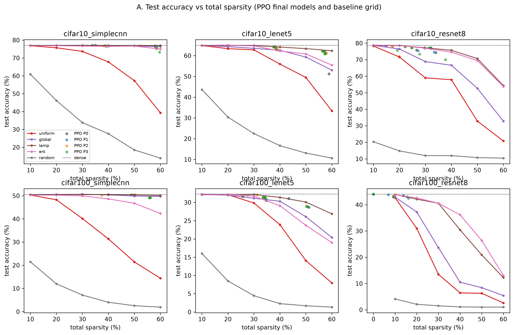

**Figure 5.1. Test accuracy against total sparsity (Phase 3).**
- **Lines:** the five baselines on a fixed descriptive sparsity grid (10–60%).
- **Points:** the final models of the 20 PPO runs per condition (P0–P3).
- **Dotted line:** dense test accuracy.
- **Caution:** the grid curves are descriptive. The statistical comparison in Table 5.2 uses baselines built at each
  PPO run's own zero count.

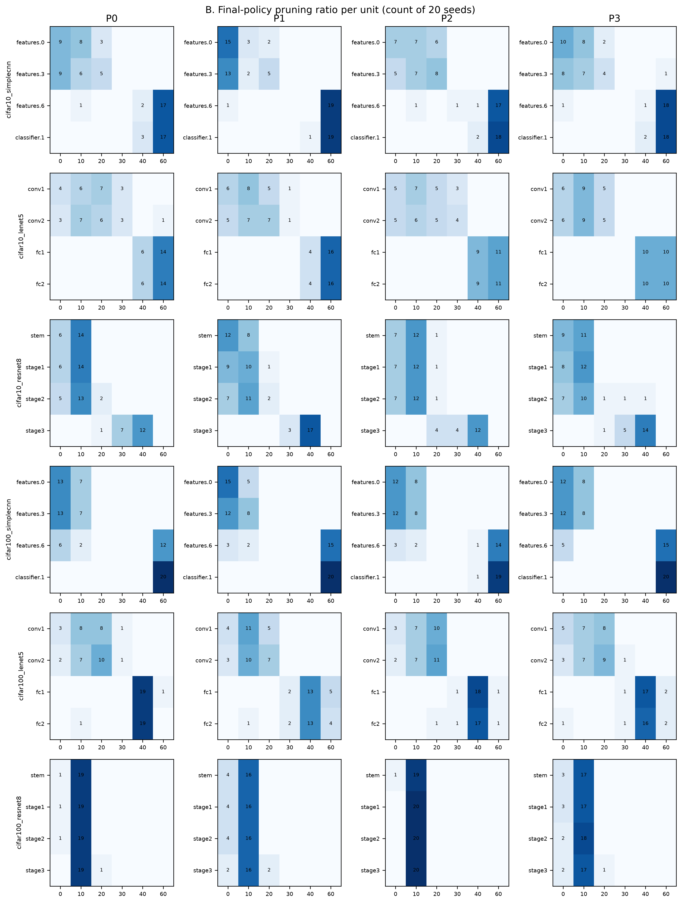

**Figure 5.2. Final-policy pruning ratio per unit (Phase 3).** Each cell is the count of the 20 seeds that chose that
ratio for that unit, by setting (rows) and condition (columns P0–P3). In Phase 3, P2 is the *shuffled* prior.

**Interpretation.** The result supports the first part of RQ1. PPO learns non-uniform allocations that are far more
accurate than uniform or random allocation at the same sparsity, in five of six settings. Against the stronger
magnitude-based baselines the advantage is mixed. Against LAMP it is reversed.

**Claim boundary.**
- The comparison is before any fine-tuning, at the sparsity PPO chose.
- It does not show that PPO beats one-shot magnitude-based allocation in general.
- It does not show that PPO matches LAMP.
- It says nothing about uniform pruning after fine-tuning: Phase 6 did not include Uniform.

## 5.4 Phase 3 — Effect of Sensitivity Guidance

**Question (RQ2, first test).** Does the sensitivity prior improve PPO's search, and does it improve the final model?

**Evidence.** Four conditions, compared on the configuration-I VAL-RL landscape and on test:
- P0: no prior;
- P1: the sensitivity prior;
- P2: the shuffled prior;
- P3: the constant prior.

The primary exploration endpoint is the VAL-RL (I) accuracy AUC over the 512 sampled policies. The final-model
endpoint is the test accuracy in excess of matched global magnitude, compared as P1 − P0.

**Results (Table 5.3, Phase-3 rows):**
- **Primary exploration endpoint (P1 − P0, VAL-RL (I) accuracy AUC): MODERATE**, supported in 3 of 6 settings:

  | Setting | Mean difference | Holm p |
  |---|---|---|
  | C10 SimpleCNN | +0.46 | 0.002 |
  | C100 SimpleCNN | +0.35 | 0.0098 |
  | C100 ResNet-8 | +0.54 | 5.7 × 10⁻⁵ |

  The other three settings are inconclusive, and none is opposite.
- **Secondary exploration endpoints: STRONG in 6 of 6** settings for each of:
  - reward-rank AUC: +0.013 to +0.032 in rank score, Holm p ≤ 5.5 × 10⁻⁴;
  - utility AUC: Holm p ≤ 3.6 × 10⁻⁴;
  - destructive-policy frequency: lower under P1, by 0.9–3.8 percentage points of sampled policies, Holm p ≤ 0.0022.
- **Layer specificity** (P1 better than both the shuffled and the constant prior): **LIMITED**, supported only in
  C10 SimpleCNN.
- **Final model: NOT SUPPORTED**, 0 of 6 supported and 0 opposite. The P1 − P0 differences in excess over global
  magnitude range from −0.10 to +0.86 pp, and every Holm p ≥ 0.094. The raw test-accuracy differences are also all
  inconclusive.

**Control insight.** On LeNet-5 the shuffled and constant priors did at least as well as the correct prior:
- **C10 LeNet-5, VAL-RL (I) accuracy AUC:**
  - P1 − P2 = −0.21 (Holm p = 0.27);
  - P1 − P3 = −0.21 (Holm p = 0.31).
- **Descriptive mean test accuracy:**
  - C10 LeNet-5: P1 62.17%, P2 62.54%, P3 62.83%;
  - C100 LeNet-5: P1 30.81%, P2 31.15%, P3 31.05%.

All three Phase-3 priors carry the same total pressure towards lighter pruning, Σ c_l = 0.5·Σ S_l (Section 3.10). The
pattern therefore raises the possibility that part of the exploration effect comes from a generic conservative bias
rather than from layer-specific information. The Phase-3 data cannot separate the two, and they do not prove either.
This possibility motivated the centred prior of Phase 4.

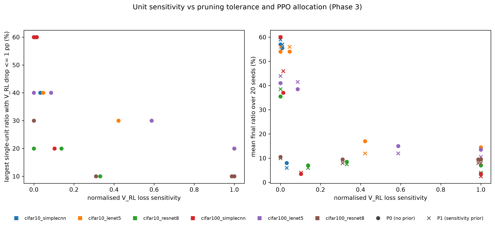

**Figure 5.3. Unit sensitivity, pruning tolerance and PPO allocation (Phase 3).**
- **Left:** for each unit, the largest single-unit ratio whose VAL-RL (I) accuracy drop is ≤ 1 pp, against normalised
  loss sensitivity S_l.
- **Right:** mean final ratio over 20 seeds of P0 (circles) and P1 (crosses) against S_l.
- **Colours:** each setting has one colour in both panels.
- **Reading:** highly sensitive units tolerate only 10–20% pruning and receive low ratios under both conditions.
- **Rendering:** a thesis re-render of the frozen Phase-3 figure D, from the same CSV, with an explicit colour key.

**Interpretation.** The sensitivity prior changes *how* PPO searches: it reaches better-ranked policies sooner and
samples fewer destructive ones. It does not change *what* PPO returns, in a way detectable on test accuracy.

**Claim boundary.** "Sensitivity improves pruned-model accuracy" is not supported. The layer-specific part of the
effect is not established by Phase 3.

## 5.5 Phase 4 — Centred Sensitivity and Exploration

**Question (RQ2, second test).** Once net conservatism is removed, does *relative* sensitivity still improve the
search?

**Evidence.** Phase 4 Stage B ran 600 runs under R0 with seeds 400–419. It compared the centred prior P2,
c_l = 1.0·(S_l − S̄), whose coefficients sum to zero, against four alternatives:
- P3: the centred values permuted across units;
- P4: a magnitude-matched pure-conservatism prior;
- P5: the sign-reversed prior;
- P0: no prior.

The primary endpoint was the reward-rank AUC on the configuration-I VAL-RL landscape.

**Results (Table 5.3, Phase-4 rows):**
- **Sensitivity-specific statement** (P2 better than both P3 and P4): **STRONG**, supported in 5 of 6 settings and
  opposite in none.
  - P2 − P3 ranges from +0.018 to +0.097 in rank-score AUC (Holm p ≤ 3.4 × 10⁻⁴, all 6 supported).
  - P2 − P4 ranges from +0.028 to +0.070 in the five supported settings.
  - In C100 ResNet-8, P2 − P4 = −0.002, which is inconclusive.
- **Against the sign-reversed prior** (P2 − P5): supported in **6 of 6** settings, by +0.021 to +0.145 (Holm
  p = 1.1 × 10⁻⁵).
- **Against no prior:** P1 − P0 and P2 − P0 were each supported in 6 of 6.
- **One exploration measure was reversed.** On the VAL-RL (I) accuracy AUC, the statement "P2 better than P3 and P4"
  is NOT SUPPORTED and REVERSED. P2 was significantly *below* the magnitude-matched conservative prior P4 in 4 of 6
  settings (C10 LeNet-5, C10 ResNet-8, C100 LeNet-5 and C100 ResNet-8; mean −0.26 to −0.76).
  - The centred prior pushes aggressive actions onto the insensitive units, so the policies it samples are better
    ranked under R0 but less accurate on average.
  - Reward rank and accuracy are different quantities under a trade-off reward. The improvement holds for the former
    only.
- **Other secondary endpoints:**
  - destructive frequency: MODERATE (4 of 6);
  - utility AUC: LIMITED (5 supported, 1 opposite);
  - best-seen rank: LIMITED (1 of 6);
  - final-selected rank: NOT SUPPORTED (0 of 6).

**Interpretation.** With the shared conservatism removed, correctly assigned relative sensitivity still makes the
explored policies better ranked under the reward. This is stronger evidence for a layer-specific effect than
Phase 3 provided. The benefit concerns the *average* quality of the explored policies, not the best policy found or
the policy returned.

**Claim boundary.**
- The centred prior is not shown to improve accuracy-based exploration in Phase 4 (that endpoint is reversed).
- It is not shown to improve the final model.

## 5.6 Phase 4 — Policy Retention and Archive Selection

**Question (RQ3).** Does PPO end on the good policies it visits, and does archive-based selection change this?

**Evidence.** Phase 4 Stage C compared four search variants under R0 and P2, each with 20 seeds per setting:
- **S0:** the terminal deterministic policy;
- **S1:** archive selection over the S0 runs;
- **S2:** elite behavioural cloning (K = 5, η = 0.1) with the terminal policy;
- **S2A:** elite behavioural cloning with archive selection.

The archive rule takes the top 10 visited policies by VAL-RL (I) reward and returns the one with the highest
VAL-SELECT (I) score. Ranks are positions among all 1,296 policies on the VAL-RL (I) landscape of R0 (1 = optimum).

Three policies are distinguished per run:
- **A. the best policy encountered;**
- **B. the terminal policy;**
- **C. the archive-selected policy.**

**Table 5.4. Retention: the best policy encountered, the terminal policy (S0) and the archive-selected policy (S2A).**
Reach is the share of the 20 runs whose policy is in the top-k of the 1,296-policy VAL-RL (I) landscape. Ranks are
medians over runs. Δ test is S2A − S0 test accuracy (pp, mean).

| Setting | A: best seen, top-10 reach (S0) | B: terminal (S0), top-10 reach | B: median rank | C: archive (S2A), top-10 reach | C: top-20 reach | C: median rank | Δ test (S2A − S0) |
|---|---|---|---|---|---|---|---|
| C10 SimpleCNN | 100% | 0% | 92 | 100% | 100% | 3 | +0.14 |
| C10 LeNet-5 | 100% | 0% | 69 | 100% | 100% | 6 | **+0.89** |
| C10 ResNet-8 | 95% | 0% | 96 | 100% | 100% | 1 | **−5.66** |
| C100 SimpleCNN | 100% | 0% | 65 | 100% | 100% | 6 | +0.22 |
| C100 LeNet-5 | 100% | 5% | 173 | 85% | 100% | 7 | +0.45 |
| C100 ResNet-8 | 95% | 0% | 114 | 80% | 100% | 10 | **−4.00** |

**Results.**
- **A. PPO visits top policies.** In every setting the best policy seen during training has a median rank of 1–2.5.
  It is in the top 10 in 95–100% of runs. The Phase-3 runs showed the same (median best-seen rank 1–4.5).
- **B. PPO does not end on them.** The terminal policy reaches the top 10 in **0% of runs in five settings and 5% in
  the sixth** (C100 LeNet-5). Its median rank is 65–173, and it reaches the top 20 in at most 5% of runs. In Phase 3,
  the terminal P0 policy reached the top 10 in 0% of runs in all six settings.
- **C. The archive retains them.** With S2A, the selected policy reaches the top 10 in **80–100%** of runs and the top
  20 in 100%, with a median rank of 1–10.
  - **Statistics:** "S2A better than S0 on final-selected VAL-RL (I) rank" is STRONG, supported in 6 of 6 settings.
    The mean rank improves by 66–150 positions (Holm p = 3.4 × 10⁻⁵). The same holds on VAL-SELECT (I) rank, 6 of 6.
  - **Archive alone (S1):** the archive rule without behavioural cloning gives 75–100% top-10 reach and is likewise
    supported in 6 of 6.

**Contribution of elite behavioural cloning.** The final Phase-4 pipeline combined the archive with elite
behavioural cloning, so the factors were separated:
- behavioural cloning alone (S2) improved the final-selected rank in only 3 of 6 settings (MODERATE);
- it improved the best-seen rank in 1 of 6 (LIMITED);
- the archive rule alone (S1) was supported in 6 of 6.

The retention gain is therefore mainly a *selection* effect of the archive, not an effect of cloning or of the
sensitivity prior.

**Test accuracy is mixed.** The archive improves the *validation rank* of the returned policy, but its test-accuracy
effect (Table 5.4, last column) varies:
- small gains in four settings: +0.14, +0.89, +0.22 and +0.45 pp;
- **large losses on ResNet-8: −5.66 pp (C10) and −4.00 pp (C100).**

The archive-only variant S1 shows the same pattern. On ResNet-8, the better-ranked policies are much sparser than
the terminal ones: 32.2% → 47.8% (C10) and 8.5% → 27.7% (C100) mean sparsity for S0 → S2A.

Note also that the pre-registered Stage-C criterion, the VAL-SELECT (I) rank of the selected policy, favours the
archive variants by construction, because they select on VAL-SELECT (I). The test comparison does not share this bias.

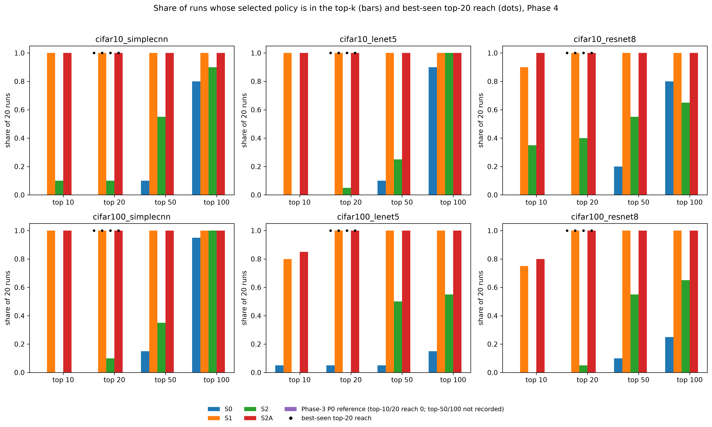

**Figure 5.4. Share of runs whose selected policy lies in the top-k of the VAL-RL (I) landscape (Phase 4, Stage C).**
- **Bars:** S0, S1, S2 and S2A.
- **Dots:** best-seen top-20 reach, which is 100% for every variant.
- **Phase-3 P0 reference series:** its top-10 and top-20 reach is 0, and top-50/100 reach was not recorded, so it
  shows no bars.
- **Rendering:** a thesis re-render of the frozen Phase-4 figure D, from the same CSV, with the legend moved below the
  panels.

**Interpretation.** The result answers RQ3 clearly at the level of search. Exploration is not the bottleneck: PPO
finds near-optimal policies early. Retention is: the terminal policy is consistently not the best one visited, and an
archive of visited policies recovers them on validation ranking.

**Claim boundary.**
- Archive selection does **not** consistently improve test accuracy. It lost 4–6 pp on ResNet-8, because the policies
  it retains are those the reward ranks highest, and that reward is misaligned (Section 5.7).
- The retention result is a validation-ranking result.

## 5.7 Phase 4 — Reward Misalignment

**Question (RQ4, diagnosis).** Once search and retention work, does the reward point PPO towards models a
practitioner would accept?

**Evidence.**
- Stage A tested three redesigned trade-off rewards against R0.
- The pre-registered stage selections then fixed the final pipeline F = (R0, P2, S2A).
- F was compared with the control K = (R0, P0, S0), the Phase-3 configuration on fresh seeds.
- The exact VAL-RL (I) landscape of R0 shows where R0's own optimum lies.

**Results.**

**Redesigned rewards (criterion A: NOT MET).** No redesigned reward met both pre-registered conditions:
- **R1a (common 50% target):** reduced the cross-setting spread of final sparsity to 0.29× that of R0. However, it
  kept ≥ 95% VAL-RL (I) retention in only 2 of 6 settings; C100 ResNet-8 retained 67.5%.
- **R1b (95%-retention targets):** kept retention but did not reduce the spread (1.05×).
- **R2 (anchor-normalised):** reached 0.66× and 4 of 6.

R0 was therefore carried forward unchanged.

**R0's own optimum.** On the VAL-RL (I) landscapes, R0's optimum lies at **23.5–56.4% sparsity**, depending on the
setting. On ResNet-8 that optimum is an accuracy-losing policy:
- C10: 48.8% sparsity, retaining 89.7% of dense VAL-RL (I) accuracy;
- C100: 23.5% sparsity, retaining 93.4%.

**Better search finds that optimum (Table 5.5, Phase-4 rows).** On ResNet-8, F's archive selection reached R0's
optimum region:
- median selected VAL-RL (I) rank 1 (C10) and 10 (C100);
- mean sparsity rising from 29.0% to 47.8% (C10) and from 8.3% to 27.7% (C100) relative to K.

Test accuracy fell accordingly:
- **C10:** 76.82% → 70.83%, a **7.86 pp** drop below dense;
- **C100:** 43.11% → 39.22%, a **4.77 pp** drop.

**Final pipeline against the control and LAMP.**
- **Criterion D, F > K on test excess over matched LAMP: NOT MET (LIMITED).**
  - Supported in C10 SimpleCNN (+0.50), C10 LeNet-5 (+0.95) and C100 LeNet-5 (+0.67 pp).
  - **Opposite on both ResNet-8 settings** (−0.95 and −0.92 pp).
  - Inconclusive in C100 SimpleCNN.
- **Criterion E, LAMP competitiveness: met only as non-inferiority.**
  - LAMP is significantly better than F in **6 of 6** settings: F − LAMP = −0.11, −0.11, −0.68, −0.48, −0.08 and
    −1.62 pp (Holm p ≤ 0.012).
  - The pre-registered one-sided non-inferiority test with a 0.5 pp margin is supported in 3 settings: C10 SimpleCNN,
    C10 LeNet-5 and C100 LeNet-5 (Holm p = 5.7 × 10⁻⁶).
- F remains far ahead of Uniform: +12.05 to +36.04 pp at matched zero count.

**Phase 4 pre-registered criteria:**

| Criterion | Status |
|---|---|
| A. Reward | **NOT MET** |
| B. Sensitivity-specific prior | **MET** (STRONG) |
| C. Search | **MET** (STRONG for S1 and S2A) |
| D. Final model vs control | **NOT MET** (LIMITED) |
| E. LAMP competitiveness | **MET only through non-inferiority** in 3 settings; "F > LAMP" NOT SUPPORTED |

By its own rule, Phase 4 counted as successful if at least one criterion held. That rule is satisfied, but the phase
is not a success on its two model-level criteria (A and D).

**Interpretation.** The optimiser did what the reward specified. R0 trades accuracy for sparsity at a fixed rate and
has no region where accuracy loss becomes unacceptable (Section 3.13.1). A weak search hid this. Once search and
retention improved, PPO found R0's optimum, which on fragile networks is an over-pruned model.

**Claim boundary.** This is evidence of reward misalignment, not a failure of PPO alone. It concerns R0 and these
landscapes. It does not show that every trade-off reward over-prunes.

## 5.8 Phase 5 — Accuracy-Constrained Reward

**Question (RQ4, remedy; RQ2, third test).** Does an accuracy-constrained, validation-aware reward remove the
over-pruning? Does sensitivity guidance still help under it?

**Evidence.** Phase 5 ran 360 runs on configuration II with seeds 500–519, under three conditions:
- **C0:** R0 + centred prior + R0-score archive selection (the Phase-4 pipeline without behavioural cloning);
- **C1:** constrained reward R_c with τ = 0.98 + centred prior + constraint-aware selection;
- **C2:** as C1 without the prior.

All three were evaluated once on test, after the final-policy list had been frozen.

**Table 5.5. ResNet-8 reward alignment across Phases 4 and 5 (test accuracy %, mean of 20 runs; sparsity = mean
selected masked sparsity).**

| Setting | Configuration | Sparsity | Test | Drop vs dense (pp) |
|---|---|---|---|---|
| C10 ResNet-8 (dense 78.69) | Phase-4 K (R0, no prior, terminal) | 29.0% | 76.82 | 1.87 |
| | Phase-4 F (R0, P2, S2A) | 47.8% | 70.83 | 7.86 |
| | Phase-5 C0 (R0, P2, archive) | 46.2% | 71.37 | **7.32** |
| | Phase-5 C1 (R_c, P2, constrained selection) | 24.5% | 77.51 | **1.18** |
| | Phase-5 C2 (R_c, no prior) | 23.9% | 77.57 | 1.12 |
| C100 ResNet-8 (dense 43.99) | Phase-4 K | 8.3% | 43.11 | 0.88 |
| | Phase-4 F | 27.7% | 39.22 | 4.77 |
| | Phase-5 C0 | 25.9% | 39.94 | 4.05 |
| | Phase-5 C1 | 15.6% | 42.83 | 1.16 |
| | Phase-5 C2 | 15.5% | 42.90 | 1.09 |

The Phase-4 and Phase-5 rows use different validation configurations for search and selection. They share the test
set and the dense reference.

**Over-pruning on ResNet-8.** On **CIFAR-10 ResNet-8**, the constrained reward reduced the mean test-accuracy loss
from **7.32 pp (C0) to 1.18 pp (C1)**, at a mean sparsity of 24.5% instead of 46.2%. On **CIFAR-100 ResNet-8** it went
from 4.05 to 1.16 pp, at 15.6% instead of 25.9%.

| Setting | C1 − C0, test (pp) | 95% CI | Seeds favouring C1 | Holm p |
|---|---|---|---|---|
| C10 ResNet-8 | +6.14 | 4.92–7.36 | 20 of 20 | 1.1 × 10⁻⁵ |
| C100 ResNet-8 | +2.89 | 2.30–3.48 | 20 of 20 | 1.1 × 10⁻⁵ |

C1's selected policies lie at or next to the constrained optimum: median constrained rank 3 (C10) and 1 (C100).

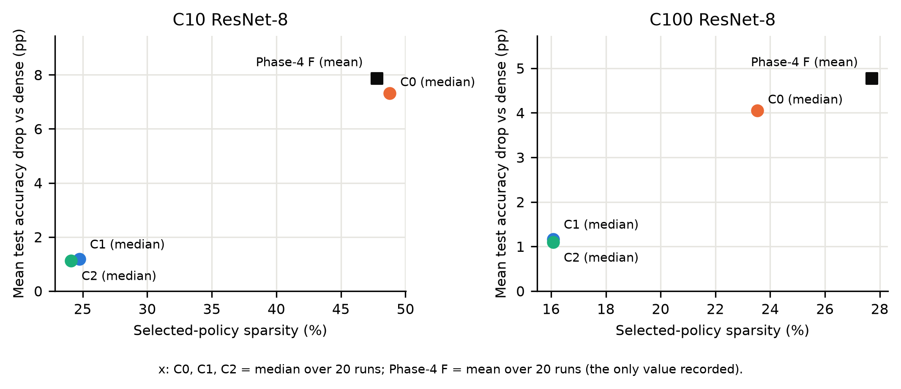

**Figure 5.5. ResNet-8 reward alignment: test-accuracy drop below dense against selected-policy sparsity.**
- C0, C1 and C2 are plotted at their **median** sparsity (48.8%, 24.7% and 24.1% for C10; 23.5%, 16.1% and 16.1% for
  C100).
- The Phase-4 F reference is plotted at its **mean** sparsity (47.8% and 27.7%), the only value recorded in the figure
  data. Each point's label states its statistic.
- **Rendering:** a thesis re-render of the frozen Phase-5 figure B, from the same CSV. The axis label no longer says
  "median" for all points.
- The mean sparsities used in the text are 46.2% and 24.5% (C10 C0, C1) and 25.9% and 15.6% (C100 C0, C1).

**Effect across all six settings (Table 5.6).**
- **C1 − C0 on test accuracy:**
  - supported in 4 settings: LeNet-5 (+0.70 and +1.12 pp) and ResNet-8;
  - **opposite in 2:** C10 SimpleCNN (−0.31 pp, Holm p = 4.6 × 10⁻⁵) and C100 SimpleCNN (−0.21 pp, Holm
    p = 0.0022).
- **Where C1 is more accurate,** it prunes 10–22 pp less than C0.
- **On SimpleCNN,** C0 already chose near-safe policies, and C1 spends the 2% accuracy allowance on slightly more
  sparsity.
- **Safe sparsity is architecture-dependent:** C1's mean sparsity runs from 15.6% (C100 ResNet-8) to 56.9% (C10
  SimpleCNN).

**Table 5.6. Phase 5 by setting (test accuracy %, mean of 20 runs; differences in pp).**

| Setting | C0 test (sparsity) | C1 test (sparsity) | C2 test | C1 − C0 | C1 − LAMP | C1 − Global |
|---|---|---|---|---|---|---|
| C10 SimpleCNN | 76.75 (56.1%) | 76.45 (56.9%) | 76.50 | −0.31 − | −0.49 − | −0.09 · |
| C10 LeNet-5 | 63.14 (53.9%) | 63.83 (38.6%) | 63.99 | +0.70 + | −0.32 − | +1.42 + |
| C10 ResNet-8 | 71.37 (46.2%) | 77.51 (24.5%) | 77.57 | +6.14 + | −0.53 − | +6.51 + |
| C100 SimpleCNN | 50.28 (52.9%) | 50.07 (53.1%) | 50.13 | −0.21 − | −0.29 − | +0.32 + |
| C100 LeNet-5 | 30.67 (46.3%) | 31.79 (30.6%) | 31.86 | +1.12 + | −0.26 − | +0.36 + |
| C100 ResNet-8 | 39.94 (25.9%) | 42.83 (15.6%) | 42.90 | +2.89 + | −0.51 − | +3.48 + |

**Comparison with global magnitude** (descriptive by pre-registration). C1 is more accurate than global magnitude at
the identical zero count in **5 of 6** settings, by +0.32 to +6.51 pp on test (sign-flip Holm p ≤ 0.0011). C10
SimpleCNN is inconclusive (−0.09 pp). This comparison was pre-registered as descriptive, so it is not a confirmatory
result.

**Comparison with LAMP.**
- LAMP is significantly more accurate than C1 in **all 6** settings, by **0.26–0.53 pp** on test (Holm p ≤ 5.9 × 10⁻⁵;
  LAMP won 16–20 of 20 seeds).
- The gap is within 0.5 pp in four settings. In both ResNet-8 settings it is 0.51–0.53 pp.
- Compared with C0, the gap to LAMP narrowed in C100 ResNet-8 (+0.66 pp, supported), widened on both SimpleCNN
  settings (opposite), and was unchanged elsewhere.

**Sensitivity under the corrected reward (C1 − C2; Table 5.3, Phase-5 rows):**
- **Primary family** (24 tests): **0 opposite outcomes.**
  - Reward-rank AUC: supported in 5 of 6 settings (Holm p ≤ 0.019; C10 ResNet-8 inconclusive).
  - VAL-RL accuracy AUC: supported in 5 of 6 (Holm p ≤ 0.012; C100 ResNet-8 inconclusive).
  - Episodes to the first top-20 and top-10 policy: inconclusive in all six settings, although every point estimate
    favours C1.
- **Secondary:**
  - destructive-action rate lower in 6 of 6 (Holm p ≤ 1.5 × 10⁻⁴);
  - selected rank better in 3 of 6;
  - best-seen rank better in 1 of 6.
- **Final test accuracy** (descriptive): C1 is **0.05–0.16 pp below** C2 in all six settings. The C1 − C2 test
  accuracy comparison was not pre-registered as a test.

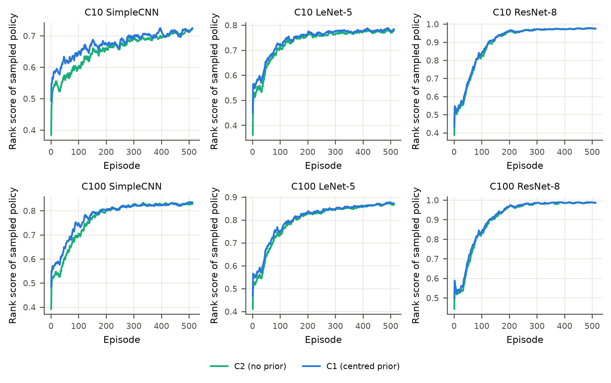

**Figure 5.6. Rank score of the sampled policy over 512 episodes, C1 (centred prior) vs C2 (no prior) (Phase 5,
VAL-RL).**
- **Plotted quantity:** the mean over 20 seeds, smoothed with a 16-episode rolling mean.
- **Reading:** the prior's advantage is concentrated early in training. In most settings the curves meet before the
  end.

**Phase 5 pre-registered criteria:**

| Criterion | Status | Reason |
|---|---|---|
| A. Accuracy safety | **PARTIALLY MET** | Supported in both ResNet-8 settings, but opposite in 2 other settings (at most 1 allowed) |
| B. Non-trivial compression | **MET** | C1 median sparsity ≥ 10% in 6 of 6 and ≥ 20% in 5 (4 required) |
| C. Search quality | **PARTIALLY MET** | Median selected constrained rank ≤ 20 in 5 of 6, but only 76.7% of runs selected a top-20 policy (≥ 80% required); 90.8% visited one |
| D. Sensitivity contribution | **MET** | A primary exploration endpoint supported in every setting, 0 of 24 opposite |
| E. Final model improvement | **PARTIALLY MET** | Supported in 4 settings, opposite in 2 (no degradation allowed) |
| F-strong. LAMP | **NOT MET** | C1 never beats LAMP; LAMP better in 6 of 6 |
| F-weak. LAMP | **MET** | Within 0.5 pp in 4 settings, none worse than 1.0 pp |

**Interpretation.** Making accuracy a constraint rather than a traded quantity largely removed the ResNet-8
over-pruning. The remaining effects are small and architecture-dependent: a slight loss on SimpleCNN and gains on
LeNet-5 and ResNet-8. Under the corrected reward, sensitivity guidance still improves exploration and still does not
improve the final model.

**Claim boundary.**
- The constrained reward does not "guarantee" accuracy (Section 5.9).
- It does not eliminate over-pruning in every setting.
- It does not make PPO better than LAMP.
- The comparison with global magnitude is descriptive.

## 5.9 Phase 5 — Validation-to-Test Transfer

**Question.** Does a policy certified as feasible on validation data remain feasible on the test set?

**Evidence.** For every selected policy, Phase 5 recorded whether q ≥ 0.98 held on three splits:
- on VAL-RL, where the reward enforced it;
- on VAL-SELECT, where the selection rule enforced it;
- on test, measured as test accuracy divided by dense test accuracy.

**Results.**

| Condition | Feasible on VAL-RL | Feasible on VAL-SELECT | Feasible on test |
|---|---|---|---|
| C0 | 40 / 120 | 44 / 120 | 40 / 120 (33.3%) |
| C1 | **120 / 120** | **119 / 120 (99.2%)** | **81 / 120 (67.5%)** |
| C2 | 120 / 120 | 119 / 120 | 90 / 120 (75.0%) |

- **Selection fallback.** The single C1 policy infeasible on VAL-SELECT is the one selection-rule fallback (C100
  LeNet-5).
- **Transfer failures.** Of the 119 C1 policies feasible on VAL-SELECT, **39 were infeasible on test.**
- **C1 test feasibility by setting:**
  - 100% in both SimpleCNN settings and in C10 ResNet-8;
  - 60% in C100 LeNet-5;
  - 45% in C10 LeNet-5;
  - **0% in C100 ResNet-8**, where the mean test retention was 0.974, just below the 0.98 threshold.

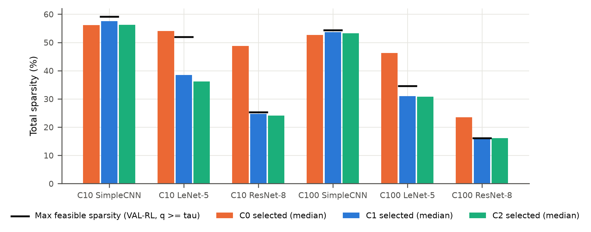

**Figure 5.7. Median selected sparsity of C0, C1 and C2 against the maximum feasible sparsity on VAL-RL (q ≥ τ),
by setting (Phase 5).**
- C0 selects policies beyond the feasible maximum in the LeNet-5 and ResNet-8 settings.
- C1 and C2 select at or just below it. These boundary policies are where test feasibility is most fragile.

**Interpretation.**
- Validation feasibility is evidence about test feasibility, not a guarantee.
- The failures occur in the LeNet-5 settings and in C100 ResNet-8, where C1 selects close to the VAL-RL feasibility
  boundary (Figure 5.7).
- The frozen Phase-5 analysis notes that two 2,500-image splits carry roughly ±1 pp of sampling noise. That is
  comparable to the 2% relative margin in these settings.

**Claim boundary.** No claim of the form "the validation constraint guarantees generalisation" is made. Phase 6 shows
that equal fine-tuning removes most of this gap (Section 5.10).

## 5.10 Phase 6 — Equal Fine-Tuning

**Question (RQ5).** Do the accuracy differences between PPO and the strongest deterministic methods persist when every
pruned model receives the same fine-tuning?

**Evidence.**
- **Methods.** Phase 6 fine-tuned three pruned models in each of 120 (setting, policy seed) pairs:
  - **PPO:** the frozen Phase-5 C1 policy;
  - **LAMP and global magnitude:** at exactly PPO's zero count (mismatch 0 in 120 of 120 triples).

  A dense control was fine-tuned alongside them. **Phase 6 contains no Uniform baseline.**
- **Protocol.** Every model received 5 epochs of fixed-mask Adam fine-tuning at learning rate 10⁻⁴ (Section 4.13).
  The models of a pair shared the fine-tuning seed and data order. The model after epoch 5 was evaluated once on test.
- **Scale.** 480 runs, plus 6 reproduction runs.

**Table 5.7. Phase 6: test accuracy before → after equal fine-tuning, and the PPO–LAMP and PPO–Global gaps (pp; mean
of 20 paired runs; 95% t-CI).**

| Setting (sparsity) | PPO | LAMP | Global | PPO − LAMP before | PPO − LAMP after [95% CI] | PPO − Global after [95% CI] |
|---|---|---|---|---|---|---|
| C10 SimpleCNN (56.9%) | 76.45 → 79.73 | 76.94 → 79.95 | 76.54 → 79.89 | −0.49 | −0.22 [−0.28, −0.15] | −0.16 [−0.21, −0.11] |
| C10 LeNet-5 (38.6%) | 63.83 → 64.88 | 64.15 → 65.06 | 62.41 → 64.83 | −0.32 | −0.18 [−0.28, −0.09] | +0.05 [−0.05, 0.15] |
| C10 ResNet-8 (24.5%) | 77.51 → 78.74 | 78.03 → 78.73 | 71.00 → 78.67 | −0.53 | +0.00 [−0.02, 0.03] | +0.07 [0.03, 0.11] |
| C100 SimpleCNN (53.1%) | 50.07 → 50.53 | 50.36 → 50.58 | 49.75 → 50.51 | −0.29 | −0.05 [−0.09, −0.01] | +0.03 [−0.02, 0.07] |
| C100 LeNet-5 (30.6%) | 31.79 → 32.36 | 32.05 → 32.49 | 31.43 → 32.24 | −0.26 | −0.14 [−0.19, −0.08] | +0.12 [0.06, 0.18] |
| C100 ResNet-8 (15.6%) | 42.83 → 44.02 | 43.34 → 44.06 | 39.35 → 44.04 | −0.51 | −0.04 [−0.07, −0.01] | −0.02 [−0.07, 0.03] |
| **Mean of 6 settings** | **57.08 → 58.38** | **57.48 → 58.48** | **55.08 → 58.36** | | | |

The dense control moved from 57.91 to 58.51 (mean over settings).

**Recovery.**
- **Every method recovered in every setting.** "Fine-tuning improves accuracy over the same mask before fine-tuning"
  is supported in 18 of 18 method × setting tests (Holm p < 10⁻⁴).
- **Recovery beyond the dense control's own gain** is supported in 17 of 18. The exception is LAMP on C10 SimpleCNN,
  which gained 0.04 pp less than the dense control.
- **Mean recovery per setting:**
  - PPO: 0.46–3.28 pp;
  - LAMP: 0.22–3.01 pp;
  - global magnitude: 0.76–7.67 pp.

  The ordering, global > PPO > LAMP in all six settings, is the inverse of the pre-fine-tuning accuracy: the more a
  mask had lost, the more it recovered.
- **Shortfall after fine-tuning.** Every method ended within 0.14 pp of the dense reference on average. On C10
  SimpleCNN, every model, dense control included, ended about 3 pp *above* the historical reference: the dense control
  itself gained +3.05 pp from the 5 extra epochs (Table 5.1, note †).

**PPO versus LAMP.**
- **Before fine-tuning,** LAMP led by 0.26–0.53 pp in every setting.
- **After fine-tuning,** the absolute PPO–LAMP difference was **0.00–0.22 pp.**
- **Change in the gap (ΔG).** The gap moved in PPO's favour, a supported result, in **5 of 6** settings (Holm
  p ≤ 0.027). C10 LeNet-5 was inconclusive (Holm p = 0.055), and no setting was opposite.
- **Who is ahead after fine-tuning.** LAMP was still significantly ahead in **3 of 6** settings:
  - C10 SimpleCNN, −0.22 pp (Holm p = 3.8 × 10⁻⁵);
  - C10 LeNet-5, −0.18 pp (Holm p = 0.0026);
  - C100 LeNet-5, −0.14 pp (Holm p = 4.6 × 10⁻⁴).

  The other three were inconclusive. PPO was significantly ahead in none.
- **The ±0.5 pp rule.** **The post-recovery PPO–LAMP differences fell within the pre-registered ±0.5 pp decision
  margin in all six settings.** The rule is that the 95% t-interval lies inside (−0.5, +0.5) pp. It is a
  confidence-interval decision rule, not a formal statistical equivalence test (Section 4.15.2). Three of the six
  settings were already inside the margin before fine-tuning (C10 LeNet-5, C100 SimpleCNN and C100 LeNet-5).

**PPO versus global magnitude.**
- **Before fine-tuning,** PPO led global magnitude by up to 6.51 pp (Section 5.8).
- **After equal recovery,** the differences were −0.16 to +0.12 pp:
  - PPO's largest remaining advantage was **0.12 pp** (C100 LeNet-5; supported);
  - PPO was also ahead by 0.07 pp in C10 ResNet-8 (supported);
  - global was ahead by 0.16 pp in C10 SimpleCNN (opposite);
  - the other three settings were inconclusive.
- **Gap change.** The change in the PPO–Global gap was opposite in 5 settings, because global recovered much more, and
  inconclusive on C10 SimpleCNN, where there had been no gap to close.
- **Margin.** Every post-recovery PPO–Global interval lies inside ±0.5 pp.

**Fixed masks and integrity.**
- **No pruned weight regrew.** In all 360 pruned runs, per-layer zero counts were identical before and after
  fine-tuning, the mask hash was unchanged, and no masked weight was non-zero.
- **Reproduction.** The 6 reproduction runs were bit-identical to the originals.
- **Integrity.** All 20 integrity checks passed.

**Phase 6 pre-registered criteria:**

| Criterion | Status | Basis |
|---|---|---|
| A. Fairness | **MET** | one protocol and epoch count; shared seed and data stream in every pair; zero-count mismatch 0 in 120 of 120 triples; masks equal the frozen table |
| B. Recovery | **MET** | recovery supported for all three pruning methods in all 6 settings |
| C. PPO competitiveness (change of the PPO–LAMP gap) | **MET** | gap moved towards PPO in 5 settings, towards LAMP in none. C concerns the change of the gap, not who is ahead: LAMP remains ahead in 3 settings |
| D. Architecture generalisation | **MET** | all six settings complete and present in every family |
| E. Sparsity preservation | **MET** | identical per-layer zero counts and unchanged masks in 360 of 360 pruned runs |
| F. Reproducibility | **MET** | 480 of 480 runs complete; 6 of 6 reproductions bit-identical |

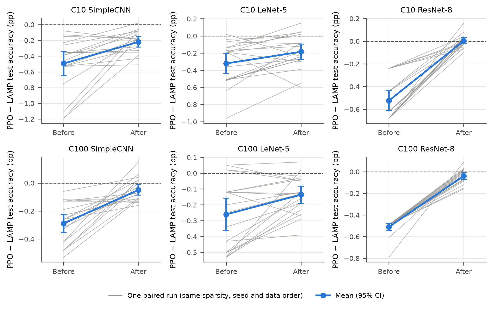

**Figure 5.8. PPO − LAMP test accuracy before and after equal 5-epoch fine-tuning (Phase 6).**
- **Grey lines:** one paired run (same sparsity, seed and data order).
- **Blue:** mean with 95% CI.
- **Dashed line:** zero difference.
- The ±0.5 pp margin is not drawn. Every post-fine-tuning interval lies inside it (Table 5.7).

**Interpretation.**
- Equal, modest fine-tuning substantially shrinks the differences among pruning methods at these sparsities. PPO's
  advantage over global magnitude and LAMP's advantage over PPO both lay mainly *before* fine-tuning.
- Fine-tuning also removed most of the validation-to-test retention problem of Section 5.9. After recovery, every
  pruned model met retention ≥ 0.98 on test. The PPO retention gap between VAL-SELECT and test narrowed significantly
  in 4 of 6 settings.

**Claim boundary.**
- PPO and LAMP are not claimed to be statistically equivalent, and LAMP remains significantly, though slightly, ahead
  in three settings.
- The result holds for these networks, sparsities and a 5-epoch budget.
- It says nothing about Uniform, ERK or Random after fine-tuning.

## 5.11 Answers to RQ1–RQ5

**Table 5.3. Sensitivity guidance across Phases 3–5: exploration endpoints versus final-model endpoints (settings
supported / opposite, of 6).**

| Phase | Comparison | Exploration endpoints | Final-model endpoint |
|---|---|---|---|
| 3 | P1 − P0 (prior vs none) | VAL-RL (I) accuracy AUC 3 / 0 (MODERATE); rank AUC 6 / 0; utility AUC 6 / 0; destructive frequency 6 / 0 (STRONG) | excess over matched Global 0 / 0 (NOT SUPPORTED) |
| 3 | P1 vs P2 and P3 (specificity) | VAL-RL (I) accuracy AUC 1 / 0 (LIMITED) | — |
| 4 | P2 vs P3 and P4 (centred, specific) | rank AUC 5 / 0 (STRONG); VAL-RL (I) accuracy AUC 0 / 4 (REVERSED); destructive 4 / 0 | final-selected rank 0 / 0 (NOT SUPPORTED) |
| 4 | P2 − P5 (sign-reversed) | rank AUC 6 / 0 | — |
| 5 | C1 − C2 (prior vs none, constrained reward) | rank AUC 5 / 0; VAL-RL accuracy AUC 5 / 0; time to top-20 / top-10 0 / 0; destructive rate 6 / 0 | test accuracy: C1 0.05–0.16 pp below C2 in 6 of 6 (descriptive) |

*(Table 5.3 is placed here, beside the answer to RQ2, because it draws on Sections 5.4, 5.5 and 5.8.)*

**RQ1: PPO against uniform and one-shot baselines.**
- **Answer.** Yes, with clear limits. PPO learns useful non-uniform allocations that substantially outperform uniform
  allocation (5 of 6 settings, up to +31.4 pp on C10 SimpleCNN test) and random allocation (6 of 6), at the sparsity
  PPO itself chose.
- **Limits.**
  - Against global magnitude and ERK the advantage is mixed.
  - LAMP is significantly more accurate than PPO before recovery: in 5 of 6 settings in Phase 3, and in 6 of 6 for
    the Phase-4 final pipeline and for Phase-5 C1.

**RQ2: sensitivity guidance.**
- **Answer.** Sensitivity guidance improves the search but not the final model.
- **Search.** It produces better-ranked policies earlier and fewer destructive policies in every phase. With the
  centred prior, this holds against controls that carry the same overall conservatism (Phase 4) and under the
  corrected reward (Phase 5).
- **Final model.** No final-accuracy benefit was found in any phase. One Phase-4 exploration measure (accuracy AUC
  against the conservative control) was reversed.

**RQ3: retention and archive selection.**
- **Answer.** The terminal PPO policy does not retain the strong policies PPO visits. Top-10 reach is 0% in five
  settings and 5% in one, although the best visited policy is in the top 10 in 95–100% of runs.
- **Archive effect.** Archive selection restores retention on validation ranking: 80–100% top-10 reach and 100% top-20
  reach with S2A. This is mainly an effect of the archive rule, not of behavioural cloning.
- **Test effect.** The effect on test accuracy is mixed, with large losses on ResNet-8 under the misaligned reward.

**RQ4: reward design.**
- **Answer.** Reward design materially determines how aggressively PPO prunes.
- **The trade-off reward R0.** Its optimum over-prunes fragile networks. Once search improved, ResNet-8 lost up to
  7.86 pp.
- **The accuracy-constrained reward.** It reduced the C10 ResNet-8 loss from 7.32 to 1.18 pp and the C100 ResNet-8
  loss from 4.05 to 1.16 pp. Its effect across settings was mixed: slightly worse on SimpleCNN.
- **Validation and test.** Validation feasibility transferred to test in only 67.5% of runs.

**RQ5: equal recovery.**
- **Answer.** Equal 5-epoch fixed-mask fine-tuning substantially narrows the differences between PPO and the strong
  deterministic methods.
  - The PPO–LAMP gap fell from 0.26–0.53 pp to 0.00–0.22 pp, within the pre-registered ±0.5 pp confidence-interval
    margin in all six settings. LAMP stayed significantly ahead in three.
  - PPO's advantage over global magnitude fell to at most 0.12 pp.
- **Implication.** PPO's distinctive advantages lay before fine-tuning.

## 5.12 Chapter Summary

**Findings in the order the phases produced them:**
1. **Phase 3.** PPO learned non-uniform allocations that strongly beat uniform and random pruning, but LAMP was more
   accurate in five of six settings.
2. **Sensitivity.** The prior made the search more efficient in every phase but never improved the final model.
3. **Phase 4: retention.** The search was not the bottleneck: PPO visited top policies but ended on poor ones. An
   archive recovered them on validation ranking.
4. **Phase 4: reward.** Better search then exposed a misaligned reward that over-pruned ResNet-8.
5. **Phase 5: constraint.** An accuracy constraint largely corrected the over-pruning. Validation feasibility
   transferred to test in only two thirds of runs.
6. **Phase 6: equal recovery.** After identical fine-tuning, the differences between methods became small. LAMP
   remained slightly ahead in three settings, and PPO's lead over global magnitude essentially disappeared.

**Negative and partial results reported alongside the positive ones:**

| Phase | Result |
|---|---|
| 3 | LAMP reversed against PPO; no final-accuracy effect of sensitivity |
| 4 | criteria A and D not met; test losses from archive selection on ResNet-8; one reversed exploration measure |
| 5 | criteria A, C and E partially met; F-strong not met; 67.5% test feasibility |
| 6 | LAMP still ahead in three settings |

**Figures.** Figures 5.1, 5.2 and 5.6–5.8 are the frozen phase figures, used unchanged. Figures 5.3–5.5 are
presentation-only thesis re-renders from the same frozen CSVs, with every plotted value verified identical
(`figures/rerender_ch5_figures.py`).

Chapter 6 asks whether these compression results translate into deployment efficiency. Chapter 7 discusses the
reasons for the pattern found here.


# Chapter 6 — Deployment and Sustainability Analysis

## 6.1 Chapter Overview

Chapter 5 evaluated the core framework on unstructured, masked pruning, where compression is measured as weight
sparsity. This chapter asks the question that the core framework cannot answer:

> **RQ6. Does model compression translate into real deployment benefit?**

The evidence comes from four later studies (Chapter 4, Table 4.7):

| Study | What it does | Section |
|---|---|---|
| Paper 3 | measures the CPU latency of every structured policy, exhaustively | 6.4–6.6 |
| Phase 7A | realises the learned Phase-5 allocation as a physically smaller network and measures its CPU package energy | 6.7–6.8 |
| Phase 7B | redesigns the agent to search directly in the structured space | 6.9–6.12 |
| Energy confirmation | attempts to measure the energy of the frozen Phase-7B model | 6.13 |

Deployment benefit is analysed at three levels (Table 3.6):
1. **compression and memory;**
2. **computation and latency;**
3. **operational energy.**

The central message of the chapter is that **an improvement at one level does not guarantee an improvement at the
next.** Each level needs its own measurement, and the accuracy cost must be stated alongside it.

**Reporting conventions:**
- Accuracies are validation accuracies on configuration II (VAL-RL / VAL-SELECT, 2,500 images each), after the
  equal 5-epoch recovery. No test-set number exists for these phases (Section 4.3).
- Phase 7A's pre-registered accuracy split is **VAL-RL**; Phase 7B's is **VAL-SELECT**. Both are reported, and the
  split is always named.
- Latency and energy were measured on the laptop CPU of Table 4.10, under the protocols of Sections 4.17–4.18.

## 6.2 From Compression to Deployment Efficiency

The core framework produced masked models. A masked network keeps every tensor at its dense shape and stores zeros
in place of removed weights. On a general-purpose CPU with dense kernels, those zeros are still loaded and multiplied
unless sparse formats and kernels are used [8]. Weight sparsity is therefore a statement about the
model, not about its cost on hardware. Cost indicators such as parameter count, FLOPs and measured speed can disagree
with one another [16]. This thesis makes no latency or energy claim for its masked models.

To reach the hardware, compression must change the shape of the computation. The extension therefore realises each
policy **structurally**: whole channels and neurons are removed, and a smaller dense network is built
[7], [22], [23].

The three levels then become measurable:

| Level | Quantity | How measured |
|---|---|---|
| 1. Compression / memory | parameter count and parameter memory (bytes); serialised size | exact, from the model |
| 2. Computation / latency | MACs (closed form, checked against hooks); batch-1 CPU latency | MACs exact; latency measured |
| 3. Operational energy | CPU package energy per 1,000 inferences, from the RAPL counter [86] | direct hardware counter; no TDP model or estimate |

## 6.3 Structured Physical Pruning Setup

The structured search space is the core space realised physically (Section 4.6.2):
- **Action set and policy count:** the same six ratios per unit, so there are 1,296 policies per network.
- **Keep rule:** each unit keeps max(1, round((1 − r)·C)) channels, those with the largest L1 norm on the dense model.
- **SimpleCNN units:** the three convolutions' filters and the hidden layer's neurons.
- **ResNet-8 units:**
  - the stem is a **coupled residual pruning group**, which sets the stage-1 residual width across every tensor that
    writes or reads it;
  - the three stage units remove **block-internal channels**.
- **Integrity:** every compacted model was checked to contain no masks, to have analytic parameter and MAC counts,
  and to reproduce the masked-equivalent logits within 10⁻⁴.

**Recovery.** Whenever accuracy was needed, the compacted model received the equal 5-epoch Phase-6 protocol with one
recovery seed (600) for every model.

**Latency protocol** (Section 4.17):
- **Configuration.** The calibration stage chose configuration A by its pre-registered rule: batch 1, one thread,
  pinned to one performance core. The dense-minus-aggressive latency difference had a signal-to-noise ratio of 12.3
  and a relative reduction of 61.6%, passing the thresholds of 5 and 10%.
- **Tables.** Each table was timed in five fresh-process sessions, with dense anchors and a 10% drift limit. A shape's
  latency is the median of its per-session medians.

## 6.4 Exhaustive CPU Latency Analysis

Paper 3 timed **all 1,296 physically compacted policies** in each of four tables:
- SimpleCNN with 10 outputs (CIFAR-10) and with 100 outputs (CIFAR-100);
- ResNet-8 with 10 outputs and with 100 outputs.

That is **5,184 structured policies** in total. Latency depends only on shape, so the tables need no trained weights
and no accuracy evaluation. Four session attempts exceeded the drift limit and were repeated; all 20 accepted
sessions met it.

**Measurement stability.** The tables are internally consistent:
- the median between-session coefficient of variation per shape was 1.2–1.6%;
- the Spearman correlation of latency gains between any two sessions was 0.96–0.995;
- raw and anchor-normalised gains agreed at Spearman ≥ 0.997.

**Absolute versus relative latency.** On the days the tables were measured, the absolute dense latency was about 16%
higher than on the calibration day, while the dense anchors within each table agreed with its identity shape to within
1%. The analysis therefore uses latency *relative to the identity shape of the same table*. Absolute milliseconds from
different measurement days are never compared.

**Table 6.1. Exhaustive structured latency tables: cost metrics against measured latency gain** (Spearman rank
correlation over 1,296 policies per table; latency gain g_T = 1 − T/T_identity).

| Table | Policies | Parameter reduction vs latency gain | MAC reduction vs latency gain | Pairs where the more parameter-sparse policy is slower | Maximum speed-up (unconstrained) |
|---|---|---|---|---|---|
| SimpleCNN, CIFAR-10 | 1,296 | 0.32 | 0.89 | 39.0% | 2.61× |
| SimpleCNN, CIFAR-100 | 1,296 | 0.31 | 0.89 | 39.4% | 2.59× |
| ResNet-8, CIFAR-10 | 1,296 | 0.55 | 0.98 | 30.6% | 1.67× |
| ResNet-8, CIFAR-100 | 1,296 | 0.54 | 0.98 | 30.8% | 1.72× |

The maximum speed-up in every table belongs to the most aggressive policy [5, 5, 5, 5]. These maxima describe the
latency space only. They are **not** accuracy-preserving speed-ups: no accuracy constraint is applied in Table 6.1
(Section 6.6).

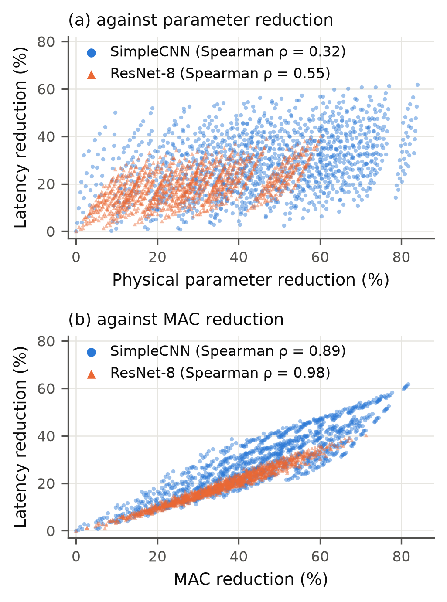

**Figure 6.1. Measured latency reduction against (a) physical parameter reduction and (b) MAC reduction, for all
1,296 structured policies of the CIFAR-10 SimpleCNN and ResNet-8 tables (Paper 3).** The CIFAR-100 tables (Table 6.1)
behave the same way.

## 6.5 Parameter Reduction versus MAC Reduction versus Latency

**Result.** Across all four tables, the correlation between latency gain and cost metric was:

| Cost metric | Spearman correlation with latency gain | Strength |
|---|---|---|
| Parameter reduction | 0.31–0.55 | weak |
| MAC reduction | 0.89–0.98 | strong |

In **39.0–39.4%** of SimpleCNN policy pairs and **30.6–30.8%** of ResNet-8 pairs, the policy with more parameter
reduction was *slower*.

**Example (CIFAR-10 SimpleCNN table).** Two policies show why the location of pruning matters more than the parameter
count:

| Policy | What it prunes | Parameter reduction | MAC reduction | Speed-up |
|---|---|---|---|---|
| [5, 5, 1, 0] | the first two convolutions at 60% | 18.7% | 69.3% | **2.08×** |
| [0, 0, 0, 5] (fc-heavy) | only the 256-unit hidden layer at 60% | 51.1% | 2.9% | **1.03×** |

- In SimpleCNN, the hidden layer holds most of the weights but very little of the arithmetic. The early
  convolutions are the reverse: their weights are few, but they operate at high spatial resolution.
- So the fc-heavy policy removes almost three times the parameters for almost no time.
- These examples describe cost only. They imply nothing about accuracy, and pruning the first convolutions at 60% is
  destructive in this network (Section 5.4).

**ResNet-8 correlates more strongly** with parameters than SimpleCNN (0.54–0.55 vs 0.31–0.32), but it still has
roughly one inverted pair in three.

**Interpretation.** Parameter sparsity is a weak proxy for CPU latency. MAC reduction is a strong proxy. Measured
latency remains the deployment-grounded quantity, because even MACs leave part of the ordering unexplained (ρ < 1).
The same mechanism reappears in Phase 7A (Section 6.8).

**Claim boundary.**
- These are batch-1, single-thread results on one laptop CPU.
- They do not transfer to other CPUs, thread counts, batch sizes or accelerators.
- No correlation is reported other than Spearman's.

## 6.6 Accuracy-Feasible Latency Headroom

Table 6.1 shows how much faster a structured network *can* be. A deployment question needs the speed-up of policies
that also keep accuracy.

**Feasibility criterion.** Paper 3 used the Phase-5 criterion: retained VAL-RL accuracy after the 5-epoch recovery,
q₅ ≥ 0.98, relative to the identically recovered dense model. The exhaustive 5-epoch recovered landscape was stopped
for computational cost (Section 4.6.3), so a cheaper accuracy proxy had to be validated first.

**Proxy validation** (1-epoch recovery against 5-epoch recovery; GO only if Spearman ≥ 0.90):

| Architecture | Validation pairs | Spearman ρ(A₁, A₅) | Decision |
|---|---|---|---|
| SimpleCNN | 156 | 0.844 | **rejected** (NO-GO) |
| ResNet-8 | 31 | 0.980 | accepted (GO) |

Because the SimpleCNN proxy was rejected, **no accuracy-feasibility claim is made for the SimpleCNN latency tables.**
Its 2.61× maximum is an unconstrained figure only.

**ResNet-8 calibration.** The ResNet-8 validation pairs contained too few truly feasible policies for the
pre-registered threshold rule, so its fallback applied. A pre-committed calibration then recovered 48 frozen ResNet-8
policies for the full 5 epochs, and the proxy threshold was set by a recall-first rule with a fixed 0.005 margin.

**Table 6.2. ResNet-8 (CIFAR-10): calibrated accuracy-feasible latency headroom.**

| Item | Value |
|---|---|
| Calibration policies (5-epoch recovered) | 48 |
| Truly 5-epoch feasible (q₅ ≥ 0.98) | 14 |
| Proxy threshold τ_proxy | 0.960 |
| Recall / precision at τ_proxy | 1.00 / 0.875 (14 true positives, 2 false positives) |
| Proxy-feasible policies in the 1,296 landscape | 52 |
| Their parameter / MAC reduction | 0–28.9% / 0–18.4% |
| **Best table speed-up among proxy-feasible policies** | **1.098×** |
| Best speed-up among the 14 truly feasible calibration policies | 1.089× ([0, 3, 1, 1]) |
| Proxy-feasible policies with speed-up ≥ 1.10× | 0 |

The 52 proxy-feasible policies are *candidates*: only the 48 calibration policies were confirmed by 5-epoch recovery,
and precision at the threshold was 0.875. The 52 are therefore not all truly feasible.

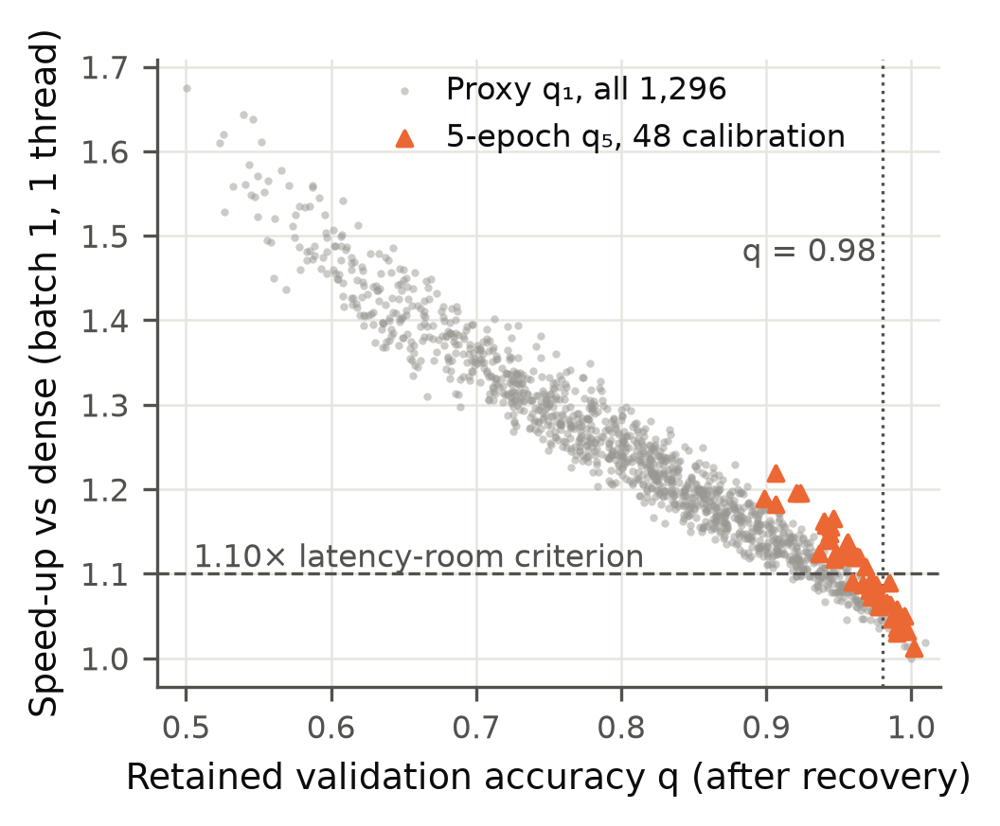

**Figure 6.2. ResNet-8 (CIFAR-10): table speed-up against retained validation accuracy (Paper 3).**
- **Grey:** the 1-epoch proxy q₁ for all 1,296 policies.
- **Orange:** 5-epoch q₅ for the 48 calibration policies.
- **Lines:** the dotted line is q = 0.98; the dashed line is the 1.10× latency-room criterion.

**Decision.** The pre-registered latency-room rule required at least 20 proxy-feasible policies **and** at least one
with a speed-up ≥ 1.10×. The first condition held (52); the second did not (best 1.098×).
**Because the latency-room requirement was not met, no hardware-aware PPO search was started.**

The gap between 1.098× and 1.10× is a protocol decision threshold fixed in advance, not a scientifically meaningful
discontinuity. The substantive finding concerns the evidence available under the 2% accuracy constraint:
- the best proxy-feasible candidate reached a 1.098× speed-up;
- the best confirmed five-epoch-feasible calibration policy reached 1.089×.

Neither satisfied the pre-registered 1.10× GO criterion. The accuracy-feasible latency room found on this CPU is
therefore small.

**Interpretation.** Large unconstrained speed-ups are not available once accuracy is protected. For SimpleCNN the
accuracy-feasible headroom could not be established at all, because its proxy failed.

**Claim boundary.** No hardware-aware reinforcement-learning result exists. Paper 3 contributes a hardware analysis,
not an RL success.

## 6.7 Phase 7A — Structured Transfer and Energy Evaluation

**Question.** If the learned PPO allocation is translated into a physically structured model, does it reduce
directly measured CPU energy, and at what accuracy cost?

**Design** (Section 4.9.6). CIFAR-10, SimpleCNN and ResNet-8, four models each:
- **Dense:** the reference, recovered with the same protocol.
- **PPO-Structured:** the most frequent Phase-5 C1 policy, transferred to structured units:
  - SimpleCNN: [0, 2, 5, 5] (3 of 20 seeds), widths [32, 51, 51, 102];
  - ResNet-8: [1, 1, 1, 3] (9 of 20 seeds), widths [14, 14, 29, 45]. The ResNet-8 mapping is approximate.
- **Uniform-Structured:** MAC-matched to PPO, giving common ratios 0.256 and 0.149.
- **LAMP-Structured:** from the Phase-6 LAMP mask at PPO's zero count.

**Measurement.**
- Every model received the identical 5-epoch recovery.
- Energy was read from the Intel RAPL package counter through the Windows Energy Meter Interface, over five
  fresh-process sessions per architecture.
- Each model per session: 1,000 warm-up inferences, then 100,000 measured inferences at batch 1.
- The dense anchor was present in every session.
- The stability pilot passed its 3% rule (dense CV 2.30% for SimpleCNN and 1.74% for ResNet-8).

**Table 6.3. Phase 7A: accuracy, compression, latency and measured energy.**
- Accuracy: after the equal 5-epoch recovery.
- Δ: pp against the recovered dense model on VAL-RL, the pre-registered split.
- Latency, energy and EDP: medians over 5 sessions, paired with the same-session dense anchor.

| Architecture | Method | VAL-RL (Δ) | VAL-SELECT | Params ↓ | MACs ↓ | Latency (ms) | Speed-up | J / 1,000 inf. | Energy ↓ | EDP |
|---|---|---|---|---|---|---|---|---|---|---|
| SimpleCNN | Dense | 80.60 (0) | 80.00 | — | — | 0.7313 | 1.00× | 11.05 | — | 1.000 |
| | PPO-Structured | 75.52 (−5.08) | 76.00 | 80.1% | 42.6% | 0.5711 | 1.28× | 8.54 | 22.8% | 0.603 |
| | Uniform-Structured | 79.12 (−1.48) | 78.48 | 44.7% | 42.5% | 0.5341 | 1.37× | 7.91 | 27.9% | 0.518 |
| | LAMP-Structured | 78.84 (−1.76) | 79.44 | 65.5% | 19.7% | 0.6579 | 1.12× | 9.76 | 12.1% | 0.783 |
| ResNet-8 | Dense | 78.40 (0) | 78.52 | — | — | 0.6984 | 1.00× | 10.88 | — | 1.000 |
| | PPO-Structured | 75.16 (−3.24) | 74.72 | 25.0% | 21.5% | 0.6400 | 1.09× | 9.59 | 13.4% | 0.791 |
| | Uniform-Structured | 75.60 (−2.80) | 76.00 | 16.1% | 19.3% | 0.6459 | 1.07× | 9.64 | 11.8% | 0.818 |
| | LAMP-Structured | 75.24 (−3.16) | 75.72 | 25.0% | 18.2% | 0.6490 | 1.07× | 9.82 | 8.9% | 0.828 |

**Energy results.**
- **Every pruned model used less package energy than the dense model in 5 of 5 sessions.** For each, the exact
  one-sided Wilcoxon signed-rank test gives p = 0.031, the smallest value attainable with five sessions.
- **The p-value is secondary.** The pre-registered decision rests on the 5-of-5 consistency and on the median saving
  exceeding the noise threshold of twice the dense between-session coefficient of variation:
  - 4.3% for SimpleCNN; 3.7% for ResNet-8.

  All six pruned models met both conditions.
- **Session spread.** PPO's per-session saving ranged from 19.5% to 25.7% on SimpleCNN and from 5.6% to 14.5% on
  ResNet-8.
- **Secondary counters.** The core counter and the net-of-idle energy agreed with the package result to within 2
  percentage points.

**Latency (Level 2).** Every pruned model was faster than the same-session dense model:
- SimpleCNN: median speed-ups of 1.28× (PPO), 1.37× (Uniform) and 1.12× (LAMP);
- ResNet-8: 1.09×, 1.07× and 1.07×.

Speed-ups track MAC reduction far more closely than parameter reduction. On SimpleCNN, PPO removed the most parameters
(80.1%) but was slower than Uniform, which removed far fewer. At nearly equal MACs Uniform was still faster than PPO,
so MACs do not explain the whole difference either. Median package power
during inference was 14.6–15.6 W for every model.

**EDP.** The normalised energy–delay product (EDP) combines energy and latency per inference relative to the
same-session dense model, so lower means a better combined energy–delay efficiency. It is not a carbon metric.
- **SimpleCNN:** PPO 0.603, Uniform 0.518, LAMP 0.783.
- **ResNet-8:** PPO 0.791, Uniform 0.818, LAMP 0.828.

## 6.8 Phase 7A — Accuracy–Energy Trade-off

**Accuracy cost.** After identical recovery, every pruned model lost accuracy on VAL-RL:

| Architecture | PPO | Uniform | LAMP |
|---|---|---|---|
| SimpleCNN | −5.08 pp | −1.48 pp | −1.76 pp |
| ResNet-8 | −3.24 pp | −2.80 pp | −3.16 pp |

**The pre-registered ±0.5 pp accuracy-preservation condition was not met by any pruned method.** On VAL-SELECT, PPO's
losses were 4.00 pp (SimpleCNN) and 3.80 pp (ResNet-8).

**Pre-registered verdicts:**
- **Primary success, Case A** (accuracy preserved and energy consistently reduced): **not met** for either
  architecture.
- **SimpleCNN:** Case B (energy reduced, with a measurable accuracy trade-off) **and Case D** (a baseline offers the
  better trade-off).
- **ResNet-8:** Case B.

**PPO against Uniform on SimpleCNN.** At almost identical MACs (42.6% vs 42.5% removed), MAC-matched Uniform-Structured
was **3.60 pp more accurate** than PPO-Structured on VAL-RL. It also **used less energy in 5 of 5 sessions** (7.91 vs
8.54 J per 1,000 inferences; median per-session difference 8.0%). **PPO does not dominate Uniform in Phase 7A: on SimpleCNN,
Uniform was better on both axes.**

The cause is visible in Table 6.3:
- The PPO allocation removed 80.1% of the parameters, but concentrated the removal in conv3 and the hidden layer.
- Its parameter cut therefore bought less time than Uniform's broad channel removal at the same MAC count (latency
  0.571 vs 0.534 ms).
- This is the Section-6.5 mechanism.

**Other comparisons** (between-method tests are two-sided exact Wilcoxon tests on five session pairs, minimum
attainable p = 0.0625, so they are descriptive only):
- **PPO vs LAMP on SimpleCNN:** neither dominates. PPO used less energy in 5 of 5 sessions (12.5% median difference)
  but was 3.32 pp less accurate.
- **ResNet-8:** PPO, Uniform and LAMP showed **no clear difference** in the energy–accuracy trade-off.
  - Against Uniform, accuracy differed by 0.44 pp and PPO used less energy in only 3 of 5 sessions.
  - Against LAMP, accuracy differed by 0.08 pp and PPO used less energy in 4 of 5.

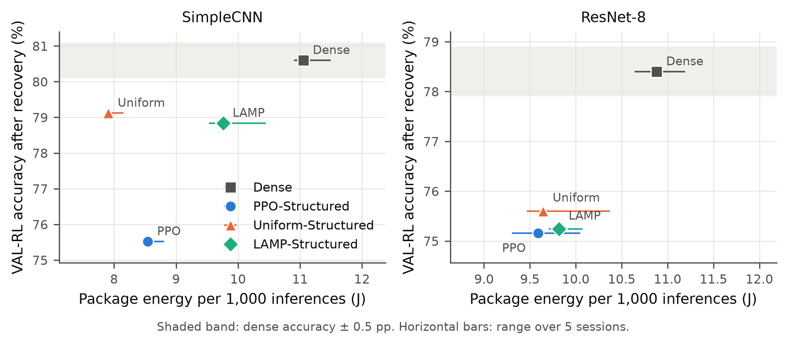

**Figure 6.3. Phase 7A: VAL-RL accuracy after recovery against measured package energy per 1,000 inferences.**
- **Points:** medians.
- **Horizontal bars:** range over the five sessions.
- **Shaded band:** dense accuracy ± 0.5 pp. No pruned model lies inside it.

**Interpretation.** Structured realisation made the compression real at the hardware:
- parameters, MACs, latency and directly measured package energy all fell, consistently across sessions;
- the measured package power was about 15 W for every model, so the energy savings followed the latency savings
  closely.

The learned masked allocation, however, did not transfer well. Its structured form lost 5.1 and 3.2 pp of VAL-RL
accuracy, and on SimpleCNN a plain uniform allocation was both more accurate and more energy-efficient.

**Claim boundary.**
- Phase 7A does not show accuracy-preserving energy reduction.
- It does not show that PPO is more energy-efficient than Uniform.
- It says nothing about the masked Phase-5/6 models themselves.
- The energy is CPU package energy on one laptop, not whole-system or lifecycle energy.

## 6.9 Motivation for Phase 7B

Phase 7A exposed a design problem rather than a measurement problem:
- **What the policy was trained for.** The transferred policy had been learned for *masked* pruning, where removing
  most of SimpleCNN's hidden-layer weights is cheap in accuracy.
- **What the hardware needed.** Realised as channel removal and then recovered, that allocation was neither accurate
  nor efficient enough.
- **A mismatched mapping for ResNet-8.** The masked units do not match the structured units.

Phase 7B was therefore designed **after** Phase 7A, as a separate variant. Its agent chooses structured actions
directly, and its reward is defined on the deployment quantities. It was not part of the original framework and was
not planned before Phase 7A.

## 6.10 Phase 7B — Structured Energy-Aware PPO

**Design** (Sections 3.16.3 and 4.9.7; summarised here):
- **Scope:** SimpleCNN on CIFAR-10 only.
- **Actions:** structured ratios per unit, each one a physical width configuration.
- **State and prior:** an eight-feature state including centred structured sensitivity, plus the centred
  sensitivity prior (β = 1.0).
- **Accuracy proxy:** feasibility judged by a 2-epoch recovery proxy on VAL-RL, accepted before the search.
  - Spearman 0.948 against 5-epoch recovery;
  - threshold τ̂ = 0.98849;
  - recall 1.00 and precision 0.655 on the validation sample.
- **Energy surrogate:** Ê = −0.117 + 13.762·T_table (J per 1,000 inferences, T in ms), fitted to directly measured
  energy of 200 calibration policies and accepted by cross-validation (Spearman 0.996, median absolute percentage error
  1.05%).
  - Candidates were tried in a fixed order.
  - The first, MACs alone, failed the acceptance criteria (Spearman 0.946 against the required 0.95; error in the
    lowest-energy quartile 8.55% against 5%).
  - The second, Paper-3 table latency, passed. Measured latency, not MACs, was the accepted predictor of measured
    energy.
- **Reward and selection:**
  - a constraint-first reward on the proxy, with α = 4 fixed on development seeds;
  - a feasible archive with lowest-predicted-energy selection;
  - 20 confirmatory seeds (700–719).
- **Recovery:** the equal 5-epoch recovery for every final model.
- **Accuracy criterion:** VAL-SELECT, which is held out from the search and selection.

**Status of the surrogate.** The surrogate supported the search only. **It is not measured energy, and it is not
evidence for the energy of any final Phase-7B model.** No predicted saving is reported as a result.

**Selection outcome.** Every one of the 20 seeds selected a policy; no archive was empty.
- **Primary policy:** [2, 2, 2, 5], selected in **5 of 20** seeds. Its widths are **[26, 51, 102, 102]**: 20% of the
  three convolutions' channels and 60% of the hidden neurons are removed.
- **Other selections:** six other policies, each selected by 1–4 seeds. All of them were also recovered and
  evaluated.
- **Proxy boundary.** The primary policy's proxy retention, 0.9890, lies just above the threshold of 0.98849. The
  selections sit at the proxy feasibility boundary.

## 6.11 Phase 7B — Memory and Computation Results

**Table 6.4. Phase 7B: accuracy, memory and computation after the equal 5-epoch recovery (SimpleCNN, CIFAR-10).**
Memory is parameter memory, Σ numel × element size (float32). Latency and energy were **not measured** (Section 6.13).

| Model | Widths | VAL-SELECT (Δ pp) | VAL-RL (Δ pp) | Parameter memory | Memory ↓ | MACs (M) | MACs ↓ |
|---|---|---|---|---|---|---|---|
| Dense | [32, 64, 128, 256] | 80.00 (0) | 80.60 (0) | 2,481,448 B | — | 10.85 | — |
| **New PPO [2, 2, 2, 5]** | [26, 51, 102, 102] | **78.88 (−1.12)** | 80.00 (−0.60) | 908,916 B | **63.4%** | 6.94 | **36.0%** |
| Uniform, r = 0.208 | [25, 51, 101, 203] | 78.76 (−1.24) | 79.76 (−0.84) | 1,555,908 B | 37.3% | 6.93 | 36.2% |
| LAMP, s = 56.2% | [32, 58, 103, 94] | 79.64 (−0.36) | 79.12 (−1.48) | 909,932 B | 63.3% | 8.76 | 19.3% |
| Old PPO (7A) [0, 2, 5, 5] | [32, 51, 51, 102] | 76.00 (−4.00) | 75.52 (−5.08) | 493,836 B | 80.1% | 6.23 | 42.6% |

**Level 1, memory.** The new PPO model needs **63.4% less parameter memory** than the dense model (908,916 vs 2,481,448
bytes). Its serialised checkpoint is 63.3% smaller.

**Level 2, computation.** It needs **36.0% fewer MACs** (6.94 M vs 10.85 M per image).

**Spread across seeds.** The seven distinct per-seed selections all removed between 34.1% and 37.5% of the MACs, but
their parameter-memory reduction ranged from 29.5% to 63.4%. The search rewarded predicted energy, which tracks
latency, and therefore MACs. The selections converged on a narrow MAC band and differ mainly in how many hidden-layer
neurons they remove, a choice that changes memory a great deal and MACs very little (Section 6.5).

**Comparison with the matched baselines** (descriptive):
- **Uniform** (MAC-matched): about the same MACs (36.2%), but much less memory reduction (37.3%).
- **LAMP** (parameter-matched): about the same memory reduction (63.3%), but far fewer MACs removed (19.3%).
- **Old PPO:** removes the most memory and MACs (80.1%, 42.6%).

**Latency.** Latency was not measured for Phase 7B, so Level 2 is established for MACs only. The Paper-3 table
latency of the policy's shape was a surrogate input, not a Phase-7B measurement.

## 6.12 Phase 7B — Accuracy Trade-off

**Result on the pre-registered split (VAL-SELECT).** The new PPO model reached 78.88% against the recovered dense
model's 80.00%, a loss of **1.12 pp**. Every other per-seed selection lost between 1.08 and 1.28 pp.

**Comparison with the Phase-7A transfer.** Measured on the same split and protocol, the old Phase-7A PPO model lost
**4.00 pp**, so the redesign reduced the loss by 2.88 pp.
- **Split caveat.** Phase 7A's widely quoted 5.08 pp loss is on VAL-RL, Phase 7A's criterion split. Comparing it
  directly with the 1.12 pp VAL-SELECT figure would mix splits.
- **VAL-RL comparison.** On VAL-RL the new model's loss was 0.60 pp, against 5.08 pp for the old model.

**Joint deployment-efficiency success criterion.** The pre-registration names it GREEN-SUCCESS (Section 4.9.7).
- **Result: met by 0 of 20 seeds.** Every selected policy lost more than the allowed 0.5 pp on VAL-SELECT, so the
  accuracy condition fails for all of them. That alone decides the outcome.
- **Unassessed conditions.** The latency and energy conditions could not be assessed either, because no measurement
  session took place (Section 6.13).
- **Case.** The pre-registered case is undetermined between "memory, MACs and energy improve but accuracy fails" and
  none of the cases.

**Comparative boundaries** (descriptive; no energy verdict is possible for any model):
- **Against Uniform:** the new PPO model is 0.12 pp more accurate on VAL-SELECT, at similar MACs (36.0% vs 36.2%
  removed) and with much lower memory (63.4% vs 37.3% removed).
- **Against LAMP:** the new PPO model is 0.76 pp less accurate, removes more MACs (36.0% vs 19.3%), and removes about
  the same parameter memory (63.4% vs 63.3%).
- **LAMP-Structured** is the only pruned model within 0.5 pp of dense on VAL-SELECT (−0.36 pp). Its joint criterion is
  not assessable, because energy was never measured.

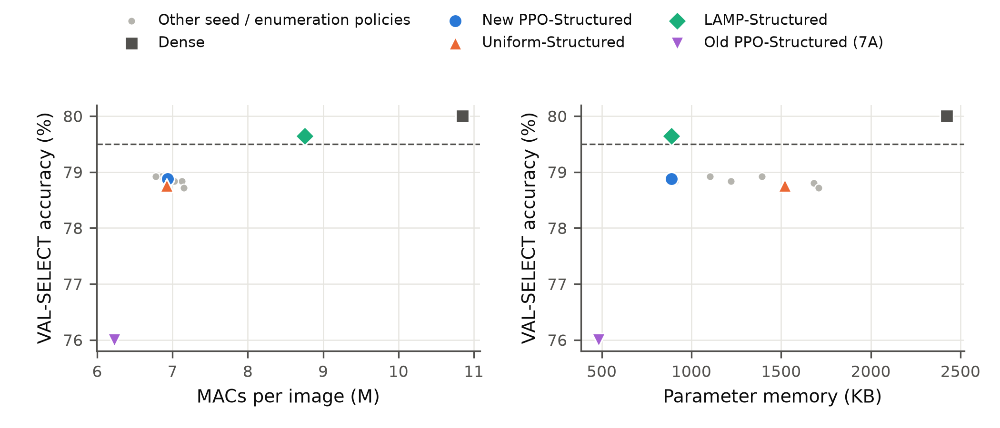

**Figure 6.4. Phase 7B: VAL-SELECT accuracy after the equal 5-epoch recovery against MACs per image (left) and
parameter memory (right).**
- **Dashed line:** dense accuracy − 0.5 pp, the accuracy condition of the joint criterion.
- **Grey points:** the other per-seed selections and the enumeration reference.

**Interpretation.**
- Learning directly in the structured space improved the memory–computation–accuracy trade-off substantially over
  transferring a masked policy. At similar MACs it cut the VAL-SELECT accuracy loss from 4.00 to 1.12 pp.
- The redesign did not reach the 0.5 pp criterion.
- The selections sit at the proxy feasibility boundary, and the proxy's precision at its threshold was 0.655 in
  validation. This is consistent with the shortfall, although the data do not isolate the proxy as its cause.

**Claim boundary.**
- Phase 7B shows no measured latency or energy reduction.
- It is not accuracy-preserving.
- It does not beat Uniform or LAMP.
- The joint deployment-efficiency criterion was not achieved.

## 6.13 Direct Energy Confirmation and Measurement Failure

Two independent attempts were made to measure Phase-7B energy directly. Both stopped at the pre-registered stability
check, before any comparison between models.

**Attempt 1, the Phase-7B confirmatory pilot** (dense model only; rule: coefficient of variation ≤ 3%; N is doubled
once, then STOP):

| Step | N per block | CV of six dense blocks | Decision |
|---|---|---|---|
| First pilot | 100,000 | **11.36%** | unstable; N doubled |
| Doubled-N attempt | 200,000 | — | voided by recorded user decision after the CPU-load gate stopped it during foreground activity |
| Permitted rerun, laptop idle | 200,000 | **4.01%** | unstable → **hardware validation STOPPED** |

No confirmatory energy session was run.

**Attempt 2, the separate energy confirmation study.**
- **Protocol.** Written and committed before any data, for the frozen Phase-7B models; all five checkpoint hashes
  were verified. The workload added a fixed 180 s thermal soak and used 200,000 inferences per block.
- **Qualification.** Dense model only, 3 fresh runs × 2 blocks = **6 blocks**.
  - Energy per 1,000 inferences ranged from 9.47 to 15.22 J (mean 12.14 J).
  - The coefficient of variation was **19.92%**, against the **3%** criterion.
  - All runs passed the validity gates, with in-block system load 7.6–10.2%, below the 15% limit.
- **Outcome.** The setup was **not qualified**. There was one permitted attempt, and the limit was not relaxed.
  **No Dense-versus-PPO paired session ran.**

**Result.** **Direct energy confirmation for Phase 7B remains unresolved.** The available measurement setup did not
satisfy the stability requirement. No estimate from latency or from the surrogate is substituted.

**What the qualification recorded** (descriptive):
- **The workload was steady.** Median latency stayed within 1.042–1.052 ms across the six blocks, a spread of about
  1%.
- **Package power was not.** It ranged from 9.1 to 14.5 W:
  - core (PP0) power ranged from 6.7 to 9.7 W;
  - the rest of the package ranged from 2.4 to 5.1 W.
- **Temperature moved with it.** The thermal-zone reading ranged from 72 to 92 °C, and the coolest run gave the lowest
  energy.

The instability therefore lay in the package's power draw under identical work, not in the timing of the inference.
The measurements do not identify its source. Nothing in them attributes the instability to the model, and only the
dense model was measured.

**The contrast with Phase 7A.** The same software counter on the same laptop had passed its pilot in Phase 7A, with CV
2.30% and 1.74%. The thesis records this contrast without claiming a cause. A software counter on a laptop is not a
guaranteed-stable instrument, which is why each study had to qualify it [87], [88].

## 6.14 Three-Level Sustainability Assessment

**Table 6.5. Three-level deployment-efficiency assessment.**

| Level | Metric | Phase 7A evidence (structured transfer) | Phase 7B evidence (structured, energy-aware PPO) | Conclusion |
|---|---|---|---|---|
| **1. Compression / memory** | parameter count / parameter memory; serialised size | parameters −80.1% (SimpleCNN) and −25.0% (ResNet-8) | parameter memory −63.4%; serialised −63.3% | **Established** in both phases |
| **2. Computation / latency** | MACs; measured batch-1 latency | MACs −42.6% / −21.5%; **measured** speed-up 1.28× / 1.09× | MACs −36.0%; latency **not measured** | MACs established in both; latency measured for 7A only. Paper 3: MACs are a strong latency proxy, parameters a weak one |
| **3. Operational energy** | RAPL package J per 1,000 inferences; EDP | **Measured:** −22.8% / −13.4%, lower in 5/5 sessions; EDP 0.603 / 0.791 | **Unresolved:** pilot CV 11.36% → 4.01%; confirmation CV 19.92% (limit 3%) | Real energy reduction demonstrated in 7A only |
| **Accuracy** (criterion ±0.5 pp) | recovered validation accuracy | **Failed:** VAL-RL −5.08 / −3.24 pp; no pruned method within 0.5 pp; Uniform dominated PPO on SimpleCNN | **Failed:** VAL-SELECT −1.12 pp; 0/20 seeds met the joint criterion | The accuracy trade-off was too large in 7A and reduced, but not removed, in 7B |

**Reading the table level by level:**
1. **Level 1 does not imply Level 2.** The Phase-7A SimpleCNN PPO model removed 80.1% of the parameters but only 42.6%
   of the MACs. MAC-matched Uniform removed only 44.7% of the parameters, yet ran faster. Paper 3 shows the same
   pattern over 5,184 shapes.
2. **Level 2 tracked Level 3 in Phase 7A.** Package power was nearly constant across models, so the energy savings
   followed the measured latency savings.
3. **Level 3 must be measured.** In Phase 7B the instrument could not be qualified, so no energy statement is made.
   Neither the strong MAC reduction nor the energy surrogate substitutes for a measurement.

Every level is reported with its accuracy cost. A deployment saving bought with a material accuracy loss is not
presented as a sustainability result.

## 6.15 Answer to RQ6

**RQ6. Does model compression translate into real deployment benefit?**

Compression can translate into real deployment savings, but not automatically, and not at every level at once.
1. **Masked sparsity alone gives no hardware evidence.** Physical structured pruning is needed for dense-kernel CPU
   cost to fall.
2. **Even structurally, parameter reduction is a weak guide to latency.** Across 5,184 measured structured policies,
   Spearman ρ was 0.31–0.55 for parameter reduction and 0.89–0.98 for MAC reduction. In 31–39% of policy pairs the
   sparser policy was slower.
3. **Accuracy-feasible headroom is small.** For ResNet-8, the best proxy-feasible candidate reached a 1.098×
   speed-up, while the best confirmed five-epoch-feasible calibration policy reached 1.089×. Neither satisfied the
   pre-registered 1.10× GO criterion, so the hardware-aware search was not started.
4. **Phase 7A: real energy savings, with material accuracy loss.** Physical structured realisation of the learned
   allocation reduced directly measured CPU package energy per inference by 22.8% (SimpleCNN) and 13.4% (ResNet-8),
   lower than dense in every session. These savings came with VAL-RL losses of 5.08 and 3.24 pp. On SimpleCNN, a
   MAC-matched uniform allocation was both more accurate and more energy-efficient.
5. **Phase 7B: a much better trade-off, but neither criterion met.** By learning directly in the structured space,
   Phase 7B substantially improved the memory–computation–accuracy trade-off. It reduced parameter memory by 63.4% and
   MACs by 36.0% while limiting the VAL-SELECT loss to 1.12 pp, against 4.00 pp for the transferred policy. It did not
   meet the 0.5 pp accuracy criterion (0 of 20 seeds), and direct energy confirmation could not be completed, because
   the measurement setup failed its stability qualification.

**Therefore** deployment benefit must be established separately for memory, computation, latency and energy, each
with its accuracy cost. An improvement at one level is a hypothesis about the next, not evidence for it.

## 6.16 Chapter Summary

- **Paper 3** measured all 5,184 structured shapes of four network–output tables. Parameter reduction is a weak latency
  proxy (ρ 0.31–0.55); MAC reduction is a strong one (ρ 0.89–0.98); measured latency remains the deployment-grounded
  metric.
  - The SimpleCNN accuracy proxy was rejected.
  - For ResNet-8, the best proxy-feasible candidate reached 1.098× and the best confirmed five-epoch-feasible
    calibration policy 1.089×. Neither satisfied the 1.10× GO criterion, so no hardware-aware RL was run.
- **Phase 7A** showed that structured pruning reduces directly measured CPU package energy (−22.8% and −13.4%). The
  transferred PPO allocation, however, lost 5.08 and 3.24 pp of VAL-RL accuracy, no method met the 0.5 pp criterion,
  and on SimpleCNN Uniform was better than PPO in both accuracy and energy.
- **Phase 7B**, designed in response, learned structured policies directly.
  - Its primary policy [2, 2, 2, 5] reduced parameter memory by 63.4% and MACs by 36.0% at a 1.12 pp VAL-SELECT cost,
    against 4.00 pp for the transferred policy.
  - No seed met the joint deployment-efficiency criterion.
- **Energy confirmation.** Both energy-measurement attempts stopped at the stability check (CV 11.36% → 4.01%, then
  19.92%, against 3%), so Phase-7B energy remains unresolved.

Chapter 7 discusses these results together with those of Chapter 5.


# Chapter 7 — Discussion

## 7.1 Chapter Overview

Chapters 5 and 6 reported what happened:
- in the core pruning experiments (Phases 3–6);
- when the pruned models were realised and measured on hardware (Paper 3, Phases 7A and 7B, and the energy
  confirmation study).

This chapter asks what those results mean. It interprets the evidence across phases, places it against the
literature reviewed in Chapter 2, and states where the proposed framework succeeds and where it does not.

**Ground rules:**
- **No new numbers.** Every number used here was reported and audited in Chapters 5 and 6, and the discussion adds no
  new measurement.
- **Causal wording only where earned.** Causal language is reserved for effects the experimental design isolated,
  such as the C1-versus-C2 contrast of Phase 5, or for relations that hold by construction.
- **Hedged wording elsewhere.** Where only an association was observed, the text says so ("is consistent with", "may
  reflect").

The discussion proceeds in the order in which the thesis encountered its problems:
- what the RL agent contributes (Sections 7.2–7.3);
- retention, reward design and recovery (Sections 7.4–7.7);
- deployment and measured energy (Sections 7.8–7.11);
- generalisability, limitations and the thesis's overall contribution (Sections 7.12–7.15).

## 7.2 What Adaptive Layer-Wise PPO Actually Contributes

**The evidence.**
- **Allocations.** Across six architecture–dataset settings, the PPO agent learned allocations that were visibly
  non-uniform. It pruned large, low-sensitivity layers heavily and kept small early layers almost intact
  (Figure 5.2).
- **Against simple allocation.** At the sparsity it chose itself, these allocations were far more accurate than
  uniform allocation (STRONG, 5 of 6 settings, up to about +31.4 pp on CIFAR-10 SimpleCNN) and random allocation
  (6 of 6).
- **Against magnitude criteria.** Against global magnitude and ERK the picture was mixed (MODERATE and LIMITED).
- **Against LAMP.** LAMP was significantly more accurate than PPO before recovery in 5 of 6 settings in Phase 3, and
  in 6 of 6 for the later pipelines of Phases 4 and 5.

**What this establishes.**
- **The agent solves the allocation problem it was given.** It discovers that layers should be pruned differently,
  and it does so without any hand-written allocation rule. In this sense the thesis confirms the premise behind
  RL-based compression [10]: layer-wise allocation is learnable from a scalar reward.
- **It does not establish superiority.** The thesis does not show that a learned allocation is better than the best
  deterministic allocation rule. The comparison with LAMP, a cheap and deterministic method, points the other way at
  the sparsities studied.

**Where the agent's value lies.**
- **Not universal superiority.** One interpretation, supported by the later phases, is that PPO's value lies in its
  *flexibility*: it optimises whatever objective it is given.
- **The phases changed the objective repeatedly, and the agent adapted:**
  - Phase 4 changed the prior;
  - Phase 5 changed the reward to a constraint;
  - Phase 7B changed the action space to physical channels and the objective to a deployment surrogate.

  The agent and its training procedure stayed the same. That property is not shared by a fixed rule such as LAMP,
  which optimises one implicit criterion.
- **The evidence for flexibility is indirect.** The thesis shows that PPO *can* be pointed at a new objective and will
  pursue it. In Phase 5 this paid off for ResNet-8. The thesis does not show that this flexibility yields a better
  final model than a tailored deterministic method for any objective tested here.

**Implication.** RL pruning should be presented as an adaptive optimisation mechanism for objectives that are hard to
express as a single saliency score, not as a replacement for strong deterministic pruning when the objective is
ordinary magnitude-based compression. Nothing in the thesis implies that PPO is necessary for pruning in general.

## 7.3 The Role of Sensitivity Information

**The pattern.** Across three phases, sensitivity guidance improved the *search*, but not the *final model*:
- **Phase 3, prior against no prior:**
  - better-ranked policies were sampled earlier, with fewer destructive policies (STRONG on three secondary search
    endpoints);
  - the primary accuracy-AUC endpoint improved in 3 of 6 settings;
  - no final-accuracy effect was found in any setting.
- **Phase 4, centred prior:** it beat both its shuffled control and a magnitude-matched conservative control on
  reward-rank AUC (STRONG), and beat the sign-reversed prior in every setting. It did not improve the final rank.
- **Phase 5, under the corrected reward:** the centred prior again improved exploration in 5 of 6 settings, with none
  of 24 primary tests opposite. Yet C1's test accuracy was 0.05–0.16 pp *below* C2's in every setting (descriptive).

**The strongest defensible reading.** Sensitivity is useful as a **search bias**. Its measurable contribution lies
primarily in exploration guidance, not in predicting which final model will be most accurate.

The pattern has a natural explanation that the thesis can describe but not prove:
- **What the prior acts on.** It changes the probability of each action. It pushes the agent away from aggressive
  ratios on sensitive units and, once centred, towards them on insensitive units. That shapes *which* policies are
  sampled early.
- **What decides the outcome.** The returned policy is decided by the reward landscape and the selection rule. In
  these small spaces, where every setting's best-seen policy already had a median rank of 1–4.5, the search finds
  near-optimal regions with or without the prior. A better route to the same destination need not change the
  destination.

**Why centring mattered.** The Phase-3 controls carried an important warning:
- **The LeNet-5 controls.** The shuffled and constant priors did as well as the correct one there.
- **A shared pressure.** All three Phase-3 priors share the same total pressure towards lighter pruning. Part of any
  benefit could therefore be generic conservatism rather than layer-specific knowledge.
- **What centring was designed to do.** It distinguishes "more sensitive than average" from "less sensitive than
  average", and removes the net conservative pressure by construction. It was designed to distinguish layer-specific
  sensitivity guidance from a generic conservative "prune less" pressure.

What Phase 4 then showed is more informative than a simple success:
- **Stronger evidence for a layer-relative effect.** The centred prior's advantage over permuted and
  magnitude-matched controls on reward-rank AUC provides stronger evidence for a layer-relative exploration effect
  than Phase 3 did. It does not amount to complete causal isolation of layer-specific information.
- **The reversed measure.** On the accuracy-based exploration measure, the *conservative* control was significantly
  better than the centred prior in 4 of 6 settings.
  - This is consistent with how the two priors act. The centred prior pushes aggressive actions onto insensitive
    units, which can raise the reward rank of sampled policies while lowering their average accuracy.
  - Reward rank and accuracy are different targets under a trade-off reward. Centring made the prior more
    layer-specific and more interpretable; it did not make it a better predictor of final accuracy.

**Implication for the literature.** Sensitivity is often treated as a direct proxy for how much a layer can be
pruned. The dissociation found here suggests evaluating sensitivity-based methods on two separate axes:
- does the information improve the *search*?
- does it improve the *outcome*?

The thesis found the first, but not the second. This does not mean sensitivity "does not work". It means its
contribution is of a different kind than often assumed.

## 7.4 Search Quality versus Policy Retention

**The finding.** One of the clearest results of the thesis is that **finding a good policy and ending on it are
different problems.**
- **Finding.** In Phase 4, PPO's best visited policy reached the top 10 of 1,296 in 95–100% of runs, with a median
  rank of 1–2.5.
- **Ending.** The terminal policy reached the top 10 in 0% of runs in five settings and 5% in the sixth (median rank
  65–173). The same pattern was present in Phase 3.
- **Retaining.** Archive selection restored retention on validation ranking: 80–100% top-10 reach and 100% top-20
  reach for the final Phase-4 pipeline.

**A possible mechanism (not isolated).** A stochastic policy-gradient method updates its distribution on noisy,
high-variance estimates. It may sample an excellent policy early and then settle on a region of high average reward
that does not contain it. The thesis observed the gap; it did not isolate its mechanism.

**What the finding establishes is methodological.** A study that reports only the terminal policy of an RL pruning
agent measures retention together with search, and can mistake one for the other. Had the thesis reported only
terminal policies, it would have concluded that PPO searches poorly. The exhaustive landscapes showed instead that it
searches well and retains poorly.

This mirrors observations in neighbouring fields:
- the gap between the search phase and the final selection in architecture search [64];
- the value of archives of visited states in exploration [66].

**Recommendation.** RL pruning studies should report, separately:
- the best visited policy;
- the retained (terminal or selected) policy;
- the selection procedure that links them.

**Elite behavioural cloning.** Phase 4 also tested whether retention could be improved *inside* training, by adding
an imitation term towards the best policies seen so far (in the spirit of self-imitation learning [65]).
- **Results:** it improved the final-selected rank in only 3 of 6 settings and the best-seen rank in 1 of 6. The
  archive rule alone improved the selected rank in 6 of 6.
- **What this supports:** in these experiments, pulling the actor towards elite policies during training was not
  equivalent to keeping the elite candidates outside the agent and choosing among them afterwards.
- **What it does not support:** a claim that behavioural cloning is ineffective in general. Only one strength
  (η = 0.1) and one elite size (K = 5) were tested, and the term was dropped after Phase 4.

**The boundary.** Archive selection improves *validation-rank* retention. Its effect on test accuracy was mixed:
- small gains in four settings;
- losses of 5.66 and 4.00 pp on ResNet-8.

The archive retained exactly what the reward ranked highest, and on ResNet-8 that was an over-pruned model. Retention
amplifies whatever the reward specifies, which leads directly to the next section. Archive selection is therefore a
retention mechanism, not a generalisation mechanism.

## 7.5 Reward Design and Over-Pruning

**A stronger optimiser exposes the reward.** Phase 4 provides the thesis's clearest reinforcement-learning lesson.
- **What changed.** Once search and retention improved, the agent reliably reached the optimum of the reward R0.
- **Where that optimum lay.** R0's optimum is set by its fixed exchange rate between accuracy and sparsity, and lies
  at 23.5–56.4% sparsity depending on the setting.
- **What it cost on ResNet-8.** The optimum is an accuracy-losing policy. With the improved pipeline, ResNet-8
  sparsity rose and test accuracy fell by 7.86 pp (CIFAR-10) and 4.77 pp (CIFAR-100) below dense.

**The optimiser did not fail.** It optimised what the reward asked for. A weaker search had hidden the misalignment by
rarely reaching the reward's optimum. This is a pruning instance of a general observation: more capable optimisers
exploit misspecified objectives more strongly [17], [89].

**The practical consequences:**
1. Search performance must be judged together with objective quality. A better rank under a misaligned reward can be
   a worse model.
2. A pruning reward must encode the acceptable accuracy–compression boundary explicitly. A trade-off reward has no
   region in which accuracy loss becomes unacceptable, so on fragile architectures its optimum can be a model no
   practitioner would deploy.

**The accuracy-constrained reward as a correction.** Phase 5 made accuracy a constraint rather than a traded quantity,
in the spirit of constrained reinforcement learning [90].
- **Effect on ResNet-8.** Comparing the constrained reward with R0 under the same prior and archive (C1 vs C0)
  isolates the reward as the manipulated factor. The ResNet-8 accuracy loss fell from 7.32 to 1.18 pp (CIFAR-10) and
  from 4.05 to 1.16 pp (CIFAR-100), at markedly more moderate sparsity.
- **Effect elsewhere.** On SimpleCNN the constrained reward was slightly *worse* than R0. There the agent used the 2%
  allowance for a little more sparsity.
- **LAMP was still stronger.** It remained more accurate than the constrained pipeline in all six settings.
- **The constraint did not transfer fully.** It held on test in only 67.5% of runs.

The evidence therefore supports a clear separation. A validation-based accuracy constraint is an effective
**optimisation constraint**: it controls over-pruning during search. It is not a **generalisation guarantee**.

## 7.6 Validation-to-Test Transfer

The gap is large enough to discuss on its own:
- 119 of 120 constrained policies passed the constraint on the selection split, but only 81 of 120 remained feasible on
  the test set;
- in CIFAR-100 ResNet-8, none of 20 did.

**Possible explanations** (none isolated by the experiments):
1. **Validation sampling variability.** Each validation split has 2,500 images. Its sampling noise is of the same order
   as the 2% relative margin, so a policy that passes by a small margin on validation can fail by a small margin on
   new data.
2. **Selection at the boundary.** The constrained reward drives the agent to the *most compressed* feasible policy, so
   the selected policies sit close to the threshold by design. A tight threshold then turns small accuracy
   differences into binary feasibility failures.
3. **Architecture and dataset dependence.** The failures concentrated in the LeNet-5 settings and in CIFAR-100
   ResNet-8, where the feasible region is small and the dense accuracy is low.

**Implication.** Constraint-based pruning needs either margins, uncertainty-aware constraints or larger selection
splits before a validation-certified constraint can be read as a promise about unseen data. Phase 6 showed that equal
recovery removed most of the gap for this pipeline. That is a property of recovery, not of the constraint.

## 7.7 Why LAMP Remains a Strong Benchmark, and Why Equal Fine-Tuning Changes the Rankings

### 7.7.1 LAMP

LAMP [9] was the strongest method before recovery throughout the core framework. It is deterministic and
requires no search. Its strength need not invalidate the thesis; it calibrates it.

One interpretation is that LAMP's layer-adaptive score already captures much of what a learned allocation can achieve
under an ordinary objective. That objective is to remove as many small-magnitude weights as possible while keeping
the network's function. Its rescaled magnitude score sets layer-wise sparsity automatically [9], which is
the decision a sensitivity-guided search tries to learn. The thesis did not test this explanation.

**The lesson about cost.** For simple compression objectives, a strong deterministic layer-adaptive baseline can be
difficult to beat, and RL must justify its additional cost:
- **PPO's cost:** repeated pruned-model evaluations (512 per run in this thesis); many seeds; reward design; prior
  calibration; archive management; selection splits.
- **LAMP's cost:** one pass over the weights.

**Where an adaptive search may become useful.** When the objective is simple, deterministic pruning is likely
preferable. When the objective includes accuracy constraints, layer sensitivity, deployment metrics or several
competing goals, an adaptive search becomes the more natural tool. The thesis does not show that this future
advantage materialises, and Phase 7B does not prove it (Section 7.10).

### 7.7.2 Equal fine-tuning

**What changed.** Phase 6 changed the comparison more than any other experiment:
- **Before recovery,** differences between methods were clearly visible: LAMP led PPO by 0.26–0.53 pp, and PPO led
  global magnitude by up to 6.51 pp.
- **After an identical five-epoch, fixed-mask recovery,** the PPO–LAMP difference fell to 0.00–0.22 pp, and PPO's
  advantage over global magnitude to at most 0.12 pp.
- **Every pruned model recovered,** and the post-recovery PPO–LAMP differences fell within the pre-registered ±0.5 pp
  confidence-interval margin in all six settings.

This is a decision rule, not a formal equivalence test, and LAMP remained slightly but significantly ahead in three
settings. The methods are therefore not equivalent. Their differences became small.

**One interpretation.** Much of the apparent advantage of one pruning rule over another reflects how much accuracy
the *initial* masked model preserves before retraining. Recovery appears to compensate most where the initial loss was
largest: global magnitude recovered the most and LAMP the least.

The Phase-6 design isolates the recovery budget. Methods differ only in their masks; seeds and data streams are
shared. So within each setting the narrowing of the gaps is an effect of equal recovery. The exact mechanism inside
fine-tuning is not isolated, and the interpretation above remains an interpretation.

**This is the thesis's most important methodological implication for pruning comparisons.**
- **Compare after equal recovery.** Methods should be compared after equal post-pruning recovery budgets, and not only
  immediately after pruning. Otherwise the comparison is partly a comparison of how much each method damages the
  network before the damage is repaired.
- **Agreement with the literature.** This is consistent with work showing that retraining choices can change pruning
  conclusions [14], [15], [18].

**The boundary of the claim.** It holds for small CNNs at the moderate sparsities PPO selected under the accuracy
constraint (mean 15.6–56.9% in Phase 6), with a five-epoch budget. It does not extend to very high sparsity, ImageNet-scale models,
transformers or large models, where recovery may compensate far less.

## 7.8 Compression versus Real Deployment Efficiency

**Masked versus structured pruning.** The core framework's masked pruning and the extension's structured pruning
serve different purposes.
- **Masked pruning** is well suited to search and analysis. Every policy is a masked copy of the same network, the
  full policy space can be evaluated, and recovery can preserve the mask exactly. But masked zeros stay inside dense
  tensors. Without sparse kernels, a masked model is not smaller or faster on a CPU [8]. The
  thesis makes no latency or energy claim for its masked models.
- **Structured pruning** changes tensor shapes. Only then can parameters, MACs, latency and energy fall physically.
  Structured pruning is not universally better, however. Removing whole channels is coarser than removing weights,
  and in Phase 7A the structured realisation of the masked allocation cost several points of accuracy.

**Sparsity is not speed.** Paper 3's exhaustive tables give a clear deployment lesson:
- **Parameter reduction** correlated only weakly with measured CPU latency gain (Spearman 0.31–0.55).
- **MAC reduction** correlated strongly (0.89–0.98).
- **Inversions are common.** In roughly a third of policy pairs or more, the more parameter-sparse policy was slower.

The SimpleCNN example shows the reason, which here is arithmetic rather than inference. In that network:
- the hidden fully connected layer holds most of the weights but very little of the computation;
- the early convolutions are the reverse.

So removing parameters from low-compute layers can shrink the model a great deal while barely changing its runtime,
and pruning expensive convolutional paths can deliver a large speed-up with few parameters removed. This is
consistent with the broader observation that cost indicators can disagree [16]. The thesis
quantifies the disagreement exhaustively for small structured CNNs on one CPU.

**Accuracy-feasible headroom.** Raw latency headroom existed: the most aggressive structured policies were up to 2.61×
faster on SimpleCNN. Under an accuracy constraint, the useful headroom shrank sharply:
- for ResNet-8, the best proxy-feasible candidate reached 1.098×;
- the best confirmed five-epoch-feasible calibration policy reached 1.089×;
- neither satisfied the pre-registered 1.10× GO criterion, and the 1.098× candidate was never confirmed feasible.

For SimpleCNN no accuracy-feasible headroom could be established at all, because its accuracy proxy failed
validation. **Unconstrained speed-ups say little about the speed-ups available to a model that must keep its
accuracy.**

## 7.9 Accuracy–Efficiency Trade-offs and the Three Levels of Efficiency

The deployment results are best read through the three levels of Chapter 3:
- **Level 1:** compression and memory;
- **Level 2:** computation and latency;
- **Level 3:** measured operational energy.

**Each level needs its own evidence:**
1. **Memory does not guarantee latency.**
   - In Phase 7A, the SimpleCNN PPO model removed 80.1% of the parameters but was slower than a uniform model that
     removed far fewer.
   - Paper 3 shows the same weak link across 5,184 shapes.
2. **MACs predict latency better, but do not replace measurement.**
   - The MAC–latency correlation is strong but below 1.
   - At nearly equal MACs, Uniform was still faster than PPO in Phase 7A.
3. **Latency does not mathematically guarantee energy.** Energy is power times time, so a faster model saves energy
   only if its average power does not rise to compensate.
   - In Phase 7A, average package power was nearly the same for every model, so energy savings followed latency
     savings.
   - That is an observation about this platform and workload, not a general law.

**Accuracy must be reported at every level.** A deployment saving obtained with a material accuracy loss is a
different result from a saving at preserved accuracy. The pre-registered criteria of Phases 7A and 7B made this
explicit by requiring accuracy within 0.5 pp of dense.

**No pruned model met that requirement in either phase, except LAMP-Structured in Phase 7B, whose energy could not be
measured.** Every deployment saving in the thesis therefore comes with an accuracy cost, and is reported with it.

## 7.10 Interpreting the Sustainability Experiments

**Phase 7A: real energy savings, but not a better model.** Phase 7A establishes one positive fact firmly:
- physically structured pruning reduced **directly measured** CPU package energy per inference;
- every pruned model used less energy than dense in all five sessions.

The learned allocation's structured form saved 22.8% (SimpleCNN) and 13.4% (ResNet-8).

**But energy savings alone are not evidence of a better model:**
- **The accuracy cost was large.** The SimpleCNN PPO model lost 5.08 pp of validation accuracy.
- **A simpler method did better.** A MAC-matched uniform model was both more accurate and lower in energy.

Phase 7A therefore does not show successful sustainability-oriented optimisation by PPO. It shows that structural
compression reaches the hardware, and that a transferred masked allocation is a poor structured allocation.

The most plausible reading, consistent with Paper 3 but not isolated, is that:
- the masked policy concentrated pruning in the hidden layer, where it costs little accuracy *as a mask*;
- as channel removal followed by recovery, that allocation was neither accurate nor computationally efficient;
- the ResNet-8 mapping was additionally approximate.

**Phase 7B: what improved.** Phase 7B is described here as a **deployment-oriented structured PPO**: its actions were
physical channel ratios, and its reward used a validated energy surrogate. Relative to the transferred policy, it
substantially improved the memory–computation–accuracy trade-off:
- parameter memory fell by 63.4% and MACs by 36.0%;
- the selection-split accuracy loss was 1.12 pp, against 4.00 pp for the old policy on the same split.

This is evidence for the design lesson of Section 7.8: **an allocation should be learned in the space where it will be
deployed.**

**Phase 7B: what it did not solve:**
- **Accuracy criterion missed.** It lost more than the 0.5 pp the pre-registration allowed, and 0 of 20 seeds met the
  joint deployment-efficiency criterion.
- **No measured latency.** Latency was not measured.
- **No measured energy.** Energy is unresolved.
- **No advantage over the baselines.** Against the MAC-matched uniform and parameter-matched LAMP structured
  baselines it showed no clear advantage overall:
  - roughly equal accuracy to Uniform, with lower memory;
  - lower accuracy than LAMP, with fewer MACs.

Phase 7B improved part of the deployment objective. It did not solve the full objective.

**The energy surrogate.**
- **Why it was useful.** It ranked policies very well (Spearman 0.996) with a small median error (1.05%), which made
  energy-aware search affordable.
- **What it cannot be.** Surrogate validity does not turn predicted energy into measured energy. The surrogate was
  validated on calibration policies. Its error for a particular final model is unknown, and the final model's energy
  was never measured.
- **The principle this illustrates:** surrogates can reduce search cost, but final deployment claims require direct
  validation on the final model.

**The measurement failure.** Phase 7B's energy remained unresolved, because the measurement setup repeatedly failed its
pre-registered stability check:
- the first pilot gave a coefficient of variation of 11.36%;
- the permitted rerun gave 4.01%;
- the separate confirmation study gave 19.92%;
- the limit was 3% throughout.

**What was observed during qualification.** Latency stayed stable within about one percent, while package power varied
substantially. The thesis does not claim to know the cause.

**The interpretation it supports** is limited but useful:
- In the present measurement setup, package-energy readings were substantially less stable than latency
  measurements. The thesis does not generalise this beyond the tested system.
- The same counter, on the same machine, had passed its stability check in Phase 7A, so qualification must be
  repeated for every measurement campaign.
- This is a limitation of the experimental environment. **It is evidence neither for nor against the Phase-7B model's
  energy use.** No model comparison was made, and only the dense model was measured.
- This agrees with studies of software energy meters, which report that their readings need careful protocol design
  and validation [86]–[88].

**On sustainability wording.** The thesis does not establish that any of its models is environmentally beneficial,
lower in carbon footprint or suitable for "green" deployment. It establishes measured operational CPU energy savings
for the Phase-7A structured models, with their accuracy costs. For Phase 7B it establishes memory and computation
reductions, with energy unresolved. Lifecycle, training-energy and carbon accounting were outside its scope.

## 7.11 What the Negative Results Establish

The thesis reports several negative or partial results. They are summarised here because they carry much of its
methodological weight.

| Negative or partial result | What it establishes |
|---|---|
| PPO did not beat LAMP before recovery (5 of 6, then 6 of 6 settings) | RL must justify its cost through flexibility or richer objectives, not small accuracy gains under ordinary compression |
| Sensitivity did not improve final accuracy in any phase | Search improvement and outcome improvement must be evaluated separately |
| Archive selection had mixed test effects | Retention is not generalisation; it amplifies whatever the reward specifies |
| Validation feasibility transferred to test in 67.5% of runs | An optimisation constraint is not a generalisation guarantee |
| Hardware-aware RL was NO-GO | Accuracy-feasible latency room can be too small to justify a latency-driven search |
| Uniform beat PPO on SimpleCNN in Phase 7A | A transferred masked allocation is not a good structured allocation; deployment metrics can reverse method rankings |
| Phase 7B missed the 0.5 pp criterion (0 of 20 seeds) | Learning in the deployment space narrows, but does not close, the accuracy gap at these compression levels |
| Phase-7B energy remained unresolved | Energy claims require a qualified instrument; strong MAC reductions and accurate surrogates do not substitute for measurement |

**Each of these results came from an experiment whose decision criteria were fixed in advance, and each was kept as
observed.** Several of them changed the
design of the next phase:
- retention led to the archive;
- over-pruning led to the constraint;
- the lossy transfer led to Phase 7B.

This sequence is the evidence that the thesis's conclusions are not tuned to a favourable result. The positive
findings are credible partly *because* the negative ones are visible. That is a logical point about evidential
weight, not an empirical causal claim.

## 7.12 Generalisability

**The evidence base:**
- **Core framework:** CIFAR-10 and CIFAR-100; three small CNNs (SimpleCNN, a CIFAR LeNet-5 and ResNet-8); four
  pruning units per network; one laptop-scale action space of 1,296 policies.
- **Deployment extension:** a subset of these settings, on one CPU platform (an Intel Core i7-1260P laptop, batch 1,
  one thread).

**Within that scope**, the core findings show some robustness. The main qualitative results recur across both
datasets and all three architectures, with architecture-dependent sizes:
- PPO beats Uniform and Random;
- LAMP is stronger before recovery;
- sensitivity helps search but not outcome;
- the retention gap;
- the narrowing under equal recovery.

The deployment findings are specific to that one platform and run configuration.

**Outside that scope** the thesis provides no evidence. It does not support generalisation to:
- ImageNet-scale data;
- larger CNNs, transformers or large language models;
- GPUs, mobile processors, edge accelerators or cloud inference;
- other batch sizes or thread counts.

**What could change at larger scale.** Several findings may change, in either direction:
- **The policy space** can no longer be enumerated. Retention and search quality can then not be measured against
  ground truth, and the case for a learned search may become stronger.
- **Recovery** may compensate less at high sparsity.
- **Latency and energy relations** are hardware-specific.

Larger-scale and multi-platform validation is future work (Chapter 8).

## 7.13 Limitations

The limitations below bound every claim in Chapters 5–7. They are grouped by kind.

**A. Model and dataset scale**
- CIFAR-scale data and small CNNs only.
- Four pruning units and six ratios per network. The space was small enough to enumerate, which made exhaustive
  ground truth possible but makes the RL problem easier than at realistic scale.
- The sustainability phases used CIFAR-10 only, and Phase 7B used SimpleCNN only.

**B. Optimisation**
- **PPO's search cost** is substantial compared with deterministic methods.
- **Sensitivity guidance** improved exploration but not final accuracy, and one Phase-4 exploration measure reversed.
- **LAMP remained stronger** before recovery and was still slightly ahead in three settings after it.
- **The results depend on reward design.** No Phase-4 redesigned reward met its criterion, and the constrained reward
  made SimpleCNN slightly worse.
- **Elite behavioural cloning** was tested at one configuration only.

**C. Validation methodology**
- Validation-to-test transfer of the accuracy constraint was imperfect (67.5% test feasibility, 0% in CIFAR-100
  ResNet-8).
- The fixed relative threshold (τ = 0.98) and the small selection splits make feasibility sensitive to sampling
  noise.
- The deployment phases used a single recovery seed per model.
- One dense reference (CIFAR-10 SimpleCNN) used an older training recipe.
- Phase 6 was not a fully independent test confirmation, since the test sets had been read for earlier frozen models.
- The ±0.5 pp rule is a confidence-interval decision rule, not a formal equivalence test.
- Recovery used one fixed five-epoch protocol. Longer or tuned recovery might change the rankings.

**D. Hardware**
- One CPU platform, one batch size and one thread configuration.
- No GPU, mobile, embedded or accelerator evaluation.
- Latency relations are architecture- and platform-specific.
- The SimpleCNN accuracy proxy failed validation, so its accuracy-feasible latency headroom is unknown.
- The exhaustive 5-epoch recovered landscape was stopped for compute cost.

**E. Energy**
- CPU package energy only. No DRAM, whole-system or wall-plug measurement, and no external power meter.
- The Phase-7B measurement setup failed its stability qualification repeatedly, so no Phase-7B energy or latency claim
  is made.
- The energy surrogate and the accuracy proxy are model-selection tools, not measurements.

**F. Sustainability**
- No carbon accounting.
- No lifecycle or embodied-energy assessment.
- No analysis of training or search energy.

The deployment-scale energy figures computed in Phase 7A are labelled projections and are not used as results.

## 7.14 Overall Scientific Contribution

**The central contribution.** The novelty of this thesis does not lie in a claim that PPO beats existing pruning
methods; it does not. It lies in **an integrated, systematically audited diagnostic framework, with pre-specified and
pre-registered decision criteria across its later experimental stages**. The framework follows one
pruning approach from layer-wise allocation to measured hardware energy, isolating a separate question at each stage:

| Stage | Question | Thesis evidence | Research question |
|---|---|---|---|
| 1. Adaptive layer-wise allocation | Can a learned agent decide *where* to prune? | Yes: far better than uniform or random; not better than LAMP | RQ1 |
| 2. Sensitivity-guided exploration | Does layer sensitivity help the search? | Search yes, outcome no | RQ2 |
| 3. Policy retention | Does the agent keep what it finds? | No, unless an archive retains it (validation ranking) | RQ3 |
| 4. Reward alignment | Does the reward encode the desired trade-off? | A trade-off reward over-prunes; a constraint controls it, without a generalisation guarantee | RQ4 |
| 5. Equal recovery | Do method differences survive identical fine-tuning? | Largely not, at these sparsities | RQ5 |
| 6. Deployment translation | Does compression become latency? | Through MACs and structure, not through parameter count | RQ6 |
| 7. Direct energy validation | Does it become measured energy, at what accuracy cost? | Yes in Phase 7A, with material accuracy loss; unresolved in Phase 7B | RQ6 |

**How the research questions fit together.** The six questions form a chain, not a list of independent results. Each
answer changed what the next question had to control for:
- **RQ1 to RQ2.** RQ1 established that the allocation is learnable, which raised the question of guidance.
- **RQ2 to RQ3.** RQ2's search-versus-outcome dissociation pointed to the returned policy rather than the search.
- **RQ3 to RQ4.** RQ3's retention fix then exposed the reward, which became RQ4.
- **RQ4 to RQ5.** RQ4's corrected models made the fair comparison of RQ5 meaningful.
- **RQ5 to RQ6.** RQ5's small post-recovery differences moved the question from accuracy to deployment.
- **Within RQ6.** RQ6 showed that compression must be re-measured at each hardware level.

**The thesis-level conclusion.** Effective pruning is **not a single optimisation problem**. It is a chain of coupled
problems:
- where to prune;
- how to search;
- how to guide the search;
- how to retain good policies;
- how to encode the desired trade-off;
- how much recovery is allowed;
- whether compression translates into hardware savings;
- whether those savings survive an accuracy constraint.

A weakness at any link can hide or reverse the effect of improvements elsewhere:
- a good search under a misaligned reward produced worse models;
- a retained policy did not generalise;
- an allocation that was good as a mask was poor as a structure;
- a strong MAC reduction remained unconfirmed as an energy saving.

**This multi-stage view, supported at each stage by experiments whose decision criteria were fixed in advance, and
reported including their negative results, is the thesis's central scientific contribution.**

**Implications for future pruning research:**
1. **Comparisons** should be made after equal recovery.
2. **RL studies** should separate search quality from retention.
3. **Rewards** should encode accuracy boundaries explicitly.
4. **Deployment claims** should be grounded in structured realisation and direct measurement, with accuracy stated
   alongside.
5. **Energy claims** should be made only after the measuring instrument has been qualified.

## 7.15 Chapter Summary

- **PPO.** It contributes a flexible, learnable layer-wise allocation that clearly beats uniform and random
  allocation. It does not beat the strong deterministic LAMP baseline, so its value lies in adaptability to changing
  objectives rather than universal superiority.
- **Sensitivity.** It acts as a search bias. It improves exploration in every phase, but not the final model.
  Centring was designed to distinguish layer-specific guidance from a generic "prune less" pressure, and its controls
  gave stronger evidence for a layer-relative exploration effect. It did not make the prior predictive of final
  accuracy.
- **Retention.** Search quality and policy retention are separate problems. An external archive retained good
  policies on validation ranking, more reliably than imitation inside training. It did not improve generalisation.
- **Reward.** A stronger optimiser exposed a misaligned trade-off reward. An accuracy constraint controlled
  over-pruning but did not guarantee test feasibility.
- **Equal recovery.** It narrowed method differences to small values. Pruning comparisons should be made under equal
  recovery budgets.
- **Deployment.** Sparsity is not speed: parameter reduction is a weak latency proxy and MACs a strong one. Measured
  latency and energy remain necessary, and accuracy-feasible hardware headroom is much smaller than unconstrained
  headroom.
- **Phases 7A and 7B.**
  - Structured pruning reduced measured CPU energy in Phase 7A, at a material accuracy cost, and Uniform was the
    better choice on SimpleCNN.
  - Deployment-oriented structured PPO (Phase 7B) improved the memory–computation–accuracy trade-off but missed the
    accuracy criterion, and its energy remains unresolved.
- **Measurement.** In the present measurement setup, package-energy readings were substantially less stable than
  latency measurements, so the instrument had to be qualified for each measurement campaign.
- **Contribution.** The thesis shows pruning to be a chain of coupled problems, each needing its own evidence. That is
  its central contribution.

Chapter 8 concludes the thesis and sets out the future work these findings motivate.


# Chapter 8 — Conclusion and Future Work

## 8.1 Chapter Overview and Summary of the Research

This chapter closes the thesis. It answers the six research questions, states the contributions in their final form
and the thesis-level conclusion, summarises the limitations, and sets out future work that follows from them. It
introduces no new evidence: every number below was reported and audited in Chapters 5 and 6.

The thesis set out to learn layer-wise pruning allocations with Proximal Policy Optimisation (PPO), guided by layer
sensitivity, and to find out what such a framework needs in order to produce a better and cheaper model. The research
proceeded as a sequence of experiments. Each experiment was designed in response to what the previous one revealed:

1. **Adaptive layer-wise PPO pruning.** A PPO agent assigned one of six pruning ratios to each of four units, on three
   small CNNs and two datasets. It was compared with five one-shot baselines at identical sparsity.
2. **Sensitivity-guided exploration.** Layer sensitivity was given to the agent as a soft prior on its actions, first
   in absolute and then in centred form, and tested against uninformative controls.
3. **Policy-retention analysis.** Exhaustive evaluation of every policy showed that the agent found near-optimal
   policies but did not end on them.
4. **Archive selection.** Visited policies were archived and the best was selected on held-out validation data.
5. **Reward-misalignment diagnosis.** With search and retention improved, the original accuracy–sparsity reward drove
   fragile networks to over-prune.
6. **Accuracy-constrained reward.** A constraint-first reward, with selection on held-out data, replaced the fixed
   trade-off.
7. **Equal fine-tuning.** Every compared model received the same fixed-mask recovery, at identical sparsity, with a
   shared data stream.
8. **Hardware latency analysis.** Every structured policy of two networks and two output sizes was timed on a CPU.
9. **Structured energy evaluation.** The learned allocation was realised as a physically smaller network, and its CPU
   package energy was measured directly.
10. **Deployment-oriented structured PPO.** The agent was redesigned to choose physical channel allocations directly,
    with an accuracy proxy and a latency-based energy surrogate.
11. **Direct energy-confirmation attempt.** A separate, pre-registered measurement study tried to confirm the energy
    of the final structured model.

Steps 1–7 form the core framework, which used masked pruning and answered RQ1–RQ5. Steps 8–11 form the deployment
extension, which was added after the core framework had been evaluated and answered RQ6.

## 8.2 Conclusions by Research Question

### RQ1. Does PPO learn non-uniform layer-wise pruning allocations that outperform simple allocation strategies, and how does it compare with a strong deterministic method such as LAMP?

**Yes against simple strategies; no against LAMP.**
- **The allocations.** PPO learned meaningful non-uniform allocations. It pruned large, low-sensitivity layers heavily
  and protected small early layers.
- **Against simple strategies, at the sparsity the agent chose:**
  - much more accurate than uniform pruning in five of six settings, by up to approximately +31.4 percentage points of
    test accuracy (CIFAR-10 SimpleCNN);
  - more accurate than random pruning in all six.
- **Against magnitude criteria:** the comparison with global magnitude and ERK was mixed.
- **Against LAMP:** before equal recovery, LAMP was significantly more accurate than PPO:
  - in five of six settings in the first comparison;
  - in all six for the later pipelines.

The learned allocator is therefore effective, but it is not universally better than a strong deterministic
layer-adaptive method.

### RQ2. Does layer-sensitivity information improve the pruning search process, and does that improvement translate into higher final predictive accuracy?

**It improves search measures, not the final model.**
- **Search.** Across Phases 3–5, sensitivity guidance improved one or more search or exploration measures: better-ranked
  policies were sampled earlier, and destructive policies less often. These improvements did not translate into
  reliable gains in final predictive accuracy.
- **Centred form.** Centring was designed to distinguish layer-specific guidance from a generic "prune less"
  pressure. Its controls provided stronger evidence for a layer-relative exploration effect, although one
  accuracy-based exploration measure favoured a conservative control.
- **Final accuracy.** No phase detected a reliable improvement. Under the corrected reward, the prior-guided pipeline
  was marginally less accurate on test than the identical pipeline without the prior.

The main measurable contribution of sensitivity was to exploration rather than to final accuracy. That is a narrower
role than is often assumed, not an absence of value.

### RQ3. Does PPO retain the strongest pruning policies encountered during search, and can archive-based policy selection improve retention?

**PPO does not retain them; an archive restores retention on validation ranking.**
- **What PPO did.** It repeatedly visited near-optimal policies but did not return them as its terminal policy. The
  terminal policy reached the top 10 of 1,296 policies in 0% of runs in five settings and 5% in the sixth, although
  the best visited policy was there in 95–100% of runs.
- **What the archive did.** Archive-based selection raised top-10 reach to 80–100% and top-20 reach to 100%, mainly
  through the archive rule itself rather than through imitation during training.
- **Effect on test accuracy:** mixed, with large losses on ResNet-8, where the archive retained exactly the
  over-pruned policies the reward preferred.

Archive selection solves a retention problem. It does not solve, or guarantee, a generalisation problem.

### RQ4. How does reward design influence pruning aggressiveness and the accuracy–compression trade-off?

**Reward design materially controls how aggressively PPO prunes.**
- **The fixed-rate reward.** The original accuracy–sparsity reward trades the two at a fixed rate, and its optimum
  over-prunes fragile networks. This became visible only once search and retention improved: on CIFAR-10 ResNet-8,
  test accuracy fell 7.86 percentage points below dense.
- **The accuracy-constrained reward.** Comparing it with the original reward under an otherwise identical pipeline,
  the mean loss on CIFAR-10 ResNet-8 fell from 7.32 to 1.18 percentage points, at more moderate sparsity.
- **Its limits:**
  - it was slightly worse on SimpleCNN;
  - LAMP remained more accurate;
  - its validation-certified feasibility held on the test set in only 67.5% of runs.

Aligning the optimisation objective and ensuring generalisation are separate issues: a validation constraint controls
the search, but it does not guarantee behaviour on unseen data.

### RQ5. How does equal post-pruning fine-tuning affect comparisons between PPO and deterministic pruning methods?

**Equal five-epoch, fixed-mask recovery substantially narrowed the differences between methods.**
- **PPO against LAMP.** The difference fell from 0.26–0.53 to 0.00–0.22 percentage points. In all six settings it
  fell within the pre-registered ±0.5 percentage-point confidence-interval decision margin.
- **Not equivalence.** This margin is a decision rule, not a formal statistical equivalence test, and LAMP remained
  significantly, though slightly, ahead in three settings.
- **PPO against global magnitude.** PPO's advantage, large before recovery, fell to at most 0.12 percentage points.

Much of the visible difference between pruning methods lay before fine-tuning. The main implication is that pruning
methods should be compared under equal post-pruning recovery budgets.

### RQ6. Do compression gains translate into real deployment benefits in memory, computation, latency and measured operational energy?

**Not automatically.**
- **Latency proxies.** Across every structured policy measured, parameter reduction was a weak proxy for CPU latency
  (Spearman 0.31–0.55), and MAC reduction a much stronger one (0.89–0.98). Measured latency remained necessary.
- **ResNet-8 headroom.** Under the accuracy constraint, the best proxy-feasible candidate reached a 1.098× speed-up
  and the best confirmed five-epoch-feasible calibration policy reached 1.089×. Neither met the pre-registered 1.10×
  GO rule, so no hardware-aware search was started.
- **Phase 7A, measured energy with an accuracy cost.** The structured realisation of the learned allocation reduced
  directly measured CPU package energy by 22.8% (SimpleCNN) and 13.4% (ResNet-8), consistently across sessions.
  - It lost 5.08 and 3.24 percentage points of validation accuracy.
  - On SimpleCNN, MAC-matched uniform pruning was both more accurate and lower in energy than PPO.
- **Phase 7B, a better trade-off without an energy result.** The deployment-oriented structured PPO reduced parameter
  memory by 63.4% and MACs by 36.0%, at a validation-accuracy cost of 1.12 percentage points.
  - No seed (0 of 20) met the joint deployment-efficiency criterion.
  - Its latency was not measured.
  - Its energy remained unresolved, because the measurement setup failed its stability qualification.

Compression can produce real deployment savings. But every deployment dimension must be measured separately, and each
must be interpreted together with its accuracy cost.

## 8.3 Main Contributions

The six contributions are stated below in final form, each with its boundary.

| # | Contribution | Boundary |
|---|---|---|
| C1 | **Adaptive PPO-based layer-wise pruning**, evaluated against Uniform, Random, global magnitude, ERK and LAMP at identical sparsity on two datasets and three architectures | Strongly better than uniform and random allocation; not superior to LAMP |
| C2 | **An analysis of sensitivity-guided exploration**, with absolute and centred priors against shuffled, constant, magnitude-matched and sign-reversed controls | Improves the search; no consistent final-accuracy gain |
| C3 | **A diagnosis of policy retention in RL pruning**, against exhaustive ground truth, and evaluation of archive-based selection | Validation-retention benefit; mixed effect on test accuracy |
| C4 | **A diagnosis of reward misalignment**, and evaluation of an accuracy-constrained, validation-aware reward | Better control of over-pruning; test feasibility not guaranteed |
| C5 | **An equal-recovery methodology:** identical fixed-mask fine-tuning, shared seeds and data, at identical sparsity | Small post-recovery differences do not constitute formal equivalence |
| C6 | **A deployment-efficiency analysis** that separates parameter compression, MAC reduction, measured latency and directly measured operational energy, including a qualified energy-measurement protocol and its reported failure | Phase-7A energy savings carry a material accuracy cost; Phase-7B energy remains unresolved |

**Together**, these contributions make the thesis's methodological point. Adaptive pruning is examined at each stage
from allocation to hardware validation, and decision criteria were fixed in advance across its later experimental
stages.

## 8.4 Overall Thesis Conclusion

**Adaptive neural-network pruning is not only a problem of selecting which weights or layers to remove.** The thesis
shows it to be a chain of connected decisions:
- how pruning is allocated across layers;
- how the search for that allocation is guided;
- whether the good policies it finds are retained;
- whether the reward matches the true objective;
- how post-pruning recovery is controlled;
- whether compression translates into hardware benefit.

**Improvement at one stage does not guarantee success at the next.** The experiments showed this repeatedly:
- **Better search exposed a poor reward.** When the agent searched and retained well, it found the over-pruned models
  that the original reward preferred.
- **Better validation selection did not transfer to test.** Archive selection and the accuracy constraint worked on
  validation data, and transferred to the test set only partly.
- **Lower parameter count did not mean lower latency.** Removing parameters from low-compute layers shrank models
  without making them proportionally faster.
- **Lower energy came with accuracy loss exceeding the pre-registered limit.** Directly measured energy fell, but the
  models that saved it lost more accuracy than the criterion allowed, and a simpler allocation did better.
- **Strong compression remained unconfirmed as energy saving.** The structured model with the best trade-off reduced
  memory and computation substantially, but its energy could not be measured reliably.

**Implications for practice.** For anyone evaluating or deploying adaptive pruning, the results translate into five
habits:
- compare methods only after an equal recovery budget;
- report the best visited policy separately from the returned one;
- write the acceptable accuracy loss into the objective, rather than trading it at a fixed rate;
- confirm any constraint on held-out data;
- treat memory, computation, latency and energy as separate claims, each requiring its own measurement and each
  reported with its accuracy cost.

**This multi-stage view is the central conclusion of the thesis.** A pruning result becomes a deployment-efficiency
result only when every link of the chain has its own evidence and when accuracy is reported alongside each efficiency
gain. The negative results are part of that conclusion, not exceptions to it. Each one identified the link that the
next experiment had to control.

## 8.5 Limitations

The limitations, discussed fully in Section 7.13, are summarised here by group.

- **A. Scale.**
  - All experiments used CIFAR-10 and CIFAR-100.
  - There is no ImageNet-scale validation.
  - Each network's pruning space was small enough to enumerate. That enabled exact ground truth but makes the search
    problem easier than at realistic scale.
- **B. Models.** Three small CNNs: SimpleCNN, a CIFAR adaptation of LeNet-5, and ResNet-8. No larger CNN, transformer
  or language model was studied. The deployment extension used a subset of these settings, and its final agent used
  SimpleCNN only.
- **C. Optimisation:**
  - PPO's search is far more expensive than a deterministic method;
  - its results depend on reward design;
  - LAMP remained stronger before recovery;
  - sensitivity guidance did not improve final accuracy.
- **D. Evaluation:**
  - validation-certified constraints transferred imperfectly to the test set;
  - feasibility was sensitive to the fixed threshold and to the size of the validation splits;
  - the later recovery and deployment experiments used a single recovery seed per model;
  - recovery used one fixed five-epoch protocol.
- **E. Hardware.** All latency and energy results come from one laptop CPU, at batch 1 and one thread. There was no
  GPU, mobile, embedded or accelerator evaluation.
- **F. Energy.**
  - Only CPU package energy was measured, with no memory or whole-system energy.
  - The Phase-7B measurements failed their stability qualification, so there is no direct energy result for the final
    structured model.
- **G. Sustainability.** No carbon accounting, lifecycle analysis or assessment of training and search energy was
  carried out. The thesis is a sustainability-oriented evaluation of operational inference energy, not an
  environmental assessment.

## 8.6 Future Work

Each direction below follows from a specific finding or limitation of the thesis. The directions are grouped by how
directly they build on the present work.

### Short-term

1. **Native structured RL pruning from the beginning.** Phase 7A showed that translating a masked policy into a
   structured network after the search was costly in accuracy. Learning directly in the structured space narrowed that
   cost substantially (Phase 7B). Future frameworks should search in the deployed structure from the start, including
   residual-coupled channel groups for residual networks.
2. **Hybrid LAMP and RL.** LAMP was cheap and strong throughout. Using deterministic layer-adaptive scores to
   initialise, constrain or bias the RL search may combine LAMP's reliability with the agent's ability to pursue
   objectives that one score cannot express.
3. **Better feasibility proxies.** Both the validation-to-test gap and the modest precision of the Phase-7B accuracy
   proxy limited how reliably feasible policies could be selected. Calibrated predictors of post-recovery accuracy,
   and selection margins rather than exact thresholds, are direct next steps.
4. **Stable external energy instrumentation.** The software energy counter on the available laptop failed its
   stability qualification in the later experiments. Future energy studies should use:
   - a logging wall-power meter;
   - controlled thermal conditions;
   - fixed processor clocks where possible.

   Each campaign should qualify its instrument before any model comparison.

### Medium-term

5. **Multi-objective optimisation.** The thesis combined objectives through constraints and a scalar reward. Explicit
   Pareto-front search over accuracy, memory, MACs, latency and measured energy would show trade-offs that a scalar
   reward hides. It should be compared with deterministic baselines on the same fronts.
6. **Improved generalisation constraints:**
   - multiple validation subsets;
   - uncertainty-aware thresholds;
   - more robust constraint formulations.

   These would address the finding that validation feasibility did not guarantee test feasibility.
7. **Larger architectures.** ResNet-18/34/50, MobileNet- and EfficientNet-class networks, or other CNNs whose pruning
   spaces cannot be enumerated. That is where a learned search may have more to offer than at the present scale.
8. **Larger datasets.** ImageNet-scale or comparable data, to test whether the retention, reward and recovery findings
   hold when the networks and the cost of each evaluation are much larger.
9. **Edge and mobile deployment.** Mobile CPUs, ARM processors, embedded GPUs and accelerators, each with its own
   latency and energy behaviour.
10. **GPU evaluation.** Whether the relationship between parameter reduction, MAC reduction and latency found on one
    CPU holds, weakens or reverses on GPUs.

### Long-term

11. **Hardware-in-the-loop multi-objective RL.** Rewards that use directly measured latency and energy rather than
    surrogates. These should be attempted only after stable energy instrumentation (item 4) is available, and with
    explicit accuracy constraints.
12. **Reliable lifecycle and carbon analysis.** Carbon-intensity conversion and lifecycle accounting can be meaningful
    only once trustworthy direct energy measurements exist. Until then, no carbon impact should be claimed. This
    thesis makes no such claim.

## 8.7 Final Remarks

The thesis does not establish PPO as a universally superior pruning method. Instead, it shows that adaptive pruning
must be evaluated as a complete pipeline, from search through recovery to deployment.

The resulting evidence identifies both where adaptive RL pruning is useful and where simpler deterministic methods
remain stronger:
- RL pruning is useful as a flexible allocator, especially when its objective is explicitly aligned with the desired
  accuracy boundary.
- Simpler deterministic methods remain stronger for ordinary compression objectives.

It also shows why hardware-level validation is necessary before efficiency claims can be made. The value of the work
lies as much in the links it found to be weak as in those it showed to be sound.


# References

[1] R. Desislavov, F. Martínez-Plumed, and J. Hernández-Orallo, “Trends in AI inference energy consumption: Beyond the performance-vs-parameter laws of deep learning,” *Sustain. Comput.: Inform. Syst.*, vol. 38, Art. no. 100857, 2023, doi: 10.1016/j.suscom.2023.100857.

[2] S. Luccioni, Y. Jernite, and E. Strubell, “Power Hungry Processing: Watts Driving the Cost of AI Deployment?,” in *Proc. ACM Conf. Fairness, Accountability, Transparency (FAccT)*, 2024, pp. 85–99, doi: 10.1145/3630106.3658542.

[3] G. Menghani, “Efficient Deep Learning: A Survey on Making Deep Learning Models Smaller, Faster, and Better,” *ACM Comput. Surv.*, vol. 55, no. 12, pp. 1–37, 2023, doi: 10.1145/3578938.

[4] Y. LeCun, J. S. Denker, and S. A. Solla, “Optimal Brain Damage,” in *Adv. Neural Inf. Process. Syst. (NeurIPS)*, vol. 2, 1989.

[5] S. Han, J. Pool, J. Tran, and W. Dally, “Learning both Weights and Connections for Efficient Neural Network,” in *Adv. Neural Inf. Process. Syst. (NeurIPS)*, vol. 28, 2015.

[6] H. Cheng, M. Zhang, and J. Q. Shi, “A Survey on Deep Neural Network Pruning: Taxonomy, Comparison, Analysis, and Recommendations,” *IEEE Trans. Pattern Anal. Mach. Intell.*, vol. 46, no. 12, pp. 10558–10578, 2024, doi: 10.1109/tpami.2024.3447085.

[7] Y. He and L. Xiao, “Structured Pruning for Deep Convolutional Neural Networks: A Survey,” *IEEE Trans. Pattern Anal. Mach. Intell.*, vol. 46, no. 5, pp. 2900–2919, 2024, doi: 10.1109/tpami.2023.3334614.

[8] T. Hoefler, D. Alistarh, T. Ben-Nun, N. Dryden, and A. Peste, “Sparsity in Deep Learning: Pruning and growth for efficient inference and training in neural networks,” *J. Mach. Learn. Res.*, vol. 22, no. 241, pp. 1–124, 2021.

[9] J. Lee, S. Park, S. Mo, S. Ahn, and J. Shin, “Layer-Adaptive Sparsity for the Magnitude-Based Pruning,” in *Proc. Int. Conf. Learn. Represent. (ICLR)*, 2021.

[10] Y. He, J. Lin, Z. Liu, H. Wang, L.-J. Li, and S. Han, “AMC: AutoML for Model Compression and Acceleration on Mobile Devices,” in *Computer Vision – ECCV 2018 (Lecture Notes in Computer Science)*, 2018, pp. 815–832, doi: 10.1007/978-3-030-01234-2_48.

[11] J. Schulman, F. Wolski, P. Dhariwal, A. Radford, and O. Klimov, “Proximal Policy Optimization Algorithms,” arXiv preprint arXiv:1707.06347, 2017.

[12] L. Engstrom et al., “Implementation Matters in Deep RL: A Case Study on PPO and TRPO,” in *Proc. Int. Conf. Learn. Represent. (ICLR)*, 2020.

[13] M. Andrychowicz et al., “What Matters for On-Policy Deep Actor-Critic Methods? A Large-Scale Study,” in *Proc. Int. Conf. Learn. Represent. (ICLR)*, 2021.

[14] A. Renda, J. Frankle, and M. Carbin, “Comparing Rewinding and Fine-tuning in Neural Network Pruning,” in *Proc. Int. Conf. Learn. Represent. (ICLR)*, 2020.

[15] D. H. Le and B.-S. Hua, “Network Pruning That Matters: A Case Study on Retraining Variants,” in *Proc. Int. Conf. Learn. Represent. (ICLR)*, 2021.

[16] M. Dehghani, Y. Tay, A. Arnab, L. Beyer, and A. Vaswani, “The Efficiency Misnomer,” in *Proc. Int. Conf. Learn. Represent. (ICLR)*, 2022.

[17] A. Pan, K. Bhatia, and J. Steinhardt, “The Effects of Reward Misspecification: Mapping and Mitigating Misaligned Models,” in *Proc. Int. Conf. Learn. Represent. (ICLR)*, 2022.

[18] D. Blalock, J. J. Gonzalez Ortiz, J. Frankle, and J. Guttag, “What is the State of Neural Network Pruning?,” in *Proc. Mach. Learn. Syst. (MLSys)*, vol. 2, 2020, pp. 129–146.

[19] J. Frankle and M. Carbin, “The Lottery Ticket Hypothesis: Finding Sparse, Trainable Neural Networks,” in *Proc. Int. Conf. Learn. Represent. (ICLR)*, 2019.

[20] A. Kuzmin, M. Nagel, M. van Baalen, A. Behboodi, and T. Blankevoort, “Pruning vs Quantization: Which is Better?,” in *Adv. Neural Inf. Process. Syst. (NeurIPS)*, vol. 36, 2023.

[21] S. Liu et al., “Sparsity May Cry: Let Us Fail (Current) Sparse Neural Networks Together!,” in *Proc. Int. Conf. Learn. Represent. (ICLR)*, 2023.

[22] H. Li, A. Kadav, I. Durdanovic, H. Samet, and H. P. Graf, “Pruning Filters for Efficient ConvNets,” in *Proc. Int. Conf. Learn. Represent. (ICLR)*, 2017.

[23] Y. He, X. Zhang, and J. Sun, “Channel Pruning for Accelerating Very Deep Neural Networks,” in *Proc. IEEE Int. Conf. Comput. Vis. (ICCV)*, 2017, pp. 1398–1406, doi: 10.1109/iccv.2017.155.

[24] W. Wen, C. Wu, Y. Wang, Y. Chen, and H. Li, “Learning Structured Sparsity in Deep Neural Networks,” in *Adv. Neural Inf. Process. Syst. (NeurIPS)*, vol. 29, 2016.

[25] G. Fang, X. Ma, M. Song, M. B. Mi, and X. Wang, “DepGraph: Towards Any Structural Pruning,” in *Proc. IEEE/CVF Conf. Comput. Vis. Pattern Recognit. (CVPR)*, 2023, pp. 16091–16101, doi: 10.1109/cvpr52729.2023.01544.

[26] G. Fang, X. Ma, M. B. Mi, and X. Wang, “Isomorphic Pruning for Vision Models,” in *Computer Vision – ECCV 2024 (Lecture Notes in Computer Science)*, 2024, pp. 232–250, doi: 10.1007/978-3-031-73404-5_14.

[27] Z. Hou et al., “CHEX: CHannel EXploration for CNN Model Compression,” in *Proc. IEEE/CVF Conf. Comput. Vis. Pattern Recognit. (CVPR)*, 2022, pp. 12277–12288, doi: 10.1109/cvpr52688.2022.01197.

[28] T. Chen, L. Liang, T. Ding, Z. Zhu, and I. Zharkov, “OTOv2: Automatic, Generic, User-Friendly,” in *Proc. Int. Conf. Learn. Represent. (ICLR)*, 2023.

[29] M. El Halabi, S. Srinivas, and S. Lacoste-Julien, “Data-Efficient Structured Pruning via Submodular Optimization,” in *Adv. Neural Inf. Process. Syst. (NeurIPS)*, vol. 35, 2022.

[30] Y. Li, K. Adamczewski, W. Li, S. Gu, R. Timofte, and L. Van Gool, “Revisiting Random Channel Pruning for Neural Network Compression,” in *Proc. IEEE/CVF Conf. Comput. Vis. Pattern Recognit. (CVPR)*, 2022, pp. 191–201, doi: 10.1109/cvpr52688.2022.00029.

[31] S. Liu et al., “The Unreasonable Effectiveness of Random Pruning: Return of the Most Naive Baseline for Sparse Training,” in *Proc. Int. Conf. Learn. Represent. (ICLR)*, 2022.

[32] A. H. Gadhikar, S. Mukherjee, and R. Burkholz, “Why Random Pruning Is All We Need to Start Sparse,” in *Proc. Int. Conf. Mach. Learn. (ICML)*, ser. PMLR, vol. 202, 2023, pp. 10542–10570.

[33] U. Evci, T. Gale, J. Menick, P. S. Castro, and E. Elsen, “Rigging the Lottery: Making All Tickets Winners,” in *Proc. Int. Conf. Mach. Learn. (ICML)*, ser. PMLR, vol. 119, 2020, pp. 2943–2952.

[34] E. Camci, M. Gupta, M. Wu, and J. Lin, “QLP: Deep Q-Learning for Pruning Deep Neural Networks,” *IEEE Trans. Circuits Syst. Video Technol.*, vol. 32, no. 10, pp. 6488–6501, 2022, doi: 10.1109/tcsvt.2022.3167951.

[35] T.-W. Chin, R. Ding, C. Zhang, and D. Marculescu, “Towards Efficient Model Compression via Learned Global Ranking,” in *Proc. IEEE/CVF Conf. Comput. Vis. Pattern Recognit. (CVPR)*, 2020, pp. 1515–1525, doi: 10.1109/cvpr42600.2020.00159.

[36] B. Li, B. Wu, J. Su, and G. Wang, “EagleEye: Fast Sub-net Evaluation for Efficient Neural Network Pruning,” in *Computer Vision – ECCV 2020 (Lecture Notes in Computer Science)*, 2020, pp. 639–654, doi: 10.1007/978-3-030-58536-5_38.

[37] Y. Zhang et al., “Advancing Model Pruning via Bi-level Optimization,” in *Adv. Neural Inf. Process. Syst. (NeurIPS)*, vol. 35, 2022.

[38] L. Yin et al., “Outlier Weighed Layerwise Sparsity (OWL): A Missing Secret Sauce for Pruning LLMs to High Sparsity,” in *Proc. Int. Conf. Mach. Learn. (ICML)*, ser. PMLR, vol. 235, 2024, pp. 57101–57115.

[39] P. Xu et al., “BESA: Pruning Large Language Models with Blockwise Parameter-Efficient Sparsity Allocation,” in *Proc. Int. Conf. Learn. Represent. (ICLR)*, 2024.

[40] E. Diao, G. Wang, J. Zhang, Y. Yang, J. Ding, and V. Tarokh, “Pruning Deep Neural Networks from a Sparsity Perspective,” in *Proc. Int. Conf. Learn. Represent. (ICLR)*, 2023.

[41] Z. Liu, M. Sun, T. Zhou, G. Huang, and T. Darrell, “Rethinking the Value of Network Pruning,” in *Proc. Int. Conf. Learn. Represent. (ICLR)*, 2019.

[42] B. Zoph and Q. V. Le, “Neural Architecture Search with Reinforcement Learning,” in *Proc. Int. Conf. Learn. Represent. (ICLR)*, 2017.

[43] T.-J. Yang et al., “NetAdapt: Platform-Aware Neural Network Adaptation for Mobile Applications,” in *Computer Vision – ECCV 2018 (Lecture Notes in Computer Science)*, 2018, pp. 289–304, doi: 10.1007/978-3-030-01249-6_18.

[44] K. Wang, Z. Liu, Y. Lin, J. Lin, and S. Han, “HAQ: Hardware-Aware Automated Quantization With Mixed Precision,” in *Proc. IEEE/CVF Conf. Comput. Vis. Pattern Recognit. (CVPR)*, 2019, pp. 8604–8612, doi: 10.1109/cvpr.2019.00881.

[45] Z. Wang and C. Li, “Channel Pruning via Lookahead Search Guided Reinforcement Learning,” in *Proc. IEEE/CVF Winter Conf. Appl. Comput. Vis. (WACV)*, 2022, pp. 3513–3524, doi: 10.1109/wacv51458.2022.00357.

[46] M. Alwani, Y. Wang, and V. Madhavan, “DECORE: Deep Compression with Reinforcement Learning,” in *Proc. IEEE/CVF Conf. Comput. Vis. Pattern Recognit. (CVPR)*, 2022, pp. 12339–12349, doi: 10.1109/cvpr52688.2022.01203.

[47] S. Yu, A. Mazaheri, and A. Jannesari, “Topology-Aware Network Pruning using Multi-stage Graph Embedding and Reinforcement Learning,” in *Proc. Int. Conf. Mach. Learn. (ICML)*, ser. PMLR, vol. 162, 2022, pp. 25656–25667.

[48] A. Ganjdanesh, S. Gao, and H. Huang, “Jointly Training and Pruning CNNs via Learnable Agent Guidance and Alignment,” in *Proc. IEEE/CVF Conf. Comput. Vis. Pattern Recognit. (CVPR)*, 2024, pp. 16058–16069, doi: 10.1109/cvpr52733.2024.01520.

[49] T.-J. Yang, Y.-H. Chen, and V. Sze, “Designing Energy-Efficient Convolutional Neural Networks Using Energy-Aware Pruning,” in *Proc. IEEE/CVF Conf. Comput. Vis. Pattern Recognit. (CVPR)*, 2017, pp. 6071–6079, doi: 10.1109/cvpr.2017.643.

[50] S. Yu et al., “Hessian-Aware Pruning and Optimal Neural Implant,” in *Proc. IEEE/CVF Winter Conf. Appl. Comput. Vis. (WACV)*, 2022, pp. 3665–3676, doi: 10.1109/wacv51458.2022.00372.

[51] M. Shen, H. Yin, P. Molchanov, L. Mao, J. Liu, and J. M. Alvarez, “Structural Pruning via Latency-Saliency Knapsack,” in *Adv. Neural Inf. Process. Syst. (NeurIPS)*, vol. 35, 2022.

[52] R. Humble, M. Shen, J. A. Latorre, E. Darve, and J. Alvarez, “Soft Masking for Cost-Constrained Channel Pruning,” in *Computer Vision – ECCV 2022 (Lecture Notes in Computer Science)*, 2022, pp. 641–657, doi: 10.1007/978-3-031-20083-0_38.

[53] J. Schulman, P. Moritz, S. Levine, M. I. Jordan, and P. Abbeel, “High-Dimensional Continuous Control Using Generalized Advantage Estimation,” in *Proc. Int. Conf. Learn. Represent. (ICLR)*, 2016.

[54] A. Raffin, A. Hill, A. Gleave, A. Kanervisto, M. Ernestus, and N. Dormann, “Stable-Baselines3: Reliable Reinforcement Learning Implementations,” *J. Mach. Learn. Res.*, vol. 22, no. 268, pp. 1–8, 2021.

[55] C. Yu et al., “The Surprising Effectiveness of PPO in Cooperative Multi-Agent Games,” in *Adv. Neural Inf. Process. Syst. (NeurIPS)*, vol. 35, 2022.

[56] M. Nonnenmacher, T. Pfeil, I. Steinwart, and D. Reeb, “SOSP: Efficiently Capturing Global Correlations by Second-Order Structured Pruning,” in *Proc. Int. Conf. Learn. Represent. (ICLR)*, 2022.

[57] H. Yang, H. Yin, M. Shen, P. Molchanov, H. Li, and J. Kautz, “Global Vision Transformer Pruning with Hessian-Aware Saliency,” in *Proc. IEEE/CVF Conf. Comput. Vis. Pattern Recognit. (CVPR)*, 2023, pp. 18547–18557, doi: 10.1109/cvpr52729.2023.01779.

[58] P. Molchanov, S. Tyree, T. Karras, T. Aila, and J. Kautz, “Pruning Convolutional Neural Networks for Resource Efficient Inference,” in *Proc. Int. Conf. Learn. Represent. (ICLR)*, 2017.

[59] P. Molchanov, A. Mallya, S. Tyree, I. Frosio, and J. Kautz, “Importance Estimation for Neural Network Pruning,” in *Proc. IEEE/CVF Conf. Comput. Vis. Pattern Recognit. (CVPR)*, 2019, pp. 11256–11264, doi: 10.1109/cvpr.2019.01152.

[60] N. Lee, T. Ajanthan, and P. Torr, “SNIP: Single-shot Network Pruning based on Connection Sensitivity,” in *Proc. Int. Conf. Learn. Represent. (ICLR)*, 2019.

[61] E. Frantar and D. Alistarh, “Optimal Brain Compression: A Framework for Accurate Post-Training Quantization and Pruning,” in *Adv. Neural Inf. Process. Syst. (NeurIPS)*, vol. 35, 2022.

[62] E. Frantar and D. Alistarh, “SparseGPT: Massive Language Models Can Be Accurately Pruned in One-Shot,” in *Proc. Int. Conf. Mach. Learn. (ICML)*, ser. PMLR, vol. 202, 2023, pp. 10323–10337.

[63] M. Sun, Z. Liu, A. Bair, and J. Z. Kolter, “A Simple and Effective Pruning Approach for Large Language Models,” in *Proc. Int. Conf. Learn. Represent. (ICLR)*, 2024.

[64] K. Yu, C. Sciuto, M. Jaggi, C. Musat, and M. Salzmann, “Evaluating The Search Phase of Neural Architecture Search,” in *Proc. Int. Conf. Learn. Represent. (ICLR)*, 2020.

[65] J. Oh, Y. Guo, S. Singh, and H. Lee, “Self-Imitation Learning,” in *Proc. Int. Conf. Mach. Learn. (ICML)*, ser. PMLR, vol. 80, 2018, pp. 3878–3887.

[66] A. Ecoffet, J. Huizinga, J. Lehman, K. O. Stanley, and J. Clune, “First return, then explore,” *Nature*, vol. 590, no. 7847, pp. 580–586, 2021, doi: 10.1038/s41586-020-03157-9.

[67] M. S. Abdelfattah, A. Mehrotra, Ł. Dudziak, and N. D. Lane, “Zero-Cost Proxies for Lightweight NAS,” in *Proc. Int. Conf. Learn. Represent. (ICLR)*, 2021.

[68] W. Kwon, S. Kim, M. W. Mahoney, J. Hassoun, K. Keutzer, and A. Gholami, “A Fast Post-Training Pruning Framework for Transformers,” in *Adv. Neural Inf. Process. Syst. (NeurIPS)*, vol. 35, 2022.

[69] X. Ma, G. Fang, and X. Wang, “LLM-Pruner: On the Structural Pruning of Large Language Models,” in *Adv. Neural Inf. Process. Syst. (NeurIPS)*, vol. 36, 2023.

[70] M. Xia, T. Gao, Z. Zeng, and D. Chen, “Sheared LLaMA: Accelerating Language Model Pre-training via Structured Pruning,” in *Proc. Int. Conf. Learn. Represent. (ICLR)*, 2024.

[71] L. Liebenwein, C. Baykal, B. Carter, D. Gifford, and D. Rus, “Lost in Pruning: The Effects of Pruning Neural Networks beyond Test Accuracy,” in *Proc. Mach. Learn. Syst. (MLSys)*, vol. 3, 2021, pp. 93–138.

[72] C. Tran, F. Fioretto, J.-E. Kim, and R. Naidu, “Pruning has a disparate impact on model accuracy,” in *Adv. Neural Inf. Process. Syst. (NeurIPS)*, vol. 35, 2022.

[73] E. Iofinova, A. Peste, M. Kurtz, and D. Alistarh, “How Well Do Sparse ImageNet Models Transfer?,” in *Proc. IEEE/CVF Conf. Comput. Vis. Pattern Recognit. (CVPR)*, 2022, pp. 12256–12266, doi: 10.1109/cvpr52688.2022.01195.

[74] M. Tan et al., “MnasNet: Platform-Aware Neural Architecture Search for Mobile,” in *Proc. IEEE/CVF Conf. Comput. Vis. Pattern Recognit. (CVPR)*, 2019, pp. 2815–2823, doi: 10.1109/cvpr.2019.00293.

[75] H. Cai, C. Gan, T. Wang, Z. Zhang, and S. Han, “Once-for-All: Train One Network and Specialize it for Efficient Deployment,” in *Proc. Int. Conf. Learn. Represent. (ICLR)*, 2020.

[76] N. Ma, X. Zhang, H.-T. Zheng, and J. Sun, “ShuffleNet V2: Practical Guidelines for Efficient CNN Architecture Design,” in *Computer Vision – ECCV 2018 (Lecture Notes in Computer Science)*, 2018, pp. 122–138, doi: 10.1007/978-3-030-01264-9_8.

[77] E. Strubell, A. Ganesh, and A. McCallum, “Energy and Policy Considerations for Deep Learning in NLP,” in *Proc. 57th Annu. Meeting Assoc. Comput. Linguistics (ACL)*, 2019, pp. 3645–3650, doi: 10.18653/v1/p19-1355.

[78] R. Schwartz, J. Dodge, N. A. Smith, and O. Etzioni, “Green AI,” *Commun. ACM*, vol. 63, no. 12, pp. 54–63, 2020, doi: 10.1145/3381831.

[79] P. Henderson, J. Hu, J. Romoff, E. Brunskill, D. Jurafsky, and J. Pineau, “Towards the Systematic Reporting of the Energy and Carbon Footprints of Machine Learning,” *J. Mach. Learn. Res.*, vol. 21, no. 248, pp. 1–43, 2020.

[80] C.-J. Wu et al., “Sustainable AI: Environmental Implications, Challenges and Opportunities,” in *Proc. Mach. Learn. Syst. (MLSys)*, vol. 4, 2022, pp. 795–813.

[81] D. Patterson et al., “The Carbon Footprint of Machine Learning Training Will Plateau, Then Shrink,” *Computer*, vol. 55, no. 7, pp. 18–28, 2022, doi: 10.1109/mc.2022.3148714.

[82] A. S. Luccioni, S. Viguier, and A.-L. Ligozat, “Estimating the Carbon Footprint of BLOOM, a 176B Parameter Language Model,” *J. Mach. Learn. Res.*, vol. 24, no. 253, pp. 1–15, 2023.

[83] S. Samsi et al., “From Words to Watts: Benchmarking the Energy Costs of Large Language Model Inference,” in *Proc. IEEE High Perform. Extreme Comput. Conf. (HPEC)*, 2023, pp. 1–9, doi: 10.1109/hpec58863.2023.10363447.

[84] X. Wang, C. Na, E. Strubell, S. Friedler, and S. Luccioni, “Energy and Carbon Considerations of Fine-Tuning BERT,” in *Findings Assoc. Comput. Linguistics: EMNLP*, 2023, pp. 9058–9069, doi: 10.18653/v1/2023.findings-emnlp.607.

[85] A. Tschand et al., “MLPerf Power: Benchmarking the Energy Efficiency of Machine Learning Systems from μWatts to MWatts for Sustainable AI,” in *Proc. IEEE Int. Symp. High-Perform. Comput. Archit. (HPCA)*, 2025, pp. 1201–1216, doi: 10.1109/hpca61900.2025.00092.

[86] K. N. Khan, M. Hirki, T. Niemi, J. K. Nurminen, and Z. Ou, “RAPL in Action: Experiences in Using RAPL for Power Measurements,” *ACM Trans. Model. Perform. Eval. Comput. Syst.*, vol. 3, no. 2, pp. 1–26, 2018, doi: 10.1145/3177754.

[87] M. Jay, V. Ostapenco, L. Lefevre, D. Trystram, A.-C. Orgerie, and B. Fichel, “An experimental comparison of software-based power meters: focus on CPU and GPU,” in *Proc. IEEE/ACM Int. Symp. Cluster, Cloud Internet Comput. (CCGrid)*, 2023, pp. 106–118, doi: 10.1109/ccgrid57682.2023.00020.

[88] G. Raffin and D. Trystram, “Dissecting the Software-Based Measurement of CPU Energy Consumption: A Comparative Analysis,” *IEEE Trans. Parallel Distrib. Syst.*, vol. 36, no. 1, pp. 96–107, 2025, doi: 10.1109/tpds.2024.3492336.

[89] J. Skalse, N. Howe, D. Krasheninnikov, and D. Krueger, “Defining and Characterizing Reward Gaming,” in *Adv. Neural Inf. Process. Syst. (NeurIPS)*, vol. 35, 2022.

[90] J. Achiam, D. Held, A. Tamar, and P. Abbeel, “Constrained Policy Optimization,” in *Proc. Int. Conf. Mach. Learn. (ICML)*, ser. PMLR, vol. 70, 2017, pp. 22–31.

[91] S. Gu et al., “A Review of Safe Reinforcement Learning: Methods, Theories and Applications,” *IEEE Trans. Pattern Anal. Mach. Intell.*, vol. 46, no. 12, pp. 11216–11235, 2024, doi: 10.1109/tpami.2024.3457538.

[92] A. Paszke et al., “PyTorch: An Imperative Style, High-Performance Deep Learning Library,” in *Adv. Neural Inf. Process. Syst. (NeurIPS)*, vol. 32, 2019.

[93] A. Krizhevsky, “Learning Multiple Layers of Features from Tiny Images,” Univ. Toronto, Toronto, ON, Canada, Tech. Rep., 2009.

[94] Y. Lecun, L. Bottou, Y. Bengio, and P. Haffner, “Gradient-based learning applied to document recognition,” *Proc. IEEE*, vol. 86, no. 11, pp. 2278–2324, 1998, doi: 10.1109/5.726791.

[95] K. He, X. Zhang, S. Ren, and J. Sun, “Deep Residual Learning for Image Recognition,” in *Proc. IEEE/CVF Conf. Comput. Vis. Pattern Recognit. (CVPR)*, 2016, pp. 770–778, doi: 10.1109/cvpr.2016.90.

[96] W. J. Youden, “Index for rating diagnostic tests,” *Cancer*, vol. 3, no. 1, pp. 32–35, 1950, doi: 10.1002/1097-0142(1950)3:1<32::aid-cncr2820030106>3.0.co;2-3.

[97] F. Wilcoxon, “Individual comparisons by ranking methods,” *Biometrics Bull.*, vol. 1, no. 6, p. 80, 1945, doi: 10.2307/3001968.

[98] S. Holm, “A simple sequentially rejective multiple test procedure,” *Scand. J. Statist.*, vol. 6, pp. 65–70, 1979.


# Appendices

These appendices contain supporting detail for Chapters 3–6. They are generated from the frozen phase files by
`tools/build_appendices.py`, and the source file is named under each table. Seed-level and session-level
records beyond these summaries remain in the repository files listed in Appendix K. The central results and
conclusions are in the main chapters.

## Appendix A — Network Architectures and Hyperparameters

### A.1 Pruning units, shapes, parameters and MACs per image (CIFAR-10 output layer)

| Architecture | Unit | Role | Modules | Weight shapes | Weights | Share of prunable | MACs per image |
|---|---|---|---|---|---|---|---|
| simplecnn | features.0 | prunable (PPO decision step) | features.0 | 32x3x3x3 | 864 | 0.14% | 884,736 |
| simplecnn | features.3 | prunable (PPO decision step) | features.3 | 64x32x3x3 | 18,432 | 2.99% | 4,718,592 |
| simplecnn | features.6 | prunable (PPO decision step) | features.6 | 128x64x3x3 | 73,728 | 11.94% | 4,718,592 |
| simplecnn | classifier.1 | prunable (PPO decision step) | classifier.1 | 256x2048 | 524,288 | 84.93% | 524,288 |
| simplecnn | classifier.3 | excluded (never pruned) | classifier.3 | 10x256 | 2,560 | — | 2,560 |
| lenet5 | conv1 | prunable (PPO decision step) | features.0 | 6x3x5x5 | 450 | 0.74% | 352,800 |
| lenet5 | conv2 | prunable (PPO decision step) | features.3 | 16x6x5x5 | 2,400 | 3.94% | 240,000 |
| lenet5 | fc1 | prunable (PPO decision step) | classifier.1 | 120x400 | 48,000 | 78.78% | 48,000 |
| lenet5 | fc2 | prunable (PPO decision step) | classifier.3 | 84x120 | 10,080 | 16.54% | 10,080 |
| lenet5 | classifier.5 | excluded (never pruned) | classifier.5 | 10x84 | 840 | — | 840 |
| resnet8 | stem | prunable (PPO decision step) | conv1 | 16x3x3x3 | 432 | 0.56% | 442,368 |
| resnet8 | stage1 | prunable (PPO decision step) | layer1.conv1;layer1.conv2 | 16x16x3x3;16x16x3x3 | 4,608 | 6.01% | 4,718,592 |
| resnet8 | stage2 | prunable (PPO decision step) | layer2.conv1;layer2.conv2;layer2.shortcut.0 | 32x16x3x3;32x32x3x3;32x16x1x1 | 14,336 | 18.69% | 3,670,016 |
| resnet8 | stage3 | prunable (PPO decision step) | layer3.conv1;layer3.conv2;layer3.shortcut.0 | 64x32x3x3;64x64x3x3;64x32x1x1 | 57,344 | 74.74% | 3,670,016 |
| resnet8 | fc | excluded (never pruned) | fc | 10x64 | 640 | — | 640 |

*Source: `results/architecture_generalization/cpu_prunable_units.csv`.*

### A.2 Dense references: three training seeds

| Setting | Seeds | Reference | Val. (ref.) | Test (ref.) | Val. mean ± SD | Test mean ± SD | Parameters | Recipe |
|---|---|---|---|---|---|---|---|---|
| cifar10 simplecnn | 1 | cnn_baseline_FIXED.pth | 77.32 | 77.03 | 77.32 | 77.03 | 620,362 | historical: Adam 1e-3, 10 epochs, final epoch (not retrained) |
| cifar10 lenet5 | 3 | lenet5_seed0.pth | 64.32 | 64.96 | 65.63 ± 1.94 | 66.21 ± 1.51 | 62,006 | Phase-2 protocol: Adam 0.001 cosine, 30 epochs, best-validation epoch |
| cifar10 resnet8 | 3 | resnet8_seed0.pth | 78.72 | 78.69 | 78.62 ± 0.23 | 78.69 ± 0.51 | 78,042 | Phase-2 protocol: Adam 0.001 cosine, 30 epochs, best-validation epoch |
| cifar100 lenet5 | 3 | lenet5_seed0.pth | 32.58 | 32.28 | 32.15 ± 0.42 | 31.42 ± 0.75 | 69,656 | Phase-2 protocol: Adam 0.001 cosine, 30 epochs, best-validation epoch |
| cifar100 resnet8 | 3 | resnet8_seed0.pth | 43.48 | 43.99 | 43.07 ± 0.54 | 43.58 ± 0.53 | 83,892 | Phase-2 protocol: Adam 0.001 cosine, 30 epochs, best-validation epoch |
| cifar100 simplecnn | 3 | simplecnn_seed0.pth | 49.08 | 50.5 | 48.78 ± 0.95 | 49.84 ± 0.65 | 643,492 | Phase-2 protocol: Adam 0.001 cosine, 30 epochs, best-validation epoch |

*Source: `results/architecture_generalization/cpu_baselines.csv`.*

### A.3 Recovery protocol (Phase 6; reused in Paper 3, Phases 7A and 7B)

| Configuration key | Value |
|---|---|
| `optimizer` | Adam |
| `lr` | 0.0001 |
| `betas` | [0.9, 0.999] |
| `eps` | 1e-08 |
| `weight_decay` | 0.0 |
| `schedule` | CosineAnnealingLR(T_max=epochs, eta_min=0), stepped per epoch |
| `batch_size` | 128 |
| `augmentation` | random crop 32 (zero pad 4) + horizontal flip |
| `batchnorm` | train mode during fine-tuning (running statistics updated identically for every method); eval mode for every evaluation; no separate recalibration |
| `selection` | none: the model after the final epoch |

*Source: `results/phase6/phase6_config.json` (`protocol`). The PPO hyper-parameters are listed in Table 3.7 and Table 4.6.*

## Appendix B — Full Phase 3 Results

### B.1 Mean test accuracy and sparsity by setting and method (20 runs; baselines at each PPO run's zero count)

| Setting | Method | Test mean | Test SD | Sparsity mean (%) | Drop vs dense (pp) |
|---|---|---|---|---|---|
| C10 SimpleCNN | PPO P0 | 76.44 | 0.49 | 55.06 | 0.59 |
| C10 SimpleCNN | PPO P1 | 76.51 | 0.41 | 56.87 | 0.52 |
| C10 SimpleCNN | PPO P2 | 76.24 | 0.61 | 55.95 | 0.79 |
| C10 SimpleCNN | PPO P3 | 76.36 | 0.80 | 56.04 | 0.67 |
| C10 SimpleCNN | uniform (matched to P0) | 45.08 | 10.44 | 55.06 | 31.95 |
| C10 SimpleCNN | global (matched to P0) | 76.51 | 0.19 | 55.06 | 0.52 |
| C10 SimpleCNN | lamp (matched to P0) | 76.99 | 0.03 | 55.06 | 0.04 |
| C10 SimpleCNN | erk (matched to P0) | 75.70 | 0.32 | 55.06 | 1.34 |
| C10 SimpleCNN | random (matched to P0) | 16.84 | 5.34 | 55.06 | 60.19 |
| C10 LeNet-5 | PPO P0 | 61.67 | 2.64 | 51.54 | 3.29 |
| C10 LeNet-5 | PPO P1 | 62.17 | 1.04 | 53.20 | 2.79 |
| C10 LeNet-5 | PPO P2 | 62.54 | 1.31 | 48.59 | 2.42 |
| C10 LeNet-5 | PPO P3 | 62.83 | 1.36 | 47.45 | 2.13 |
| C10 LeNet-5 | uniform (matched to P0) | 45.38 | 9.56 | 51.54 | 19.58 |
| C10 LeNet-5 | global (matched to P0) | 58.94 | 2.35 | 51.54 | 6.03 |
| C10 LeNet-5 | lamp (matched to P0) | 63.31 | 0.64 | 51.54 | 1.65 |
| C10 LeNet-5 | erk (matched to P0) | 59.74 | 2.10 | 51.54 | 5.22 |
| C10 LeNet-5 | random (matched to P0) | 12.99 | 2.92 | 51.54 | 51.97 |
| C10 ResNet-8 | PPO P0 | 76.95 | 0.78 | 28.35 | 1.74 |
| C10 ResNet-8 | PPO P1 | 76.87 | 0.69 | 30.31 | 1.82 |
| C10 ResNet-8 | PPO P2 | 77.00 | 1.26 | 26.96 | 1.69 |
| C10 ResNet-8 | PPO P3 | 76.49 | 1.79 | 29.20 | 2.20 |
| C10 ResNet-8 | uniform (matched to P0) | 62.79 | 4.18 | 28.35 | 15.90 |
| C10 ResNet-8 | global (matched to P0) | 69.57 | 2.82 | 28.35 | 9.12 |
| C10 ResNet-8 | lamp (matched to P0) | 76.80 | 1.37 | 28.35 | 1.89 |
| C10 ResNet-8 | erk (matched to P0) | 77.01 | 0.94 | 28.35 | 1.68 |
| C10 ResNet-8 | random (matched to P0) | 12.59 | 1.67 | 28.35 | 66.10 |
| C100 SimpleCNN | PPO P0 | 49.66 | 0.59 | 53.28 | 0.84 |
| C100 SimpleCNN | PPO P1 | 49.48 | 0.53 | 54.32 | 1.02 |
| C100 SimpleCNN | PPO P2 | 49.52 | 0.54 | 53.39 | 0.98 |
| C100 SimpleCNN | PPO P3 | 49.50 | 0.53 | 54.21 | 1.00 |
| C100 SimpleCNN | uniform (matched to P0) | 19.96 | 1.33 | 53.28 | 30.54 |
| C100 SimpleCNN | global (matched to P0) | 49.67 | 0.23 | 53.28 | 0.84 |
| C100 SimpleCNN | lamp (matched to P0) | 50.30 | 0.04 | 53.28 | 0.20 |
| C100 SimpleCNN | erk (matched to P0) | 45.31 | 1.26 | 53.28 | 5.19 |
| C100 SimpleCNN | random (matched to P0) | 2.37 | 0.30 | 53.28 | 48.13 |
| C100 LeNet-5 | PPO P0 | 31.19 | 0.23 | 34.59 | 1.10 |
| C100 LeNet-5 | PPO P1 | 30.81 | 1.04 | 36.98 | 1.47 |
| C100 LeNet-5 | PPO P2 | 31.15 | 0.58 | 34.37 | 1.13 |
| C100 LeNet-5 | PPO P3 | 31.05 | 0.81 | 35.03 | 1.23 |
| C100 LeNet-5 | uniform (matched to P0) | 27.51 | 1.85 | 34.59 | 4.77 |
| C100 LeNet-5 | global (matched to P0) | 31.32 | 0.40 | 34.59 | 0.96 |
| C100 LeNet-5 | lamp (matched to P0) | 31.86 | 0.20 | 34.59 | 0.42 |
| C100 LeNet-5 | erk (matched to P0) | 30.88 | 0.97 | 34.59 | 1.40 |
| C100 LeNet-5 | random (matched to P0) | 3.29 | 0.31 | 34.59 | 28.99 |
| C100 ResNet-8 | PPO P0 | 43.01 | 0.09 | 9.46 | 0.98 |
| C100 ResNet-8 | PPO P1 | 43.13 | 0.38 | 8.76 | 0.86 |
| C100 ResNet-8 | PPO P2 | 43.01 | 0.07 | 9.23 | 0.98 |
| C100 ResNet-8 | PPO P3 | 43.09 | 0.31 | 8.62 | 0.90 |
| C100 ResNet-8 | uniform (matched to P0) | 42.78 | 0.93 | 9.46 | 1.21 |
| C100 ResNet-8 | global (matched to P0) | 42.74 | 0.02 | 9.46 | 1.25 |
| C100 ResNet-8 | lamp (matched to P0) | 43.76 | 0.09 | 9.46 | 0.23 |
| C100 ResNet-8 | erk (matched to P0) | 43.81 | 0.14 | 9.46 | 0.18 |
| C100 ResNet-8 | random (matched to P0) | 4.25 | 0.36 | 9.46 | 39.74 |

*Source: `results/architecture_generalization/phase3_summary.csv`.*

### B.2 All pre-registered Phase 3 comparisons (paired by seed, n = 20; exact sign-flip test, Holm within family)

| Setting | Comparison | Endpoint | Mean diff. | 95% t-CI | Holm p | +/−/tie | Outcome |
|---|---|---|---|---|---|---|---|
| C10 SimpleCNN | P0 - uniform | test_accuracy | 31.365 | [26.568, 36.162] | 1.1e-05 | 20/0/0 | supported |
| C10 SimpleCNN | P0 - global | test_accuracy | −0.066 | [−0.261, 0.129] | 1 | 15/5/0 | inconclusive |
| C10 SimpleCNN | P0 - lamp | test_accuracy | −0.547 | [−0.770, −0.323] | 5.3e-05 | 1/19/0 | opposite |
| C10 SimpleCNN | P0 - erk | test_accuracy | 0.748 | [0.556, 0.940] | 1.5e-04 | 17/3/0 | supported |
| C10 SimpleCNN | P0 - random | test_accuracy | 59.603 | [57.186, 62.020] | 4.6e-05 | 20/0/0 | supported |
| C10 SimpleCNN | P1 - P0 | vrl_auc | 0.461 | [0.254, 0.669] | 0.002 | 16/4/0 | supported |
| C10 SimpleCNN | P1 - P2 | vrl_auc | 0.413 | [0.193, 0.634] | 0.016 | 15/5/0 | supported |
| C10 SimpleCNN | P1 - P3 | vrl_auc | 0.327 | [0.135, 0.519] | 0.025 | 16/4/0 | supported |
| C10 SimpleCNN | P1 - P0 | rank_auc | 0.032 | [0.022, 0.042] | 1.1e-05 | 20/0/0 | supported |
| C10 SimpleCNN | P1 - P0 | utility_auc | 0.029 | [0.020, 0.038] | 1.1e-05 | 20/0/0 | supported |
| C10 SimpleCNN | P1 - P0 | destructive_frequency | −0.032 | [−0.048, −0.016] | 0.0012 | 2/18/0 | supported |
| C10 SimpleCNN | P1 - P0 | excess_over_global | 0.081 | [−0.124, 0.286] | 0.94 | 5/6/9 | inconclusive |
| C10 SimpleCNN | P1 - P0 | test_accuracy | 0.068 | [−0.180, 0.316] | 1 | 6/5/9 | inconclusive |
| C10 LeNet-5 | P0 - uniform | test_accuracy | 16.291 | [12.297, 20.284] | 1.1e-05 | 20/0/0 | supported |
| C10 LeNet-5 | P0 - global | test_accuracy | 2.736 | [1.683, 3.789] | 0.0015 | 18/2/0 | supported |
| C10 LeNet-5 | P0 - lamp | test_accuracy | −1.643 | [−2.754, −0.531] | 4.6e-05 | 0/20/0 | opposite |
| C10 LeNet-5 | P0 - erk | test_accuracy | 1.934 | [0.923, 2.944] | 0.0087 | 19/1/0 | supported |
| C10 LeNet-5 | P0 - random | test_accuracy | 48.685 | [47.326, 50.044] | 4.6e-05 | 20/0/0 | supported |
| C10 LeNet-5 | P1 - P0 | vrl_auc | 0.068 | [−0.101, 0.237] | 0.91 | 12/8/0 | inconclusive |
| C10 LeNet-5 | P1 - P2 | vrl_auc | −0.215 | [−0.406, −0.023] | 0.27 | 6/14/0 | inconclusive |
| C10 LeNet-5 | P1 - P3 | vrl_auc | −0.207 | [−0.406, −0.009] | 0.31 | 9/11/0 | inconclusive |
| C10 LeNet-5 | P1 - P0 | rank_auc | 0.027 | [0.014, 0.039] | 5.5e-04 | 18/2/0 | supported |
| C10 LeNet-5 | P1 - P0 | utility_auc | 0.020 | [0.011, 0.029] | 3.6e-04 | 18/2/0 | supported |
| C10 LeNet-5 | P1 - P0 | destructive_frequency | −0.038 | [−0.054, −0.021] | 0.0012 | 3/17/0 | supported |
| C10 LeNet-5 | P1 - P0 | excess_over_global | 0.861 | [−0.173, 1.894] | 0.41 | 8/3/9 | inconclusive |
| C10 LeNet-5 | P1 - P0 | test_accuracy | 0.504 | [−0.565, 1.572] | 1 | 6/5/9 | inconclusive |
| C10 ResNet-8 | P0 - uniform | test_accuracy | 14.165 | [12.369, 15.961] | 1.1e-05 | 20/0/0 | supported |
| C10 ResNet-8 | P0 - global | test_accuracy | 7.379 | [6.293, 8.464] | 4.6e-05 | 20/0/0 | supported |
| C10 ResNet-8 | P0 - lamp | test_accuracy | 0.153 | [−0.408, 0.713] | 1 | 8/12/0 | inconclusive |
| C10 ResNet-8 | P0 - erk | test_accuracy | −0.061 | [−0.371, 0.249] | 1 | 11/9/0 | inconclusive |
| C10 ResNet-8 | P0 - random | test_accuracy | 64.361 | [63.691, 65.032] | 4.6e-05 | 20/0/0 | supported |
| C10 ResNet-8 | P1 - P0 | vrl_auc | 0.195 | [−0.185, 0.575] | 0.91 | 13/7/0 | inconclusive |
| C10 ResNet-8 | P1 - P2 | vrl_auc | −0.019 | [−0.369, 0.330] | 1 | 11/9/0 | inconclusive |
| C10 ResNet-8 | P1 - P3 | vrl_auc | 0.044 | [−0.330, 0.419] | 1 | 11/9/0 | inconclusive |
| C10 ResNet-8 | P1 - P0 | rank_auc | 0.024 | [0.018, 0.029] | 1.1e-05 | 20/0/0 | supported |
| C10 ResNet-8 | P1 - P0 | utility_auc | 0.018 | [0.014, 0.022] | 1.1e-05 | 20/0/0 | supported |
| C10 ResNet-8 | P1 - P0 | destructive_frequency | −0.016 | [−0.025, −0.007] | 0.0022 | 3/17/0 | supported |
| C10 ResNet-8 | P1 - P0 | excess_over_global | 0.847 | [−0.315, 2.008] | 0.57 | 8/4/8 | inconclusive |
| C10 ResNet-8 | P1 - P0 | test_accuracy | −0.078 | [−0.259, 0.104] | 1 | 5/7/8 | inconclusive |
| C100 SimpleCNN | P0 - uniform | test_accuracy | 29.693 | [29.332, 30.054] | 1.1e-05 | 20/0/0 | supported |
| C100 SimpleCNN | P0 - global | test_accuracy | −0.009 | [−0.176, 0.159] | 1 | 8/12/0 | inconclusive |
| C100 SimpleCNN | P0 - lamp | test_accuracy | −0.647 | [−0.905, −0.388] | 0.002 | 6/14/0 | opposite |
| C100 SimpleCNN | P0 - erk | test_accuracy | 4.350 | [4.021, 4.678] | 4.6e-05 | 20/0/0 | supported |
| C100 SimpleCNN | P0 - random | test_accuracy | 47.288 | [47.145, 47.431] | 4.6e-05 | 20/0/0 | supported |
| C100 SimpleCNN | P1 - P0 | vrl_auc | 0.350 | [0.145, 0.554] | 0.0098 | 16/4/0 | supported |
| C100 SimpleCNN | P1 - P2 | vrl_auc | 0.343 | [0.160, 0.526] | 0.016 | 15/5/0 | supported |
| C100 SimpleCNN | P1 - P3 | vrl_auc | 0.216 | [0.002, 0.430] | 0.31 | 14/6/0 | inconclusive |
| C100 SimpleCNN | P1 - P0 | rank_auc | 0.024 | [0.016, 0.033] | 6.3e-05 | 17/3/0 | supported |
| C100 SimpleCNN | P1 - P0 | utility_auc | 0.026 | [0.017, 0.035] | 2.9e-05 | 18/2/0 | supported |
| C100 SimpleCNN | P1 - P0 | destructive_frequency | −0.015 | [−0.021, −0.010] | 1.7e-04 | 1/19/0 | supported |
| C100 SimpleCNN | P1 - P0 | excess_over_global | −0.104 | [−0.309, 0.101] | 0.94 | 2/8/10 | inconclusive |
| C100 SimpleCNN | P1 - P0 | test_accuracy | −0.179 | [−0.502, 0.144] | 1 | 2/8/10 | inconclusive |
| C100 LeNet-5 | P0 - uniform | test_accuracy | 3.672 | [2.828, 4.515] | 1.1e-05 | 20/0/0 | supported |
| C100 LeNet-5 | P0 - global | test_accuracy | −0.134 | [−0.343, 0.076] | 0.96 | 1/19/0 | inconclusive |
| C100 LeNet-5 | P0 - lamp | test_accuracy | −0.678 | [−0.821, −0.534] | 5.3e-05 | 1/19/0 | opposite |
| C100 LeNet-5 | P0 - erk | test_accuracy | 0.302 | [−0.145, 0.749] | 0.19 | 11/9/0 | inconclusive |
| C100 LeNet-5 | P0 - random | test_accuracy | 27.891 | [27.731, 28.051] | 4.6e-05 | 20/0/0 | supported |
| C100 LeNet-5 | P1 - P0 | vrl_auc | 0.007 | [−0.132, 0.145] | 0.92 | 13/7/0 | inconclusive |
| C100 LeNet-5 | P1 - P2 | vrl_auc | −0.083 | [−0.215, 0.049] | 0.81 | 11/9/0 | inconclusive |
| C100 LeNet-5 | P1 - P3 | vrl_auc | −0.086 | [−0.207, 0.034] | 0.81 | 9/11/0 | inconclusive |
| C100 LeNet-5 | P1 - P0 | rank_auc | 0.023 | [0.013, 0.033] | 6.3e-05 | 18/2/0 | supported |
| C100 LeNet-5 | P1 - P0 | utility_auc | 0.014 | [0.008, 0.020] | 2.9e-05 | 18/2/0 | supported |
| C100 LeNet-5 | P1 - P0 | destructive_frequency | −0.029 | [−0.042, −0.016] | 0.0012 | 4/16/0 | supported |
| C100 LeNet-5 | P1 - P0 | excess_over_global | 0.772 | [0.111, 1.432] | 0.094 | 9/2/9 | inconclusive |
| C100 LeNet-5 | P1 - P0 | test_accuracy | −0.380 | [−0.895, 0.136] | 0.75 | 7/5/8 | inconclusive |
| C100 ResNet-8 | P0 - uniform | test_accuracy | 0.229 | [−0.250, 0.708] | 1 | 1/0/19 | inconclusive |
| C100 ResNet-8 | P0 - global | test_accuracy | 0.275 | [0.223, 0.327] | 4.6e-05 | 20/0/0 | supported |
| C100 ResNet-8 | P0 - lamp | test_accuracy | −0.750 | [−0.834, −0.665] | 5.3e-05 | 1/19/0 | opposite |
| C100 ResNet-8 | P0 - erk | test_accuracy | −0.798 | [−0.907, −0.688] | 5.3e-05 | 1/19/0 | opposite |
| C100 ResNet-8 | P0 - random | test_accuracy | 38.757 | [38.547, 38.968] | 4.6e-05 | 20/0/0 | supported |
| C100 ResNet-8 | P1 - P0 | vrl_auc | 0.536 | [0.360, 0.713] | 5.7e-05 | 18/2/0 | supported |
| C100 ResNet-8 | P1 - P2 | vrl_auc | 0.152 | [−0.056, 0.359] | 0.81 | 13/7/0 | inconclusive |
| C100 ResNet-8 | P1 - P3 | vrl_auc | 0.127 | [−0.042, 0.297] | 0.81 | 11/9/0 | inconclusive |
| C100 ResNet-8 | P1 - P0 | rank_auc | 0.013 | [0.011, 0.016] | 1.1e-05 | 20/0/0 | supported |
| C100 ResNet-8 | P1 - P0 | utility_auc | 0.019 | [0.014, 0.023] | 1.5e-05 | 19/1/0 | supported |
| C100 ResNet-8 | P1 - P0 | destructive_frequency | −0.009 | [−0.012, −0.007] | 1.4e-04 | 1/18/1 | supported |
| C100 ResNet-8 | P1 - P0 | excess_over_global | 0.153 | [−0.190, 0.495] | 0.94 | 2/2/16 | inconclusive |
| C100 ResNet-8 | P1 - P0 | test_accuracy | 0.116 | [−0.060, 0.291] | 1 | 3/1/16 | inconclusive |

*Source: `results/architecture_generalization/phase3_statistics.csv`.*

## Appendix C — Sensitivity Vectors and Phase 4 Prior Diagnostics

### C.1 Normalised loss sensitivity S_l by setting

| Setting | Config. I VAL-RL (Phases 3–4) | Config. II VAL-RL (Phase 5) | Phase-5 P2 coefficients c_l = S_l − S̄ |
|---|---|---|---|
| C10 SimpleCNN | 1.000, 0.032, 0.009, 0.000 | 1.000, 0.030, 0.012, 0.000 | 0.740, −0.230, −0.249, −0.260 |
| C10 LeNet-5 | 1.000, 0.422, 0.046, 0.000 | 1.000, 0.440, 0.042, 0.000 | 0.629, 0.070, −0.329, −0.371 |
| C10 ResNet-8 | 1.000, 0.138, 0.331, 0.000 | 1.000, 0.145, 0.320, 0.000 | 0.634, −0.221, −0.046, −0.366 |
| C100 SimpleCNN | 1.000, 0.103, 0.014, 0.000 | 1.000, 0.119, 0.010, 0.000 | 0.718, −0.164, −0.272, −0.282 |
| C100 LeNet-5 | 1.000, 0.587, 0.000, 0.086 | 1.000, 0.564, 0.000, 0.059 | 0.594, 0.159, −0.406, −0.347 |
| C100 ResNet-8 | 0.987, 0.310, 1.000, 0.000 | 1.000, 0.309, 0.997, 0.000 | 0.423, −0.268, 0.421, −0.577 |

Phase 7B structured sensitivity (C10 SimpleCNN, VAL-RL (2,500 images), units conv1, conv2, conv3, fc1): normalised 0.898, 1.000, 0.341, 0.000; centred 0.338, 0.440, −0.219, −0.560.

*Sources: `results/architecture_generalization/phase3_frozen_inputs.json`; `results/phase5/phase5_config.json`; `results/phase7b_green_pruning/structured_sensitivity.json`.*

### C.2 Phase 4 prior comparisons (reward-rank AUC and secondary endpoints)

| Setting | Comparison | Endpoint | Mean diff. | 95% t-CI | Holm p | +/−/tie | Outcome |
|---|---|---|---|---|---|---|---|
| C10 SimpleCNN | P2 - P3 | rank_auc | 0.097 | [0.074, 0.120] | 2.3e-05 | 20/0/0 | supported |
| C10 SimpleCNN | P2 - P4 | rank_auc | 0.070 | [0.052, 0.088] | 3.8e-05 | 19/1/0 | supported |
| C10 LeNet-5 | P2 - P3 | rank_auc | 0.071 | [0.049, 0.093] | 8.4e-05 | 18/2/0 | supported |
| C10 LeNet-5 | P2 - P4 | rank_auc | 0.052 | [0.035, 0.069] | 5.7e-05 | 19/1/0 | supported |
| C10 ResNet-8 | P2 - P3 | rank_auc | 0.044 | [0.031, 0.057] | 2.3e-05 | 20/0/0 | supported |
| C10 ResNet-8 | P2 - P4 | rank_auc | 0.028 | [0.017, 0.039] | 3.4e-04 | 19/1/0 | supported |
| C100 SimpleCNN | P2 - P3 | rank_auc | 0.070 | [0.045, 0.095] | 3.8e-05 | 19/1/0 | supported |
| C100 SimpleCNN | P2 - P4 | rank_auc | 0.047 | [0.029, 0.064] | 5.3e-05 | 19/1/0 | supported |
| C100 LeNet-5 | P2 - P3 | rank_auc | 0.044 | [0.026, 0.062] | 3.4e-04 | 17/3/0 | supported |
| C100 LeNet-5 | P2 - P4 | rank_auc | 0.032 | [0.023, 0.041] | 4.6e-05 | 19/1/0 | supported |
| C100 ResNet-8 | P2 - P3 | rank_auc | 0.018 | [0.011, 0.025] | 5.3e-05 | 18/2/0 | supported |
| C100 ResNet-8 | P2 - P4 | rank_auc | −0.002 | [−0.005, 0.001] | 0.13 | 9/11/0 | inconclusive |
| C10 SimpleCNN | P1 - P0 | rank_auc | 0.030 | [0.022, 0.038] | 2.3e-05 | 20/0/0 | supported |
| C10 SimpleCNN | P2 - P0 | rank_auc | 0.061 | [0.045, 0.076] | 2.3e-05 | 20/0/0 | supported |
| C10 LeNet-5 | P1 - P0 | rank_auc | 0.029 | [0.018, 0.041] | 1.1e-04 | 19/1/0 | supported |
| C10 LeNet-5 | P2 - P0 | rank_auc | 0.057 | [0.042, 0.073] | 2.3e-05 | 19/1/0 | supported |
| C10 ResNet-8 | P1 - P0 | rank_auc | 0.020 | [0.013, 0.028] | 1.1e-04 | 19/1/0 | supported |
| C10 ResNet-8 | P2 - P0 | rank_auc | 0.033 | [0.024, 0.042] | 2.3e-05 | 19/1/0 | supported |
| C100 SimpleCNN | P1 - P0 | rank_auc | 0.039 | [0.029, 0.049] | 2.3e-05 | 20/0/0 | supported |
| C100 SimpleCNN | P2 - P0 | rank_auc | 0.051 | [0.038, 0.065] | 2.3e-05 | 19/1/0 | supported |
| C100 LeNet-5 | P1 - P0 | rank_auc | 0.026 | [0.018, 0.034] | 2.3e-05 | 20/0/0 | supported |
| C100 LeNet-5 | P2 - P0 | rank_auc | 0.044 | [0.036, 0.053] | 2.3e-05 | 20/0/0 | supported |
| C100 ResNet-8 | P1 - P0 | rank_auc | 0.014 | [0.011, 0.017] | 2.3e-05 | 20/0/0 | supported |
| C100 ResNet-8 | P2 - P0 | rank_auc | 0.010 | [0.007, 0.013] | 2.3e-05 | 20/0/0 | supported |
| C10 SimpleCNN | P2 - P5 | rank_auc | 0.145 | [0.124, 0.165] | 1.1e-05 | 20/0/0 | supported |
| C10 LeNet-5 | P2 - P5 | rank_auc | 0.102 | [0.083, 0.121] | 1.1e-05 | 20/0/0 | supported |
| C10 ResNet-8 | P2 - P5 | rank_auc | 0.065 | [0.054, 0.077] | 1.1e-05 | 20/0/0 | supported |
| C100 SimpleCNN | P2 - P5 | rank_auc | 0.110 | [0.094, 0.126] | 1.1e-05 | 20/0/0 | supported |
| C100 LeNet-5 | P2 - P5 | rank_auc | 0.073 | [0.066, 0.081] | 1.1e-05 | 20/0/0 | supported |
| C100 ResNet-8 | P2 - P5 | rank_auc | 0.021 | [0.014, 0.028] | 1.1e-05 | 20/0/0 | supported |
| C10 SimpleCNN | P2 - P3 | vrl_auc | 0.880 | [0.656, 1.104] | 6.9e-05 | 19/1/0 | supported |
| C10 SimpleCNN | P2 - P4 | vrl_auc | 0.230 | [0.045, 0.414] | 0.12 | 17/3/0 | inconclusive |
| C10 LeNet-5 | P2 - P3 | vrl_auc | −0.165 | [−0.341, 0.011] | 0.26 | 8/12/0 | inconclusive |
| C10 LeNet-5 | P2 - P4 | vrl_auc | −0.377 | [−0.558, −0.197] | 6.7e-04 | 3/17/0 | opposite |
| C10 ResNet-8 | P2 - P3 | vrl_auc | 0.215 | [−0.382, 0.812] | 1 | 10/10/0 | inconclusive |
| C10 ResNet-8 | P2 - P4 | vrl_auc | −0.760 | [−1.196, −0.324] | 0.012 | 5/15/0 | opposite |
| C100 SimpleCNN | P2 - P3 | vrl_auc | 0.591 | [0.318, 0.863] | 0.0016 | 17/3/0 | supported |
| C100 SimpleCNN | P2 - P4 | vrl_auc | 0.057 | [−0.146, 0.260] | 1 | 13/7/0 | inconclusive |
| C100 LeNet-5 | P2 - P3 | vrl_auc | −0.018 | [−0.152, 0.116] | 1 | 8/12/0 | inconclusive |
| C100 LeNet-5 | P2 - P4 | vrl_auc | −0.259 | [−0.382, −0.137] | 3.1e-04 | 1/19/0 | opposite |
| C100 ResNet-8 | P2 - P3 | vrl_auc | 0.419 | [0.042, 0.796] | 0.12 | 15/5/0 | inconclusive |
| C100 ResNet-8 | P2 - P4 | vrl_auc | −0.513 | [−0.680, −0.346] | 1.9e-04 | 2/18/0 | opposite |
| C10 SimpleCNN | P2 - P3 | utility_auc | 0.088 | [0.068, 0.108] | 2.3e-05 | 20/0/0 | supported |
| C10 SimpleCNN | P2 - P4 | utility_auc | 0.066 | [0.049, 0.083] | 3.8e-05 | 19/1/0 | supported |
| C10 LeNet-5 | P2 - P3 | utility_auc | 0.053 | [0.036, 0.070] | 1.1e-04 | 17/3/0 | supported |
| C10 LeNet-5 | P2 - P4 | utility_auc | 0.040 | [0.027, 0.053] | 4.6e-05 | 19/1/0 | supported |
| C10 ResNet-8 | P2 - P3 | utility_auc | 0.034 | [0.025, 0.043] | 2.3e-05 | 20/0/0 | supported |
| C10 ResNet-8 | P2 - P4 | utility_auc | 0.022 | [0.014, 0.030] | 1.7e-04 | 18/2/0 | supported |
| C100 SimpleCNN | P2 - P3 | utility_auc | 0.075 | [0.050, 0.101] | 3.8e-05 | 19/1/0 | supported |
| C100 SimpleCNN | P2 - P4 | utility_auc | 0.051 | [0.033, 0.069] | 3.8e-05 | 19/1/0 | supported |
| C100 LeNet-5 | P2 - P3 | utility_auc | 0.024 | [0.014, 0.034] | 3.3e-04 | 18/2/0 | supported |
| C100 LeNet-5 | P2 - P4 | utility_auc | 0.018 | [0.013, 0.024] | 4.0e-05 | 19/1/0 | supported |
| C100 ResNet-8 | P2 - P3 | utility_auc | 0.023 | [0.012, 0.034] | 8.6e-05 | 18/2/0 | supported |
| C100 ResNet-8 | P2 - P4 | utility_auc | −0.004 | [−0.009, −0.000] | 0.038 | 8/12/0 | opposite |
| C10 SimpleCNN | P2 - P3 | destructive_frequency | −0.073 | [−0.090, −0.055] | 4.6e-05 | 0/19/1 | supported |
| C10 SimpleCNN | P2 - P4 | destructive_frequency | −0.034 | [−0.046, −0.022] | 2.6e-04 | 1/19/0 | supported |
| C10 LeNet-5 | P2 - P3 | destructive_frequency | −0.083 | [−0.102, −0.064] | 4.6e-05 | 1/19/0 | supported |
| C10 LeNet-5 | P2 - P4 | destructive_frequency | −0.046 | [−0.066, −0.027] | 3.7e-04 | 2/18/0 | supported |
| C10 ResNet-8 | P2 - P3 | destructive_frequency | −0.034 | [−0.052, −0.016] | 0.002 | 3/17/0 | supported |
| C10 ResNet-8 | P2 - P4 | destructive_frequency | −0.010 | [−0.018, −0.001] | 0.062 | 5/15/0 | inconclusive |
| C100 SimpleCNN | P2 - P3 | destructive_frequency | −0.037 | [−0.049, −0.024] | 7.6e-05 | 1/19/0 | supported |
| C100 SimpleCNN | P2 - P4 | destructive_frequency | −0.017 | [−0.026, −0.008] | 0.0034 | 2/16/2 | supported |
| C100 LeNet-5 | P2 - P3 | destructive_frequency | −0.040 | [−0.057, −0.023] | 8.4e-04 | 2/18/0 | supported |
| C100 LeNet-5 | P2 - P4 | destructive_frequency | −0.017 | [−0.028, −0.006] | 0.014 | 3/17/0 | supported |
| C100 ResNet-8 | P2 - P3 | destructive_frequency | −0.013 | [−0.021, −0.006] | 0.0034 | 3/16/1 | supported |
| C100 ResNet-8 | P2 - P4 | destructive_frequency | 0.000 | [−0.001, 0.002] | 0.68 | 7/6/7 | inconclusive |
| C10 SimpleCNN | P2 - P3 | first_episode_top100 | −24.100 | [−75.695, 27.495] | 1 | 2/3/15 | inconclusive |
| C10 SimpleCNN | P2 - P4 | first_episode_top100 | −2.100 | [−6.291, 2.091] | 1 | 1/3/16 | inconclusive |
| C10 LeNet-5 | P2 - P3 | first_episode_top100 | −3.600 | [−14.474, 7.274] | 1 | 1/7/12 | inconclusive |
| C10 LeNet-5 | P2 - P4 | first_episode_top100 | −2.300 | [−12.110, 7.510] | 1 | 2/7/11 | inconclusive |
| C10 ResNet-8 | P2 - P3 | first_episode_top100 | −2.450 | [−5.782, 0.882] | 0.75 | 1/7/12 | inconclusive |
| C10 ResNet-8 | P2 - P4 | first_episode_top100 | −0.700 | [−2.343, 0.943] | 1 | 3/4/13 | inconclusive |
| C100 SimpleCNN | P2 - P3 | first_episode_top100 | −8.150 | [−20.003, 3.703] | 1 | 0/4/16 | inconclusive |
| C100 SimpleCNN | P2 - P4 | first_episode_top100 | −5.750 | [−15.037, 3.537] | 1 | 1/4/15 | inconclusive |
| C100 LeNet-5 | P2 - P3 | first_episode_top100 | 3.400 | [−6.573, 13.373] | 1 | 2/6/12 | inconclusive |
| C100 LeNet-5 | P2 - P4 | first_episode_top100 | −3.850 | [−15.246, 7.546] | 1 | 2/5/13 | inconclusive |
| C100 ResNet-8 | P2 - P3 | first_episode_top100 | −2.850 | [−9.824, 4.124] | 1 | 4/6/10 | inconclusive |
| C100 ResNet-8 | P2 - P4 | first_episode_top100 | 2.950 | [−0.096, 5.996] | 1 | 4/1/15 | inconclusive |
| C10 SimpleCNN | P2 - P3 | first_episode_top50 | −25.950 | [−77.331, 25.431] | 0.44 | 1/5/14 | inconclusive |
| C10 SimpleCNN | P2 - P4 | first_episode_top50 | −11.650 | [−23.063, −0.237] | 0.043 | 0/9/11 | supported |
| C10 LeNet-5 | P2 - P3 | first_episode_top50 | −25.700 | [−51.233, −0.167] | 0.21 | 3/9/8 | inconclusive |
| C10 LeNet-5 | P2 - P4 | first_episode_top50 | −20.250 | [−34.057, −6.443] | 0.043 | 1/10/9 | supported |
| C10 ResNet-8 | P2 - P3 | first_episode_top50 | −11.550 | [−24.897, 1.797] | 0.44 | 1/5/14 | inconclusive |
| C10 ResNet-8 | P2 - P4 | first_episode_top50 | −6.600 | [−14.559, 1.359] | 0.44 | 0/5/15 | inconclusive |
| C100 SimpleCNN | P2 - P3 | first_episode_top50 | −29.150 | [−66.102, 7.802] | 0.14 | 0/7/13 | inconclusive |
| C100 SimpleCNN | P2 - P4 | first_episode_top50 | −7.200 | [−16.140, 1.740] | 0.44 | 1/6/13 | inconclusive |
| C100 LeNet-5 | P2 - P3 | first_episode_top50 | −18.400 | [−41.841, 5.041] | 0.44 | 3/8/9 | inconclusive |
| C100 LeNet-5 | P2 - P4 | first_episode_top50 | −26.950 | [−53.612, −0.288] | 0.023 | 0/10/10 | supported |
| C100 ResNet-8 | P2 - P3 | first_episode_top50 | −3.250 | [−14.492, 7.992] | 0.56 | 4/8/8 | inconclusive |
| C100 ResNet-8 | P2 - P4 | first_episode_top50 | 4.350 | [−0.368, 9.068] | 0.44 | 5/1/14 | inconclusive |
| C10 SimpleCNN | P2 - P3 | best_seen_rank | −9.300 | [−23.708, 5.108] | 0.07 | 1/9/10 | inconclusive |
| C10 SimpleCNN | P2 - P4 | best_seen_rank | −1.400 | [−3.127, 0.327] | 0.11 | 1/6/13 | inconclusive |
| C10 LeNet-5 | P2 - P3 | best_seen_rank | −3.550 | [−8.142, 1.042] | 0.079 | 1/13/6 | inconclusive |
| C10 LeNet-5 | P2 - P4 | best_seen_rank | −0.400 | [−0.890, 0.090] | 0.16 | 1/6/13 | inconclusive |
| C10 ResNet-8 | P2 - P3 | best_seen_rank | −4.400 | [−8.459, −0.341] | 0.037 | 1/12/7 | supported |
| C10 ResNet-8 | P2 - P4 | best_seen_rank | −1.750 | [−3.181, −0.319] | 0.095 | 2/10/8 | inconclusive |
| C100 SimpleCNN | P2 - P3 | best_seen_rank | −2.500 | [−4.607, −0.393] | 0.082 | 2/8/10 | inconclusive |
| C100 SimpleCNN | P2 - P4 | best_seen_rank | −1.750 | [−3.769, 0.269] | 0.15 | 3/7/10 | inconclusive |
| C100 LeNet-5 | P2 - P3 | best_seen_rank | −8.350 | [−12.520, −4.180] | 0.0088 | 2/12/6 | supported |
| C100 LeNet-5 | P2 - P4 | best_seen_rank | −4.400 | [−7.105, −1.695] | 0.016 | 1/11/8 | supported |
| C100 ResNet-8 | P2 - P3 | best_seen_rank | −2.750 | [−5.052, −0.448] | 0.079 | 1/11/8 | inconclusive |
| C100 ResNet-8 | P2 - P4 | best_seen_rank | −1.900 | [−3.784, −0.016] | 0.11 | 2/10/8 | inconclusive |
| C10 SimpleCNN | P2 - P3 | final_rank_vrl | −95.200 | [−141.890, −48.510] | 0.0038 | 2/15/3 | supported |
| C10 SimpleCNN | P2 - P4 | final_rank_vrl | −60.950 | [−106.551, −15.349] | 0.073 | 3/10/7 | inconclusive |
| C10 LeNet-5 | P2 - P3 | final_rank_vrl | −70.600 | [−119.798, −21.402] | 0.061 | 2/15/3 | inconclusive |
| C10 LeNet-5 | P2 - P4 | final_rank_vrl | −59.250 | [−100.244, −18.256] | 0.043 | 2/13/5 | supported |
| C10 ResNet-8 | P2 - P3 | final_rank_vrl | −54.700 | [−104.544, −4.856] | 0.11 | 4/8/8 | inconclusive |
| C10 ResNet-8 | P2 - P4 | final_rank_vrl | −56.400 | [−93.413, −19.387] | 0.015 | 1/11/8 | supported |
| C100 SimpleCNN | P2 - P3 | final_rank_vrl | −57.100 | [−100.545, −13.655] | 0.061 | 4/11/5 | inconclusive |
| C100 SimpleCNN | P2 - P4 | final_rank_vrl | −16.750 | [−43.614, 10.114] | 0.65 | 8/8/4 | inconclusive |
| C100 LeNet-5 | P2 - P3 | final_rank_vrl | −85.650 | [−163.739, −7.561] | 0.13 | 6/10/4 | inconclusive |
| C100 LeNet-5 | P2 - P4 | final_rank_vrl | −66.900 | [−100.953, −32.847] | 0.0053 | 6/13/1 | supported |
| C100 ResNet-8 | P2 - P3 | final_rank_vrl | −5.200 | [−22.501, 12.101] | 0.66 | 3/6/11 | inconclusive |
| C100 ResNet-8 | P2 - P4 | final_rank_vrl | −11.650 | [−33.847, 10.547] | 0.66 | 3/6/11 | inconclusive |

*Source: `results/phase4/phase4_statistics.csv` (families B-*).*

## Appendix D — Archive and Reward-Alignment Diagnostics

### D.1 Phase 4 search quality by variant (VAL-RL (I) ranks among 1,296 policies; medians over 20 runs)

| Setting | Variant | Selected rank | Selected V_SELECT rank | Best-seen rank | Best-seen top-10 | Selected top-10 | Selected top-20 | Test mean | Sparsity mean |
|---|---|---|---|---|---|---|---|---|---|
| C10 SimpleCNN | S0 | 92 | 78 | 1 | 1.00 | 0.00 | 0.00 | 76.62 | 57.74 |
| C10 SimpleCNN | S1 | 3 | 1 | 1 | 1.00 | 1.00 | 1.00 | 76.77 | 56.06 |
| C10 SimpleCNN | S2 | 46 | 38 | 1 | 1.00 | 0.10 | 0.10 | 76.76 | 56.25 |
| C10 SimpleCNN | S2A | 3 | 1 | 1 | 1.00 | 1.00 | 1.00 | 76.76 | 56.06 |
| C10 LeNet-5 | S0 | 69 | 66 | 1 | 1.00 | 0.00 | 0.00 | 62.32 | 54.89 |
| C10 LeNet-5 | S1 | 5.5 | 1.5 | 1 | 1.00 | 1.00 | 1.00 | 63.20 | 52.94 |
| C10 LeNet-5 | S2 | 69 | 66 | 1 | 1.00 | 0.00 | 0.05 | 62.08 | 56.78 |
| C10 LeNet-5 | S2A | 6 | 1 | 1 | 1.00 | 1.00 | 1.00 | 63.22 | 52.79 |
| C10 ResNet-8 | S0 | 96 | 87 | 2.5 | 0.95 | 0.00 | 0.00 | 76.48 | 32.20 |
| C10 ResNet-8 | S1 | 3.5 | 2.5 | 2.5 | 0.95 | 0.90 | 1.00 | 71.52 | 45.09 |
| C10 ResNet-8 | S2 | 42 | 28 | 1 | 1.00 | 0.35 | 0.40 | 71.77 | 43.58 |
| C10 ResNet-8 | S2A | 1 | 1 | 1 | 1.00 | 1.00 | 1.00 | 70.83 | 47.78 |
| C100 SimpleCNN | S0 | 65 | 70 | 1 | 1.00 | 0.00 | 0.00 | 49.62 | 52.86 |
| C100 SimpleCNN | S1 | 6 | 2 | 1 | 1.00 | 1.00 | 1.00 | 49.89 | 54.07 |
| C100 SimpleCNN | S2 | 62 | 61 | 1 | 1.00 | 0.00 | 0.10 | 49.69 | 53.66 |
| C100 SimpleCNN | S2A | 6 | 1 | 1 | 1.00 | 1.00 | 1.00 | 49.84 | 54.20 |
| C100 LeNet-5 | S0 | 173 | 140 | 1 | 1.00 | 0.05 | 0.05 | 30.28 | 41.32 |
| C100 LeNet-5 | S1 | 7 | 2 | 1 | 1.00 | 0.80 | 1.00 | 30.71 | 46.46 |
| C100 LeNet-5 | S2 | 48.5 | 34.5 | 1 | 1.00 | 0.00 | 0.00 | 29.70 | 48.76 |
| C100 LeNet-5 | S2A | 7 | 2 | 1 | 1.00 | 0.85 | 1.00 | 30.72 | 46.30 |
| C100 ResNet-8 | S0 | 114 | 137 | 2 | 0.95 | 0.00 | 0.00 | 43.22 | 8.53 |
| C100 ResNet-8 | S1 | 10 | 2.5 | 2 | 0.95 | 0.75 | 1.00 | 39.41 | 27.26 |
| C100 ResNet-8 | S2 | 45 | 55.5 | 2 | 0.90 | 0.00 | 0.05 | 42.82 | 13.78 |
| C100 ResNet-8 | S2A | 10 | 2 | 2 | 0.90 | 0.80 | 1.00 | 39.22 | 27.71 |
| C10 SimpleCNN | Phase-3 P0 (reference, seeds | 100.5 | — | 1.5 | — | 0.00 | 0.00 | 76.44 | — |
| C10 LeNet-5 | Phase-3 P0 (reference, seeds | 74.5 | — | 2 | — | 0.00 | 0.00 | 61.67 | — |
| C10 ResNet-8 | Phase-3 P0 (reference, seeds | 122 | — | 4 | — | 0.00 | 0.00 | 76.95 | — |
| C100 SimpleCNN | Phase-3 P0 (reference, seeds | 65 | — | 1 | — | 0.00 | 0.00 | 49.66 | — |
| C100 LeNet-5 | Phase-3 P0 (reference, seeds | 199 | — | 4.5 | — | 0.00 | 0.00 | 31.19 | — |
| C100 ResNet-8 | Phase-3 P0 (reference, seeds | 114 | — | 2 | — | 0.00 | 0.00 | 43.01 | — |

*Source: `results/phase4/phase4_search_quality.csv`.*

### D.2 Phase 4 Stage-A rewards (P0, terminal policy)

| Setting | Reward | Sparsity mean | Sparsity SD | VAL-RL retention | Test mean | Reward optimum sparsity | Optimum retention |
|---|---|---|---|---|---|---|---|
| C100 LeNet-5 | R0 | 31.97 | 4.45 | 0.975 | 31.21 | 47.70 | 0.958 |
| C100 LeNet-5 | R1a | 49.18 | 4.96 | 0.886 | 28.51 | 48.46 | 0.945 |
| C100 LeNet-5 | R1b | 31.01 | 4.73 | 0.975 | 31.31 | 47.70 | 0.958 |
| C100 LeNet-5 | R2 | 37.56 | 6.60 | 0.951 | 30.53 | 47.70 | 0.958 |
| C100 ResNet-8 | R0 | 8.28 | 2.83 | 0.988 | 43.11 | 23.53 | 0.934 |
| C100 ResNet-8 | R1a | 42.31 | 4.44 | 0.675 | 28.96 | 45.40 | 0.643 |
| C100 ResNet-8 | R1b | 7.38 | 3.79 | 0.989 | 43.19 | 22.42 | 0.974 |
| C100 ResNet-8 | R2 | 22.97 | 6.99 | 0.928 | 40.20 | 44.23 | 0.663 |
| C100 SimpleCNN | R0 | 51.11 | 6.60 | 0.982 | 49.75 | 53.80 | 0.998 |
| C100 SimpleCNN | R1a | 49.33 | 2.91 | 0.992 | 50.25 | 49.80 | 0.982 |
| C100 SimpleCNN | R1b | 50.16 | 6.95 | 0.984 | 49.86 | 53.80 | 0.998 |
| C100 SimpleCNN | R2 | 52.40 | 7.25 | 0.977 | 49.48 | 53.80 | 0.998 |
| C10 LeNet-5 | R0 | 51.32 | 8.64 | 0.961 | 62.28 | 53.93 | 0.966 |
| C10 LeNet-5 | R1a | 54.03 | 5.84 | 0.946 | 61.50 | 50.28 | 0.970 |
| C10 LeNet-5 | R1b | 49.19 | 10.02 | 0.962 | 62.42 | 53.93 | 0.966 |
| C10 LeNet-5 | R2 | 47.76 | 9.55 | 0.965 | 62.40 | 57.58 | 0.956 |
| C10 ResNet-8 | R0 | 29.03 | 4.65 | 0.973 | 76.82 | 48.78 | 0.897 |
| C10 ResNet-8 | R1a | 40.19 | 5.20 | 0.890 | 70.30 | 48.78 | 0.897 |
| C10 ResNet-8 | R1b | 21.40 | 6.67 | 0.973 | 76.62 | 32.70 | 0.972 |
| C10 ResNet-8 | R2 | 37.30 | 7.10 | 0.929 | 73.35 | 48.78 | 0.897 |
| C10 SimpleCNN | R0 | 54.31 | 7.82 | 0.986 | 76.37 | 56.40 | 0.991 |
| C10 SimpleCNN | R1a | 49.78 | 5.82 | 0.994 | 76.60 | 51.07 | 0.990 |
| C10 SimpleCNN | R1b | 54.49 | 6.08 | 0.987 | 76.48 | 56.40 | 0.991 |
| C10 SimpleCNN | R2 | 54.39 | 7.92 | 0.982 | 76.20 | 58.78 | 0.988 |

*Source: `results/phase4/phase4_reward_comparison.csv`.*

### D.3 Phase 4 final pipeline F and control K against matched baselines (test, pp)

| Pipeline | Setting | Baseline | PPO test | Baseline test | PPO − baseline | PPO wins / ties / baseline wins | Sparsity |
|---|---|---|---|---|---|---|---|
| F | C10 SimpleCNN | lamp | 76.76 | 76.87 | −0.11 | 0/0/20 | 56.06 |
| F | C10 SimpleCNN | global | 76.76 | 76.75 | 0.01 | 3/17/0 | 56.06 |
| F | C10 SimpleCNN | uniform | 76.76 | 40.72 | 36.04 | 20/0/0 | 56.06 |
| F | C10 SimpleCNN | erk | 76.76 | 75.54 | 1.23 | 20/0/0 | 56.06 |
| F | C10 SimpleCNN | random | 76.76 | 15.36 | 61.40 | 20/0/0 | 56.06 |
| F | C10 LeNet-5 | lamp | 63.22 | 63.33 | −0.11 | 12/0/8 | 52.79 |
| F | C10 LeNet-5 | global | 63.22 | 59.17 | 4.05 | 20/0/0 | 52.79 |
| F | C10 LeNet-5 | uniform | 63.22 | 46.43 | 16.79 | 20/0/0 | 52.79 |
| F | C10 LeNet-5 | erk | 63.22 | 61.04 | 2.18 | 20/0/0 | 52.79 |
| F | C10 LeNet-5 | random | 63.22 | 11.97 | 51.25 | 20/0/0 | 52.79 |
| F | C10 ResNet-8 | lamp | 70.83 | 71.51 | −0.68 | 1/0/19 | 47.78 |
| F | C10 ResNet-8 | global | 70.83 | 52.26 | 18.57 | 20/0/0 | 47.78 |
| F | C10 ResNet-8 | uniform | 70.83 | 40.94 | 29.88 | 20/0/0 | 47.78 |
| F | C10 ResNet-8 | erk | 70.83 | 70.92 | −0.09 | 1/0/19 | 47.78 |
| F | C10 ResNet-8 | random | 70.83 | 10.86 | 59.96 | 20/0/0 | 47.78 |
| F | C100 SimpleCNN | lamp | 49.84 | 50.32 | −0.48 | 0/0/20 | 54.20 |
| F | C100 SimpleCNN | global | 49.84 | 49.71 | 0.13 | 20/0/0 | 54.20 |
| F | C100 SimpleCNN | uniform | 49.84 | 18.06 | 31.79 | 20/0/0 | 54.20 |
| F | C100 SimpleCNN | erk | 49.84 | 45.36 | 4.49 | 20/0/0 | 54.20 |
| F | C100 SimpleCNN | random | 49.84 | 2.17 | 47.68 | 20/0/0 | 54.20 |
| F | C100 LeNet-5 | lamp | 30.72 | 30.81 | −0.08 | 3/0/17 | 46.30 |
| F | C100 LeNet-5 | global | 30.72 | 28.08 | 2.65 | 20/0/0 | 46.30 |
| F | C100 LeNet-5 | uniform | 30.72 | 18.67 | 12.05 | 20/0/0 | 46.30 |
| F | C100 LeNet-5 | erk | 30.72 | 25.85 | 4.87 | 20/0/0 | 46.30 |
| F | C100 LeNet-5 | random | 30.72 | 1.74 | 28.99 | 20/0/0 | 46.30 |
| F | C100 ResNet-8 | lamp | 39.22 | 40.84 | −1.62 | 0/0/20 | 27.71 |
| F | C100 ResNet-8 | global | 39.22 | 28.25 | 10.97 | 20/0/0 | 27.71 |
| F | C100 ResNet-8 | uniform | 39.22 | 17.10 | 22.12 | 20/0/0 | 27.71 |
| F | C100 ResNet-8 | erk | 39.22 | 41.30 | −2.08 | 0/0/20 | 27.71 |
| F | C100 ResNet-8 | random | 39.22 | 1.60 | 37.62 | 20/0/0 | 27.71 |
| K | C10 SimpleCNN | lamp | 76.37 | 76.99 | −0.61 | 0/0/20 | 54.31 |
| K | C10 SimpleCNN | global | 76.37 | 76.52 | −0.15 | 16/0/4 | 54.31 |
| K | C10 SimpleCNN | uniform | 76.37 | 46.80 | 29.57 | 20/0/0 | 54.31 |
| K | C10 SimpleCNN | erk | 76.37 | 75.76 | 0.61 | 17/0/3 | 54.31 |
| K | C10 SimpleCNN | random | 76.37 | 17.25 | 59.13 | 20/0/0 | 54.31 |
| K | C10 LeNet-5 | lamp | 62.28 | 63.35 | −1.06 | 0/0/20 | 51.32 |
| K | C10 LeNet-5 | global | 62.28 | 59.16 | 3.12 | 17/0/3 | 51.32 |
| K | C10 LeNet-5 | uniform | 62.28 | 45.78 | 16.51 | 20/0/0 | 51.32 |
| K | C10 LeNet-5 | erk | 62.28 | 59.93 | 2.35 | 20/0/0 | 51.32 |
| K | C10 LeNet-5 | random | 62.28 | 13.01 | 49.27 | 20/0/0 | 51.32 |
| K | C10 ResNet-8 | lamp | 76.82 | 76.55 | 0.27 | 10/0/10 | 29.03 |
| K | C10 ResNet-8 | global | 76.82 | 69.42 | 7.40 | 20/0/0 | 29.03 |
| K | C10 ResNet-8 | uniform | 76.82 | 62.92 | 13.90 | 20/0/0 | 29.03 |
| K | C10 ResNet-8 | erk | 76.82 | 76.87 | −0.05 | 13/0/7 | 29.03 |
| K | C10 ResNet-8 | random | 76.82 | 12.30 | 64.52 | 20/0/0 | 29.03 |
| K | C100 SimpleCNN | lamp | 49.75 | 50.34 | −0.60 | 2/0/18 | 51.11 |
| K | C100 SimpleCNN | global | 49.75 | 49.77 | −0.02 | 7/0/13 | 51.11 |
| K | C100 SimpleCNN | uniform | 49.75 | 21.56 | 28.18 | 20/0/0 | 51.11 |
| K | C100 SimpleCNN | erk | 49.75 | 45.78 | 3.97 | 20/0/0 | 51.11 |
| K | C100 SimpleCNN | random | 49.75 | 2.69 | 47.05 | 20/0/0 | 51.11 |
| K | C100 LeNet-5 | lamp | 31.21 | 31.97 | −0.76 | 0/0/20 | 31.97 |
| K | C100 LeNet-5 | global | 31.21 | 31.52 | −0.31 | 1/0/19 | 31.97 |
| K | C100 LeNet-5 | uniform | 31.21 | 28.65 | 2.57 | 17/3/0 | 31.97 |
| K | C100 LeNet-5 | erk | 31.21 | 31.29 | −0.07 | 7/0/13 | 31.97 |
| K | C100 LeNet-5 | random | 31.21 | 4.09 | 27.12 | 20/0/0 | 31.97 |
| K | C100 ResNet-8 | lamp | 43.11 | 43.80 | −0.70 | 0/2/18 | 8.28 |
| K | C100 ResNet-8 | global | 43.11 | 42.89 | 0.22 | 18/2/0 | 8.28 |
| K | C100 ResNet-8 | uniform | 43.11 | 43.10 | 0.01 | 1/19/0 | 8.28 |
| K | C100 ResNet-8 | erk | 43.11 | 43.86 | −0.75 | 0/2/18 | 8.28 |
| K | C100 ResNet-8 | random | 43.11 | 8.32 | 34.79 | 18/2/0 | 8.28 |

*Source: `results/phase4/phase4_baseline_comparison.csv`.*

### D.4 Phase 4 search, final-model and LAMP families

| Setting | Comparison | Endpoint | Mean diff. | 95% t-CI | Holm p | +/−/tie | Outcome |
|---|---|---|---|---|---|---|---|
| C10 SimpleCNN | R1a - R0 | final_regret_vrl | 0.152 | [−0.236, 0.539] | 1 | 8/7/5 | inconclusive |
| C10 SimpleCNN | R1b - R0 | final_regret_vrl | 0.150 | [−0.022, 0.322] | 1 | 7/4/9 | inconclusive |
| C10 SimpleCNN | R2 - R0 | final_regret_vrl | 0.202 | [−0.047, 0.450] | 1 | 9/2/9 | inconclusive |
| C10 LeNet-5 | R1a - R0 | final_regret_vrl | 0.358 | [−0.344, 1.061] | 1 | 12/5/3 | inconclusive |
| C10 LeNet-5 | R1b - R0 | final_regret_vrl | 0.112 | [−0.247, 0.470] | 1 | 4/7/9 | inconclusive |
| C10 LeNet-5 | R2 - R0 | final_regret_vrl | 0.085 | [−0.147, 0.317] | 1 | 8/4/8 | inconclusive |
| C10 ResNet-8 | R1a - R0 | final_regret_vrl | 1.230 | [0.762, 1.698] | 0.0014 | 15/4/1 | opposite |
| C10 ResNet-8 | R1b - R0 | final_regret_vrl | 0.808 | [0.176, 1.441] | 0.02 | 12/3/5 | opposite |
| C10 ResNet-8 | R2 - R0 | final_regret_vrl | 0.937 | [0.131, 1.742] | 0.42 | 10/7/3 | inconclusive |
| C100 SimpleCNN | R1a - R0 | final_regret_vrl | 0.198 | [0.094, 0.303] | 0.016 | 13/3/4 | opposite |
| C100 SimpleCNN | R1b - R0 | final_regret_vrl | 0.028 | [−0.062, 0.119] | 1 | 4/3/13 | inconclusive |
| C100 SimpleCNN | R2 - R0 | final_regret_vrl | −0.095 | [−0.239, 0.049] | 1 | 5/9/6 | inconclusive |
| C100 LeNet-5 | R1a - R0 | final_regret_vrl | −0.048 | [−0.498, 0.401] | 1 | 3/11/6 | inconclusive |
| C100 LeNet-5 | R1b - R0 | final_regret_vrl | 0.030 | [−0.094, 0.154] | 1 | 4/3/13 | inconclusive |
| C100 LeNet-5 | R2 - R0 | final_regret_vrl | −0.045 | [−0.298, 0.208] | 1 | 6/7/7 | inconclusive |
| C100 ResNet-8 | R1a - R0 | final_regret_vrl | −0.407 | [−0.616, −0.197] | 0.016 | 1/18/1 | supported |
| C100 ResNet-8 | R1b - R0 | final_regret_vrl | 0.005 | [−0.074, 0.084] | 1 | 2/3/15 | inconclusive |
| C100 ResNet-8 | R2 - R0 | final_regret_vrl | 0.040 | [−0.720, 0.800] | 1 | 3/16/1 | inconclusive |
| C10 SimpleCNN | S1 - S0 | sel_rank_vrl | −85.550 | [−95.496, −75.604] | 3.4e-05 | 0/20/0 | supported |
| C10 SimpleCNN | S2 - S0 | sel_rank_vrl | −27.750 | [−42.432, −13.068] | 0.007 | 2/14/4 | supported |
| C10 SimpleCNN | S2A - S0 | sel_rank_vrl | −85.400 | [−95.311, −75.489] | 3.4e-05 | 0/20/0 | supported |
| C10 LeNet-5 | S1 - S0 | sel_rank_vrl | −74.000 | [−95.809, −52.191] | 3.4e-05 | 0/20/0 | supported |
| C10 LeNet-5 | S2 - S0 | sel_rank_vrl | −19.750 | [−41.037, 1.537] | 0.1 | 2/6/12 | inconclusive |
| C10 LeNet-5 | S2A - S0 | sel_rank_vrl | −73.750 | [−95.345, −52.155] | 3.4e-05 | 0/20/0 | supported |
| C10 ResNet-8 | S1 - S0 | sel_rank_vrl | −86.350 | [−99.142, −73.558] | 3.4e-05 | 0/20/0 | supported |
| C10 ResNet-8 | S2 - S0 | sel_rank_vrl | −33.900 | [−62.382, −5.418] | 0.071 | 8/11/1 | inconclusive |
| C10 ResNet-8 | S2A - S0 | sel_rank_vrl | −89.050 | [−101.965, −76.135] | 3.4e-05 | 0/20/0 | supported |
| C100 SimpleCNN | S1 - S0 | sel_rank_vrl | −66.650 | [−85.541, −47.759] | 3.4e-05 | 0/20/0 | supported |
| C100 SimpleCNN | S2 - S0 | sel_rank_vrl | −16.750 | [−35.846, 2.346] | 0.1 | 3/10/7 | inconclusive |
| C100 SimpleCNN | S2A - S0 | sel_rank_vrl | −66.300 | [−84.652, −47.948] | 3.4e-05 | 0/20/0 | supported |
| C100 LeNet-5 | S1 - S0 | sel_rank_vrl | −149.750 | [−176.684, −122.816] | 3.4e-05 | 1/19/0 | supported |
| C100 LeNet-5 | S2 - S0 | sel_rank_vrl | −84.900 | [−120.478, −49.322] | 0.0016 | 3/17/0 | supported |
| C100 LeNet-5 | S2A - S0 | sel_rank_vrl | −149.550 | [−175.962, −123.138] | 3.4e-05 | 1/19/0 | supported |
| C100 ResNet-8 | S1 - S0 | sel_rank_vrl | −97.650 | [−113.231, −82.069] | 3.4e-05 | 0/20/0 | supported |
| C100 ResNet-8 | S2 - S0 | sel_rank_vrl | −37.900 | [−61.703, −14.097] | 0.013 | 2/13/5 | supported |
| C100 ResNet-8 | S2A - S0 | sel_rank_vrl | −97.850 | [−113.834, −81.866] | 3.4e-05 | 0/20/0 | supported |
| C10 SimpleCNN | S2 - S0 | best_seen_rank | −0.200 | [−0.392, −0.008] | 0.5 | 0/4/16 | inconclusive |
| C10 LeNet-5 | S2 - S0 | best_seen_rank | −0.200 | [−0.559, 0.159] | 1 | 1/3/16 | inconclusive |
| C10 ResNet-8 | S2 - S0 | best_seen_rank | −1.950 | [−3.234, −0.666] | 0.0059 | 0/11/9 | supported |
| C100 SimpleCNN | S2 - S0 | best_seen_rank | −0.100 | [−0.244, 0.044] | 1 | 0/2/18 | inconclusive |
| C100 LeNet-5 | S2 - S0 | best_seen_rank | −0.700 | [−1.328, −0.072] | 0.16 | 1/7/12 | inconclusive |
| C100 ResNet-8 | S2 - S0 | best_seen_rank | 0.100 | [−1.364, 1.564] | 1 | 3/5/12 | inconclusive |
| C10 SimpleCNN | S1 - S0 | sel_rank_vselect | −74.600 | [−83.765, −65.435] | 3.4e-05 | 0/20/0 | supported |
| C10 SimpleCNN | S2 - S0 | sel_rank_vselect | −23.700 | [−36.958, −10.442] | 0.01 | 2/14/4 | supported |
| C10 SimpleCNN | S2A - S0 | sel_rank_vselect | −74.750 | [−83.946, −65.554] | 3.4e-05 | 0/20/0 | supported |
| C10 LeNet-5 | S1 - S0 | sel_rank_vselect | −78.350 | [−100.921, −55.779] | 3.4e-05 | 0/20/0 | supported |
| C10 LeNet-5 | S2 - S0 | sel_rank_vselect | −18.850 | [−40.354, 2.654] | 0.17 | 2/6/12 | inconclusive |
| C10 LeNet-5 | S2A - S0 | sel_rank_vselect | −78.500 | [−101.198, −55.802] | 3.4e-05 | 0/20/0 | supported |
| C10 ResNet-8 | S1 - S0 | sel_rank_vselect | −76.850 | [−89.017, −64.683] | 3.4e-05 | 0/20/0 | supported |
| C10 ResNet-8 | S2 - S0 | sel_rank_vselect | −27.300 | [−51.944, −2.656] | 0.1 | 7/12/1 | inconclusive |
| C10 ResNet-8 | S2A - S0 | sel_rank_vselect | −79.000 | [−91.284, −66.716] | 3.4e-05 | 0/20/0 | supported |
| C100 SimpleCNN | S1 - S0 | sel_rank_vselect | −74.200 | [−94.637, −53.763] | 3.4e-05 | 0/20/0 | supported |
| C100 SimpleCNN | S2 - S0 | sel_rank_vselect | −15.750 | [−36.929, 5.429] | 0.17 | 3/10/7 | inconclusive |
| C100 SimpleCNN | S2A - S0 | sel_rank_vselect | −74.500 | [−95.126, −53.874] | 3.4e-05 | 0/20/0 | supported |
| C100 LeNet-5 | S1 - S0 | sel_rank_vselect | −125.550 | [−153.789, −97.311] | 3.4e-05 | 0/20/0 | supported |
| C100 LeNet-5 | S2 - S0 | sel_rank_vselect | −77.050 | [−107.296, −46.804] | 9.4e-04 | 2/18/0 | supported |
| C100 LeNet-5 | S2A - S0 | sel_rank_vselect | −126.700 | [−155.071, −98.329] | 3.4e-05 | 0/20/0 | supported |
| C100 ResNet-8 | S1 - S0 | sel_rank_vselect | −123.500 | [−140.214, −106.786] | 3.4e-05 | 0/20/0 | supported |
| C100 ResNet-8 | S2 - S0 | sel_rank_vselect | −43.150 | [−68.794, −17.506] | 0.012 | 3/12/5 | supported |
| C100 ResNet-8 | S2A - S0 | sel_rank_vselect | −123.750 | [−140.557, −106.943] | 3.4e-05 | 0/20/0 | supported |
| C10 SimpleCNN | F - K | excess_lamp | 0.504 | [0.106, 0.901] | 4.3e-04 | 16/4/0 | supported |
| C10 LeNet-5 | F - K | excess_lamp | 0.951 | [0.652, 1.249] | 6.7e-05 | 18/2/0 | supported |
| C10 ResNet-8 | F - K | excess_lamp | −0.952 | [−1.641, −0.263] | 0.02 | 7/13/0 | opposite |
| C100 SimpleCNN | F - K | excess_lamp | 0.115 | [−0.092, 0.321] | 0.26 | 11/9/0 | inconclusive |
| C100 LeNet-5 | F - K | excess_lamp | 0.673 | [0.494, 0.852] | 2.3e-05 | 19/1/0 | supported |
| C100 ResNet-8 | F - K | excess_lamp | −0.925 | [−1.280, −0.569] | 3.8e-04 | 5/15/0 | opposite |
| C10 SimpleCNN | F - K | excess_global | 0.166 | [−0.206, 0.537] | 0.46 | 4/16/0 | inconclusive |
| C10 LeNet-5 | F - K | excess_global | 0.923 | [0.088, 1.758] | 0.094 | 11/9/0 | inconclusive |
| C10 ResNet-8 | F - K | excess_global | 11.169 | [9.405, 12.933] | 1.5e-05 | 19/1/0 | supported |
| C100 SimpleCNN | F - K | excess_global | 0.155 | [0.015, 0.294] | 0.094 | 13/7/0 | inconclusive |
| C100 LeNet-5 | F - K | excess_global | 2.953 | [2.665, 3.240] | 1.1e-05 | 20/0/0 | supported |
| C100 ResNet-8 | F - K | excess_global | 10.753 | [8.519, 12.987] | 1.1e-05 | 20/0/0 | supported |
| C10 SimpleCNN | F - LAMP | val | −0.111 | [−0.121, −0.101] | 1.1e-05 | 0/20/0 | opposite |
| C10 LeNet-5 | F - LAMP | val | −0.112 | [−0.201, −0.023] | 0.012 | 12/8/0 | opposite |
| C10 ResNet-8 | F - LAMP | val | −0.682 | [−1.157, −0.207] | 0.004 | 1/19/0 | opposite |
| C100 SimpleCNN | F - LAMP | val | −0.481 | [−0.519, −0.443] | 1.1e-05 | 0/20/0 | opposite |
| C100 LeNet-5 | F - LAMP | val | −0.084 | [−0.151, −0.016] | 0.004 | 3/17/0 | opposite |
| C100 ResNet-8 | F - LAMP | val | −1.620 | [−1.941, −1.298] | 1.1e-05 | 0/20/0 | opposite |
| C10 SimpleCNN | F - LAMP > -0.5 | test F - LAMP (+0.5 margin) | −0.111 | [−0.121, −0.101] | 5.7e-06 | 0/20/ | supported |
| C10 LeNet-5 | F - LAMP > -0.5 | test F - LAMP (+0.5 margin) | −0.112 | [−0.201, −0.023] | 5.7e-06 | 12/8/ | supported |
| C10 ResNet-8 | F - LAMP > -0.5 | test F - LAMP (+0.5 margin) | −0.682 | [−1.157, −0.207] | 1 | 1/19/ | inconclusive |
| C100 SimpleCNN | F - LAMP > -0.5 | test F - LAMP (+0.5 margin) | −0.481 | [−0.519, −0.443] | 0.64 | 0/20/ | inconclusive |
| C100 LeNet-5 | F - LAMP > -0.5 | test F - LAMP (+0.5 margin) | −0.084 | [−0.151, −0.016] | 5.7e-06 | 3/17/ | supported |
| C100 ResNet-8 | F - LAMP > -0.5 | test F - LAMP (+0.5 margin) | −1.620 | [−1.941, −1.298] | 1 | 0/20/ | inconclusive |

*Source: `results/phase4/phase4_statistics.csv`. The E family's endpoint is labelled `val` in the source file, but its values are test accuracies (Chapter 5 QA §19.6).*

## Appendix E — Phase 5 Detailed Results

### E.1 Selected policies by setting and condition (20 runs each)

| Cond. | Setting | Sparsity mean | Sparsity median | Test mean | Drop vs dense | Feasible VAL-RL/VAL-SELECT/test (of 20) | Mean q_test | Fallbacks |
|---|---|---|---|---|---|---|---|---|
| C0 | C10 SimpleCNN | 56.10 | 56.10 | 76.75 | 0.28 | 20/20/20 | 0.9964 | 0 |
| C0 | C10 LeNet-5 | 53.89 | 54.00 | 63.14 | 1.83 | 0/0/0 | 0.9719 | 0 |
| C0 | C10 ResNet-8 | 46.23 | 48.78 | 71.37 | 7.32 | 0/0/0 | 0.9070 | 0 |
| C0 | C100 SimpleCNN | 52.90 | 52.66 | 50.28 | 0.22 | 20/20/20 | 0.9956 | 0 |
| C0 | C100 LeNet-5 | 46.32 | 46.25 | 30.67 | 1.61 | 0/4/0 | 0.9501 | 0 |
| C0 | C100 ResNet-8 | 25.88 | 23.53 | 39.94 | 4.05 | 0/0/0 | 0.9079 | 0 |
| C1 | C10 SimpleCNN | 56.93 | 57.59 | 76.45 | 0.58 | 20/20/20 | 0.9924 | 0 |
| C1 | C10 LeNet-5 | 38.57 | 38.42 | 63.83 | 1.13 | 20/20/9 | 0.9827 | 0 |
| C1 | C10 ResNet-8 | 24.50 | 24.74 | 77.51 | 1.18 | 20/20/20 | 0.9850 | 0 |
| C1 | C100 SimpleCNN | 53.09 | 53.67 | 50.07 | 0.43 | 20/20/20 | 0.9915 | 0 |
| C1 | C100 LeNet-5 | 30.60 | 31.01 | 31.79 | 0.49 | 20/19/12 | 0.9848 | 1 |
| C1 | C100 ResNet-8 | 15.62 | 16.08 | 42.83 | 1.16 | 20/20/0 | 0.9736 | 0 |
| C2 | C10 SimpleCNN | 56.21 | 56.26 | 76.50 | 0.53 | 20/20/20 | 0.9931 | 0 |
| C2 | C10 LeNet-5 | 36.92 | 36.17 | 63.99 | 0.97 | 20/20/15 | 0.9851 | 0 |
| C2 | C10 ResNet-8 | 23.92 | 24.09 | 77.57 | 1.12 | 20/20/20 | 0.9857 | 0 |
| C2 | C100 SimpleCNN | 51.86 | 53.24 | 50.13 | 0.37 | 20/20/20 | 0.9926 | 0 |
| C2 | C100 LeNet-5 | 30.13 | 30.77 | 31.86 | 0.42 | 20/19/14 | 0.9870 | 1 |
| C2 | C100 ResNet-8 | 15.45 | 16.08 | 42.90 | 1.09 | 20/20/1 | 0.9752 | 0 |

*Source: `results/phase5/phase5_constraint_results.csv`.*

### E.2 All pre-registered and descriptive Phase 5 comparisons

| Setting | Comparison | Endpoint | Mean diff. | 95% t-CI | Holm p | +/−/tie | Outcome |
|---|---|---|---|---|---|---|---|
| C10 SimpleCNN | C1 - C0 | test_accuracy | −0.307 | [−0.458, −0.155] | 4.6e-05 | 2/17/1 | opposite |
| C10 LeNet-5 | C1 - C0 | test_accuracy | 0.699 | [0.512, 0.886] | 1.1e-05 | 20/0/0 | supported |
| C10 ResNet-8 | C1 - C0 | test_accuracy | 6.138 | [4.918, 7.357] | 1.1e-05 | 20/0/0 | supported |
| C100 SimpleCNN | C1 - C0 | test_accuracy | −0.208 | [−0.325, −0.091] | 0.0022 | 5/15/0 | opposite |
| C100 LeNet-5 | C1 - C0 | test_accuracy | 1.120 | [0.947, 1.293] | 1.1e-05 | 20/0/0 | supported |
| C100 ResNet-8 | C1 - C0 | test_accuracy | 2.887 | [2.299, 3.475] | 1.1e-05 | 20/0/0 | supported |
| C10 SimpleCNN | C1 - C2 | rank_auc | 0.019 | [0.011, 0.027] | 0.0014 | 18/2/0 | supported |
| C10 LeNet-5 | C1 - C2 | rank_auc | 0.011 | [0.006, 0.016] | 0.0014 | 17/3/0 | supported |
| C10 ResNet-8 | C1 - C2 | rank_auc | 0.004 | [0.001, 0.007] | 0.083 | 16/4/0 | inconclusive |
| C100 SimpleCNN | C1 - C2 | rank_auc | 0.011 | [0.007, 0.016] | 0.0011 | 18/2/0 | supported |
| C100 LeNet-5 | C1 - C2 | rank_auc | 0.009 | [0.004, 0.013] | 0.019 | 16/4/0 | supported |
| C100 ResNet-8 | C1 - C2 | rank_auc | 0.005 | [0.002, 0.008] | 0.016 | 15/5/0 | supported |
| C10 SimpleCNN | C1 - C2 | vrl_accuracy_auc | 0.406 | [0.295, 0.517] | 4.6e-05 | 20/0/0 | supported |
| C10 LeNet-5 | C1 - C2 | vrl_accuracy_auc | 0.152 | [0.097, 0.207] | 9.6e-04 | 19/1/0 | supported |
| C10 ResNet-8 | C1 - C2 | vrl_accuracy_auc | 0.198 | [0.094, 0.301] | 0.011 | 17/3/0 | supported |
| C100 SimpleCNN | C1 - C2 | vrl_accuracy_auc | 0.374 | [0.278, 0.471] | 4.6e-05 | 20/0/0 | supported |
| C100 LeNet-5 | C1 - C2 | vrl_accuracy_auc | 0.095 | [0.065, 0.125] | 3.4e-04 | 18/2/0 | supported |
| C100 ResNet-8 | C1 - C2 | vrl_accuracy_auc | 0.222 | [0.022, 0.421] | 0.27 | 13/7/0 | inconclusive |
| C10 SimpleCNN | C1 - C2 | first_episode_top20 | −123.300 | [−222.999, −23.601] | 0.1 | 0/8/12 | inconclusive |
| C10 LeNet-5 | C1 - C2 | first_episode_top20 | −73.000 | [−153.113, 7.113] | 0.33 | 1/6/13 | inconclusive |
| C10 ResNet-8 | C1 - C2 | first_episode_top20 | −7.950 | [−16.654, 0.754] | 0.33 | 1/6/13 | inconclusive |
| C100 SimpleCNN | C1 - C2 | first_episode_top20 | −36.450 | [−89.448, 16.548] | 0.21 | 2/8/10 | inconclusive |
| C100 LeNet-5 | C1 - C2 | first_episode_top20 | −56.750 | [−174.039, 60.539] | 1 | 2/7/11 | inconclusive |
| C100 ResNet-8 | C1 - C2 | first_episode_top20 | −4.200 | [−11.445, 3.045] | 1 | 1/4/15 | inconclusive |
| C10 SimpleCNN | C1 - C2 | first_episode_top10 | −123.950 | [−222.271, −25.629] | 0.1 | 0/8/12 | inconclusive |
| C10 LeNet-5 | C1 - C2 | first_episode_top10 | −118.350 | [−213.902, −22.798] | 0.17 | 0/7/13 | inconclusive |
| C10 ResNet-8 | C1 - C2 | first_episode_top10 | −5.800 | [−18.766, 7.166] | 1 | 3/5/12 | inconclusive |
| C100 SimpleCNN | C1 - C2 | first_episode_top10 | −66.650 | [−137.451, 4.151] | 0.27 | 0/6/14 | inconclusive |
| C100 LeNet-5 | C1 - C2 | first_episode_top10 | −80.550 | [−163.782, 2.682] | 0.62 | 0/4/16 | inconclusive |
| C100 ResNet-8 | C1 - C2 | first_episode_top10 | −0.400 | [−9.935, 9.135] | 1 | 7/5/8 | inconclusive |
| C10 SimpleCNN | C1 - C2 | destructive_rate | −0.019 | [−0.026, −0.012] | 1.5e-04 | 1/18/1 | supported |
| C10 LeNet-5 | C1 - C2 | destructive_rate | −0.013 | [−0.016, −0.010] | 6.5e-05 | 0/19/1 | supported |
| C10 ResNet-8 | C1 - C2 | destructive_rate | −0.012 | [−0.014, −0.009] | 3.4e-05 | 0/20/0 | supported |
| C100 SimpleCNN | C1 - C2 | destructive_rate | −0.016 | [−0.020, −0.012] | 6.5e-05 | 0/19/1 | supported |
| C100 LeNet-5 | C1 - C2 | destructive_rate | −0.011 | [−0.015, −0.008] | 1.1e-04 | 1/19/0 | supported |
| C100 ResNet-8 | C1 - C2 | destructive_rate | −0.008 | [−0.010, −0.005] | 6.5e-05 | 0/19/1 | supported |
| C10 SimpleCNN | C1 - C2 | best_seen_rank | −7.050 | [−12.803, −1.297] | 0.02 | 0/10/10 | supported |
| C10 LeNet-5 | C1 - C2 | best_seen_rank | −6.250 | [−11.839, −0.661] | 0.094 | 2/8/10 | inconclusive |
| C10 ResNet-8 | C1 - C2 | best_seen_rank | −1.500 | [−2.651, −0.349] | 0.094 | 1/8/11 | inconclusive |
| C100 SimpleCNN | C1 - C2 | best_seen_rank | −2.300 | [−4.203, −0.397] | 0.098 | 1/11/8 | inconclusive |
| C100 LeNet-5 | C1 - C2 | best_seen_rank | −4.400 | [−8.969, 0.169] | 0.23 | 3/7/10 | inconclusive |
| C100 ResNet-8 | C1 - C2 | best_seen_rank | −0.300 | [−0.783, 0.183] | 0.91 | 2/6/12 | inconclusive |
| C10 SimpleCNN | C1 - C2 | selected_rank | −5.800 | [−10.200, −1.400] | 0.02 | 1/11/8 | supported |
| C10 LeNet-5 | C1 - C2 | selected_rank | −7.900 | [−12.394, −3.406] | 0.016 | 1/11/8 | supported |
| C10 ResNet-8 | C1 - C2 | selected_rank | −1.500 | [−2.651, −0.349] | 0.094 | 1/8/11 | inconclusive |
| C100 SimpleCNN | C1 - C2 | selected_rank | −4.950 | [−9.085, −0.815] | 0.0029 | 0/13/7 | supported |
| C100 LeNet-5 | C1 - C2 | selected_rank | −3.150 | [−10.682, 4.382] | 0.91 | 1/7/12 | inconclusive |
| C100 ResNet-8 | C1 - C2 | selected_rank | −0.300 | [−0.783, 0.183] | 0.91 | 2/6/12 | inconclusive |
| C10 SimpleCNN | C1 - LAMP | test_accuracy | −0.494 | [−0.648, −0.340] | 1.1e-05 | 0/20/0 | opposite |
| C10 LeNet-5 | C1 - LAMP | test_accuracy | −0.321 | [−0.439, −0.202] | 1.1e-05 | 1/19/0 | opposite |
| C10 ResNet-8 | C1 - LAMP | test_accuracy | −0.525 | [−0.613, −0.437] | 1.1e-05 | 0/20/0 | opposite |
| C100 SimpleCNN | C1 - LAMP | test_accuracy | −0.289 | [−0.355, −0.223] | 1.1e-05 | 0/20/0 | opposite |
| C100 LeNet-5 | C1 - LAMP | test_accuracy | −0.260 | [−0.362, −0.158] | 5.9e-05 | 4/16/0 | opposite |
| C100 ResNet-8 | C1 - LAMP | test_accuracy | −0.511 | [−0.544, −0.478] | 1.1e-05 | 0/20/0 | opposite |
| C10 SimpleCNN | C1 - global | test_accuracy | −0.094 | [−0.260, 0.073] | 0.26 | 11/9/0 | inconclusive |
| C10 LeNet-5 | C1 - global | test_accuracy | 1.423 | [1.147, 1.699] | 1.1e-05 | 20/0/0 | supported |
| C10 ResNet-8 | C1 - global | test_accuracy | 6.510 | [6.076, 6.944] | 1.1e-05 | 20/0/0 | supported |
| C100 SimpleCNN | C1 - global | test_accuracy | 0.324 | [0.245, 0.403] | 1.1e-05 | 20/0/0 | supported |
| C100 LeNet-5 | C1 - global | test_accuracy | 0.360 | [0.185, 0.535] | 0.0011 | 14/4/2 | supported |
| C100 ResNet-8 | C1 - global | test_accuracy | 3.481 | [2.986, 3.976] | 1.1e-05 | 20/0/0 | supported |
| C10 SimpleCNN | C1 - C0 | minus_lamp | −0.376 | [−0.531, −0.220] | 6.9e-05 | 2/18/0 | opposite |
| C10 LeNet-5 | C1 - C0 | minus_lamp | 0.006 | [−0.133, 0.144] | 1 | 9/10/1 | inconclusive |
| C10 ResNet-8 | C1 - C0 | minus_lamp | 0.108 | [−0.701, 0.917] | 1 | 7/13/0 | inconclusive |
| C100 SimpleCNN | C1 - C0 | minus_lamp | −0.119 | [−0.203, −0.035] | 0.037 | 6/14/0 | opposite |
| C100 LeNet-5 | C1 - C0 | minus_lamp | −0.145 | [−0.276, −0.013] | 0.11 | 6/14/0 | inconclusive |
| C100 ResNet-8 | C1 - C0 | minus_lamp | 0.662 | [0.292, 1.032] | 0.01 | 19/1/0 | supported |
| C10 SimpleCNN | C1 - C0 | selected_rank | −3.050 | [−10.435, 4.335] | 0.81 | 5/15/0 | inconclusive |
| C10 LeNet-5 | C1 - C0 | selected_rank | −506.600 | [−520.349, −492.851] | 1.1e-05 | 0/20/0 | supported |
| C10 ResNet-8 | C1 - C0 | selected_rank | −217.750 | [−253.888, −181.612] | 1.1e-05 | 0/20/0 | supported |
| C100 SimpleCNN | C1 - C0 | selected_rank | −0.850 | [−5.838, 4.138] | 0.81 | 8/12/0 | inconclusive |
| C100 LeNet-5 | C1 - C0 | selected_rank | −369.550 | [−386.738, −352.362] | 1.1e-05 | 0/20/0 | supported |
| C100 ResNet-8 | C1 - C0 | selected_rank | −76.150 | [−87.342, −64.959] | 1.1e-05 | 0/20/0 | supported |
| C10 SimpleCNN | C1 - C0 | selected_sparsity | 0.826 | [−0.020, 1.672] | 0.11 | 15/5/0 | inconclusive |
| C10 LeNet-5 | C1 - C0 | selected_sparsity | −15.323 | [−16.591, −14.055] | 1.1e-05 | 0/20/0 | opposite |
| C10 ResNet-8 | C1 - C0 | selected_sparsity | −21.727 | [−24.570, −18.884] | 1.1e-05 | 0/20/0 | opposite |
| C100 SimpleCNN | C1 - C0 | selected_sparsity | 0.192 | [−0.507, 0.890] | 0.55 | 12/8/0 | inconclusive |
| C100 LeNet-5 | C1 - C0 | selected_sparsity | −15.714 | [−17.385, −14.044] | 1.1e-05 | 0/20/0 | opposite |
| C100 ResNet-8 | C1 - C0 | selected_sparsity | −10.260 | [−11.621, −8.900] | 1.1e-05 | 0/20/0 | opposite |

*Source: `results/phase5/phase5_statistics.csv`.*

## Appendix F — Phase 6 Recovery Results

### F.1 Test accuracy before and after equal recovery, by setting and method (means of 20 runs)

| Setting | Method | Sparsity | Test before | Test after | Recovery | Gap to dense after | Retention ≥ 0.98 before / after | Zero-count change |
|---|---|---|---|---|---|---|---|---|
| C100 LeNet-5 | dense | 0.00 | 32.28 | 32.39 | 0.11 | −0.114 | 1.00 / 1.00 | 0 |
| C100 LeNet-5 | global | 30.60 | 31.43 | 32.24 | 0.81 | 0.042 | 0.20 / 1.00 | 0 |
| C100 LeNet-5 | lamp | 30.60 | 32.05 | 32.49 | 0.44 | −0.213 | 1.00 / 1.00 | 0 |
| C100 LeNet-5 | ppo | 30.60 | 31.79 | 32.36 | 0.57 | −0.077 | 0.60 / 1.00 | 0 |
| C100 ResNet-8 | dense | 0.00 | 43.99 | 44.08 | 0.09 | −0.086 | 1.00 / 1.00 | 0 |
| C100 ResNet-8 | global | 15.62 | 39.35 | 44.04 | 4.69 | −0.050 | 0.00 / 1.00 | 0 |
| C100 ResNet-8 | lamp | 15.62 | 43.34 | 44.06 | 0.72 | −0.071 | 1.00 / 1.00 | 0 |
| C100 ResNet-8 | ppo | 15.62 | 42.83 | 44.02 | 1.20 | −0.032 | 0.00 / 1.00 | 0 |
| C100 SimpleCNN | dense | 0.00 | 50.50 | 50.60 | 0.10 | −0.102 | 1.00 / 1.00 | 0 |
| C100 SimpleCNN | global | 53.09 | 49.75 | 50.51 | 0.76 | −0.005 | 1.00 / 1.00 | 0 |
| C100 SimpleCNN | lamp | 53.09 | 50.36 | 50.58 | 0.22 | −0.081 | 1.00 / 1.00 | 0 |
| C100 SimpleCNN | ppo | 53.09 | 50.07 | 50.53 | 0.46 | −0.031 | 1.00 / 1.00 | 0 |
| C10 LeNet-5 | dense | 0.00 | 64.96 | 65.10 | 0.14 | −0.143 | 1.00 / 1.00 | 0 |
| C10 LeNet-5 | global | 38.57 | 62.41 | 64.83 | 2.42 | 0.133 | 0.00 / 1.00 | 0 |
| C10 LeNet-5 | lamp | 38.57 | 64.15 | 65.06 | 0.91 | −0.103 | 1.00 / 1.00 | 0 |
| C10 LeNet-5 | ppo | 38.57 | 63.83 | 64.88 | 1.04 | 0.082 | 0.45 / 1.00 | 0 |
| C10 ResNet-8 | dense | 0.00 | 78.69 | 78.83 | 0.14 | −0.143 | 1.00 / 1.00 | 0 |
| C10 ResNet-8 | global | 24.50 | 71.00 | 78.67 | 7.67 | 0.025 | 0.00 / 1.00 | 0 |
| C10 ResNet-8 | lamp | 24.50 | 78.03 | 78.73 | 0.70 | −0.044 | 1.00 / 1.00 | 0 |
| C10 ResNet-8 | ppo | 24.50 | 77.51 | 78.74 | 1.23 | −0.048 | 1.00 / 1.00 | 0 |
| C10 SimpleCNN | dense | 0.00 | 77.03 | 80.08 | 3.05 | −3.050 | 1.00 / 1.00 | 0 |
| C10 SimpleCNN | global | 56.93 | 76.54 | 79.89 | 3.35 | −2.861 | 1.00 / 1.00 | 0 |
| C10 SimpleCNN | lamp | 56.93 | 76.94 | 79.95 | 3.01 | −2.920 | 1.00 / 1.00 | 0 |
| C10 SimpleCNN | ppo | 56.93 | 76.45 | 79.73 | 3.28 | −2.701 | 1.00 / 1.00 | 0 |

*Source: `results/phase6/phase6_pre_post_accuracy.csv`.*

### F.2 PPO vs LAMP and PPO vs global magnitude (H2, H3 and reference families)

| Setting | Family | Endpoint | Mean diff. | 95% t-CI | Holm p | Outcome | CI inside ±0.5 pp |
|---|---|---|---|---|---|---|---|
| C10 SimpleCNN | H2 PPO vs LAMP | test accuracy | −0.219 | [−0.284, −0.154] | 3.8e-05 | opposite | True |
| C10 LeNet-5 | H2 PPO vs LAMP | test accuracy | −0.185 | [−0.276, −0.093] | 0.0026 | opposite | True |
| C10 ResNet-8 | H2 PPO vs LAMP | test accuracy | 0.004 | [−0.024, 0.031] | 0.82 | inconclusive | True |
| C100 SimpleCNN | H2 PPO vs LAMP | test accuracy | −0.050 | [−0.087, −0.013] | 0.055 | inconclusive | True |
| C100 LeNet-5 | H2 PPO vs LAMP | test accuracy | −0.136 | [−0.190, −0.082] | 4.6e-04 | opposite | True |
| C100 ResNet-8 | H2 PPO vs LAMP | test accuracy | −0.039 | [−0.069, −0.009] | 0.055 | inconclusive | True |
| C10 SimpleCNN | H2 PPO vs LAMP | recovery difference | 0.275 | [0.116, 0.434] | 0.0026 | supported | True |
| C10 LeNet-5 | H2 PPO vs LAMP | recovery difference | 0.136 | [0.031, 0.241] | 0.055 | inconclusive | True |
| C10 ResNet-8 | H2 PPO vs LAMP | recovery difference | 0.529 | [0.431, 0.626] | 2.3e-05 | supported | False |
| C100 SimpleCNN | H2 PPO vs LAMP | recovery difference | 0.239 | [0.155, 0.323] | 1.4e-04 | supported | True |
| C100 LeNet-5 | H2 PPO vs LAMP | recovery difference | 0.124 | [0.040, 0.208] | 0.027 | supported | True |
| C100 ResNet-8 | H2 PPO vs LAMP | recovery difference | 0.472 | [0.417, 0.527] | 2.3e-05 | supported | False |
| C10 SimpleCNN | H2 reference: PPO - LAMP before fine-tuning | test accuracy | −0.494 | [−0.648, −0.340] | 1.1e-05 | opposite | False |
| C10 LeNet-5 | H2 reference: PPO - LAMP before fine-tuning | test accuracy | −0.321 | [−0.439, −0.202] | 1.1e-05 | opposite | True |
| C10 ResNet-8 | H2 reference: PPO - LAMP before fine-tuning | test accuracy | −0.525 | [−0.613, −0.437] | 1.1e-05 | opposite | False |
| C100 SimpleCNN | H2 reference: PPO - LAMP before fine-tuning | test accuracy | −0.289 | [−0.355, −0.223] | 1.1e-05 | opposite | True |
| C100 LeNet-5 | H2 reference: PPO - LAMP before fine-tuning | test accuracy | −0.260 | [−0.362, −0.158] | 5.9e-05 | opposite | True |
| C100 ResNet-8 | H2 reference: PPO - LAMP before fine-tuning | test accuracy | −0.511 | [−0.544, −0.478] | 1.1e-05 | opposite | False |
| C10 SimpleCNN | H3 PPO vs global magnitude | test accuracy | −0.161 | [−0.214, −0.107] | 4.6e-05 | opposite | True |
| C10 LeNet-5 | H3 PPO vs global magnitude | test accuracy | 0.051 | [−0.049, 0.151] | 0.92 | inconclusive | True |
| C10 ResNet-8 | H3 PPO vs global magnitude | test accuracy | 0.072 | [0.031, 0.113] | 0.0095 | supported | True |
| C100 SimpleCNN | H3 PPO vs global magnitude | test accuracy | 0.026 | [−0.015, 0.067] | 0.85 | inconclusive | True |
| C100 LeNet-5 | H3 PPO vs global magnitude | test accuracy | 0.119 | [0.057, 0.181] | 0.0066 | supported | True |
| C100 ResNet-8 | H3 PPO vs global magnitude | test accuracy | −0.018 | [−0.065, 0.029] | 0.92 | inconclusive | True |
| C10 SimpleCNN | H3 PPO vs global magnitude | recovery difference | −0.067 | [−0.249, 0.115] | 0.92 | inconclusive | True |
| C10 LeNet-5 | H3 PPO vs global magnitude | recovery difference | −1.372 | [−1.612, −1.132] | 2.3e-05 | opposite | False |
| C10 ResNet-8 | H3 PPO vs global magnitude | recovery difference | −6.438 | [−6.869, −6.007] | 2.3e-05 | opposite | False |
| C100 SimpleCNN | H3 PPO vs global magnitude | recovery difference | −0.298 | [−0.384, −0.212] | 2.3e-05 | opposite | True |
| C100 LeNet-5 | H3 PPO vs global magnitude | recovery difference | −0.241 | [−0.386, −0.096] | 0.016 | opposite | True |
| C100 ResNet-8 | H3 PPO vs global magnitude | recovery difference | −3.499 | [−4.022, −2.976] | 2.3e-05 | opposite | False |
| C10 SimpleCNN | H3 reference: PPO - global magnitude before fine-tuning | test accuracy | −0.094 | [−0.260, 0.073] | 0.26 | inconclusive | True |
| C10 LeNet-5 | H3 reference: PPO - global magnitude before fine-tuning | test accuracy | 1.423 | [1.147, 1.699] | 1.1e-05 | supported | False |
| C10 ResNet-8 | H3 reference: PPO - global magnitude before fine-tuning | test accuracy | 6.510 | [6.076, 6.944] | 1.1e-05 | supported | False |
| C100 SimpleCNN | H3 reference: PPO - global magnitude before fine-tuning | test accuracy | 0.324 | [0.245, 0.403] | 1.1e-05 | supported | True |
| C100 LeNet-5 | H3 reference: PPO - global magnitude before fine-tuning | test accuracy | 0.360 | [0.185, 0.535] | 0.0011 | supported | False |
| C100 ResNet-8 | H3 reference: PPO - global magnitude before fine-tuning | test accuracy | 3.481 | [2.986, 3.976] | 1.1e-05 | supported | False |

*Sources: `results/phase6/phase6_ppo_vs_lamp.csv`, `results/phase6/phase6_ppo_vs_global.csv`. The column 'CI inside ±0.5 pp' is the pre-registered confidence-interval decision rule; it is not a formal equivalence test.*

## Appendix G — Hardware and Latency Protocol

### G.1 H0 calibration: per-configuration decision quantities

| Config. | Signal (ms) | Noise (ms) | SNR | Relative reduction | Positive in all sessions | Usable |
|---|---|---|---|---|---|---|
| A | 0.4127 | 0.0335 | 12.32 | 61.6% | True | True |
| B | 0.1222 | 0.0287 | 4.26 | 31.8% | True | False |
| C | 15.4531 | 1.6070 | 9.62 | 63.2% | True | True |

*Source: `results/paper3/h0_decision.json`. Rule: SNR ≥ 5, reduction ≥ 10%, positive in every session; order A, C, B.*

### G.2 H0 calibration shapes (configuration A)

| Model | Actions | Parameters | Param. reduction | MAC reduction | Median (ms) | Between-session CV | Speed-up vs dense |
|---|---|---|---|---|---|---|---|
| dense | [0, 0, 0, 0] | 620,362 | 0.0% | 0.0% | 0.6699 | 2.14% | 1.000 |
| light | [1, 1, 1, 1] | 501,893 | 19.1% | 17.6% | 0.6015 | 2.22% | 1.116 |
| moderate | [3, 3, 3, 3] | 305,850 | 50.7% | 49.5% | 0.4470 | 1.97% | 1.499 |
| aggressive | [5, 5, 5, 5] | 99,781 | 83.9% | 81.7% | 0.2572 | 2.62% | 2.597 |
| fc_heavy | [0, 0, 0, 5] | 303,276 | 51.1% | 2.9% | 0.6451 | 2.38% | 1.034 |
| conv_heavy | [0, 5, 5, 0] | 232,117 | 62.6% | 65.2% | 0.4566 | 2.49% | 1.466 |

*Source: `results/paper3/h0_latency_summary.csv`.*

### G.3 Latency-table session log (anchor drift; limit 10%)

| Table | Session | Attempt | Load before (%) | Load after (%) | Anchor drift | Accepted |
|---|---|---|---|---|---|---|
| resnet8_c10 | 1 | 1 | 4.1 | 3.0 | 27.1% | False |
| resnet8_c10 | 1 | 2 | 2.6 | 2.6 | 9.0% | True |
| resnet8_c100 | 1 | 1 | 2.7 | 2.2 | 9.5% | True |
| simplecnn_c10 | 1 | 1 | 2.8 | 2.4 | 7.5% | True |
| simplecnn_c100 | 1 | 1 | 2.2 | 5.1 | 40.6% | False |
| simplecnn_c100 | 1 | 2 | 4.7 | 2.6 | 7.1% | True |
| resnet8_c100 | 2 | 1 | 2.1 | 3.3 | 8.8% | True |
| resnet8_c10 | 2 | 1 | 2.3 | 2.4 | 7.6% | True |
| simplecnn_c10 | 2 | 1 | 2.3 | 2.2 | 8.8% | True |
| simplecnn_c100 | 2 | 1 | 3.1 | 2.0 | 8.4% | True |
| resnet8_c100 | 3 | 1 | 2.3 | 3.4 | 8.7% | True |
| simplecnn_c10 | 3 | 1 | 2.7 | 2.3 | 7.9% | True |
| resnet8_c10 | 3 | 1 | 2.5 | 2.3 | 9.7% | True |
| simplecnn_c100 | 3 | 1 | 2.7 | 2.6 | 8.4% | True |
| resnet8_c100 | 4 | 1 | 2.1 | 3.1 | 9.6% | True |
| resnet8_c10 | 4 | 1 | 2.7 | 3.1 | 10.6% | False |
| resnet8_c10 | 4 | 2 | 5.4 | 2.4 | 7.4% | True |
| simplecnn_c100 | 4 | 1 | 2.6 | 3.4 | 14.0% | False |
| simplecnn_c100 | 4 | 2 | 3.1 | 1.9 | 8.6% | True |
| simplecnn_c10 | 4 | 1 | 2.2 | 2.8 | 8.9% | True |
| resnet8_c10 | 5 | 1 | 3.3 | 2.8 | 8.4% | True |
| simplecnn_c10 | 5 | 1 | 2.6 | 2.6 | 9.4% | True |
| simplecnn_c100 | 5 | 1 | 2.7 | 3.0 | 9.1% | True |
| resnet8_c100 | 5 | 1 | 3.2 | 4.2 | 6.8% | True |

*Source: `results/paper3/h2_latency_freeze.json` (`session_log`).*

### G.4 Proxy validation and ResNet-8 threshold calibration

| Architecture | Validation pairs | Spearman ρ(A₁, A₅) | MAE of q | Top-10 overlap | q₅-feasible pairs | GO |
|---|---|---|---|---|---|---|
| cifar10_simplecnn | 156 | 0.844 | 0.0088 | 3 | 112 | False |
| cifar10_resnet8 | 31 | 0.980 | 0.0679 | 10 | 2 | True |

| Item | Value |
|---|---|
| Calibration policies / truly feasible | 48 / 14 |
| τ_proxy | 0.9601 |
| Recall / precision (TP, FP, FN, TN) | 1.00 / 0.875 (14, 2, 0, 32) |
| Proxy-feasible landscape policies | 52 |
| Best proxy-feasible speed-up | 1.098× |
| Policies ≥ 1.10× | 0 |
| GO to PPO | False |

*Sources: `results/paper3/paper3_proxy_decision.json`, `results/paper3/resnet8_threshold_calibration_decision.json`. The best confirmed five-epoch-feasible calibration policy reached 1.089× ([0, 3, 1, 1]; `resnet8_threshold_calibration_report.md`).*

## Appendix H — Phase 7A Energy Protocol and Session Results

### H.1 Per-session measurements (N = 100,000 batch-1 inferences per block)

| Architecture | Session | Order | Method | J / 1,000 (package) | J / 1,000 (PP0) | Package W | Median latency (ms) |
|---|---|---|---|---|---|---|---|
| simplecnn | 1 | 0 | ppo | 8.781 | 7.179 | 15.55 | 0.5679 |
| simplecnn | 1 | 1 | dense | 10.902 | 8.722 | 14.57 | 0.7472 |
| simplecnn | 1 | 2 | lamp | 9.532 | 7.599 | 14.15 | 0.6690 |
| simplecnn | 1 | 3 | uniform | 7.862 | 6.283 | 14.33 | 0.5444 |
| simplecnn | 2 | 0 | lamp | 10.016 | 8.266 | 15.72 | 0.6384 |
| simplecnn | 2 | 1 | uniform | 7.922 | 6.396 | 14.72 | 0.5341 |
| simplecnn | 2 | 2 | ppo | 8.462 | 6.807 | 14.51 | 0.5831 |
| simplecnn | 2 | 3 | dense | 10.962 | 8.823 | 14.74 | 0.7461 |
| simplecnn | 3 | 0 | dense | 11.496 | 9.422 | 15.97 | 0.7257 |
| simplecnn | 3 | 1 | lamp | 9.760 | 7.875 | 14.71 | 0.6599 |
| simplecnn | 3 | 2 | ppo | 8.541 | 6.830 | 14.51 | 0.5882 |
| simplecnn | 3 | 3 | uniform | 7.906 | 6.374 | 14.53 | 0.5439 |
| simplecnn | 4 | 0 | ppo | 8.806 | 7.254 | 15.80 | 0.5577 |
| simplecnn | 4 | 1 | lamp | 9.716 | 7.847 | 14.70 | 0.6579 |
| simplecnn | 4 | 2 | uniform | 7.859 | 6.381 | 14.64 | 0.5328 |
| simplecnn | 4 | 3 | dense | 11.054 | 8.936 | 15.02 | 0.7313 |
| simplecnn | 5 | 0 | lamp | 10.451 | 8.700 | 16.73 | 0.6296 |
| simplecnn | 5 | 1 | uniform | 8.154 | 6.675 | 15.54 | 0.5242 |
| simplecnn | 5 | 2 | dense | 11.209 | 9.128 | 15.36 | 0.7287 |
| simplecnn | 5 | 3 | ppo | 8.531 | 6.935 | 14.92 | 0.5711 |
| resnet8 | 1 | 0 | dense | 10.876 | 8.853 | 15.64 | 0.6992 |
| resnet8 | 1 | 1 | uniform | 9.588 | 7.665 | 14.72 | 0.6510 |
| resnet8 | 1 | 2 | lamp | 10.076 | 7.978 | 15.09 | 0.6548 |
| resnet8 | 1 | 3 | ppo | 9.303 | 7.488 | 14.55 | 0.6400 |
| resnet8 | 2 | 0 | dense | 11.000 | 9.062 | 15.93 | 0.6929 |
| resnet8 | 2 | 1 | lamp | 9.708 | 7.841 | 14.89 | 0.6490 |
| resnet8 | 2 | 2 | ppo | 9.526 | 7.677 | 14.76 | 0.6425 |
| resnet8 | 2 | 3 | uniform | 9.465 | 7.653 | 14.59 | 0.6459 |
| resnet8 | 3 | 0 | ppo | 10.048 | 8.309 | 16.36 | 0.6176 |
| resnet8 | 3 | 1 | lamp | 9.767 | 7.921 | 15.09 | 0.6452 |
| resnet8 | 3 | 2 | uniform | 9.645 | 7.807 | 14.84 | 0.6457 |
| resnet8 | 3 | 3 | dense | 10.640 | 8.585 | 14.77 | 0.7156 |
| resnet8 | 4 | 0 | dense | 11.192 | 9.238 | 16.11 | 0.6971 |
| resnet8 | 4 | 1 | uniform | 9.801 | 7.943 | 15.03 | 0.6492 |
| resnet8 | 4 | 2 | ppo | 9.592 | 7.767 | 14.88 | 0.6413 |
| resnet8 | 4 | 3 | lamp | 9.819 | 7.903 | 14.96 | 0.6525 |
| resnet8 | 5 | 0 | uniform | 10.372 | 8.651 | 16.91 | 0.6125 |
| resnet8 | 5 | 1 | ppo | 9.709 | 7.977 | 15.59 | 0.6195 |
| resnet8 | 5 | 2 | lamp | 9.909 | 8.090 | 15.52 | 0.6397 |
| resnet8 | 5 | 3 | dense | 10.882 | 8.921 | 15.48 | 0.6984 |

*Source: `results/phase7a_sustainability/energy_raw.csv`.*

### H.2 Session summaries

| Architecture | Method | Median J / 1,000 | CV over sessions | Median saving | Min–max saving | Sessions below dense | One-sided Wilcoxon p | Consistent reduction |
|---|---|---|---|---|---|---|---|---|
| simplecnn | dense | 11.054 | 2.14% | 0.0% | 0.0–0.0% | 0 | — | False |
| simplecnn | ppo | 8.541 | 1.83% | 22.8% | 19.5–25.7% | 5 | 0.031 | True |
| simplecnn | uniform | 7.906 | 1.54% | 27.9% | 27.3–31.2% | 5 | 0.031 | True |
| simplecnn | lamp | 9.760 | 3.59% | 12.1% | 6.8–15.1% | 5 | 0.031 | True |
| resnet8 | dense | 10.882 | 1.84% | 0.0% | 0.0–0.0% | 0 | — | False |
| resnet8 | ppo | 9.592 | 2.84% | 13.4% | 5.6–14.5% | 5 | 0.031 | True |
| resnet8 | uniform | 9.645 | 3.63% | 11.8% | 4.7–13.9% | 5 | 0.031 | True |
| resnet8 | lamp | 9.819 | 1.46% | 8.9% | 7.4–12.3% | 5 | 0.031 | True |

*Source: `results/phase7a_sustainability/energy_summary.csv`.*

## Appendix I — Phase 7B Confirmatory Results

### I.1 Per-seed selected policies (20 confirmatory seeds)

| Seed | Actions | Widths | Proxy q | MAC reduction | Parameter reduction | Table latency (ms) |
|---|---|---|---|---|---|---|
| 700 | [3, 1, 2, 5] | [22, 58, 102, 102] | 0.9900 | 34.3% | 62.4% | 0.5839 |
| 701 | [2, 2, 2, 5] | [26, 51, 102, 102] | 0.9890 | 36.0% | 63.4% | 0.6067 |
| 702 | [2, 2, 2, 5] | [26, 51, 102, 102] | 0.9890 | 36.0% | 63.4% | 0.6067 |
| 703 | [3, 1, 3, 2] | [22, 58, 90, 205] | 0.9890 | 36.8% | 42.5% | 0.5942 |
| 704 | [3, 1, 3, 2] | [22, 58, 90, 205] | 0.9890 | 36.8% | 42.5% | 0.5942 |
| 705 | [2, 2, 2, 4] | [26, 51, 102, 154] | 0.9900 | 35.3% | 49.6% | 0.6157 |
| 706 | [3, 1, 3, 0] | [22, 58, 90, 256] | 0.9895 | 36.2% | 30.6% | 0.6005 |
| 707 | [2, 2, 2, 5] | [26, 51, 102, 102] | 0.9890 | 36.0% | 63.4% | 0.6067 |
| 708 | [3, 1, 3, 0] | [22, 58, 90, 256] | 0.9895 | 36.2% | 30.6% | 0.6005 |
| 709 | [3, 1, 3, 2] | [22, 58, 90, 205] | 0.9890 | 36.8% | 42.5% | 0.5942 |
| 710 | [2, 2, 2, 1] | [26, 51, 102, 230] | 0.9900 | 34.1% | 29.5% | 0.6162 |
| 711 | [2, 2, 2, 1] | [26, 51, 102, 230] | 0.9900 | 34.1% | 29.5% | 0.6162 |
| 712 | [2, 2, 2, 5] | [26, 51, 102, 102] | 0.9890 | 36.0% | 63.4% | 0.6067 |
| 713 | [2, 2, 2, 1] | [26, 51, 102, 230] | 0.9900 | 34.1% | 29.5% | 0.6162 |
| 714 | [2, 2, 2, 4] | [26, 51, 102, 154] | 0.9900 | 35.3% | 49.6% | 0.6157 |
| 715 | [3, 1, 3, 4] | [22, 58, 90, 154] | 0.9890 | 37.5% | 54.4% | 0.5868 |
| 716 | [2, 2, 2, 4] | [26, 51, 102, 154] | 0.9900 | 35.3% | 49.6% | 0.6157 |
| 717 | [3, 1, 3, 4] | [22, 58, 90, 154] | 0.9890 | 37.5% | 54.4% | 0.5868 |
| 718 | [2, 2, 2, 5] | [26, 51, 102, 102] | 0.9890 | 36.0% | 63.4% | 0.6067 |
| 719 | [2, 2, 2, 1] | [26, 51, 102, 230] | 0.9900 | 34.1% | 29.5% | 0.6162 |

*Source: `results/phase7b_green_pruning/selected_policies.json`. Proxy threshold τ̂ = 0.98849. Predicted (surrogate) energies are deliberately omitted: they are search-internal and are not results.*

### I.2 All recovered final models (5-epoch recovery)

| Id | Roles | Widths | VAL-SELECT | Δ VAL-SELECT | VAL-RL | Memory ↓ | MACs ↓ | Joint criterion |
|---|---|---|---|---|---|---|---|---|
| 0000 | dense | [32, 64, 128, 256] | 80.00 | 0.00 | 80.60 | 0.0% | 0.0% | NO (memory, MACs failed; latency and energy not measured) |
| 2225 | new_ppo, seed701, seed702, seed707, seed712, seed718 | [26, 51, 102, 102] | 78.88 | −1.12 | 80.00 | 63.4% | 36.0% | NO (accuracy failed; latency and energy not measured) |
| uniform_r0.208 | uniform | [25, 51, 101, 203] | 78.76 | −1.24 | 79.76 | 37.3% | 36.2% | NO (accuracy failed; latency and energy not measured) |
| lamp_s56.2 | lamp | [32, 58, 103, 94] | 79.64 | −0.36 | 79.12 | 63.3% | 19.3% | not assessable (hardware validation stopped) |
| 3125 | seed700, enumeration_reference | [22, 58, 102, 102] | 78.84 | −1.16 | 79.64 | 62.4% | 34.3% | NO (accuracy failed; latency and energy not measured) |
| 3132 | seed703, seed704, seed709 | [22, 58, 90, 205] | 78.92 | −1.08 | 79.60 | 42.5% | 36.8% | NO (accuracy failed; latency and energy not measured) |
| 2224 | seed705, seed714, seed716 | [26, 51, 102, 154] | 78.84 | −1.16 | 79.84 | 49.6% | 35.3% | NO (accuracy failed; latency and energy not measured) |
| 3130 | seed706, seed708 | [22, 58, 90, 256] | 78.80 | −1.20 | 79.56 | 30.6% | 36.2% | NO (accuracy failed; latency and energy not measured) |
| 2221 | seed710, seed711, seed713, seed719 | [26, 51, 102, 230] | 78.72 | −1.28 | 79.68 | 29.5% | 34.1% | NO (accuracy failed; latency and energy not measured) |
| 3134 | seed715, seed717 | [22, 58, 90, 154] | 78.92 | −1.08 | 79.52 | 54.4% | 37.5% | NO (accuracy failed; latency and energy not measured) |
| phase7a_ppo | old_ppo | [32, 51, 51, 102] | 76.00 | −4.00 | 75.52 | 80.1% | 42.6% | NO (accuracy failed; latency and energy not measured) |

*Source: `results/phase7b_green_pruning/final_summary.csv`. The last column is the pre-registered joint deployment-efficiency criterion (internal file name GREEN-SUCCESS). Latency and energy were not measured.*

## Appendix J — Energy-Measurement Qualification and Failure Records

### J.1 Dense-only stability pilots and qualification (energy per 1,000 inferences, J)

| Measurement | N per block | Six dense blocks | CV | Limit | Decision |
|---|---|---|---|---|---|
| 7A pilot, simplecnn | 100,000 | 11.518, 11.150, 11.081, 11.253, 10.963, 10.768 | 2.30% | 3% | passed |
| 7A pilot, resnet8 | 100,000 | 10.793, 10.489, 10.555, 10.667, 10.358, 10.312 | 1.74% | 3% | passed |
| 7B surrogate-calibration pilot | 20,000 | 12.200, 11.198, 11.107, 11.729, 11.433, 11.420 | 3.47% | 4% | stable |
| 7B confirmatory pilot (pilot_n100000) | 100,000 | 13.088, 11.414, 11.204, 15.125, 12.265, 12.273 | 11.36% | 3% | unstable |
| 7B confirmatory pilot (pilot_n200000) | 200,000 | 11.814, 12.074, 11.039, 11.539, 11.025, 11.033 | 4.01% | 3% | unstable |
| 7B energy-confirmation qualification | 200,000 | 11.417, 14.278, 12.962, 15.221, 9.514, 9.473 | 19.92% | 3% | not qualified |

*Sources: `results/phase7a_sustainability/energy_pilot/pilot_n100000.json`; `results/phase7b_green_pruning/_energy_calibration/pilot_n20000.json`; `results/phase7b_green_pruning/statistics.json`; `results/phase7b_energy_confirmation/measurement_qualification.json`. A doubled-N 7B pilot attempt stopped by the load gate was declared void by recorded user decision (`_energy_final/void_pilot_n200000_20261027/`, `development_log.md`) and is not listed.*

### J.2 Energy-confirmation qualification blocks (descriptive diagnostics)

| Run | Position | J / 1,000 | Package W | Median latency (ms) | System load (%) | CPU-2 performance (%) | Thermal zone start → end (°C) |
|---|---|---|---|---|---|---|---|
| qual1 | 0 | 11.417 | 11.16 | 1.0456 | 8.4 | 130 | 86 → 76 |
| qual1 | 1 | 14.278 | 13.76 | 1.0513 | 9.2 | 133 | 77 → 83 |
| qual2 | 0 | 12.962 | 12.72 | 1.0479 | 8.9 | 131 | 86 → 84 |
| qual2 | 1 | 15.221 | 14.51 | 1.0517 | 10.2 | 135 | 79 → 92 |
| qual3 | 0 | 9.514 | 9.40 | 1.0420 | 7.6 | 129 | 76 → 81 |
| qual3 | 1 | 9.473 | 9.09 | 1.0430 | 7.9 | 125 | 72 → 73 |

*Source: `results/phase7b_energy_confirmation/measurement_qualification.json` (`blocks`). No cause of the instability is claimed, and no Dense-versus-PPO session was run.*

## Appendix K — Reproducibility Information

### K.1 Frozen inputs (SHA-256 prefixes)

| Item | File | SHA-256 (prefix) |
|---|---|---|
| Dense reference cifar10 simplecnn | cnn_baseline_FIXED.pth | ca28f8345c23365e |
| Dense reference cifar10 lenet5 | lenet5_seed0.pth | 5ca6e0fce0fd4346 |
| Dense reference cifar10 resnet8 | resnet8_seed0.pth | 41fc5ee592b96fa0 |
| Dense reference cifar100 lenet5 | lenet5_seed0.pth | 8e1b1aee6cff5a8e |
| Dense reference cifar100 resnet8 | resnet8_seed0.pth | 8b84bfad252eae41 |
| Dense reference cifar100 simplecnn | simplecnn_seed0.pth | d75dd19ca3178d43 |
| Configuration-I split (CIFAR-10) | archive_validation_split.npz | 55b7ff40a25b9b24 |
| Configuration-I split (CIFAR-100) | cifar100_split_indices.npz | d7351925477304cf |
| Configuration-II split (cifar10) | cifar10_phase5_split.npz | eccd7522d55b4048 |
| Configuration-II split (cifar100) | cifar100_phase5_split.npz | 131cf53457b45ca2 |

*Sources: `results/architecture_generalization/cpu_baselines.csv`; `results/reproducibility/*_split_manifest.json`; `results/phase5/splits/phase5_split_manifest.json`.*

### K.2 Pre-registration and freeze commits

| Experiment | Governing file | Commit that first added it |
|---|---|---|
| Phase 2 dense training | `results/cpu_dense_training_protocol.md` | `366d21ae` |
| Phase 3 | `results/phase3_preregistration.md` | `2dbcc770` |
| Phase 4 | `results/phase4/phase4_preregistration.md` | `f52e87d9` |
| Phase 5 | `results/phase5/phase5_preregistration.md` | `3cbaec1a` |
| Phase 6 | `results/phase6/phase6_preregistration.md` | `b1b5396f` |
| Paper 3 H0 | `results/paper3/h0_protocol.md` | `c2dcb22a` |
| Paper 3 H2 | `results/paper3/paper3_preregistration.md` | `45936846` |
| Paper 3 proxy | `results/paper3/paper3_proxy_protocol.md` | `ec7a7f27` |
| Paper 3 ResNet-8 calibration | `results/paper3/resnet8_threshold_calibration_protocol.md` | `5b127804` |
| Phase 7A | `results/phase7a_sustainability/preregistration.json` | `b8c27665` |
| Phase 7B design | `results/phase7b_green_pruning/phase7b_design.md` | `f5abe039` |
| Phase 7B final | `results/phase7b_green_pruning/phase7b_final_preregistration.json` | `0e101d55` |
| 7B energy confirmation | `results/phase7b_energy_confirmation/protocol.json` | `df233be0` |

*Commits verified with `git log --diff-filter=A` (Chapter 4, Table 4.9).*

### K.3 Software environments

| Item | Core framework (Phases 2–6) | Deployment extension (Paper 3, 7A, 7B, energy confirmation) |
|---|---|---|
| CPU | Intel(R) Core(TM) i5-6400 CPU @ 2.70GHz | 12th Gen Intel(R) Core(TM) i7-1260P |
| OS | Windows-10-10.0.22621-SP0 (Windows 11 build 22621) | Microsoft Windows 11 Home Single Language 10.0.26200 |
| Python | 3.11.9 | 3.11.9 |
| PyTorch | 2.7.1+cpu | 2.7.1+cpu |
| Stable-Baselines3 | 2.8.0 | 2.8.0 (pinned environment) |
| Gymnasium / NumPy | 1.2.3 / 2.2.2 | pinned environment |
| CUDA | False | not used |

*Sources: `results/phase5/phase5_environment.json`; `results/phase7b_energy_confirmation/environment.json`; `requirements_locked.txt`.*

### K.4 Where the full records are

| Phase | Run-level records |
|---|---|
| 3 | `results/architecture_generalization/phase3_all_runs.csv`, `phase3_runs/`, `phase3_predictions/` |
| 4 | `results/phase4/phase4_all_runs.csv`, `runs/`, `predictions/` |
| 5 | `results/phase5/phase5_all_runs.csv`, `phase5_archive.json`, `phase5_final_policies.json`, `runs/` |
| 6 | `results/phase6/phase6_all_runs.csv`, `phase6_final_models.json`, `runs/`, `test_evaluations/` |
| Paper 3 | `results/paper3/h2_latency_table_*.csv`, `h2_latency_raw_*.csv`, `h2_latency_freeze.json` |
| 7A | `results/phase7a_sustainability/energy_raw.csv`, `accuracy_results.csv`, `recovered_models_freeze.json` |
| 7B | `results/phase7b_green_pruning/ppo_all_seeds.csv`, `archive_all_policies.csv`, `recovery_results.csv`, `proxy_landscape.csv` |
| 7B energy confirmation | `results/phase7b_energy_confirmation/energy_raw.csv`, `measurement_qualification.json`, `checkpoint_verification.json` |

